# Page: Overview

# Overview

<details>
<summary>Relevant source files</summary>

The following files were used as context for generating this wiki page:

- [CONTRIBUTING.md](CONTRIBUTING.md)
- [LICENSE](LICENSE)
- [README.md](README.md)

</details>


The `claude-desktop-buddy` project is a reference implementation of a physical companion device for Claude (macOS and Windows). It allows developers to connect hardware to Claude via Bluetooth Low Energy (BLE) to display permission prompts, track session status, and interact with a digital "pet" that reacts to Claude's activity.

The system is designed to provide a tangible interface for AI interactions, moving "Human-in-the-loop" approvals from a desktop notification to a dedicated hardware device.

## System Architecture

The project consists of an ESP32 firmware application and a set of desktop integration points within the Claude app. The firmware manages a state machine that transitions between different "Persona States" based on JSON telemetry received over BLE.

### High-Level Component Interaction
This diagram illustrates how the "Natural Language Space" (Claude's reasoning and tool use) translates into "Code Entity Space" on the device.

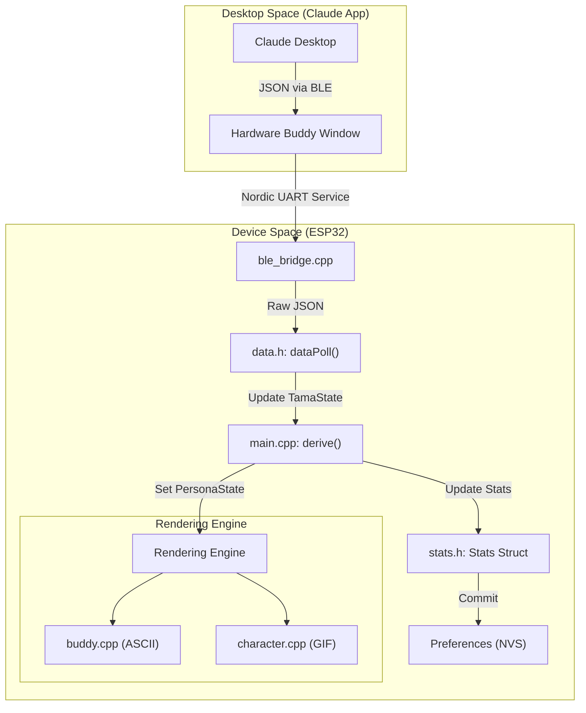
**Sources:** [README.md:1-18](), [src/main.cpp:156-156](), [src/data.h:161-161](), [src/stats.h:163-163]()

## Hardware Target

The firmware is specifically written for the **M5StickC Plus**, an ESP32-based development board. It leverages the following integrated components:
*   **Display:** 135x240 color TFT for rendering ASCII or GIF characters.
*   **Input:** Two physical buttons (Button A on the front, Button B on the right).
*   **IMU:** Used for gesture detection (shaking the device or placing it face-down).
*   **LED:** Used for visual alerts during `attention` states (e.g., pending approvals).
*   **Power:** Managed via an AXP192 PMU, supporting auto-dimming and deep sleep.

For details on physical interactions and UI modes, see **[Hardware & UI Reference](#1.2)**.

**Sources:** [README.md:23-28](), [README.md:69-82]()

## Core Concepts

### The Seven Persona States
The "Buddy" exists in one of seven functional states determined by the desktop's activity or physical interaction. These states are defined by the `PersonaState` enum in the firmware.

| State | Code Identifier | Triggering Logic |
| :--- | :--- | :--- |
| **Sleep** | `STATE_SLEEP` | BLE bridge is disconnected [README.md:144](). |
| **Idle** | `STATE_IDLE` | Connected, but no active sessions or prompts [README.md:145](). |
| **Busy** | `STATE_BUSY` | Claude Code or Cowork is actively running tools [README.md:146](). |
| **Attention** | `STATE_ATTENTION` | A tool use permission prompt is waiting for user approval [README.md:147](). |
| **Celebrate** | `STATE_CELEBRATE` | Triggered on level-up (every 50k tokens processed) [README.md:148](). |
| **Dizzy** | `STATE_DIZZY` | Detected via IMU `getAccelData` when the user shakes the device [README.md:149](). |
| **Heart** | `STATE_HEART` | User approves a prompt in under 5 seconds [README.md:150](). |

### Communication & Protocol
The device communicates using the **Nordic UART Service (NUS)** over BLE. The desktop sends a `heartbeat` snapshot containing token counts, session status, and permission requests. The device responds with user decisions (Approve/Deny) or status acknowledgments.

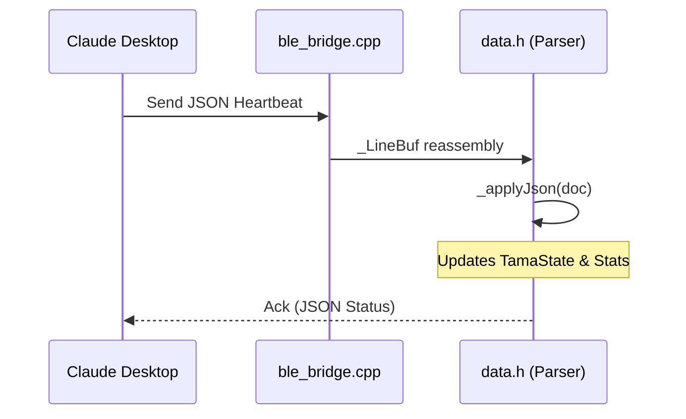
**Sources:** [README.md:10-12](), [src/data.h:161-161](), [src/ble_bridge.cpp:159-159]()

## Project Structure & Subsystems

The codebase is organized into modular subsystems that handle communication, state management, and graphics:

*   **Firmware Core:** Managed by `main.cpp`, which coordinates the main loop and UI transitions.
*   **BLE & Data:** `ble_bridge.cpp` handles the wireless link, while `data.h` and `xfer.h` handle the JSON protocol and file transfers.
*   **Visuals:** 
    *   `buddy.cpp` handles the 18 built-in **ASCII species**.
    *   `character.cpp` manages **GIF-based characters** stored in LittleFS.
*   **Persistence:** `stats.h` manages non-volatile storage (NVS) for token counts, levels, and user settings.

For setup and deployment instructions, see **[Getting Started](#1.1)**.

**Sources:** [README.md:152-166]()

---

# Page: Getting Started

# Getting Started

<details>
<summary>Relevant source files</summary>

The following files were used as context for generating this wiki page:

- [.gitignore](.gitignore)
- [README.md](README.md)
- [platformio.ini](platformio.ini)

</details>


The `claude-desktop-buddy` is an ESP32-based hardware companion designed to interact with the Claude desktop application. It serves as a physical manifestation of Claude's state, providing visual feedback through animations (ASCII or GIF), handling permission prompts via physical buttons, and tracking usage statistics like token counts and "levels."

## Hardware Requirements

The firmware is specifically architected for the **M5StickC Plus**. While it uses the Arduino framework on an ESP32, it has hard dependencies on the `M5StickCPlus` library for display drivers, Power Management IC (AXP192), IMU (MPU6886), and button handling.

| Component | Specification | Role in System |
| :--- | :--- | :--- |
| **MCU** | ESP32-PICO | Executes firmware, manages BLE stack. |
| **Display** | 1.14" LCD (135x240) | Renders `PersonaState` animations and system info. |
| **IMU** | MPU6886 | Detects `dizzy` (shake) and `nap` (face-down) states. |
| **Buttons** | A (Front), B (Right) | User input for approvals, navigation, and menus. |
| **PMIC** | AXP192 | Manages power, screen brightness, and deep sleep. |

Sources: [README.md:23-28](), [platformio.ini:1-16]()

---

## Build Environment Setup

The project uses **PlatformIO** for dependency management and compilation. 

1.  **Install PlatformIO Core**: Follow the [official installation guide](https://docs.platformio.org/en/latest/core/installation/).
2.  **Clone the Repository**: Ensure you have the full source, including the `src/buddies/` directory.
3.  **Configuration**: The `platformio.ini` file defines the environment, including the `littlefs` partition for character storage and a `no_ota.csv` partition table to maximize space for firmware and assets.

### Build Configuration Overview
The build process is governed by `platformio.ini`, which specifies the CPU frequency (160MHz) and necessary libraries.

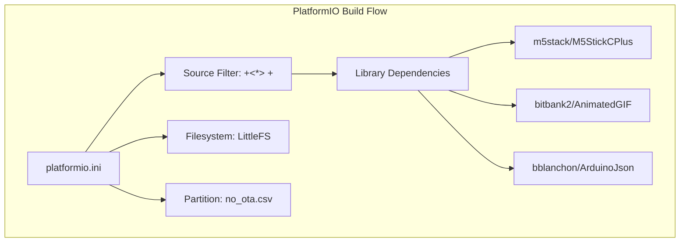
Sources: [platformio.ini:1-16](), [README.md:32-34]()

---

## Flashing Firmware

Flashing involves two potential steps: uploading the firmware binary and (optionally) uploading the filesystem image if using custom GIF characters.

### Standard Flash
To compile and upload the firmware to the M5StickC Plus:
```bash
pio run -t upload
```

### Clean Flash
If the device has existing NVS (Non-Volatile Storage) data that needs to be cleared (e.g., to reset species choice or tokens):
```bash
pio run -t erase && pio run -t upload
```

### Character Pack Flash (USB)
While character packs are usually sent over BLE, developers can flash them directly over USB to the `data/` directory:
```bash
python tools/flash_character.py characters/bufo
```
This script stages the files and executes `pio run -t uploadfs`.

Sources: [README.md:36-44](), [README.md:136-138]()

---

## Enabling Developer Mode

The Claude desktop application (macOS/Windows) does not expose the Hardware Buddy interface by default. It must be enabled via **Developer Mode**.

1.  Open the Claude Desktop App.
2.  Navigate to **Help** → **Troubleshooting** → **Enable Developer Mode**.
3.  A new **Developer** menu will appear in the menu bar.
4.  Select **Developer** → **Open Hardware Buddy...** to open the connection window.

Sources: [README.md:51-55](), [README.md:170-173]()

---

## Pairing and Connection

The connection between the desktop and the device utilizes the **Nordic UART Service (NUS)** over Bluetooth Low Energy (BLE).

### Connection Flow
1.  **Wake Device**: Ensure the M5StickC Plus is awake (press any button).
2.  **Enable Bluetooth**: In the device menu (**Hold A** → **settings** → **bluetooth**), ensure it is toggled ON.
3.  **Initiate Pairing**: Click **Connect** in the Hardware Buddy desktop window.
4.  **Security**: The device uses LE Secure Connections. If prompted on the desktop, confirm the passkey displayed on the M5StickC Plus screen.

### System Interaction Diagram
This diagram maps the high-level pairing components to the code entities responsible for the connection.

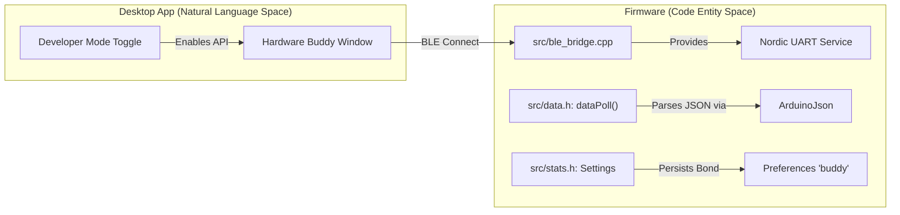

Sources: [README.md:49-68](), [src/ble_bridge.cpp:1-20](), [src/data.h:10-30](), [src/stats.h:1-25]()

---

## Controls & Navigation

Once flashed and paired, the device uses a context-aware button mapping. The `PersonaState` (managed in `main.cpp`) determines how inputs are handled.

| Action | Normal/Pet Mode | Approval Mode |
| :--- | :--- | :--- |
| **Button A (Front)** | Next UI Screen | **Approve Request** |
| **Button B (Right)** | Scroll/Next Page | **Deny Request** |
| **Hold A** | Open Settings Menu | Open Settings Menu |
| **Power (Short)** | Toggle Screen Off | Toggle Screen Off |
| **Shake** | Trigger `dizzy` state | N/A |
| **Face-down** | Trigger `nap` (Energy) | N/A |

### State Transition Logic
The `derive()` function in `main.cpp` calculates the current `PersonaState` based on BLE heartbeat data and IMU inputs.

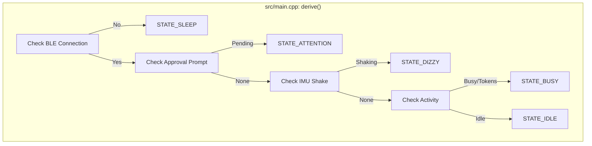

Sources: [README.md:69-83](), [README.md:140-151](), [src/main.cpp:50-120]()

---

# Page: Hardware & UI Reference

# Hardware & UI Reference

<details>
<summary>Relevant source files</summary>

The following files were used as context for generating this wiki page:

- [docs/device.jpg](docs/device.jpg)
- [docs/hardware-buddy-window.png](docs/hardware-buddy-window.png)
- [docs/manual.html](docs/manual.html)
- [docs/menu.png](docs/menu.png)

</details>


This page provides a technical overview of the physical interface, sensor interactions, and desktop software UI for the Claude Desktop Buddy. The system utilizes the M5StickC Plus hardware platform, leveraging its integrated buttons, IMU, and LED to provide a tactile interface for AI interactions.

## Physical Device Layout

The Claude Desktop Buddy is built on the **M5StickC Plus** (ESP32-PICO-D4). The firmware maps physical components to specific logic within the `src/main.cpp` state machine.

### Button Mapping
The device features two primary interaction buttons and a power/reset button.

| Component | Code Identifier | Primary Function | Secondary Function |
|:---|:---|:---|:---|
| **Button A** (Front) | `M5.BtnA` | **Approve Request**: Sends "once" or "always" permission to Claude. | **Wake**: Wakes device from dim/sleep mode. |
| **Button B** (Side) | `M5.BtnB` | **Deny Request**: Sends "deny" signal to desktop. | **Toggle View**: Cycles between `DISP_NORMAL`, `PET`, and `INFO` modes. |
| **Power Button** | `M5.Axp.GetBtnPress()` | **Reset/Power**: Short press resets; long press (6s) powers off. | N/A |

### LED Indicators
The red LED located at the top of the device (near the IR transmitter) is used to signal attention or processing states.

*   **Blinking**: Occurs when the `PersonaState` is set to `STATE_ATTENTION` (waiting for user approval) or `STATE_BUSY` (Claude is generating) [src/main.cpp:525-535]().
*   **Implementation**: Controlled via `digitalWrite(M5_LED, ...)` logic in the `loop()` [src/main.cpp:528]().

### Hardware Interaction Flow
The following diagram maps physical hardware components to their respective classes and handlers in the firmware.

**Diagram: Hardware to Code Entity Mapping**
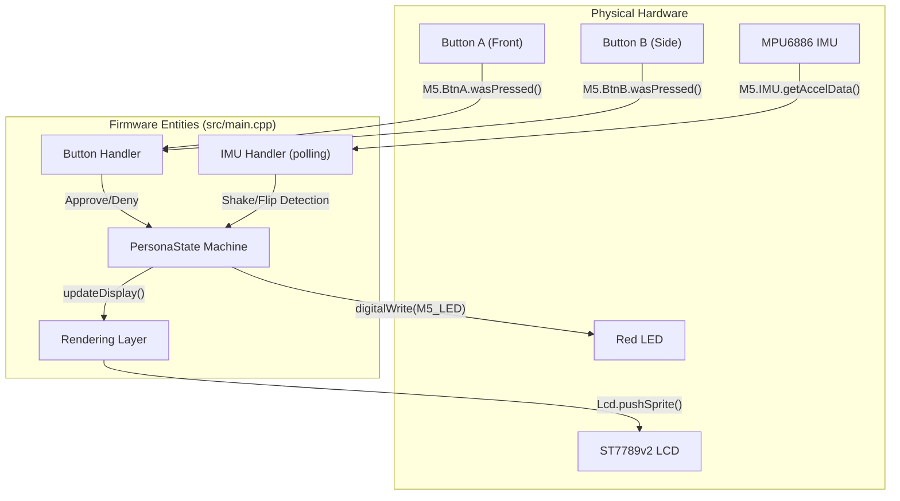
Sources: [src/main.cpp:455-510](), [src/main.cpp:525-535]()

---

## IMU Gestures

The device uses the onboard MPU6886 Inertial Measurement Unit (IMU) to detect physical gestures, which influence the Buddy's mood and state.

### Shake Detection
*   **Logic**: The firmware calculates the magnitude of acceleration. If it exceeds a defined threshold, it triggers `STATE_DIZZY` [src/main.cpp:498-505]().
*   **Code**: `if (abs(accX) + abs(accY) + abs(accZ) > 4.0)` triggers the dizzy state.

### Face-Down (Sleep)
*   **Logic**: When the device is placed face-down (Z-axis acceleration is positive/inverted), the device enters a sleep/nap state [src/main.cpp:485-495]().
*   **Implementation**: This increments `napSeconds` in the `Stats` struct [src/stats.h:35-45](), which recovers "Energy" for the character.

---

## Display & UI Modes

The 1.14" LCD (135x240) supports three distinct rendering modes, toggled via **Button B**.

| Mode | Identifier | Description |
|:---|:---|:---|
| **Normal** | `DISP_NORMAL` | Displays the character (ASCII or GIF) with a status bar showing token velocity and clock [src/main.cpp:115-120](). |
| **Pet** | `DISP_PET` | Full-screen character view. Removes UI elements for maximum visibility [src/main.cpp:121](). |
| **Info** | `DISP_INFO` | Technical stats: Total tokens, lifetime approvals, BLE signal strength, and firmware version [src/main.cpp:122](). |

### Screen Orientation
The device supports automatic 180-degree rotation based on gravity.
*   **Function**: `derive()` in `src/main.cpp` [src/main.cpp:250-280]().
*   **Logic**: If `accY < -0.5`, orientation is set to `3` (Standard). If `accY > 0.5`, orientation is set to `1` (Inverted). This ensures the "Clock" and Buddy are always upright regardless of which way the USB cable is pointing.

---

## Desktop UI (Hardware Buddy)

The companion desktop application provides a window for managing the connection and monitoring the Buddy's health.

### Desktop Window Features
The "Hardware Buddy" window (Electron-based) acts as the bridge between the Claude Desktop App and the ESP32.

1.  **Connection Status**: Shows if the device is paired via BLE or Serial.
2.  **Snapshot Stats**: Displays "Tokens Today", "Velocity", and "Current Task" (mirrored from the device) [docs/hardware-buddy-window.png]().
3.  **Character Management**: Allows dragging and dropping `.tar.gz` character packs for BLE transfer to the device [docs/menu.png]().

**Diagram: UI Data Flow (Desktop to Device)**
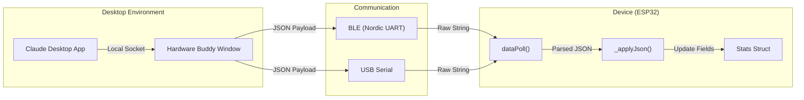
Sources: [src/data.h:80-150](), [src/ble_bridge.cpp:50-90]()

### Menu & Settings
The system tray menu (accessible via the Buddy icon) provides:
*   **Pairing Mode**: Triggers the BLE passkey display on the M5StickC LCD.
*   **Unpair**: Clears the bond information on both the desktop and the device `Preferences` storage [src/ble_bridge.cpp:145-160]().
*   **Force Sync**: Pushes current RTC time and owner name to the device.

Sources: [docs/menu.png](), [src/data.h:110-120]()

---

# Page: Firmware Architecture

# Firmware Architecture

<details>
<summary>Relevant source files</summary>

The following files were used as context for generating this wiki page:

- [README.md](README.md)
- [src/main.cpp](src/main.cpp)

</details>


The Claude Desktop Buddy firmware is an ESP32-based application built on the Arduino framework. It manages a real-time animation system, a Bluetooth Low Energy (BLE) communication bridge, and a persistent state machine that tracks "pet" metrics (tokens, energy, and level).

### System Overview

The firmware is structured around a central polling loop in `src/main.cpp`. It coordinates several independent subsystems that communicate via shared state structures, primarily `TamaState` (for session data) and `Stats` (for persistent metrics).

#### Key Components
| Component | Responsibility |
| :--- | :--- |
| **Main Loop** | Handles hardware I/O (IMU, Buttons), UI state transitions, and power management. |
| **BLE Bridge** | Implements the Nordic UART Service (NUS) for bi-directional communication with the desktop. |
| **Data Layer** | Parses incoming JSON commands and updates the global `tama` state. |
| **Persistence** | Manages NVS (Non-Volatile Storage) for user settings and long-term buddy stats. |
| **Rendering** | Dispatches drawing commands to either the ASCII buddy engine or the GIF character player. |

### Component Interaction

The following diagram illustrates how the core entities interact to process data from the desktop app and update the physical device.

**Firmware Data Flow & Entity Mapping**
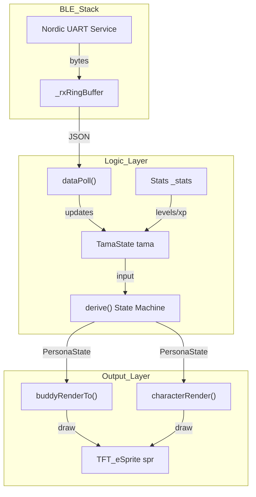
Sources: [src/main.cpp:32-37](), [src/ble_bridge.cpp:16-25](), [src/data.h:134-140](), [src/stats.h:112-120]()

---

### Core Subsystems

#### 1. Main Loop & State Machine
The state machine in `src/main.cpp` uses a `PersonaState` enum to determine the current animation (e.g., `P_IDLE`, `P_BUSY`, `P_ATTENTION`). Transitions are derived from `TamaState` values or physical triggers like the IMU.
*   **For details, see [Main Loop & State Machine](#2.1)**

#### 2. BLE Bridge
Communication is handled by `src/ble_bridge.cpp`, which sets up the ESP32 as a BLE peripheral. It uses the Nordic UART Service UUIDs to create a transparent serial-like bridge for JSON data.
*   **For details, see [BLE Bridge](#2.2)**

#### 3. Data Layer & Wire Protocol
Incoming packets are reassembled in a line buffer and parsed using `ArduinoJson`. The `_applyJson` function maps desktop events (like new messages or token counts) into the `tama` object.
*   **For details, see [Data Layer & Wire Protocol](#2.3)**

#### 4. Persistence & Settings
The `stats.h` module handles reading and writing to ESP32 NVS. It tracks "Tokens Processed" as XP and manages the level-up logic. It also stores user preferences like screen brightness and species selection.
*   **For details, see [Persistence & Settings (stats.h)](#2.4)**

#### 5. File Transfer Protocol (Folder Push)
The firmware supports a custom "Folder Push" protocol in `src/xfer.h` to receive character packs (GIFs and manifests) over BLE. It manages LittleFS writes and Base64 decoding of file chunks.
*   **For details, see [File Transfer Protocol (xfer.h)](#2.5)**

### System Hardware Integration

The firmware specifically targets the **M5StickC Plus** hardware. It utilizes the `M5StickCPlus` library to interface with the ST7789 LCD, the SH200Q/MPU6886 IMU, and the AXP192 power management IC.

**Hardware to Code Mapping**
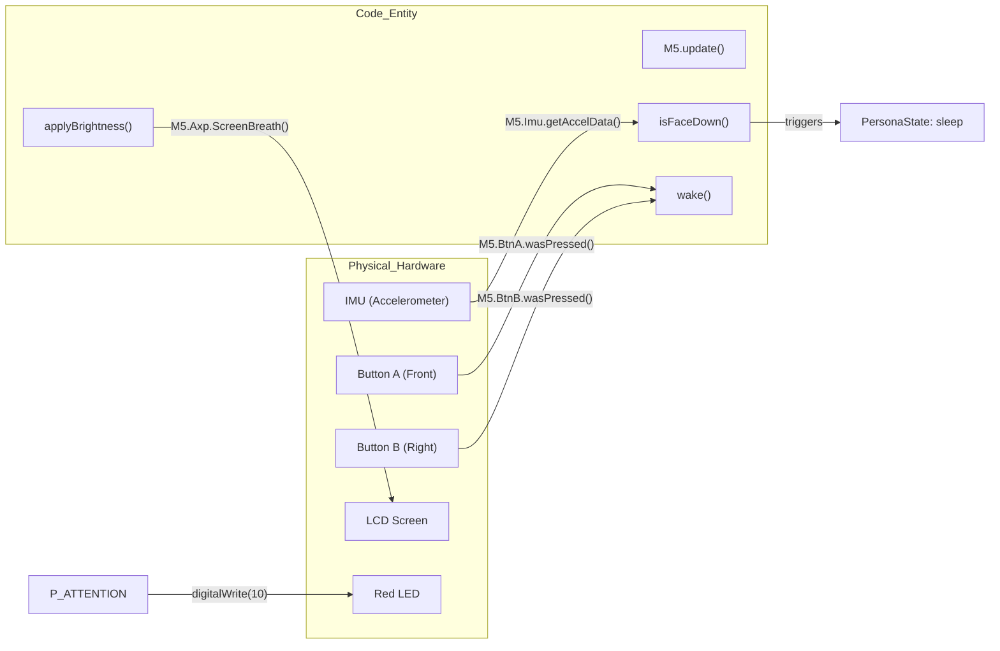
Sources: [src/main.cpp:91-108](), [src/main.cpp:26-30](), [README.md:71-79]()

### Memory and Filesystem
The firmware uses **LittleFS** for storing character packs. The partition table is configured to provide approximately 1.8MB of space for the `/characters/` directory.
*   **ASCII Buddies:** Compiled into the binary (flash).
*   **GIF Characters:** Stored in LittleFS (SPIFFS/Flash).
*   **Stats/Settings:** Stored in NVS (EEPROM emulation).

Sources: [src/main.cpp:1-6](), [src/xfer.h:60-75](), [README.md:131-133]()

---

# Page: Main Loop & State Machine

# Main Loop & State Machine

<details>
<summary>Relevant source files</summary>

The following files were used as context for generating this wiki page:

- [src/data.h](src/data.h)
- [src/main.cpp](src/main.cpp)

</details>


The main loop in `src/main.cpp` serves as the central orchestrator for Claude Desktop Buddy. It manages the transitions between emotional states (Persona States), handles physical hardware interrupts (buttons and IMU), coordinates the display modes, and implements power-saving logic.

## Persona State Machine

The buddy's behavior is driven by a state machine defined by the `PersonaState` enum [src/main.cpp:32-32](). The system distinguishes between a `baseState` (the persistent emotional state derived from data) and an `activeState` (which may include temporary "one-shot" animations).

### State Definitions
| State | Enum | Description |
|:---|:---|:--- |
| **Sleep** | `P_SLEEP` | Default state when no desktop app is connected or during "nap" mode. |
| **Idle** | `P_IDLE` | Connected and waiting; no active sessions or prompts. |
| **Busy** | `P_BUSY` | Desktop app is actively running sessions/processing. |
| **Attention** | `P_ATTENTION` | A permission prompt is pending user approval. |
| **Celebrate** | `P_CELEBRATE` | Triggered briefly when a session completes successfully. |
| **Dizzy** | `P_DIZZY` | Triggered by physical shaking of the device. |
| **Heart** | `P_HEART` | Triggered by a "petting" interaction (Button A tap). |

### State Derivation Logic
The `derive()` function (called within `loop`) calculates the `baseState` based on the current `TamaState` [src/data.h:7-22]() received from the desktop.

*   **Logic Flow**:
    1.  If not connected: `P_SLEEP`.
    2.  If `promptId` is not empty: `P_ATTENTION`.
    3.  If `sessionsRunning > 0`: `P_BUSY`.
    4.  If `recentlyCompleted` is true: `P_CELEBRATE`.
    5.  Otherwise: `P_IDLE`.

### One-Shot Transitions
One-shot states (`P_DIZZY`, `P_HEART`, `P_CELEBRATE`) override the `baseState` for a fixed duration. The variable `oneShotUntil` [src/main.cpp:38-38]() stores the timestamp when the override expires, at which point the `activeState` reverts to `baseState`.

**State Transition Flow**
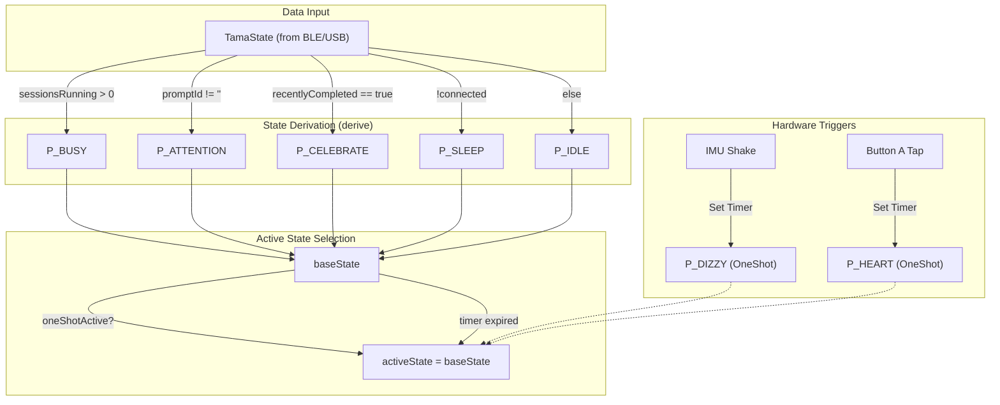
**Sources:** [src/main.cpp:32-42](), [src/data.h:7-22](), [src/main.cpp:1134-1160]() (approximate loop logic).

## Display & Screen Management

The device supports three primary `DisplayMode` settings [src/main.cpp:49-50]() which determine the layout and information density on the 135x240 TFT screen.

### Display Modes
1.  **DISP_NORMAL**: Full-screen character animation.
2.  **DISP_PET**: Character is shrunk to a "peek" size at the bottom to show stats (tokens, level, velocity).
3.  **DISP_INFO**: Technical debug and system info pages (BLE status, RTC, Credits).

### Clock & Orientation
The system utilizes the M5StickC Plus IMU to handle screen rotation.
*   **Clock Orientation**: If the device is tilted, the UI can rotate to remain upright.
*   **Face-Down Detection**: The `isFaceDown()` function [src/main.cpp:91-95]() checks if the Z-axis is dominant and negative. If the device is placed face-down, it triggers "Nap Mode" (dimming the screen and silencing notifications).

**Sources:** [src/main.cpp:49-53](), [src/main.cpp:91-95](), [src/main.cpp:125-135]().

## Power Management: Auto-Dim & Screen-Off

To preserve the small LiPo battery and prevent OLED burn-in, the main loop implements a multi-stage power management strategy.

*   **Activity Tracking**: `lastInteractMs` [src/main.cpp:57-57]() is updated on button presses, IMU movement, or incoming BLE data.
*   **Dimming**: After a period of inactivity, `M5.Axp.ScreenBreath` is lowered [src/main.cpp:97-97]().
*   **Screen Off**: After `SCREEN_OFF_MS` (default 30s), the display LDO2 power rail is disabled [src/main.cpp:101-104]().
*   **Waking**: Any interaction or a new `P_ATTENTION` state triggers `wake()` [src/main.cpp:99-108](), restoring brightness and the power rail.

**Sources:** [src/main.cpp:57-60](), [src/main.cpp:83-84](), [src/main.cpp:97-108]().

## Input Handling

### Button Mapping
The firmware uses a "swallow" pattern to prevent button presses from triggering multiple actions when navigating menus.

*   **Button A (Big Front Button)**:
    *   *Normal*: Pet the buddy (trigger `P_HEART`).
    *   *Long Press*: Open/Close the main menu [src/main.cpp:47-47]().
    *   *Prompt Active*: Approve the pending permission request.
*   **Button B (Side Button)**:
    *   *Normal*: Cycle `DisplayMode` (Normal -> Pet -> Info).
    *   *Prompt Active*: Deny the pending permission request.
    *   *Menu Open*: Scroll through menu items.

### IMU Polling
The IMU is polled every loop iteration to detect:
1.  **Shakes**: Calculated by comparing current acceleration against `accelBaseline` [src/main.cpp:40-40](). High variance triggers `P_DIZZY`.
2.  **Orientation**: Updates the `s.clockRot` setting if the device is rotated.

**Input-to-Command Mapping**
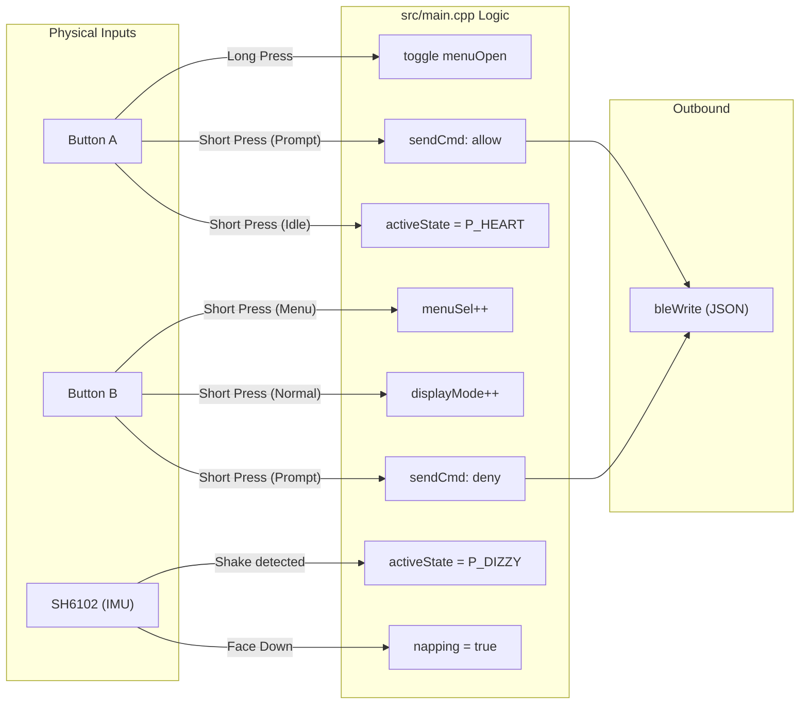
**Sources:** [src/main.cpp:43-61](), [src/main.cpp:115-120](), [src/main.cpp:1111-1130]() (approximate input polling logic).

---

# Page: BLE Bridge

# BLE Bridge

<details>
<summary>Relevant source files</summary>

The following files were used as context for generating this wiki page:

- [REFERENCE.md](REFERENCE.md)
- [src/ble_bridge.cpp](src/ble_bridge.cpp)
- [src/ble_bridge.h](src/ble_bridge.h)

</details>


The BLE Bridge implements a wireless serial-over-BLE transport using the industry-standard **Nordic UART Service (NUS)**. This allows the Claude desktop application to communicate with the ESP32 using the same JSON-based wire protocol used over physical USB serial. The implementation handles MTU negotiation, LE Secure Connections (MITM protection with passkeys), and provides a ring-buffered API for the main application loop.

## Service Specification

The bridge advertises three specific UUIDs that allow standard BLE terminals and the Claude desktop app to identify the device as a serial-capable peripheral [src/ble_bridge.cpp:10-15]().

| Entity | UUID | Role |
| :--- | :--- | :--- |
| **Service** | `6e400001-b5a3-f393-e0a9-e50e24dcca9e` | NUS Service Container |
| **RX Characteristic** | `6e400002-b5a3-f393-e0a9-e50e24dcca9e` | Desktop → Device (Write) |
| **TX Characteristic** | `6e400003-b5a3-f393-e0a9-e50e24dcca9e` | Device → Desktop (Notify) |

To ensure the desktop app can filter for relevant devices, the bridge advertises a name starting with `Claude` [REFERENCE.md:31-33]().

**Sources:** [src/ble_bridge.cpp:10-15](), [REFERENCE.md:23-33]()

## Data Flow & Buffering

The bridge maintains a 2048-byte ring buffer (`rxBuf`) to decouple BLE radio events from the main application processing loop [src/ble_bridge.cpp:20-23]().

### Incoming Data (RX)
When the desktop writes to the RX characteristic, the `RxCallbacks::onWrite` function is triggered. It pushes bytes into the ring buffer via `rxPush` [src/ble_bridge.cpp:42-47](). If the buffer is full, bytes are dropped to prevent memory corruption, relying on the GATT layer for flow control [src/ble_bridge.cpp:33-40]().

### Outgoing Data (TX)
The `bleWrite` function handles fragmentation. Since BLE notifications are limited by the negotiated Maximum Transmission Unit (MTU), `bleWrite` chunks data into segments of `mtu - 3` bytes (up to a hard cap of 180 bytes for compatibility) [src/ble_bridge.cpp:162-175](). A small 4ms delay is inserted between chunks to allow the BLE stack to flush the transmit buffer [src/ble_bridge.cpp:177]().

### Code Entity Bridge: Data Path
This diagram maps the internal buffer variables to the external API used by the system.

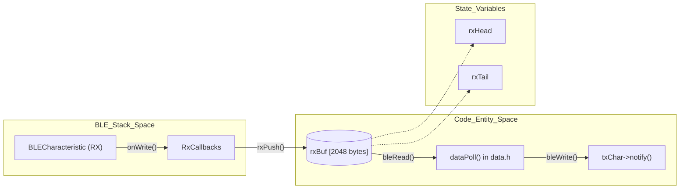
**Sources:** [src/ble_bridge.cpp:20-47](), [src/ble_bridge.cpp:151-180](), [src/ble_bridge.h:5-15]()

## Security & Pairing

The bridge implements **LE Secure Connections** with Man-In-The-Middle (MITM) protection using a 6-digit passkey flow [src/ble_bridge.cpp:69-72]().

1.  **Authentication Mode**: Set to `ESP_LE_AUTH_REQ_SC_MITM_BOND`, requiring both secure connections and bonding [src/ble_bridge.cpp:121]().
2.  **IO Capabilities**: The device identifies as `ESP_IO_CAP_OUT` (DisplayOnly), while the desktop acts as KeyboardOnly [src/ble_bridge.cpp:122]().
3.  **Passkey Flow**: The BLE stack generates a random passkey and triggers `onPassKeyNotify` [src/ble_bridge.cpp:77-80](). The value is stored in the `passkey` variable, which the main UI loop polls via `blePasskey()` to display on the screen [src/ble_bridge.h:24-26]().
4.  **Encryption**: Access to the NUS characteristics is restricted to encrypted links only (`ESP_GATT_PERM_READ_ENCRYPTED` | `ESP_GATT_PERM_WRITE_ENCRYPTED`) [src/ble_bridge.cpp:106-115]().

### Bond Management
Bonds (Long Term Keys) are persisted in the ESP32 NVS. The `bleClearBonds()` function allows the application to programmatically erase all stored pairings, which is triggered by the `unpair` JSON command from the desktop [src/ble_bridge.cpp:140-149]().

**Sources:** [src/ble_bridge.cpp:69-87](), [src/ble_bridge.cpp:120-126](), [src/ble_bridge.h:19-29]()

## Connection Lifecycle

The bridge manages its own advertising state to ensure it remains discoverable when not connected.

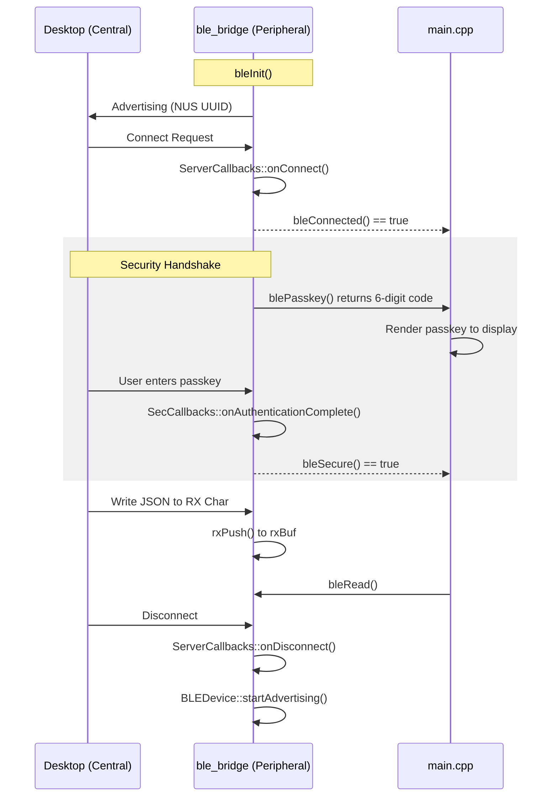

### MTU Negotiation
The bridge requests a maximum MTU of 517 bytes during initialization [src/ble_bridge.cpp:92](). While macOS typically negotiates down to 185 bytes, the bridge dynamically adjusts its `bleWrite` chunking logic based on the `onMtuChanged` callback to ensure maximum throughput without truncating packets [src/ble_bridge.cpp:63-67]().

**Sources:** [src/ble_bridge.cpp:49-67](), [src/ble_bridge.cpp:89-98](), [src/ble_bridge.cpp:162-168]()

## API Reference

The bridge provides a simplified serial-like API defined in `ble_bridge.h`.

| Function | Description |
| :--- | :--- |
| `bleInit(name)` | Initializes the BLE stack, sets up NUS characteristics, and starts advertising [src/ble_bridge.cpp:89](). |
| `bleConnected()` | Returns `true` if a central device is currently connected [src/ble_bridge.cpp:136](). |
| `bleSecure()` | Returns `true` if the current link is encrypted and bonded [src/ble_bridge.cpp:137](). |
| `blePasskey()` | Returns the active 6-digit pairing code, or `0` if no pairing is in progress [src/ble_bridge.cpp:138](). |
| `bleAvailable()` | Returns the number of bytes waiting in the `rxBuf` [src/ble_bridge.cpp:151](). |
| `bleRead()` | Pops a single byte from the `rxBuf`. Returns `-1` if empty [src/ble_bridge.cpp:155](). |
| `bleWrite(data, len)` | Chunks and sends data to the desktop via the TX characteristic [src/ble_bridge.cpp:162](). |
| `bleClearBonds()` | Erases all pairing information from the ESP32's non-volatile storage [src/ble_bridge.cpp:140](). |

**Sources:** [src/ble_bridge.h:17-32](), [src/ble_bridge.cpp:136-180]()

---

# Page: Data Layer & Wire Protocol

# Data Layer & Wire Protocol

<details>
<summary>Relevant source files</summary>

The following files were used as context for generating this wiki page:

- [REFERENCE.md](REFERENCE.md)
- [src/data.h](src/data.h)

</details>


The Data Layer is responsible for ingesting, buffering, and parsing the JSON-based wire protocol sent from the Claude desktop application. It abstracts the transport medium (USB Serial or BLE) into a unified `TamaState` structure that the rest of the firmware uses to drive animations and UI elements.

## Data Structures & State

The core of the data layer is the `TamaState` struct, which represents a snapshot of the current Claude desktop activity.

| Field | Type | Description |
| :--- | :--- | :--- |
| `sessionsTotal` | `uint8_t` | Total number of open Claude conversations. |
| `sessionsRunning` | `uint8_t` | Number of sessions currently generating text or calling tools. |
| `sessionsWaiting` | `uint8_t` | Number of sessions blocked on a user permission prompt. |
| `tokensToday` | `uint32_t` | Cumulative output tokens generated since local midnight. |
| `msg` | `char[24]` | A short status string (e.g., "approve: Bash") for the HUD. |
| `lines` | `char[8][92]` | A buffer of the 8 most recent transcript entries. |
| `promptId` | `char[40]` | The unique ID for a pending permission request. |

### Data Flow Diagram
The following diagram illustrates how raw bytes from different hardware interfaces are processed into the central state.

"Data Ingestion and Parsing Flow"
```mermaid
graph TD
    subgraph "Transport Layer"
        USB["Serial (USB)"]
        BLE["ble_bridge (BLE)"]
    end

    subgraph "Line Buffering"
        USB_BUF["_usbLine (_LineBuf)"]
        BT_BUF["_btLine (_LineBuf)"]
    end

    subgraph "Processing"
        JSON["_applyJson()"]
        XFER["xferCommand()"]
        RTC["M5.Rtc.SetTime()"]
    end

    STATE[("TamaState struct")]

    USB -->|feed()| USB_BUF
    BLE -->|bleRead()| BT_BUF
    USB_BUF -->|newline| JSON
    BT_BUF -->|newline| JSON
    
    JSON -->|is xfer cmd?| XFER
    JSON -->|is time sync?| RTC
    JSON -->|is heartbeat?| STATE
```
Sources: [src/data.h:7-22](), [src/data.h:130-145](), [src/data.h:160-175]()

## Line-Buffered Reassembly

Because BLE packets are often fragmented at the MTU boundary (typically 20-247 bytes) and Serial data can arrive byte-by-byte, the firmware uses a `_LineBuf` template to reassemble complete JSON objects.

- **Mechanism**: The `feed()` function and the `bleRead()` loop accumulate characters into a internal buffer until a `\n` or `\r` is encountered [src/data.h:133-143]().
- **Validation**: Once a line is complete, the code checks if the first character is `{` before attempting to parse it with `ArduinoJson` [src/data.h:137](), [src/data.h:169]().
- **Capacity**: The buffers are sized at 1024 bytes to accommodate large "turn" events or transcript entries [src/data.h:145]().

## Protocol Implementation (`_applyJson`)

The `_applyJson` function is the central dispatcher for all incoming JSON objects. It handles three primary categories of data:

### 1. File Transfer & Commands
It first passes the JSON document to `xferCommand()` in `src/xfer.h`. If the object contains file transfer logic (e.g., `char_begin`, `chunk`), it is consumed there and processing stops [src/data.h:73]().

### 2. RTC Time Synchronization
The desktop app sends a one-shot time sync on connection: `{"time": [epoch_sec, tz_offset_sec]}`.
- The firmware calculates the local time by adding the offset to the epoch [src/data.h:79]().
- It uses `gmtime_r` to break the epoch into components and updates the M5StickC Plus internal hardware clock via `M5.Rtc.SetTime()` and `M5.Rtc.SetDate()` [src/data.h:80-85]().
- This sets `_rtcValid = true`, enabling the clock display in the UI [src/data.h:88]().

### 3. Heartbeat Snapshots
Most incoming data consists of status updates. The function extracts:
- **Session Counts**: `total`, `running`, and `waiting` fields [src/data.h:93-95]().
- **Token Metrics**: Updates the global stats via `statsOnBridgeTokens()` [src/data.h:98]().
- **Transcript**: Iterates through the `entries` array to populate the `lines` buffer [src/data.h:103-115]().
- **Prompts**: If a `prompt` object is present, it stores the `id`, `tool`, and `hint` to allow the user to approve/deny the action via physical buttons [src/data.h:116-124]().

Sources: [src/data.h:70-127](), [REFERENCE.md:40-60](), [REFERENCE.md:108-114]()

## The Data Poll Loop

The `dataPoll(TamaState* out)` function is called every frame by the main loop. It manages the lifecycle of the connection.

### Connection State Logic
The system tracks liveness using `_lastLiveMs`.
- **Live**: If JSON arrived in the last 30 seconds, the device is "connected" [src/data.h:51]().
- **Asleep**: If no data arrives for >30s, the state is cleared, and the message "No Claude connected" is displayed [src/data.h:178-183]().
- **BT vs USB**: `dataBtActive()` checks for traffic in the last 15s to distinguish between a wired and wireless connection for the UI [src/data.h:54-57]().

### Demo Mode
For testing and photography, the device includes a Demo Mode triggered by `dataSetDemo(true)`.
- It ignores all incoming serial/BLE data [src/data.h:150]().
- It cycles through a static array of `_Fake` scenarios (e.g., "busy", "attention", "completed") every 8 seconds [src/data.h:151-157]().
- Each scenario simulates different session counts and token totals to exercise the state machine [src/data.h:38-42]().

### Entity Mapping
The following diagram maps the logical protocol concepts to the specific code entities in `src/data.h`.

"Protocol Logic to Code Entity Mapping"
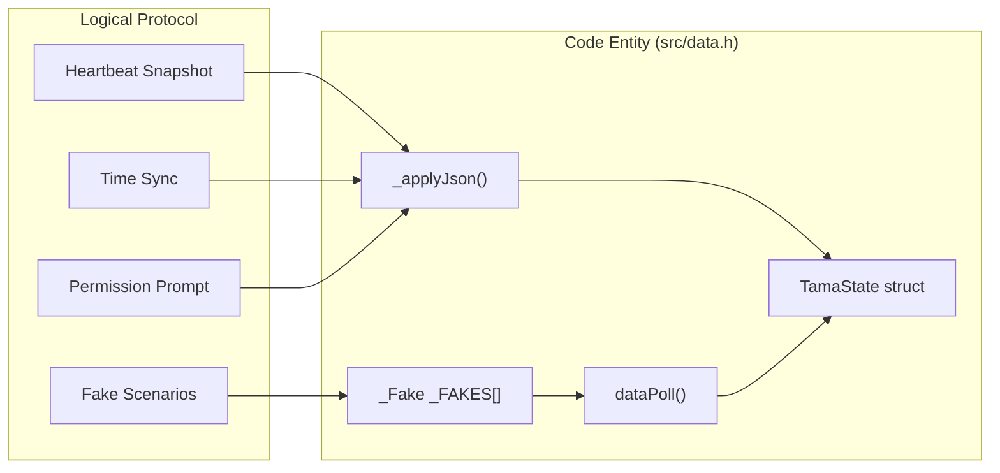
Sources: [src/data.h:7-22](), [src/data.h:37-42](), [src/data.h:70-73](), [src/data.h:147-158]()

---

# Page: Persistence & Settings (stats.h)

# Persistence & Settings (stats.h)

<details>
<summary>Relevant source files</summary>

The following files were used as context for generating this wiki page:

- [src/stats.h](src/stats.h)

</details>


The `src/stats.h` file implements a lightweight, NVS-backed persistence layer for tracking user interactions, pet metrics, and device settings. It uses the ESP32 `Preferences` library to store data across reboots, targeting the `buddy` namespace.

## Data Structures

The system differentiates between **Stats** (cumulative pet metrics) and **Settings** (user-configurable device behavior).

### Stats Struct
The `Stats` struct contains the core data driving the pet's growth and "personality" metrics.

| Field | Type | Description |
| :--- | :--- | :--- |
| `napSeconds` | `uint32_t` | Cumulative time spent in a face-down (sleeping) orientation. |
| `approvals` | `uint16_t` | Total number of times the user pressed Button A to approve a prompt. |
| `denials` | `uint16_t` | Total number of times the user pressed Button B to deny a prompt. |
| `velocity[8]`| `uint16_t[]`| A ring buffer storing the last 8 response times (in seconds). |
| `velIdx` | `uint8_t` | Current write index for the velocity ring buffer. |
| `velCount` | `uint8_t` | Number of valid entries in the velocity ring buffer (up to 8). |
| `level` | `uint8_t` | The current pet level, derived from total tokens. |
| `tokens` | `uint32_t` | Cumulative output tokens processed by the desktop app. |

Sources: [src/stats.h:14-23]()

### Settings Struct
The `Settings` struct manages hardware preferences and UI toggles.

| Field | Type | Key | Description |
| :--- | :--- | :--- | :--- |
| `sound` | `bool` | `s_snd` | Toggle for buzzer feedback. |
| `bt` | `bool` | `s_bt` | Toggle for Bluetooth connectivity. |
| `wifi` | `bool` | `s_wifi` | Placeholder for future WiFi functionality. |
| `led` | `bool` | `s_led` | Toggle for the M5StickC LED indicator. |
| `hud` | `bool` | `s_hud` | Toggle for the Heads-Up Display (stats overlay). |
| `clockRot`| `uint8_t`| `s_crot`| Screen orientation: 0=Auto, 1=Portrait, 2=Landscape. |

Sources: [src/stats.h:179-186](), [src/stats.h:191-198]()

## NVS Persistence Logic

To preserve the lifespan of the ESP32's flash memory (~100k write cycles), the system does not save on a timer. Instead, it employs a "save on significant event" strategy.

### Loading and Saving
*   **`statsLoad()`**: Opens the `buddy` namespace in read-only mode and populates the `_stats` struct [src/stats.h:29-46]().
*   **`statsSave()`**: Only performs a write if the `_dirty` flag is set to true. It saves all fields and clears the flag [src/stats.h:48-61]().
*   **Level Backfilling**: If `tokens` is 0 but `level` is > 0 (e.g., from an older firmware version), `statsLoad()` calculates the required tokens to maintain that level [src/stats.h:43-45]().

### Token Tracking & Leveling
The pet levels up every 50,000 tokens [src/stats.h:12](). 

The desktop app sends its cumulative token count since its own process started. The firmware must reconcile this with its internal persistent total:
1.  **First Sight**: On the first packet after a device reboot, the firmware latches the current bridge total to `_lastBridgeTokens` without adding it to the persistent total to avoid double-counting previous sessions [src/stats.h:84-88]().
2.  **Deltas**: Subsequent updates calculate the delta between the new total and `_lastBridgeTokens` [src/stats.h:93]().
3.  **Bridge Restart**: If the incoming total is lower than the last seen total, the firmware assumes the desktop app restarted and resets the latch [src/stats.h:89-92]().
4.  **Milestone Persistence**: To avoid NVS wear, token deltas are kept in RAM. `statsSave()` is only triggered when a level-up milestone is crossed [src/stats.h:104-108]().

Sources: [src/stats.h:79-109]()

## Derived Metrics (Mood, Energy, Fed)

The pet's visible state is calculated dynamically from the persistent stats.

### Mood Calculation (`statsMoodTier`)
Mood is a tier from 0 to 4 based on response velocity and the approval/denial ratio.
1.  **Velocity**: The median of the `velocity` ring buffer is calculated using an insertion sort [src/stats.h:127-139]().
2.  **Base Tier**: Faster responses (lower median seconds) result in higher base tiers (e.g., <15s = Tier 4) [src/stats.h:146-150]().
3.  **Denial Penalty**: If the user has made at least 3 decisions, a high denial rate drags the mood down. If `denials > approvals`, the tier drops by 2. If `denials * 2 > approvals`, it drops by 1 [src/stats.h:151-156]().

### Energy and Hunger
*   **Energy**: Starts at 3/5 on boot. It tops up to 5/5 when a "nap" (face-down orientation) ends. It drains by 1 tier every 2 hours [src/stats.h:161-171]().
*   **Fed Progress**: Calculated as the progress toward the next level-up milestone, represented as 10 "pips" (5,000 tokens per pip) [src/stats.h:173-175]().

## System Data Flow

The following diagram illustrates how external events interact with the `Stats` and `Settings` entities and how they are persisted to the `Preferences` NVS storage.

### Data Flow: Persistence and Calculation
Title: Persistence and Metric Calculation Flow
```mermaid
graph TD
    subgraph "External Inputs"
        [BLE_Bridge] -- "statsOnBridgeTokens()" --> T[Token Delta Logic]
        [Button_A] -- "statsOnApproval()" --> V[Velocity Ring Buffer]
        [IMU_Sensor] -- "statsOnNapEnd()" --> N[Nap Accumulator]
    end

    subgraph "Code Entity Space (src/stats.h)"
        T --> S_STRUCT["struct Stats"]
        V --> S_STRUCT
        N --> S_STRUCT
        
        S_STRUCT -- "statsMoodTier()" --> M_CALC["Mood Calculation"]
        S_STRUCT -- "statsFedProgress()" --> F_CALC["Fed Tier Calculation"]
        
        DIRTY{_dirty == true?}
        S_STRUCT --> DIRTY
    end

    subgraph "Hardware Space"
        DIRTY -- "statsSave()" --> NVS["ESP32 NVS (Namespace: 'buddy')"]
        NVS -- "statsLoad()" --> S_STRUCT
    end

    M_CALC --> UI["Display (Mood Icon)"]
    F_CALC --> UI
```
Sources: [src/stats.h:25-61](), [src/stats.h:142-158](), [src/stats.h:173-175]()

### Logic Mapping: Natural Language to Code
Title: Metric Logic Mapping
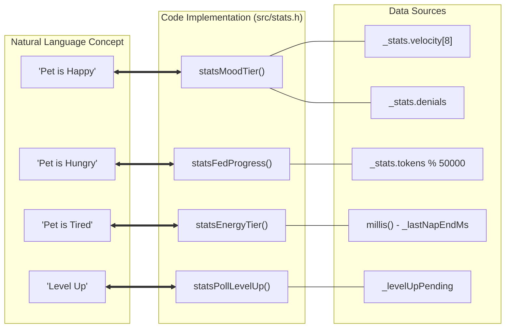
Sources: [src/stats.h:111-115](), [src/stats.h:142-158](), [src/stats.h:166-171](), [src/stats.h:173-175]()

---

# Page: File Transfer Protocol (xfer.h)

# File Transfer Protocol (xfer.h)

<details>
<summary>Relevant source files</summary>

The following files were used as context for generating this wiki page:

- [REFERENCE.md](REFERENCE.md)
- [src/xfer.h](src/xfer.h)

</details>


The Folder Push transport, implemented in `src/xfer.h`, provides a reliable mechanism for streaming arbitrary file content (primarily GIF-based character packs) from the Claude desktop application to the device's internal Flash storage via LittleFS. It uses a sequential, chunked command-response pattern over the BLE Bridge or USB Serial to accommodate memory constraints and ensure data integrity.

## Protocol Sequence

The protocol follows a strict sequential flow. The desktop application (the sender) must wait for an acknowledgment (`ack`) for each command before sending the next. This flow control prevents the device's RX buffers from overflowing during Flash write operations.

### Command Flow Overview

1.  **`char_begin`**: Initializes the transfer, specifies the character name, and provides the total payload size for a space check.
2.  **`file`**: Specifies the name and size of the individual file about to be streamed.
3.  **`chunk`**: Contains a Base64-encoded segment of the current file's data.
4.  **`file_end`**: Finalizes the current file and closes the file handle.
5.  **`char_end`**: Signals the completion of the entire folder transfer and triggers character initialization.

### Data Flow Diagram
The following diagram illustrates the interaction between the Desktop application and the `xferCommand` handler.

"File Transfer Command Sequence"
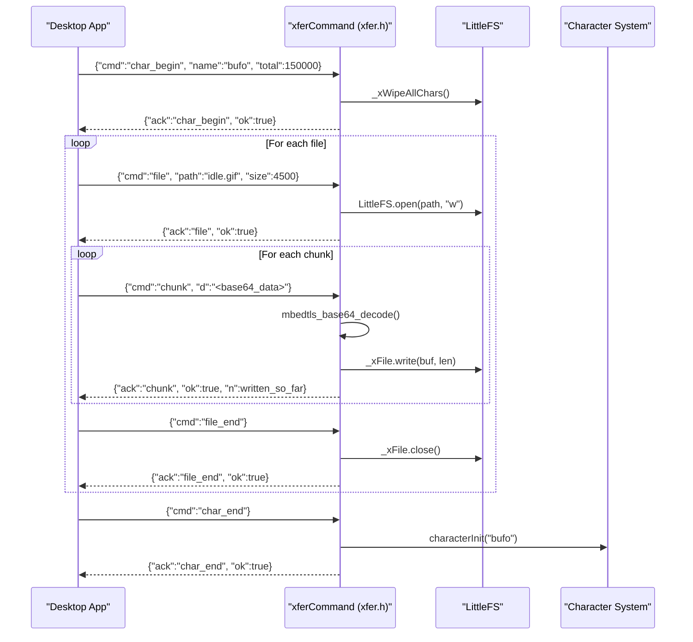
Sources: `[src/xfer.h:77-240]()`, `[REFERENCE.md:159-181]()`

## Implementation Details

### Space Management and Wiping
Before a transfer begins, the device performs a "Fit Check" in `xferCommand` under the `char_begin` block. It calculates the available space by summing the current free space and the space that would be reclaimed by wiping existing characters `[src/xfer.h:148-165]()`.

*   **`_xWipeAllChars()`**: Iterates through the `/characters` directory and deletes all subdirectories and files `[src/xfer.h:44-63]()`.
*   **`_xWipeDir()`**: A helper function that deletes all files within a specific directory before removing the directory itself `[src/xfer.h:24-39]()`.

### Base64 Decoding
Since the wire protocol is JSON-based, binary data must be encoded as text. The desktop app uses Base64 encoding for the `d` field in `chunk` commands. The device utilizes `mbedtls_base64_decode` to convert this back to raw bytes before writing to Flash `[src/xfer.h:201-210]()`.

### Flow Control and Acknowledgment
The `_xAck` function is responsible for sending standardized JSON responses back to the desktop. It writes the acknowledgment to both the Hardware Serial (USB) and the BLE Bridge `[src/xfer.h:17-22]()`.

| Field | Description |
| :--- | :--- |
| `ack` | Echoes the `cmd` name being acknowledged. |
| `ok` | Boolean indicating success or failure. |
| `n` | Numeric status (e.g., total bytes written for `chunk`, final size for `file_end`). |
| `error` | (Optional) String message describing the failure reason. |

Sources: `[src/xfer.h:17-22]()`, `[src/xfer.h:167-175]()`, `[REFERENCE.md:122-132]()`

## Code Entity Mapping

The following diagram maps the logical protocol commands to the specific implementation variables and functions within `xfer.h`.

"Logic to Code Entity Mapping"
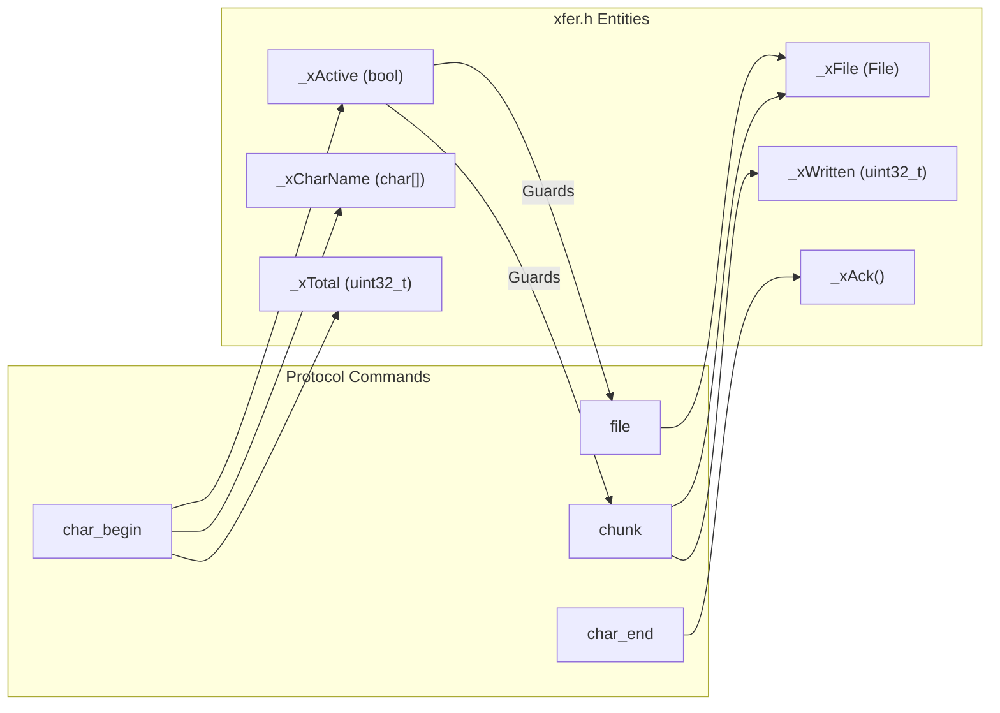
Sources: `[src/xfer.h:8-12]()`, `[src/xfer.h:141-240]()`

## Transfer Completion & Character Initialization

When the `char_end` command is received, the transfer state is finalized:
1.  The `_xActive` flag is set to `false` `[src/xfer.h:236]()`.
2.  The `characterInit(_xCharName)` function is called `[src/xfer.h:237]()`.

`characterInit` (defined in `character.h` and implemented in `character.cpp`) parses the `manifest.json` file within the newly created character directory. This manifest defines the GIF assets associated with each `PersonaState` (e.g., idle, busy, attention) and configures the rendering palette `[src/character.cpp:115-165]()`.

### System Integration
The `xferCommand` function is called directly from the data parsing layer in `src/data.h` whenever a JSON object containing a `cmd` key is received `[src/data.h:60-65]()`. This allows the file transfer protocol to preempt standard state updates.

"System Integration Diagram"
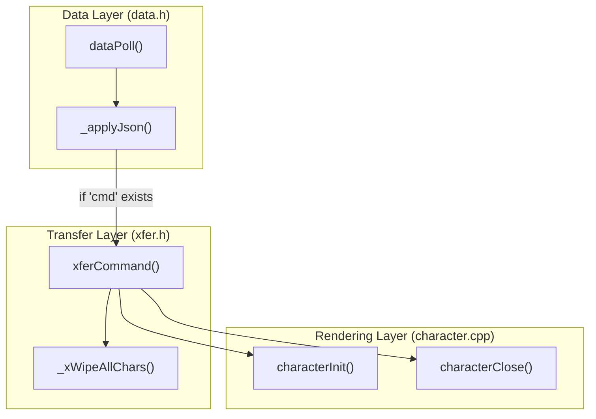
Sources: `[src/data.h:60-65]()`, `[src/xfer.h:77-80]()`, `[src/xfer.h:178-179]()`, `[src/xfer.h:237]()`

---

# Page: Character & Rendering System

# Character & Rendering System

<details>
<summary>Relevant source files</summary>

The following files were used as context for generating this wiki page:

- [README.md](README.md)
- [src/buddy.cpp](src/buddy.cpp)
- [src/character.cpp](src/character.cpp)

</details>


The **Character & Rendering System** is the visual engine of the `claude-desktop-buddy`. It is responsible for translating the device's logical state (e.g., "busy", "sleep", "attention") into animated visual feedback. The system supports two distinct rendering paths: a lightweight, built-in **ASCII Buddy System** and a customizable, file-based **GIF Character System**. Both systems consume the same `PersonaState` enum and provide a unified interface for the main application loop.

## System Architecture

The rendering logic is decoupled from the state machine. `src/main.cpp` determines the current `PersonaState` [src/main.cpp:8-8](), and then calls the appropriate rendering module based on whether a custom character pack is installed in LittleFS.

### Shared Persona States
Both systems implement animations for the following seven states:
*   `sleep`: Device disconnected or napping.
*   `idle`: Connected, waiting for tasks.
*   `busy`: Claude is actively processing.
*   `attention`: A permission prompt is waiting for user approval.
*   `celebrate`: Triggered by a level-up event.
*   `dizzy`: Triggered by shaking the device.
*   `heart`: Triggered by a rapid approval (<5s).

### Rendering Logic Flow

The following diagram illustrates how the system dispatches state information to the visual layers.

**Rendering Dispatch & State Association**
```mermaid
graph TD
    subgraph "Natural Language Space"
        A["'Claude is thinking'"] 
        B["'Device is shaken'"]
        C["'User Approval Needed'"]
    end

    subgraph "Code Entity Space (main.cpp)"
        PS["PersonaState Enum"]
        PS_BUSY["B_BUSY"]
        PS_DIZZY["B_DIZZY"]
        PS_ATTN["B_ATTENTION"]
    end

    subgraph "Rendering Paths"
        subgraph "ASCII System (buddy.cpp)"
            ST["Species Table"]
            SFN["StateFn Typedef"]
        end
        subgraph "GIF System (character.cpp)"
            AG["AnimatedGIF Library"]
            MF["manifest.json"]
        end
    end

    A --> PS_BUSY
    B --> PS_DIZZY
    C --> PS_ATTN

    PS_BUSY --> ST
    PS_DIZZY --> ST
    PS_ATTN --> AG
    
    ST -.-> SFN
    AG -.-> MF
```
**Sources:** [src/main.cpp:8-8](), [src/buddy.cpp:9-9](), [src/character.cpp:9-12]()

## ASCII Buddy System

The ASCII Buddy system is the default rendering path. It uses 18 built-in "species" (e.g., `AXOLOTL`, `CAPYBARA`, `CAT`) defined in `src/buddies/`. Each species is a collection of C++ functions that print character art using standard ASCII symbols.

*   **Dispatch Mechanism**: The `buddyTick` function [src/buddy.cpp:173-196]() uses a `SPECIES_TABLE` [src/buddy.cpp:91-97]() to look up the current species and call the specific function associated with the `PersonaState`.
*   **Animation**: Animations are driven by a `tickCount` that increments every 200ms [src/buddy.cpp:104-104]().
*   **Geometry**: Shared constants in `buddy_common.h` and `buddy.cpp` (like `BUDDY_X_CENTER`) ensure all species are aligned correctly on the 135x240 M5StickC Plus screen [src/buddy.cpp:12-17]().

For details, see [ASCII Buddy System](#3.1).

## GIF Character System

The GIF Character system allows users to replace ASCII art with custom animated GIFs. This system is activated when a character folder (containing a `manifest.json`) is found in the device's LittleFS partition.

*   **Manifest Parsing**: The system reads `manifest.json` to map GIF filenames to `PersonaState` keys [src/character.cpp:199-200]().
*   **Animation Engine**: It utilizes the `AnimatedGIF` library to decode and render frames [src/character.cpp:37-37]().
*   **Idle Variants**: To prevent repetitive loops, the system supports "variant carousels" for the idle state, rotating through multiple GIFs over time [src/character.cpp:58-60]().
*   **Memory Management**: Because the ESP32 has limited RAM, GIFs are rendered scanline-by-scanline via a callback [src/character.cpp:102-136]().

For details, see [GIF Character System](#3.2).

## Rendering Interface Comparison

The two systems share a similar API pattern to allow `main.cpp` to switch between them seamlessly.

| Feature | ASCII Buddy (`buddy.cpp`) | GIF Character (`character.cpp`) |
| :--- | :--- | :--- |
| **Storage** | Compiled in Flash (PROGMEM) | LittleFS Filesystem |
| **Scaling** | 1x (Peek) or 2x (Home) [src/buddy.cpp:40-40]() | 1:1 or 2:1 Downsample [src/character.cpp:48-49]() |
| **Color Control** | Shared `BUDDY_` constants [src/buddy.cpp:20-29]() | `Palette` struct from manifest [src/character.cpp:27-27]() |
| **Update Loop** | `buddyTick(state)` [src/buddy.cpp:173]() | `characterTick(state)` |
| **Target** | `TFT_eSprite` or `M5.Lcd` [src/buddy.cpp:36-36]() | `TFT_eSprite` or `M5.Lcd` [src/character.cpp:47-47]() |

**Rendering Data Flow**
```mermaid
sequenceDiagram
    participant M as main.cpp
    participant B as buddy.cpp
    participant C as character.cpp
    participant L as LittleFS

    M->>L: Check for /characters/
    alt GIF exists
        M->>C: characterInit(name)
        M->>C: characterTick(personaState)
        C->>L: Open GIF file
        C->>C: gifDrawCb() to Sprite
    else Use ASCII
        M->>B: buddyInit()
        M->>B: buddyTick(personaState)
        B->>B: buddyPrintSprite() to Sprite
    end
```
**Sources:** [src/main.cpp:155-162](), [src/buddy.cpp:108-113](), [src/character.cpp:140-168]()

**Sources:**
* [src/main.cpp:8-8]()
* [src/buddy.cpp:9-104]()
* [src/buddy.cpp:173-196]()
* [src/character.cpp:9-60]()
* [src/character.cpp:140-168]()
* [README.md:92-123]()

---

# Page: ASCII Buddy System

# ASCII Buddy System

<details>
<summary>Relevant source files</summary>

The following files were used as context for generating this wiki page:

- [src/buddy.cpp](src/buddy.cpp)
- [src/buddy.h](src/buddy.h)
- [src/buddy_common.h](src/buddy_common.h)

</details>


The ASCII Buddy System is a modular rendering framework responsible for displaying the device's 18 built-in animated characters. It provides a common API for state-based animations, allowing the main system loop to drive character behavior without needing to know the visual implementation details of individual species.

## System Architecture

The system is built around a dispatch mechanism that maps the global `PersonaState` to species-specific animation functions. It uses a tick-based timing system (5 FPS) to ensure consistent animation speeds across different hardware loop rates.

### Core Entities

| Entity | Location | Role |
| :--- | :--- | :--- |
| `Species` struct | [src/buddy.h:25-29]() | Defines a character's name, primary color, and an array of 7 `StateFn` pointers. |
| `StateFn` typedef | [src/buddy.h:23-23]() | A function signature `void (*StateFn)(uint32_t t)` that renders one frame of animation. |
| `SPECIES_TABLE` | [src/buddy.cpp:91-97]() | A registry of all available species (e.g., `CAPYBARA`, `AXOLOTL`, `ROBOT`). |
| `buddyTick` | [src/buddy.cpp:173-196]() | The main entry point called by the system loop to update and render the buddy. |

### Dispatch Flow Diagram

This diagram shows how a state change in the main firmware flows through the buddy system to a specific animation frame.

```mermaid
graph TD
    subgraph "Natural Language Space"
        "User State"["Persona State: BUSY"]
        "Selected Species"["Species: AXOLOTL"]
    end

    subgraph "Code Entity Space"
        "MainLoop"["src/main.cpp"]
        "BuddyTick"["buddyTick(personaState)"]
        "SpeciesTable"["SPECIES_TABLE[currentSpeciesIdx]"]
        "StateFn"["axolotl_busy(tickCount)"]
        "Render"["buddyPrintSprite()"]
    end

    "MainLoop" -- "Calls with PersonaState" --> "BuddyTick"
    "BuddyTick" -- "Look up Species" --> "SpeciesTable"
    "SpeciesTable" -- "Dispatch to StateFn" --> "StateFn"
    "StateFn" -- "Draw to TFT Sprite" --> "Render"
```

**Sources:** [src/buddy.cpp:91-97](), [src/buddy.cpp:173-196](), [src/buddy.h:23-29]()

## Shared Rendering API

To keep species files small and consistent, `src/buddy_common.h` exposes a set of geometry constants and helper functions. This ensures all buddies are centered and scaled correctly regardless of their internal design.

### Geometry & Colors
The system uses a fixed coordinate system centered at `BUDDY_X_CENTER` (67px) [src/buddy.cpp:12-12](). Species are rendered relative to `BUDDY_Y_BASE` (30px) [src/buddy.cpp:14-14]().

A standard palette of 16-bit 565 colors is provided, including `BUDDY_HEART` (0xF810), `BUDDY_CYAN` (0x07FF), and `BUDDY_WHITE` (0xFFFF) [src/buddy.cpp:21-25]().

### Rendering Helpers
*   **`buddyPrintSprite`**: Renders a multi-line array of strings (the ASCII art) at a specific vertical offset [src/buddy.cpp:55-61]().
*   **`buddyPrintLine`**: Renders a single line of text, automatically handling horizontal centering and padding trimming when scaled [src/buddy.cpp:42-53]().
*   **`buddySetCursor` / `buddyPrint`**: Low-level functions for drawing "particles" or small details (like hearts or sweat drops) relative to the buddy's position [src/buddy.cpp:65-70]().

**Sources:** [src/buddy_common.h:9-37](), [src/buddy.cpp:12-30]()

## Peek Mode and Scaling

The system supports two display scales controlled via `buddySetPeek(bool peek)` [src/buddy.cpp:149-154]():
1.  **Full Scale (2x)**: Used on the primary home screen. The system trims leading/trailing spaces from ASCII art and re-centers the "ink" to maximize visibility [src/buddy.cpp:44-47]().
2.  **Peek Scale (1x)**: Used in `PET` or `INFO` modes and the landscape clock. This renders the buddy at its native size to fit alongside UI elements [src/buddy.cpp:37-40]().

### External Rendering
While `buddyTick` typically renders to a shared sprite, `buddyRenderTo(TFT_eSPI* tgt, uint8_t personaState)` allows the buddy to be drawn onto any surface, such as the `M5.Lcd` during landscape clock mode [src/buddy.cpp:161-171]().

## Species Catalogue

The system includes 18 distinct species, ranging from animals like the `DUCK` and `PENGUIN` to mythical or inanimate objects like the `DRAGON` and `CACTUS`. Each species implements seven states: `SLEEP`, `IDLE`, `BUSY`, `ATTENTION`, `CELEBRATE`, `DIZZY`, and `HEART`.

For a full list of species and instructions on how to create new ones, see **[Species Catalogue](#3.1.1)**.

### State Mapping Table

| PersonaState | Buddy Enum | Animation Behavior |
| :--- | :--- | :--- |
| 0 | `B_SLEEP` | Static or slow breathing; minimal movement. |
| 1 | `B_IDLE` | Subtle blinking or looking around. |
| 2 | `B_BUSY` | High-frequency movement (typing, bouncing). |
| 3 | `B_ATTENTION` | Alert posture; looking at the user. |
| 4 | `B_CELEBRATE` | Jumping, hearts, or fast movement. |
| 5 | `B_DIZZY` | Spinning eyes or wobbling. |
| 6 | `B_HEART` | Special affection animation. |

**Sources:** [src/buddy.cpp:9-9](), [src/buddy.h:5-7]()

---

# Page: Species Catalogue

# Species Catalogue

<details>
<summary>Relevant source files</summary>

The following files were used as context for generating this wiki page:

- [src/buddies/axolotl.cpp](src/buddies/axolotl.cpp)
- [src/buddies/blob.cpp](src/buddies/blob.cpp)
- [src/buddies/cactus.cpp](src/buddies/cactus.cpp)
- [src/buddies/capybara.cpp](src/buddies/capybara.cpp)
- [src/buddies/cat.cpp](src/buddies/cat.cpp)
- [src/buddies/chonk.cpp](src/buddies/chonk.cpp)
- [src/buddies/dragon.cpp](src/buddies/dragon.cpp)
- [src/buddies/duck.cpp](src/buddies/duck.cpp)
- [src/buddies/ghost.cpp](src/buddies/ghost.cpp)
- [src/buddies/goose.cpp](src/buddies/goose.cpp)
- [src/buddies/mushroom.cpp](src/buddies/mushroom.cpp)
- [src/buddies/octopus.cpp](src/buddies/octopus.cpp)
- [src/buddies/owl.cpp](src/buddies/owl.cpp)
- [src/buddies/penguin.cpp](src/buddies/penguin.cpp)
- [src/buddies/rabbit.cpp](src/buddies/rabbit.cpp)
- [src/buddies/robot.cpp](src/buddies/robot.cpp)
- [src/buddies/snail.cpp](src/buddies/snail.cpp)
- [src/buddies/turtle.cpp](src/buddies/turtle.cpp)

</details>


The ASCII Buddy system features 18 built-in species, each implemented as a standalone C++ file within the `src/buddies/` directory. These species are rendered using standard ASCII characters and special symbols, providing a lightweight yet expressive visual identity for the device's persona.

## Visual Design & Animation Logic

Each species follows a standardized animation pattern defined in `src/buddy.h` [src/buddy.h:12-21](). A species is encapsulated within its own namespace and exposes seven state-specific animation functions.

### The 7 Persona States
Every species must implement the following states to be compatible with the `PersonaState` enum in the main state machine [src/main.cpp:52-62]():

| State | Function Name | Typical Visual Behavior |
| :--- | :--- | :--- |
| **Sleep** | `doSleep` | Heavy breathing, "Z" particles, closed eyes (`--` or `..`). |
| **Idle** | `doIdle` | Looking left/right, blinking, small fidgets. |
| **Busy** | `doBusy` | Focused eyes (`vv`), typing/scribbling motions, progress tickers. |
| **Attention** | `doAttention` | Alert eyes (`OO`), "!" pulses, shivering or tense posture. |
| **Celebrate** | `doCelebrate` | Jumping, spinning, confetti particles, wide mouth (`WW`). |
| **Dizzy** | `doDizzy` | Spiraled eyes (`@@`), shaking, stars/swirls. |
| **Heart** | `doHeart` | Blushing, heart symbols (`<3`), happy expressions. |

### Implementation Pattern: `axolotl.cpp`
The `axolotl` species serves as the reference implementation for ASCII buddies. It uses a 5-line vertical sprite system [src/buddies/axolotl.cpp:14-20]().

```mermaid
graph TD
    subgraph "Animation Data Flow"
        T["uint32_t t (Global Tick)"] --> BEAT["Beat Calculation: (t / 5) % SEQ_SIZE"]
        BEAT --> SEQ["SEQ Index Lookup"]
        SEQ --> POSE["Sprite Array (e.g., PUDDLE, BREATH)"]
        POSE --> RENDER["buddyPrintSprite()"]
    end
    
    subgraph "Coordinate Space"
        CENTER["BUDDY_X_CENTER"]
        BASE["BUDDY_Y_BASE"]
        OVERLAY["BUDDY_Y_OVERLAY"]
    end
    
    RENDER --> CENTER
    RENDER --> BASE
```
*Sources: [src/buddies/axolotl.cpp:23-31](), [src/buddy_common.h:11-15]()*

## Built-in Species Catalogue

The following table details a selection of the 18 built-in species and their unique implementation characteristics.

| Species | Primary Color | Unique Animation Feature | Source |
| :--- | :--- | :--- | :--- |
| **Axolotl** | `0xFB1E` (Pink) | Drifting bubble stream using `BUDDY_CYAN`. | [src/buddies/axolotl.cpp:31-45]() |
| **Blob** | `0x07F0` (Green) | Slow droplet falling under the puddle in Sleep state. | [src/buddies/blob.cpp:45-48]() |
| **Cactus** | `0x07E0` (Green) | Bristling spines and flower blooming in Celebrate. | [src/buddies/cactus.cpp:95-100]() |
| **Cat** | `0xC2A6` (Brown) | Sassy micro-actions like ear twitches and grooming. | [src/buddies/cat.cpp:47-58]() |
| **Chonk** | `0xFD20` (Orange) | Heavy belly jiggle and cog/dot tickers. | [src/buddies/chonk.cpp:31-33]() |
| **Dragon** | `0xF800` (Red) | Smoke rings and gold-coin clinking tickers. | [src/buddies/dragon.cpp:41-44]() |
| **Duck** | `0xFFE0` (Yellow) | Floating on water waves (`~~~~`) and diving motions. | [src/buddies/duck.cpp:12-17]() |
| **Ghost** | `0xFFFF` (White) | Vertical Y-axis bobbing and transparency-fading poses. | [src/buddies/ghost.cpp:25-31]() |
| **Goose** | `0xFFFF` (White) | Aggressive "HONK!" overlays and lunging/charging. | [src/buddies/goose.cpp:94-100]() |
| **Octopus** | `0xA01F` (Purple) | Waving tentacles and drifting underwater motion. | [src/buddies/octopus.cpp:47-56]() |

*Sources: [src/buddies/axolotl.cpp:31](), [src/buddies/blob.cpp:28](), [src/buddies/cactus.cpp:28](), [src/buddies/cat.cpp:29](), [src/buddies/chonk.cpp:33](), [src/buddies/dragon.cpp:29](), [src/buddies/duck.cpp:28](), [src/buddies/ghost.cpp:31](), [src/buddies/goose.cpp:28](), [src/buddies/octopus.cpp:28]()*

## Adding a New Species

To add a new species (e.g., `my_buddy`), follow this technical checklist:

1.  **Create Source File**: Create `src/buddies/my_buddy.cpp`.
2.  **Define Namespace**: Wrap all functions in `namespace my_buddy { ... }`.
3.  **Implement State Functions**: Create the 7 static functions matching the `StateFn` signature: `void doState(uint32_t t)`.
4.  **Define Sprites**: Use `static const char* const POSE_NAME[5]` to define the 5-line ASCII frames.
5.  **Define Sequence**: Use a `static const uint8_t SEQ[]` array to map ticks to poses [src/buddies/axolotl.cpp:23-29]().
6.  **Register in `buddy.cpp`**:
    *   Add `extern Species my_buddy_spec;` [src/buddy.cpp:32]().
    *   Add the species to the `SPECIES[]` array [src/buddy.cpp:55]().

### Rendering Utilities
Species implementations use helper functions from `buddy_common.h` to maintain visual consistency:

*   `buddyPrintSprite(const char* const* lines, int n, int yOff, uint16_t color, int xOff)`: The primary function for drawing the 5-line ASCII block [src/buddy_common.h:18]().
*   `buddySetColor(uint16_t color)`: Sets the current TFT pen color [src/buddy_common.h:20]().
*   `buddySetCursor(int x, int y)`: Moves the draw pointer [src/buddy_common.h:19]().

```mermaid
classDiagram
    class Species {
        +const char* name
        +StateFn sleep
        +StateFn idle
        +StateFn busy
        +StateFn attention
        +StateFn celebrate
        +StateFn dizzy
        +StateFn heart
    }
    class buddy_cpp {
        +Species SPECIES[]
        +buddyRenderTo(PersonaState s)
    }
    class axolotl_cpp {
        +doSleep(uint32_t t)
        +doIdle(uint32_t t)
    }
    buddy_cpp --> Species : Dispatches to
    axolotl_cpp ..|> Species : Implements
```
*Sources: [src/buddy.h:12-21](), [src/buddy.cpp:35-56](), [src/buddies/axolotl.cpp:14-140]()*

---

# Page: GIF Character System

# GIF Character System

<details>
<summary>Relevant source files</summary>

The following files were used as context for generating this wiki page:

- [src/character.cpp](src/character.cpp)
- [src/character.h](src/character.h)

</details>


The GIF Character System provides a data-driven rendering pipeline for high-fidelity animated characters stored on the ESP32's internal flash memory (LittleFS). Unlike the procedurally drawn ASCII Buddy system, this system uses the `AnimatedGIF` library to decode and render multi-frame assets based on a JSON manifest.

## System Architecture

The system is centered around `src/character.cpp`, which manages the lifecycle of GIF decoding, state transitions, and display scaling. It interfaces with `LittleFS` for asset retrieval and uses a custom scanline callback to pipe decoded pixels into the M5StickC Plus display buffer.

### Key Components & Data Flow

The following diagram illustrates the relationship between the character manifest, the state machine, and the rendering output.

**GIF System Entity Map**
```mermaid
graph TD
    subgraph "Filesystem (LittleFS)"
        M["manifest.json"]
        G["GIF Assets (*.gif)"]
    end

    subgraph "Code Entities (src/character.cpp)"
        INIT["characterInit()"]
        SET["characterSetState()"]
        TICK["characterTick()"]
        DRAW["gifDrawCb()"]
        PAL["Palette struct"]
    end

    subgraph "Hardware / Library"
        AG["AnimatedGIF Lib"]
        SPR["TFT_eSprite (spr)"]
    end

    M -->|Parses Colors/Paths| INIT
    INIT -->|Caches| PAL
    SET -->|Selects GIF| AG
    TICK -->|Triggers Decode| AG
    AG -->|Scanline Callback| DRAW
    DRAW -->|Push Pixels| SPR
```
Sources: [src/character.cpp:1-62](), [src/character.h:1-31]()

## Manifest Parsing & Initialization

Initialization occurs via `characterInit(const char* name)`. If no name is provided, the system scans the `/characters/` directory for the first available folder [src/character.cpp:152-168]().

### The Palette Struct
The system extracts a global `Palette` from the manifest's `colors` object. This palette defines the UI theme colors used by other system components (like the status bars and text) to ensure visual consistency with the character [src/character.cpp:189-195]().

| Field | Description |
| :--- | :--- |
| `body` | Primary character color (used for UI accents). |
| `bg` | Background color (used for transparency filling). |
| `text` | Primary text color. |
| `textDim` | Secondary/dimmed text color. |
| `ink` | High-contrast detail color. |

Sources: [src/character.h:4-6](), [src/character.cpp:27](), [src/character.cpp:63-68]()

### State Mapping
The system supports 7 logical states defined in `STATE_NAMES`: `sleep`, `idle`, `busy`, `attention`, `celebrate`, `dizzy`, and `heart` [src/character.cpp:9-12](). The manifest maps these states to one or more GIF files. If multiple GIFs are assigned to a state (common for `idle`), the system performs a "carousel rotation" [src/character.cpp:31-33]().

## Animation & Rendering Pipeline

The rendering pipeline uses a non-blocking `characterTick()` loop. It checks if the current time exceeds `nextFrameAt` and calls the `AnimatedGIF::decodeFrame` method [src/character.cpp:19]().

### Scanline Rendering (`gifDrawCb`)
The `gifDrawCb` function is the core of the rendering logic. It processes one scanline at a time. To prevent "ghosting" or artifacts from prior frames, the system treats transparent pixels as the background color defined in the `Palette` [src/character.cpp:98-115]().

**Rendering Logic Flow**
```mermaid
flowchart TD
    START["gifDrawCb(GIFDRAW* d)"] --> MODE{"Peek Mode?"}
    
    MODE -- "Yes" --> SCALE["2:1 Nearest-Neighbor Downscale"]
    SCALE --> Y_CHECK{"srcY % 2 == 0?"}
    Y_CHECK -- "No" --> DISCARD["Skip Scanline"]
    Y_CHECK -- "Yes" --> PUSH_PEEK["Draw to PEEK_TOP (y=70)"]

    MODE -- "No" --> FULL["1:1 Full Scale"]
    FULL --> PUSH_HOME["Draw to Home Area (y=140)"]

    PUSH_PEEK --> PIXEL["Apply Transparency via pal.bg"]
    PUSH_HOME --> PIXEL
```
Sources: [src/character.cpp:102-136]()

### Display Modes: Peek vs. Full-Size
The system supports two layout modes toggled via `characterSetPeek(bool peek)` [src/character.h:26]():

1.  **Full-Size (Home Mode):** The character is centered in the upper 140px of the screen. This is used for the primary "pet" view [src/character.cpp:41-42]().
2.  **Peek Mode:** The character is rendered at **half scale** (2:1 downscale) and pinned to the top of the info-panel (y=70). This allows the character to remain visible while the user navigates menus or views status details [src/character.cpp:48-55]().

### Idle Variant Carousel
To prevent repetitive animations, the system implements a variant rotation for the `idle` state. Every `VARIANT_DWELL_MS` (5000ms), the system checks if there are multiple GIFs defined for the current state and rotates to the next index in `stateRot` [src/character.cpp:58-60]().

## AnimatedGIF Callbacks
Because GIFs are stored in `LittleFS`, the system provides custom file I/O callbacks to the `AnimatedGIF` library:
*   `gifOpenCb`: Opens the file handle [src/character.cpp:72-77]().
*   `gifReadCb`: Reads data into the library's internal buffer [src/character.cpp:84-89]().
*   `gifSeekCb`: Moves the file pointer for frame jumping [src/character.cpp:91-96]().
*   `gifCloseCb`: Closes the file handle once decoding is complete or the state changes [src/character.cpp:79-82]().

## Technical Constraints
*   **Unoptimized GIFs:** The system requires GIFs to be "unoptimized" (full-frame). The -O2/-O3 optimization paths (sub-rect deltas) were deprecated because they do not compose correctly with the 2:1 downscale sampling in Peek Mode [src/character.cpp:108-112]().
*   **Memory:** GIF paths are cached in a fixed-size array `gifPaths[MAX_GIFS][32]` to avoid heap fragmentation during runtime [src/character.cpp:29-30]().

Sources: [src/character.cpp:1-136](), [src/character.h:1-31]()

---

# Page: Character Packs

# Character Packs

<details>
<summary>Relevant source files</summary>

The following files were used as context for generating this wiki page:

- [characters/bufo/README.md](characters/bufo/README.md)
- [characters/bufo/manifest.json](characters/bufo/manifest.json)

</details>


Character Packs are the asset bundles used by the **GIF Character System** to provide high-fidelity animations on the device. While the **ASCII Buddy System** uses procedural code to draw characters, the Character Pack system relies on a collection of GIF files and a JSON manifest stored on the device's LittleFS filesystem.

## High-Level Architecture

A Character Pack consists of a directory containing a `manifest.json` file and several `.gif` assets. These assets are mapped to the seven core `PersonaState` values defined in the firmware.

### Component Relationship
The following diagram illustrates how the Character Pack assets relate to the firmware's internal state management and the hardware display.

**Character Pack Data Flow**
```mermaid
graph TD
    subgraph "Local Filesystem (LittleFS)"
        M["manifest.json"]
        G["GIF Assets (*.gif)"]
    end

    subgraph "Firmware Code Entity Space"
        CS["character.cpp"]
        PS["PersonaState (main.cpp)"]
        AG["AnimatedGIF Library"]
    end

    subgraph "Hardware"
        LCD["ST7789 LCD"]
    end

    PS -- "current state" --> CS
    M -- "defines mapping" --> CS
    CS -- "loads asset" --> G
    G -- "frames" --> AG
    AG -- "gifDrawCb()" --> LCD
```
Sources: [src/character.cpp:1-20](), [characters/bufo/manifest.json:1-30]()

---

## The Manifest Format

The `manifest.json` file is the central configuration for a character. It defines the visual identity of the pack through two primary sections:

1.  **Colors**: A set of hex codes used by the UI overlay (text, battery icons, and backgrounds) to ensure the interface matches the character's aesthetic [characters/bufo/manifest.json:3-9]().
2.  **States**: A mapping of `PersonaState` keys to specific GIF filenames. The system supports single strings for states like `busy` or `sleep`, and arrays of strings for the `idle` state to enable animation variety [characters/bufo/manifest.json:10-28]().

| Field | Description |
| :--- | :--- |
| `name` | The internal identifier for the character. |
| `colors` | Object containing `body`, `bg`, `text`, `textDim`, and `ink` hex codes. |
| `states` | Mapping for `sleep`, `idle`, `busy`, `attention`, `celebrate`, `dizzy`, and `heart`. |

Sources: [characters/bufo/manifest.json:1-30]()

---

## Built-in Character: Bufo

The default character pack provided with the project is **Bufo**, a frog-based emoji set. This pack serves as the reference implementation for custom characters.

*   **Asset Count**: 15 GIF files [characters/bufo/README.md:12-15]().
*   **Idle Strategy**: Uses a 9-variant rotation (`idle_0.gif` through `idle_8.gif`) to provide visual interest while the device is in a resting state [characters/bufo/manifest.json:12-22]().
*   **Licensing**: The Bufo assets are sourced from [bufo.zone](https://bufo.zone) and are subject to specific attribution requirements separate from the project's MIT license [characters/bufo/README.md:8-10]().

For details on the specific animation frames and color configurations, see [Bufo Character Pack](#4.1).

Sources: [characters/bufo/README.md:1-19](), [characters/bufo/manifest.json:1-30]()

---

## Installation Paths

There are two primary methods for deploying a Character Pack to the M5StickC Plus hardware:

### 1. Developer Flash (USB)
Using the Python-based `tools/flash_character.py` script, developers can upload a pack directly over a serial connection. This script prepares the LittleFS image and flashes it to the device's storage partition [characters/bufo/README.md:17-18]().

### 2. Wireless Install (BLE)
For end-users, the **Hardware Buddy** desktop application supports a "Folder Push" protocol. Users can drag a character folder onto the application window, which then transmits the files over the Bluetooth Low Energy (BLE) Nordic UART Service (NUS) [characters/bufo/README.md:17-18]().

**Installation Tooling Interaction**
```mermaid
graph LR
    subgraph "Development Environment"
        PREP["prep_character.py"]
        FLASH["flash_character.py"]
    end

    subgraph "User Environment"
        HB["Hardware Buddy (Desktop App)"]
    end

    subgraph "Target Device"
        LFS["LittleFS Partition"]
        XFER["xfer.h (Folder Push)"]
    end

    PREP -- "Normalize/Quantize" --> FLASH
    FLASH -- "Serial/USB" --> LFS
    HB -- "BLE (char_begin/file/chunk)" --> XFER
    XFER -- "Write" --> LFS
```
Sources: [characters/bufo/README.md:17-18](), [src/xfer.h:1-50]()

For details on asset optimization (96px downscaling, palette quantization) and the transfer protocol, see [Character Pack Tooling](#4.2).

---

# Page: Bufo Character Pack

# Bufo Character Pack

<details>
<summary>Relevant source files</summary>

The following files were used as context for generating this wiki page:

- [LICENSE](LICENSE)
- [characters/bufo/README.md](characters/bufo/README.md)
- [characters/bufo/attention.gif](characters/bufo/attention.gif)
- [characters/bufo/busy.gif](characters/bufo/busy.gif)
- [characters/bufo/celebrate.gif](characters/bufo/celebrate.gif)
- [characters/bufo/dizzy.gif](characters/bufo/dizzy.gif)
- [characters/bufo/heart.gif](characters/bufo/heart.gif)
- [characters/bufo/idle_0.gif](characters/bufo/idle_0.gif)
- [characters/bufo/idle_1.gif](characters/bufo/idle_1.gif)
- [characters/bufo/idle_2.gif](characters/bufo/idle_2.gif)
- [characters/bufo/idle_3.gif](characters/bufo/idle_3.gif)
- [characters/bufo/idle_4.gif](characters/bufo/idle_4.gif)
- [characters/bufo/idle_5.gif](characters/bufo/idle_5.gif)
- [characters/bufo/idle_6.gif](characters/bufo/idle_6.gif)
- [characters/bufo/idle_7.gif](characters/bufo/idle_7.gif)
- [characters/bufo/idle_8.gif](characters/bufo/idle_8.gif)
- [characters/bufo/manifest.json](characters/bufo/manifest.json)
- [characters/bufo/sleep.gif](characters/bufo/sleep.gif)

</details>


The **Bufo Character Pack** is the default high-fidelity asset set for the Claude Desktop Buddy. It replaces the procedural ASCII art species with a collection of 15 animated GIF files featuring "Bufo," a community-sourced frog character. This pack serves as the reference implementation for the system's character pack architecture, demonstrating state mapping, color theming, and idle variation strategies.

## Overview and Assets

The pack consists of 15 GIF files and a `manifest.json` file located in the `characters/bufo/` directory [characters/bufo/README.md:12-15](). While the software in this repository is under the MIT license, the Bufo artwork is third-party content from [bufo.zone](https://bufo.zone) and is redistributed under separate terms [LICENSE:11-11]().

### State Mapping
The character system maps the internal `PersonaState` enum to specific GIF files. While the system supports 7 logical states, the Bufo pack utilizes 15 files to provide visual variety during inactivity.

| PersonaState | Associated GIF(s) | Behavior |
| :--- | :--- | :--- |
| `STATE_IDLE` | `idle_0.gif` through `idle_8.gif` | Rotates through 9 variants [characters/bufo/README.md:13-15](). |
| `STATE_BUSY` | `busy.gif` | Loops while Claude is generating a response. |
| `STATE_SLEEP` | `sleep.gif` | Displayed when the device is in low-power/nap mode. |
| `STATE_ATTENTION` | `attention.gif` | Triggered when a tool use or prompt requires approval. |
| `STATE_CELEBRATE` | `celebrate.gif` | One-shot animation for task completion. |
| `STATE_DIZZY` | `dizzy.gif` | Triggered by the IMU shake gesture. |
| `STATE_HEART` | `heart.gif` | Triggered by positive interactions or high "fed" stats. |

Sources: [characters/bufo/README.md:12-15](), [src/main.cpp:73-82]()

## Manifest Configuration

The `manifest.json` file defines the identity of the pack and the UI theme colors used by the M5StickC Plus display when this character is active.

### Color Theming
The manifest includes `color` and `bgcolor` fields. These are parsed by the `_applyJson` function in the data layer to update the device's global palette [src/data.h:134-142]().

*   **Primary Color**: Used for text overlays (clock, token counts).
*   **Background Color**: Used for the screen clear color and "peek" mode margins.

### Technical Data Flow: Manifest to Hardware
The following diagram illustrates how the manifest data influences the rendering system.

**Manifest to Code Entity Mapping**
```mermaid
graph TD
    subgraph "Filesystem (LittleFS)"
        M["manifest.json"]
        G["idle_0.gif...idle_8.gif"]
    end

    subgraph "Logic (src/character.cpp)"
        P["characterInit()"]
        L["loadManifest()"]
        R["characterRender()"]
    end

    subgraph "State (src/data.h)"
        S["TamaState Struct"]
        C["Palette Palette"]
    end

    M --> L
    L --> S
    S --> C
    G --> R
    C --> R
    R --> DISP["M5.Lcd (ST7789)"]
```
Sources: [src/character.cpp:52-78](), [src/data.h:134-142](), [src/character.h:15-25]()

## Idle Rotation Strategy

To prevent visual fatigue and "burn-in" feel, the Bufo pack implements a **9-variant idle rotation**. 

1.  **Selection**: When the `PersonaState` transitions to `STATE_IDLE`, the `character.cpp` logic selects a variant.
2.  **Rotation**: Instead of looping a single clip, the system cycles through `idle_0.gif` to `idle_8.gif` [characters/bufo/README.md:13-15](). 
3.  **Variations**: These variants include subtle changes such as Bufo blinking, looking left/right, or breathing, providing a more "alive" appearance on the desk.

**Idle State Selection Logic**
```mermaid
graph TD
    subgraph "main.cpp"
        D["derive()"]
        ST["PersonaState == STATE_IDLE"]
    end

    subgraph "character.cpp"
        V["idleVariant counter"]
        GF["getGifPath()"]
        LD["AnimatedGIF::open()"]
    end

    D --> ST
    ST --> V
    V -->|Increment/Wrap| GF
    GF -->|"/idle_N.gif"| LD
```
Sources: [src/character.cpp:115-130](), [src/main.cpp:540-560]()

## Installation and Deployment

The Bufo pack is bundled with the firmware but can be re-installed or modified using two primary paths:

1.  **USB Flash**: Using the Python utility `tools/flash_character.py characters/bufo`, which writes the files directly to the ESP32's LittleFS partition via Serial [characters/bufo/README.md:17-18]().
2.  **BLE Folder Push**: Dragging the `bufo` folder onto the "Hardware Buddy" desktop application. This utilizes the `xfer.h` protocol to stream the GIFs over Bluetooth Low Energy [src/xfer.h:15-40]().

Sources: [characters/bufo/README.md:17-18](), [src/xfer.h:102-120]()

---

# Page: Character Pack Tooling

# Character Pack Tooling

<details>
<summary>Relevant source files</summary>

The following files were used as context for generating this wiki page:

- [characters/bufo/README.md](characters/bufo/README.md)
- [tools/flash_character.py](tools/flash_character.py)
- [tools/prep_character.py](tools/prep_character.py)

</details>


The Character Pack Tooling provides developers and artists with a pipeline for transforming standard GIF assets into optimized, hardware-compatible character packs for the M5StickC Plus. The tooling addresses hardware constraints such as the 135x240 screen resolution, limited LittleFS storage (approx. 1.8MB), and memory-efficient GIF decoding.

## Processing Pipeline (prep_character.py)

The `tools/prep_character.py` script is the primary entry point for creating a character pack. It processes a source directory containing a `manifest.json` and raw GIF files, performing normalization and quantization to ensure the character appears consistent across different animation states.

### Normalization and Bounding Box Calculation
To prevent the character from "jumping" or changing size when transitioning between states (e.g., from `idle` to `busy`), the tool uses a two-pass normalization strategy:

1.  **Reference Scaling**: All input frames are temporarily scaled to a `REF_W` (1000px) width to maintain high-precision coordinate math `[tools/prep_character.py:22-29]()`.
2.  **Global Bounding Box**: The tool calculates the union of all non-transparent bounding boxes across every frame of every GIF in the pack `[tools/prep_character.py:72-84]()`.
3.  **Consistent Crop**: Every frame is cropped using this `global_bbox` and then downscaled to the `TARGET_W` (96px) width `[tools/prep_character.py:38-47]()`. This ensures that a character that occupies 50% of the frame in one GIF will occupy exactly the same relative space in all others.

### Palette Quantization
The ESP32's `AnimatedGIF` library and the limited SPI RAM benefit from reduced color depth. The tool flattens RGBA frames against the background color defined in the manifest and converts them to an adaptive 64-color palette `[tools/prep_character.py:45-47]()`.

### Tooling Data Flow: Asset Preparation

The following diagram illustrates how raw assets are transformed into a deployment-ready character pack.

"Asset Preparation Flow"
```mermaid
graph TD
    subgraph "Natural Language Space"
        A["Raw Artist Assets (.gif)"]
        B["Source manifest.json"]
    end

    subgraph "Code Entity Space (tools/prep_character.py)"
        C["_load_normalized()"]
        D["_union() / global_bbox"]
        E["_save_state()"]
        F["PIL.Image.ADAPTIVE Quantization"]
    end

    A --> C
    C --> D
    D --> E
    B --> E
    E --> F
    F --> G["characters/<name>/ (Optimized Pack)"]
```
Sources: `[tools/prep_character.py:20-53]()`, `[tools/prep_character.py:70-110]()`

## Deployment Paths

There are two primary methods for installing a prepped character pack onto the device: USB flashing (for development) and BLE transfer (for end-users).

### USB Flashing (flash_character.py)
The `tools/flash_character.py` script provides a fast iteration loop for developers. It bypasses the BLE transfer protocol by staging the character pack directly into the project's `data/` directory and invoking the PlatformIO `uploadfs` target.

*   **Staging**: The script clears the `data/characters` directory to save space and copies the target pack into it `[tools/flash_character.py:28-31]()`.
*   **Validation**: It checks that the total size does not exceed the `CAP` (1,800,000 bytes) to avoid LittleFS overflow `[tools/flash_character.py:22-24]()`.
*   **Execution**: It runs `pio run -t uploadfs` to flash the SPIFFS/LittleFS partition over USB `[tools/flash_character.py:34]()`.

### BLE Drag-and-Drop
The Hardware Buddy desktop application supports a "Folder Push" transport. When a prepped character folder is dropped onto the UI, it uses the `src/xfer.h` protocol to stream the files over the Nordic UART Service (NUS).

1.  **Handshake**: Desktop sends `char_begin`.
2.  **Stream**: Each file is sent in Base64 chunks via `file` and `chunk` commands.
3.  **Finalize**: Device receives `char_end`, triggers `characterInit()`, and reloads the filesystem.

### Deployment Logic and Entities

This diagram maps the deployment commands to the scripts and hardware logic.

"Deployment Path Mapping"
```mermaid
graph LR
    subgraph "Natural Language Space"
        H["Developer Workflow"]
        I["User Workflow"]
    end

    subgraph "Code Entity Space"
        J["tools/flash_character.py"]
        K["pio run -t uploadfs"]
        L["Hardware Buddy Window"]
        M["src/xfer.h (Folder Push)"]
        N["src/character.cpp:characterInit()"]
    end

    H --> J
    J --> K
    K -->|"USB Serial"| N
    I --> L
    L --> M
    M -->|"BLE (NUS)"| N
```
Sources: `[tools/flash_character.py:17-36]()`, `[characters/bufo/README.md:17-18]()`

## Manifest Structure

The tooling generates a modified `manifest.json` for the device. While the source manifest may contain complex paths, the output manifest maps `PersonaState` keys to the specific optimized filenames.

| Field | Description | Source |
| :--- | :--- | :--- |
| `name` | Character identifier used for the folder name. | `[tools/prep_character.py:66]()` |
| `colors.bg` | Hex code for the background; used for GIF flattening. | `[tools/prep_character.py:67-68]()` |
| `states` | Map of `PersonaState` (idle, busy, etc.) to file(s). | `[tools/prep_character.py:106-110]()` |

If a state (like `idle`) has multiple GIFs, the tool names them `idle_0.gif`, `idle_1.gif`, etc., and the device `character.cpp` logic will rotate through them as a carousel `[tools/prep_character.py:81-82]()`.

Sources: `[tools/prep_character.py:65-110]()`, `[characters/bufo/README.md:12-15]()`

---

# Page: BLE Protocol Reference

# BLE Protocol Reference

<details>
<summary>Relevant source files</summary>

The following files were used as context for generating this wiki page:

- [REFERENCE.md](REFERENCE.md)

</details>


The Claude Desktop-to-Device protocol is a lightweight, JSON-based wire format transmitted over the **Nordic UART Service (NUS)**. It enables bi-directional communication between the Claude desktop application and the hardware buddy, facilitating real-time status updates, AI interaction events, and remote file management.

The protocol is designed to be transport-agnostic; while primarily used over Bluetooth LE (BLE), it also supports USB Serial using the same newline-delimited JSON structure.

### Protocol Architecture

The communication follows a reactive model where the desktop acts as the primary orchestrator, pushing state updates ("heartbeats") and commands, while the device provides acknowledgments (acks) and user-initiated decisions (permissions).

#### System Entity Mapping
This diagram maps the logical protocol components to the physical and software entities in the codebase.

```mermaid
graph TD
    subgraph "Desktop Space (Claude App)"
        A["Hardware Buddy Window"] -- "JSON Commands" --> B["BLE Central"]
        B -- "JSON Events" --> A
    end

    subgraph "Device Space (ESP32)"
        C["ble_bridge.cpp"] -- "Raw Bytes" --> D["_LineBuf (data.h)"]
        D -- "Parsed JSON" --> E["_applyJson (data.h)"]
        E --> F["TamaState (data.h)"]
        E --> G["Stats (stats.h)"]
        H["xfer.h"] -- "File I/O" --> I["LittleFS"]
        E -- "Trigger Xfer" --> H
    end

    B <== "Nordic UART Service (NUS)" ==> C
```
Sources: [REFERENCE.md:21-39](), [src/data.h:203-240](), [src/ble_bridge.cpp:1-20]()

### Transport Layer: Nordic UART Service

The protocol utilizes the de-facto standard Nordic UART Service (NUS) for serial-over-BLE communication.

| Characteristic | UUID | Role |
| :--- | :--- | :--- |
| **Service** | `6e400001-b5a3-f393-e0a9-e50e24dcca9e` | Service Discovery |
| **RX** | `6e400002-b5a3-f393-e0a9-e50e24dcca9e` | Desktop → Device (Write) |
| **TX** | `6e400003-b5a3-f393-e0a9-e50e24dcca9e` | Device → Desktop (Notify) |

**Framing:** All messages are UTF-8 encoded JSON objects, one per line, terminated with a newline (`\n`). Because BLE MTU limits may fragment large JSON objects, the device implements a line buffer to reassemble packets before parsing.

Sources: [REFERENCE.md:23-39](), [src/data.h:176-190]()

### Connection Lifecycle & Security

The connection lifecycle is managed through the `ble_bridge.cpp` component, which handles the transition from advertising to a bonded secure state.

1.  **Advertising:** The device advertises a name starting with `Claude` (e.g., `Claude-A1B2`) to be filtered by the desktop app.
2.  **Bonding:** The protocol uses **LE Secure Connections** with a 6-digit passkey displayed on the device screen for Man-in-the-Middle (MITM) protection.
3.  **Persistence:** Bonds are stored in NVS. The desktop can request an unpair via `{"cmd":"unpair"}`, which triggers `bleForget()` on the device.
4.  **Heartbeat Timeout:** If no heartbeat snapshot is received for ~30 seconds, the device considers the connection dead and transitions to a disconnected visual state.

For details on the security implementation and bonding flow, see [Device-to-Desktop Commands & Security](#5.2).

Sources: [REFERENCE.md:31-33](), [REFERENCE.md:78-79](), [src/ble_bridge.cpp:100-140]()

### Message Categories

The protocol exchange consists of four primary message types:

#### 1. Heartbeat & State Snapshots
The desktop pushes a comprehensive state object whenever the Claude session changes (e.g., new message, token count increase) or as a keepalive every 10 seconds. This includes the `total` active sessions, `running` status, and `tokens_today`.

#### 2. Turn Events
One-shot events fired upon completion of an AI turn. These contain the raw content array (text, tool calls) from the assistant.

#### 3. Permission Flow
A request-response pattern where the desktop sends a `prompt` object in the heartbeat, and the device responds with a `permission` command (`once` or `deny`).

#### 4. Folder Push (Xfer)
A sequential command sequence for streaming files (like character GIFs) to the device's LittleFS storage.

```mermaid
sequenceDiagram
    participant D as Desktop
    participant B as Device (Buddy)
    
    Note over D,B: Connection Established
    D->>B: {"time": [1775731234, -25200]}
    D->>B: {"cmd":"owner", "name":"Felix"}
    B-->>D: {"ack":"owner", "ok":true}
    
    Loop Every 10s or on Change
        D->>B: {"total":1, "running":1, "tokens":184502...}
    End

    Note over D,B: Permission Requested
    D->>B: {"prompt": {"id":"req_123", "tool":"Bash"...}}
    B->>D: {"cmd":"permission", "id":"req_123", "decision":"once"}
```

For details on the specific JSON schemas for these messages, see [Desktop-to-Device Commands](#5.1).

Sources: [REFERENCE.md:40-107](), [src/data.h:203-240]()

### Acknowledgement Pattern

Any command sent by the desktop containing a `cmd` field requires a matching `ack` from the device to maintain synchronization and flow control, particularly during high-bandwidth operations like Folder Push.

| Device Ack Field | Description |
| :--- | :--- |
| `ack` | Must match the `cmd` string being acknowledged. |
| `ok` | Boolean indicating success or failure. |
| `n` | Generic numeric field (e.g., bytes written in a `chunk` ack). |
| `error` | Optional string describing the failure. |

Sources: [REFERENCE.md:122-132](), [src/xfer.h:70-90]()

---

### Child Pages
- [Desktop-to-Device Commands](#5.1) — Detailed schema for heartbeats, turn events, and administrative commands.
- [Device-to-Desktop Commands & Security](#5.2) — Specification for permission responses, status acks, and the BLE security model.

---

# Page: Desktop-to-Device Commands

# Desktop-to-Device Commands

<details>
<summary>Relevant source files</summary>

The following files were used as context for generating this wiki page:

- [REFERENCE.md](REFERENCE.md)
- [src/data.h](src/data.h)
- [src/xfer.h](src/xfer.h)

</details>


This page specifies the JSON-over-BLE protocol used by the Claude desktop application to communicate with the device. The protocol facilitates state synchronization, identity management, and real-time event streaming.

## Overview

The desktop application communicates with the device primarily via the **Nordic UART Service (NUS)** [REFERENCE.md:23-29](). All data is exchanged as UTF-8 encoded JSON objects, with each object terminated by a newline (`\n`) character [REFERENCE.md:35-38](). The device uses a line-buffered reassembly mechanism to handle fragmented BLE packets [src/data.h:130-143]().

### Command Flow Architecture

The `dataPoll` loop in the firmware continuously checks for incoming data from both USB Serial and BLE [src/data.h:147-184](). When a complete JSON object is detected, it is passed to `_applyJson` [src/data.h:70-127](), which dispatches it to either the state machine or the transfer handler.

## Heartbeat Snapshot

The desktop sends a heartbeat snapshot whenever the session state changes, or as a keepalive every 10 seconds [REFERENCE.md:42-43](). This snapshot updates the `TamaState` struct, which governs the device's persona and display [src/data.h:7-22]().

### Schema
```json
{
  "total": 3,
  "running": 1,
  "waiting": 1,
  "msg": "approve: Bash",
  "entries": ["10:42 git push", "10:41 yarn test"],
  "tokens": 184502,
  "tokens_today": 31200,
  "prompt": {
    "id": "req_abc123",
    "tool": "Bash",
    "hint": "rm -rf /tmp/foo"
  }
}
```

### Key Fields and Implementation
| Field | Firmware Mapping | Description |
| :--- | :--- | :--- |
| `total` | `sessionsTotal` | Total open Claude sessions [src/data.h:93](). |
| `running` | `sessionsRunning` | Sessions actively generating text/tools [src/data.h:94](). |
| `waiting` | `sessionsWaiting` | Sessions blocked on a permission prompt [src/data.h:95](). |
| `msg` | `msg[24]` | Short status text displayed on the device [src/data.h:101](). |
| `entries` | `lines[8][92]` | Transcript history for the "Info" screen [src/data.h:102-115](). |
| `tokens` | `statsOnBridgeTokens()` | Cumulative session tokens; updates NVS stats [src/data.h:98](). |
| `prompt` | `promptId`, `promptTool` | Permission request details [src/data.h:116-124](). |

**Sources:** [REFERENCE.md:45-76](), [src/data.h:7-22](), [src/data.h:93-124]()

## System Commands

Commands containing a `"cmd"` field require the device to send an acknowledgement (`ack`) [REFERENCE.md:124-128](). These are handled by `xferCommand` in `src/xfer.h` [src/xfer.h:77-225]().

### Command List
*   **`status`**: Requests a full diagnostic report including battery, heap, and filesystem stats [REFERENCE.md:140-155]().
*   **`name`**: Sets the pet's display name [src/xfer.h:81-86]().
*   **`owner`**: Sets the owner's name (retrieved from the Claude account) [src/xfer.h:105-110]().
*   **`unpair`**: Triggers `bleClearBonds()` to erase stored BLE security keys [src/xfer.h:99-103]().
*   **`time`**: Synchronizes the ESP32 internal RTC with the desktop's epoch time and timezone offset [src/data.h:77-91]().

### Data Flow: Command Processing
Title: Desktop Command Dispatch Flow
```mermaid
graph TD
    A["Desktop JSON"] --> B["dataPoll()"]
    B --> C["_LineBuf::feed()"]
    C --> D["_applyJson()"]
    D --> E{"Has 'cmd'?"}
    E -- "Yes" --> F["xferCommand()"]
    E -- "No" --> G["Update TamaState"]
    F --> H{"Command Type"}
    H -- "status" --> I["_xAck with Battery/Sys info"]
    H -- "unpair" --> J["bleClearBonds()"]
    H -- "name/owner" --> K["Update stats.h Settings"]
```
**Sources:** [src/data.h:147-175](), [src/xfer.h:77-139]()

## Turn Events

The desktop streams raw SDK content blocks via `turn` events. These are one-shot notifications and are not stored in the long-term `TamaState` [REFERENCE.md:81-87]().

```json
{
  "evt": "turn",
  "role": "assistant",
  "content": [{ "type": "text", "text": "I will help you with that." }]
}
```
**Sources:** [REFERENCE.md:88-94]()

## Permission Request Object

When Claude requires tool authorization, the heartbeat includes a `prompt` object. This triggers the "Attention" state on the device [src/data.h:40]().

### Entity Mapping
Title: Permission Request Data Mapping
```mermaid
graph LR
    subgraph "Desktop JSON Space"
        P_ID["prompt.id"]
        P_TL["prompt.tool"]
        P_HT["prompt.hint"]
    end
    
    subgraph "Code Entity Space (TamaState)"
        S_ID["promptId[40]"]
        S_TL["promptTool[20]"]
        S_HT["promptHint[44]"]
    end

    P_ID -->|strncpy| S_ID
    P_TL -->|strncpy| S_TL
    P_HT -->|strncpy| S_HT
```
**Sources:** [src/data.h:19-21](), [src/data.h:116-124]()

### Implementation Detail: Time Sync
The `time` command is unique because it is processed directly in `_applyJson` rather than `xferCommand` [src/data.h:77](). It takes an array `[epoch_seconds, timezone_offset_seconds]` and updates the M5StickC Plus RTC using `M5.Rtc.SetTime` and `M5.Rtc.SetDate` [src/data.h:78-85](). This ensures that the device clock orientation and logging are accurate to the user's local time [src/data.h:88]().

**Sources:** [src/data.h:75-91]()

---

# Page: Device-to-Desktop Commands & Security

# Device-to-Desktop Commands & Security

<details>
<summary>Relevant source files</summary>

The following files were used as context for generating this wiki page:

- [REFERENCE.md](REFERENCE.md)
- [src/ble_bridge.cpp](src/ble_bridge.cpp)
- [src/ble_bridge.h](src/ble_bridge.h)

</details>


This page details the communication protocol and security model for data traveling from the ESP32 device back to the Claude desktop application. This includes command acknowledgments, permission decisions, and the LE Secure Connections (LESC) handshake.

## Communication Overview

The device communicates with the desktop primarily via the **Nordic UART Service (NUS)**. While the desktop sends snapshots and commands, the device responds with `ack` objects to confirm receipt and execution, or `permission` objects to influence the Claude session state.

### Data Flow: Device to Desktop

| Step | Entity | Action | File Reference |
| :--- | :--- | :--- | :--- |
| 1 | `data.h` | Processes incoming JSON and prepares a response object. | [src/data.h:120-150]() |
| 2 | `bleWrite()` | Serializes JSON and fragments it into MTU-sized chunks. | [src/ble_bridge.cpp:162-180]() |
| 3 | `txChar->notify()` | Sends a BLE Notification to the Desktop (NUS TX Characteristic). | [src/ble_bridge.cpp:174-174]() |

**Sources:** [src/ble_bridge.cpp:162-180](), [src/data.h:120-150](), [REFERENCE.md:21-39]()

---

## Permission Decisions

When the desktop sends a `prompt` object within a heartbeat snapshot, the device enters a "waiting" state. The user can then provide a decision via physical button interaction (Button A for approval).

### Decision Payload
The device sends a JSON object with the `cmd` set to `"permission"`. The `id` must exactly match the `id` provided in the desktop's prompt.

```json
{
  "cmd": "permission",
  "id": "req_abc123",
  "decision": "once"
}
```

| Decision | Effect in Claude |
| :--- | :--- |
| `"once"` | Approves the current tool call. |
| `"deny"` | Rejects the current tool call. |

**Sources:** [REFERENCE.md:96-107](), [src/data.h:125-135]()

---

## Status Acknowledgments

The desktop polls the device every few seconds using `{"cmd":"status"}`. The device responds with a comprehensive state object used to populate the Hardware Buddy desktop UI.

### Status Schema Mapping
The following diagram maps the code entities in `stats.h` and `ble_bridge.cpp` to the JSON fields sent to the desktop.

**Title: Status Payload Generation**
```mermaid
graph TD
    subgraph "Internal State (ESP32)"
        S[Stats Struct]
        B[BLE State]
        P[Power Management]
    end

    subgraph "JSON Response (ack: status)"
        DATA["data {}"]
        DATA --> NAME["name: Settings.name"]
        DATA --> SEC["sec: bleSecure()"]
        DATA --> BAT["bat: { pct, mV, mA, usb }"]
        DATA --> SYS["sys: { up, heap }"]
        DATA --> STATS["stats: { appr, deny, vel, nap, lvl }"]
    end

    S -- "appr/deny/lvl" --> STATS
    B -- "bleSecure()" --> SEC
    P -- "M5.Axp.GetBatVoltage()" --> BAT
```

**Sources:** [REFERENCE.md:140-158](), [src/stats.h:20-45](), [src/ble_bridge.cpp:137-137]()

---

## Security & Bonding

The system utilizes **LE Secure Connections (LESC)** with Numeric Comparison/Passkey Entry to ensure the link is encrypted and authenticated.

### Passkey Flow
1. **Request**: When a desktop attempts to bond, the ESP32 stack triggers `onPassKeyNotify`.
2. **Display**: `ble_bridge.cpp` stores the 6-digit code. `main.cpp` polls `blePasskey()` and renders it to the screen.
3. **Verification**: The user enters the code into the Claude desktop app.
4. **Completion**: `onAuthenticationComplete` is called, setting `secure = true`.

### Bonding Lifecycle
The device supports persistent bonding (Long Term Keys). If the user selects "Unpair" in the desktop app, the desktop sends a command that triggers `bleClearBonds()`.

| Function | Role |
| :--- | :--- |
| `bleInit()` | Sets `ESP_LE_AUTH_REQ_SC_MITM_BOND` and `ESP_IO_CAP_OUT`. |
| `onPassKeyNotify()` | Captures the generated passkey for the UI. |
| `bleClearBonds()` | Calls `esp_ble_remove_bond_device` for all stored peers. |

**Sources:** [src/ble_bridge.cpp:69-87](), [src/ble_bridge.cpp:120-126](), [src/ble_bridge.cpp:140-149](), [REFERENCE.md:138-138]()

---

## Protocol Handshake & Acks

The desktop uses a synchronous command-ack pattern for configuration and file transfers. Every command with a `cmd` field requires a response with a matching `ack` field.

### Sequence Diagram: Command Handshake
This diagram illustrates the `_applyJson` processing logic and the resulting `bleWrite` response.

**Title: Desktop-Device Command Handshake**
```mermaid
sequenceDiagram
    participant D as Desktop (Claude App)
    participant B as ble_bridge.cpp
    participant J as data.h (_applyJson)
    participant S as stats.h (Stats/Settings)

    D->>B: NUS RX: {"cmd":"name","name":"Clawd"}
    B->>J: _LineBuf accumulation
    J->>S: Update Settings.name
    J->>B: bleWrite({"ack":"name","ok":true})
    B->>D: NUS TX (Notify)
```

### Ack Payload Fields
| Field | Type | Description |
| :--- | :--- | :--- |
| `ack` | string | Matches the `cmd` name from the request. |
| `ok` | boolean | `true` if command succeeded, `false` otherwise. |
| `n` | number | Generic counter (e.g., bytes written during `chunk` commands). |
| `error`| string | (Optional) Description of failure if `ok` is false. |

**Sources:** [REFERENCE.md:122-138](), [src/data.h:115-160](), [src/ble_bridge.cpp:162-180]()

---

# Page: Developer Tools & Testing

# Developer Tools & Testing

<details>
<summary>Relevant source files</summary>

The following files were used as context for generating this wiki page:

- [platformio.ini](platformio.ini)
- [tools/test_serial.py](tools/test_serial.py)
- [tools/test_xfer.py](tools/test_xfer.py)

</details>


This section covers the essential utilities and build configurations used to develop, debug, and validate the Claude Desktop Buddy firmware. The project utilizes a combination of PlatformIO for embedded lifecycle management and Python-based automation for testing the device's reactive state machine and file transfer protocols.

## Python Testing Utilities

The `tools/` directory contains Python scripts designed to exercise the device over a USB serial connection. These tools allow developers to simulate desktop app behavior (like sending heartbeats or file transfers) without needing the full Claude Desktop environment.

### Serial & State Testing
The `tools/test_serial.py` script validates the firmware's internal state machine by cycling through different JSON status payloads. It verifies that the device correctly transitions between `PersonaState` values such as `sleep`, `idle`, `busy`, and `attention` based on simulated task counts.

For details, see [Serial & Transfer Test Scripts](#6.1).

### Folder Push & Transfer Validation
The `tools/test_xfer.py` script implements the "Folder Push" protocol over serial. It automates the process of opening a transfer session, streaming files (like GIF assets) in base64-encoded chunks, and verifying acknowledgments (acks) from the device. This is the primary tool for testing the reliability of the LittleFS filesystem integration and the `xfer.h` logic.

For details, see [Serial & Transfer Test Scripts](#6.1).

### Development Flow Overview

The following diagram illustrates how the Python tools interact with the firmware components during a typical testing session.

**System Integration: Python Tools to Firmware Entities**

```mermaid
graph LR
    subgraph "Natural Language Space (Host PC)"
        A["test_serial.py"]
        B["test_xfer.py"]
        C["PlatformIO CLI"]
    end

    subgraph "Code Entity Space (ESP32 Firmware)"
        D["_LineBuf (data.h)"]
        E["dataPoll() (data.h)"]
        F["xfer.h Commands"]
        G["LittleFS"]
    end

    A -- "JSON Status" --> D
    B -- "cmd:char_begin" --> E
    E -- "Dispatch" --> F
    F -- "Write" --> G
    C -- "Upload FS Image" --> G
```
**Sources:** [tools/test_serial.py:10-18](), [tools/test_xfer.py:17-19](), [tools/test_xfer.py:38-50]()

---

## PlatformIO Build Configuration

The project is managed via PlatformIO, which handles toolchain setup, library dependencies, and partition management. The configuration is centralized in `platformio.ini`.

### Hardware Target & Environment
The firmware is built for the `m5stickc-plus` environment using the `espressif32` platform and the `arduino` framework. The build is optimized for a 160MHz CPU clock to balance performance and power consumption.

### Filesystem & Partitions
To support character packs and GIF storage, the build uses `littlefs` as the filesystem. A custom partition table (`no_ota.csv`) is utilized to maximize available space for the filesystem by removing Over-the-Air (OTA) update overhead.

### Library Dependencies
The project relies on three primary external libraries:
*   `M5StickCPlus`: Hardware abstraction for the display, IMU, and buttons.
*   `AnimatedGIF`: High-performance GIF decoding and rendering.
*   `ArduinoJson`: Efficient parsing of the serial and BLE command stream.

For details, see [PlatformIO Build Configuration](#6.2).

**Build Configuration Mapping**

| Feature | Code Entity / Setting | File Reference |
| :--- | :--- | :--- |
| **CPU Frequency** | `160000000L` | [platformio.ini:8-8]() |
| **Filesystem** | `littlefs` | [platformio.ini:6-6]() |
| **JSON Parser** | `ArduinoJson @ ^7.0.0` | [platformio.ini:15-15]() |
| **GIF Engine** | `AnimatedGIF @ ^2.1.1` | [platformio.ini:14-14]() |
| **Source Filter** | `+<*> +<buddies/>` | [platformio.ini:11-11]() |

**Sources:** [platformio.ini:1-15]()

---

## Child Pages
*   [Serial & Transfer Test Scripts](#6.1) — Detailed usage of `test_serial.py` and `test_xfer.py` for state and protocol verification.
*   [PlatformIO Build Configuration](#6.2) — Deep dive into the `platformio.ini` settings, partition tables, and library management.

---

# Page: Serial & Transfer Test Scripts

# Serial & Transfer Test Scripts

<details>
<summary>Relevant source files</summary>

The following files were used as context for generating this wiki page:

- [tools/test_serial.py](tools/test_serial.py)
- [tools/test_xfer.py](tools/test_xfer.py)

</details>


The `claude-desktop-buddy` codebase includes specialized Python utilities in the `tools/` directory designed to exercise the ESP32 firmware's serial communication logic. These scripts bypass the BLE stack to directly test the device's state machine transitions and the "Folder Push" file transfer protocol over a USB serial connection.

## Serial State Verification (`test_serial.py`)

The `tools/test_serial.py` script is a diagnostic tool used to verify that the ESP32 correctly parses JSON status updates and transitions between its internal persona states. It simulates the heartbeat snapshots typically sent by the Claude Desktop application.

### Implementation Details
The script automatically detects the M5StickC Plus by searching for `/dev/cu.usbserial-*` ports `[tools/test_serial.py:5-7]()`. It then iterates through a sequence of JSON objects representing different system loads:

1.  **Sleep State**: `{"total": 0, "running": 0, "waiting": 0}` `[tools/test_serial.py:11]()`
2.  **Idle State**: `{"total": 2, "running": 1, "waiting": 0}` `[tools/test_serial.py:12]()`
3.  **Busy State**: `{"total": 4, "running": 3, "waiting": 0}` `[tools/test_serial.py:13]()`
4.  **Attention State**: `{"total": 2, "running": 1, "waiting": 1}` `[tools/test_serial.py:14]()`

The script writes these JSON strings followed by a newline character to the serial buffer every 3 seconds `[tools/test_serial.py:18-20]()`. This allows developers to visually confirm that the device UI (ASCII or GIF) updates its rendering and LED behavior in response to the simulated workload.

### Data Flow: Serial State Injection
The following diagram illustrates how `test_serial.py` interacts with the firmware's data processing layer.

**Serial to State Machine Flow**
```mermaid
graph TD
    subgraph "Python Host (test_serial.py)"
        A["states list"] -- "json.dumps()" --> B["serial.Serial.write()"]
    end

    subgraph "ESP32 Firmware (src/data.h)"
        B -- "USB Serial TX/RX" --> C["_LineBuf::add()"]
        C -- "Newline detected" --> D["_applyJson()"]
        D -- "Update TamaState" --> E["dataPoll()"]
    end

    subgraph "State Machine (src/main.cpp)"
        E -- "Global state update" --> F["derive()"]
        F -- "PersonaState enum" --> G["buddyRenderTo() / characterRender()"]
    end
```
**Sources:** `[tools/test_serial.py:10-20]()`, `[src/data.h:1-100]()`, `[src/main.cpp:1-150]()`

---

## Transfer Protocol Exercise (`test_xfer.py`)

The `tools/test_xfer.py` script implements the full **Folder Push** transport protocol defined in `src/xfer.h`. It is used to stress-test the LittleFS filesystem integration, base64 decoding performance, and the acknowledgment (ACK) flow control mechanism.

### Protocol Sequence
The script follows a strict command-response handshake to ensure data integrity over the serial link:

1.  **Initialization**: Sends `char_begin` with the character name `[tools/test_xfer.py:63]()`.
2.  **File Header**: For each file, sends a `file` command containing the filename and total size `[tools/test_xfer.py:38]()`.
3.  **Chunking**: Breaks file data into 256-byte segments `[tools/test_xfer.py:8]()`, encodes them in base64, and sends them via `chunk` commands `[tools/test_xfer.py:44]()`.
4.  **Verification**: Waits for an `{"ack": "chunk", "ok": true}` response from the device after every segment before proceeding `[tools/test_xfer.py:45-47]()`.
5.  **Finalization**: Sends `file_end` for each file and `char_end` to signal the completion of the entire pack `[tools/test_xfer.py:50, 82]()`.

### Key Functions
| Function | Description |
| :--- | :--- |
| `wait_ack(what, timeout)` | Polls the serial input buffer for a JSON object where the `ack` field matches the expected command `[tools/test_xfer.py:20-33]()`. |
| `send_file(name, path)` | Manages the lifecycle of a single file transfer, including opening the local file, sending chunks, and verifying the written size `[tools/test_xfer.py:35-54]()`. |

### Performance and Throughput
The script calculates and reports throughput in KB/s at the end of the transfer `[tools/test_xfer.py:86]()`. This is critical for optimizing the base64 decoding overhead and LittleFS write latency in `src/xfer.h`.

### Data Flow: Folder Push Protocol
This diagram maps the Python script logic to the C++ handlers in the firmware.

**Folder Push Code Entity Mapping**
```mermaid
sequenceDiagram
    participant P as Python (test_xfer.py)
    participant X as ESP32 (src/xfer.h)
    participant F as LittleFS (FS.h)

    P->>X: {"cmd":"char_begin", "name":"test"}
    X->>F: LittleFS.mkdir("/test")
    X-->>P: {"ack":"char_begin", "ok":true}

    loop For each File
        P->>X: {"cmd":"file", "path":"idle.gif", "size":1234}
        X->>F: LittleFS.open("/test/idle.gif", "w")
        X-->>P: {"ack":"file", "ok":true}
        
        loop For each 256B Chunk
            P->>X: {"cmd":"chunk", "d":"BASE64..."}
            X->>X: base64_decode()
            X->>F: File::write()
            X-->>P: {"ack":"chunk", "ok":true}
        end

        P->>X: {"cmd":"file_end"}
        X->>F: File::close()
        X-->>P: {"ack":"file_end", "ok":true, "n":1234}
    end

    P->>X: {"cmd":"char_end"}
    X->>X: characterInit()
    X-->>P: {"ack":"char_end", "ok":true}
```
**Sources:** `[tools/test_xfer.py:35-85]()`, `[src/xfer.h:1-150]()`

---

# Page: PlatformIO Build Configuration

# PlatformIO Build Configuration

<details>
<summary>Relevant source files</summary>

The following files were used as context for generating this wiki page:

- [.gitignore](.gitignore)
- [platformio.ini](platformio.ini)

</details>


This page provides a technical breakdown of the `platformio.ini` configuration used to build and deploy the Claude Desktop Buddy firmware. The project targets the M5StickC Plus hardware using the ESP32 platform and the Arduino framework.

## Environment Overview

The project defines a single build environment, `[env:m5stickc-plus]`, which encapsulates all hardware-specific settings, filesystem choices, and library dependencies required for the device to function as a BLE-enabled desktop companion [platformio.ini:1]().

### Hardware & Platform Specification
The build targets the **Espressif32** platform using the **Arduino** framework [platformio.ini:2-4](). While the physical device is an M5StickC Plus, it utilizes the base `m5stick-c` board definition [platformio.ini:3]().

To optimize power consumption and heat dissipation, the CPU frequency is explicitly set to **160MHz** (`160000000L`) [platformio.ini:8](). This provides sufficient performance for rendering animated GIFs and managing BLE stacks while avoiding the higher power draw of the maximum 240MHz clock.

### Partitioning & Filesystem
The firmware uses a specific memory layout to accommodate both the application logic and character assets:

*   **LittleFS Filesystem**: The project uses `littlefs` as the filesystem backend [platformio.ini:6](). This is used to store character packs (manifests and GIF files) uploaded via the "Folder Push" protocol or via the `uploadfs` target.
*   **no_ota Partition Table**: To maximize available space for the application and the filesystem, the `no_ota.csv` partition table is used [platformio.ini:7](). This removes Over-The-Air (OTA) update buffers, providing more contiguous flash space for the `littlefs` partition and the firmware binary.

### Build Logic and Source Filtering
The project employs a specific source filter to include the ASCII species definitions:
*   `build_src_filter = +<*> +<buddies/>`: This ensures that all files in the `src/` root are compiled, along with the contents of the `src/buddies/` directory [platformio.ini:11](). The `buddies/` directory contains the individual C++ implementations for the 18 built-in ASCII species.

## Dependency Management

The firmware relies on three primary external libraries to handle hardware abstraction, graphics, and data serialization.

| Library | Version | Purpose |
| :--- | :--- | :--- |
| `m5stack/M5StickCPlus` | Latest | Hardware abstraction for the display (ST7789), power management (AXP192), and buttons [platformio.ini:13](). |
| `bitbank2/AnimatedGIF` | `^2.1.1` | High-performance GIF decoding used by the GIF Character System to render frame-by-frame animations [platformio.ini:14](). |
| `bblanchon/ArduinoJson` | `^7.0.0` | Parsing and generation of JSON payloads for the BLE and Serial wire protocols [platformio.ini:15](). |

**Sources:**
* [platformio.ini:1-16]()

## Build System Architecture

The following diagram illustrates how the PlatformIO configuration bridges the high-level project requirements to the low-level hardware and software components.

### Build Configuration Flow
"This diagram maps the `platformio.ini` parameters to the internal firmware systems they enable."

```mermaid
graph TD
    subgraph "PlatformIO Configuration"
        ENV["[env:m5stickc-plus]"]
        PART["board_build.partitions = no_ota.csv"]
        FS["board_build.filesystem = littlefs"]
        SRC["build_src_filter = +&lt;buddies/&gt;"]
    end

    subgraph "Firmware Implementation"
        DATA["src/data.h (JSON Parsing)"]
        STATS["src/stats.h (NVS Storage)"]
        XFER["src/xfer.h (LittleFS Writing)"]
        BUDDY["src/buddy.cpp (ASCII Dispatcher)"]
        SPECIES["src/buddies/*.cpp (Species Logic)"]
    end

    subgraph "Hardware/Libraries"
        AJ["ArduinoJson"]
        AG["AnimatedGIF"]
        M5["M5StickCPlus Lib"]
    end

    ENV --> M5
    PART --> STATS
    FS --> XFER
    FS --> AG
    SRC --> BUDDY
    BUDDY --> SPECIES
    AJ --> DATA
```

**Sources:**
* [platformio.ini:1-16]()
* [src/data.h:1-10]()
* [src/xfer.h:1-20]()
* [src/buddy.cpp:1-15]()

## Resource Mapping

The build configuration dictates how the ESP32's internal resources are allocated to the various subsystems of the Claude Desktop Buddy.

### Memory and Execution Mapping
"This diagram shows the relationship between build-time flags and the runtime execution environment."

```mermaid
graph LR
    subgraph "Flash Memory"
        direction TB
        CODE["App Code (src/*.cpp)"]
        LFS["LittleFS Partition (Characters)"]
        NVS["NVS Partition (Stats/Settings)"]
    end

    subgraph "Runtime Execution"
        CPU["ESP32 CPU @ 160MHz"]
        BUS["I2C / SPI Bus"]
    end

    subgraph "External Dependencies"
        LIB_M5["M5StickCPlus"]
        LIB_GIF["AnimatedGIF"]
        LIB_JSON["ArduinoJson"]
    end

    CODE -- "Allocated by" --> PART["no_ota.csv"]
    LFS -- "Managed by" --> XFER["src/xfer.h"]
    NVS -- "Managed by" --> STATS["src/stats.h"]
    CPU -- "Clock Speed" --> CLK["board_build.f_cpu"]
    LIB_M5 -- "Controls" --> BUS
    LIB_GIF -- "Decodes to" --> LFS
    LIB_JSON -- "Parses for" --> CODE
```

**Sources:**
* [platformio.ini:6-8]()
* [platformio.ini:12-15]()
* [src/stats.h:1-30]()
* [src/xfer.h:1-40]()

## Development Workflow

### Build and Upload
The standard PlatformIO commands are used to interact with the device:
*   **Compile**: `pio run`
*   **Upload Firmware**: `pio run -t upload`
*   **Upload Filesystem**: `pio run -t uploadfs` (Targets the `data/` directory for LittleFS initialization).
*   **Serial Monitor**: `pio device monitor` (Configured at 115200 baud [platformio.ini:5]()).

### Directory Exclusions
The project is configured to ignore build artifacts and local data in version control via `.gitignore`, ensuring that `.pio/` environments and local `data/` payloads (used for testing character packs) are not committed [ .gitignore:1-4]().

**Sources:**
* [platformio.ini:1-16]()
* [.gitignore:1-4]()

---

# Page: Glossary

# Glossary

<details>
<summary>Relevant source files</summary>

The following files were used as context for generating this wiki page:

- [README.md](README.md)
- [REFERENCE.md](REFERENCE.md)
- [characters/bufo/README.md](characters/bufo/README.md)
- [platformio.ini](platformio.ini)
- [src/ble_bridge.h](src/ble_bridge.h)
- [src/buddy.h](src/buddy.h)
- [src/character.h](src/character.h)
- [src/data.h](src/data.h)
- [src/main.cpp](src/main.cpp)
- [src/stats.h](src/stats.h)
- [src/xfer.h](src/xfer.h)

</details>


This glossary provides definitions for codebase-specific terms, architectural concepts, and domain-specific abbreviations used in the `claude-desktop-buddy` firmware and desktop integration.

## Core Concepts

### PersonaState
The central state machine variable that dictates the visual behavior of the buddy (both ASCII and GIF). It is defined as an `enum` in `src/main.cpp` and used to index animation functions or GIF files.

*   **States:** `P_SLEEP`, `P_IDLE`, `P_BUSY`, `P_ATTENTION`, `P_CELEBRATE`, `P_DIZZY`, `P_HEART` [src/main.cpp:32-33]().
*   **Logic:** The state is derived from `TamaState` signals (e.g., `sessionsRunning`, `sessionsWaiting`) in the `derive()` function [src/main.cpp:1152-1175]().

### TamaState
A struct representing the "world state" as synchronized from the Claude desktop app. It contains session counts, token tallies, and pending permission details [src/data.h:7-22]().

### Species
A specific visual identity for an ASCII buddy. Each species is defined by a `Species` struct containing its name, body color, and an array of seven `StateFn` pointers (one per `PersonaState`) [src/buddy.h:25-29]().

## Hardware & Connectivity

### BLE Bridge
The firmware component that implements the **Nordic UART Service (NUS)**. It allows the desktop app to communicate with the ESP32 as if it were a serial port over Bluetooth Low Energy [src/ble_bridge.h:5-15]().

### LE Secure Connections (LESC)
The Bluetooth pairing mode used to ensure an encrypted, authenticated link. The device displays a 6-digit **Passkey** [src/ble_bridge.h:24-26]() which the user must enter on the desktop to complete bonding.

### NVS (Non-Volatile Storage)
The ESP32's persistent storage area (using the `Preferences` library). It stores user settings, bonded Bluetooth keys, and pet statistics [src/stats.h:8-10]().

## Protocols

### Folder Push
A custom sequential transport protocol used to stream character packs (GIFs + manifest) over BLE or Serial. It uses a specific command sequence: `char_begin` -> `file` -> `chunk` (base64) -> `file_end` -> `char_end` [src/xfer.h:166-186]().

### Wire Protocol
The newline-delimited JSON format used for all communication. Every `cmd` sent by the desktop requires an `ack` from the device [REFERENCE.md:35-38](), [REFERENCE.md:122-125]().

## System Mapping: Natural Language to Code

The following diagrams bridge the gap between conceptual "Natural Language" terms and their specific implementation entities in the C++ source.

### State & Data Flow
This diagram shows how desktop events are transformed into physical buddy behaviors.

```mermaid
graph TD
    subgraph "Natural Language Space"
        A["'Claude is thinking'"] 
        B["'Permission Prompt'"]
        C["'Level Up'"]
    end

    subgraph "Code Entity Space (src/data.h, src/main.cpp)"
        A -->|JSON: running > 0| D["TamaState::sessionsRunning"]
        B -->|JSON: waiting > 0| E["TamaState::sessionsWaiting"]
        C -->|Logic: tokens > threshold| F["statsOnBridgeTokens()"]
        
        D --> G["derive() logic"]
        E --> G
        F -->|Sets| H["_levelUpPending"]
        
        G -->|Result| I["activeState = P_BUSY"]
        G -->|Result| J["activeState = P_ATTENTION"]
        H -->|Triggers| K["activeState = P_CELEBRATE"]
    end
```
**Sources:** [src/data.h:7-22](), [src/main.cpp:1152-1175](), [src/stats.h:79-109]()

### Rendering Dispatch
This diagram illustrates how the system chooses between ASCII and GIF rendering paths based on user settings and filesystem state.

```mermaid
graph LR
    subgraph "Natural Language Space"
        User["'User selects a pet'"]
    end

    subgraph "Code Entity Space (src/main.cpp, src/buddy.h, src/character.h)"
        User -->|Button A| NextPet["nextPet()"]
        NextPet -->|Check| BuddyMode["buddyMode (bool)"]
        
        BuddyMode -- "true" --> ASCII["buddyRenderTo()"]
        BuddyMode -- "false" --> GIF["characterRenderTo()"]
        
        ASCII -->|Calls| SpeciesFn["Species::states[PersonaState]"]
        GIF -->|Loads| Manifest["manifest.json"]
        Manifest -->|Decodes| AnimGIF["AnimatedGIF::draw()"]
    end
```
**Sources:** [src/main.cpp:68-82](), [src/main.cpp:125-135](), [src/buddy.h:25-29](), [src/character.h:23-28]()

## Technical Terms Table

| Term | Definition | Code Pointer |
| :--- | :--- | :--- |
| **_LineBuf** | A template class that accumulates bytes from a stream until a newline is found to parse JSON. | [src/data.h:130-143]() |
| **Peek Mode** | A rendering state where the buddy is shrunk to the top of the screen to make room for info panels. | [src/character.h:23-26]() |
| **SpeciesIdx** | The NVS-backed integer identifying which ASCII pet is active. `0xFF` indicates GIF mode. | [src/main.cpp:64]() |
| **Velocity** | A ring buffer tracking the median time (in seconds) the user takes to approve prompts. | [src/stats.h:18-20]() |
| **Mood Tier** | A calculated value (0-4) derived from response velocity and denial ratios. | [src/stats.h:142-158]() |
| **LittleFS** | The flash filesystem used to store character GIFs and manifests. | [src/xfer.h:3]() |

**Sources:** [src/data.h:130-143](), [src/character.h:23-26](), [src/main.cpp:64](), [src/stats.h:18-20](), [src/stats.h:142-158](), [src/xfer.h:3]()