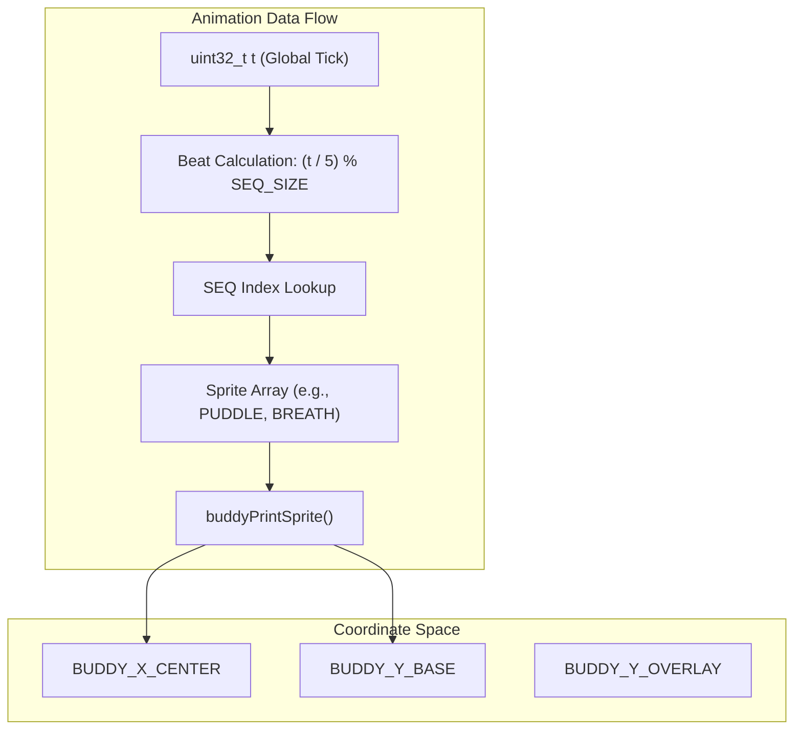
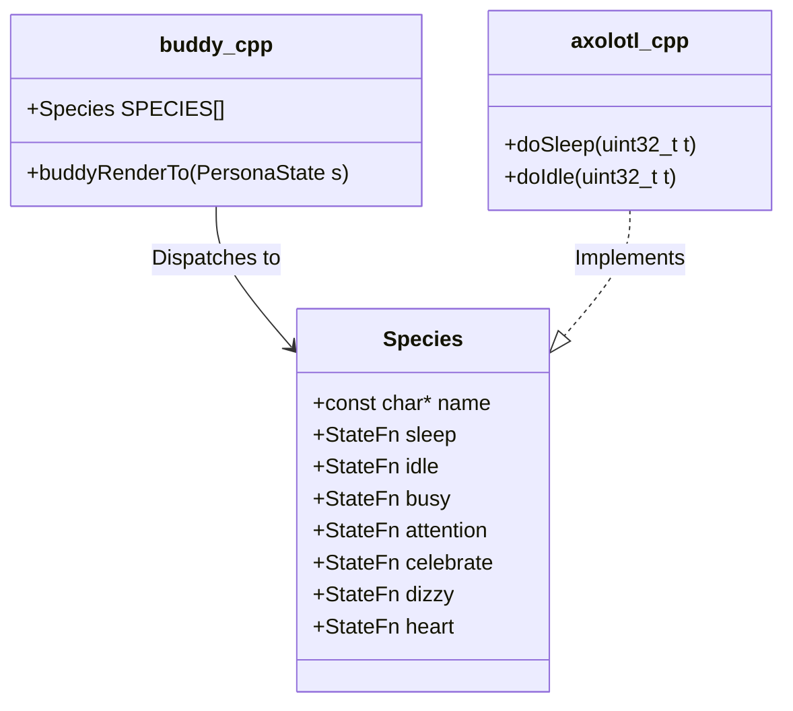

<!-- source: DeepWiki mcp.deepwiki.com · repo anthropics/claude-desktop-buddy · extra page Species Catalogue · fetched 2026-10-26 -->

# Species Catalogue

Relevant source files

The following files were used as context for generating this wiki page:

- [src/buddies/axolotl.cpp](src/buddies/axolotl.cpp)
- [src/buddies/blob.cpp](src/buddies/blob.cpp)
- [src/buddies/cactus.cpp](src/buddies/cactus.cpp)
- [src/buddies/capybara.cpp](src/buddies/capybara.cpp)
- [src/buddies/cat.cpp](src/buddies/cat.cpp)
- [src/buddies/chonk.cpp](src/buddies/chonk.cpp)
- [src/buddies/dragon.cpp](src/buddies/dragon.cpp)
- [src/buddies/duck.cpp](src/buddies/duck.cpp)
- [src/buddies/ghost.cpp](src/buddies/ghost.cpp)
- [src/buddies/goose.cpp](src/buddies/goose.cpp)
- [src/buddies/mushroom.cpp](src/buddies/mushroom.cpp)
- [src/buddies/octopus.cpp](src/buddies/octopus.cpp)
- [src/buddies/owl.cpp](src/buddies/owl.cpp)
- [src/buddies/penguin.cpp](src/buddies/penguin.cpp)
- [src/buddies/rabbit.cpp](src/buddies/rabbit.cpp)
- [src/buddies/robot.cpp](src/buddies/robot.cpp)
- [src/buddies/snail.cpp](src/buddies/snail.cpp)
- [src/buddies/turtle.cpp](src/buddies/turtle.cpp)

The ASCII Buddy system features 18 built-in species, each implemented as a standalone C++ file within the `src/buddies/` directory. These species are rendered using standard ASCII characters and special symbols, providing a lightweight yet expressive visual identity for the device's persona.

## Visual Design & Animation Logic

Each species follows a standardized animation pattern defined in `src/buddy.h` [src/buddy.h:12-21](). A species is encapsulated within its own namespace and exposes seven state-specific animation functions.

### The 7 Persona States
Every species must implement the following states to be compatible with the `PersonaState` enum in the main state machine [src/main.cpp:52-62]():

| State | Function Name | Typical Visual Behavior |
| :--- | :--- | :--- |
| **Sleep** | `doSleep` | Heavy breathing, "Z" particles, closed eyes (`--` or `..`). |
| **Idle** | `doIdle` | Looking left/right, blinking, small fidgets. |
| **Busy** | `doBusy` | Focused eyes (`vv`), typing/scribbling motions, progress tickers. |
| **Attention** | `doAttention` | Alert eyes (`OO`), "!" pulses, shivering or tense posture. |
| **Celebrate** | `doCelebrate` | Jumping, spinning, confetti particles, wide mouth (`WW`). |
| **Dizzy** | `doDizzy` | Spiraled eyes (`@@`), shaking, stars/swirls. |
| **Heart** | `doHeart` | Blushing, heart symbols (`<3`), happy expressions. |

### Implementation Pattern: `axolotl.cpp`
The `axolotl` species serves as the reference implementation for ASCII buddies. It uses a 5-line vertical sprite system [src/buddies/axolotl.cpp:14-20]().

*Sources: [src/buddies/axolotl.cpp:23-31](), [src/buddy_common.h:11-15]()*

## Built-in Species Catalogue

The following table details a selection of the 18 built-in species and their unique implementation characteristics.

| Species | Primary Color | Unique Animation Feature | Source |
| :--- | :--- | :--- | :--- |
| **Axolotl** | `0xFB1E` (Pink) | Drifting bubble stream using `BUDDY_CYAN`. | [src/buddies/axolotl.cpp:31-45]() |
| **Blob** | `0x07F0` (Green) | Slow droplet falling under the puddle in Sleep state. | [src/buddies/blob.cpp:45-48]() |
| **Cactus** | `0x07E0` (Green) | Bristling spines and flower blooming in Celebrate. | [src/buddies/cactus.cpp:95-100]() |
| **Cat** | `0xC2A6` (Brown) | Sassy micro-actions like ear twitches and grooming. | [src/buddies/cat.cpp:47-58]() |
| **Chonk** | `0xFD20` (Orange) | Heavy belly jiggle and cog/dot tickers. | [src/buddies/chonk.cpp:31-33]() |
| **Dragon** | `0xF800` (Red) | Smoke rings and gold-coin clinking tickers. | [src/buddies/dragon.cpp:41-44]() |
| **Duck** | `0xFFE0` (Yellow) | Floating on water waves (`~~~~`) and diving motions. | [src/buddies/duck.cpp:12-17]() |
| **Ghost** | `0xFFFF` (White) | Vertical Y-axis bobbing and transparency-fading poses. | [src/buddies/ghost.cpp:25-31]() |
| **Goose** | `0xFFFF` (White) | Aggressive "HONK!" overlays and lunging/charging. | [src/buddies/goose.cpp:94-100]() |
| **Octopus** | `0xA01F` (Purple) | Waving tentacles and drifting underwater motion. | [src/buddies/octopus.cpp:47-56]() |

*Sources: [src/buddies/axolotl.cpp:31](), [src/buddies/blob.cpp:28](), [src/buddies/cactus.cpp:28](), [src/buddies/cat.cpp:29](), [src/buddies/chonk.cpp:33](), [src/buddies/dragon.cpp:29](), [src/buddies/duck.cpp:28](), [src/buddies/ghost.cpp:31](), [src/buddies/goose.cpp:28](), [src/buddies/octopus.cpp:28]()*

## Adding a New Species

To add a new species (e.g., `my_buddy`), follow this technical checklist:

1.  **Create Source File**: Create `src/buddies/my_buddy.cpp`.
2.  **Define Namespace**: Wrap all functions in `namespace my_buddy { ... }`.
3.  **Implement State Functions**: Create the 7 static functions matching the `StateFn` signature: `void doState(uint32_t t)`.
4.  **Define Sprites**: Use `static const char* const POSE_NAME[5]` to define the 5-line ASCII frames.
5.  **Define Sequence**: Use a `static const uint8_t SEQ[]` array to map ticks to poses [src/buddies/axolotl.cpp:23-29]().
6.  **Register in `buddy.cpp`**:
    *   Add `extern Species my_buddy_spec;` [src/buddy.cpp:32]().
    *   Add the species to the `SPECIES[]` array [src/buddy.cpp:55]().

### Rendering Utilities
Species implementations use helper functions from `buddy_common.h` to maintain visual consistency:

*   `buddyPrintSprite(const char* const* lines, int n, int yOff, uint16_t color, int xOff)`: The primary function for drawing the 5-line ASCII block [src/buddy_common.h:18]().
*   `buddySetColor(uint16_t color)`: Sets the current TFT pen color [src/buddy_common.h:20]().
*   `buddySetCursor(int x, int y)`: Moves the draw pointer [src/buddy_common.h:19]().

*Sources: [src/buddy.h:12-21](), [src/buddy.cpp:35-56](), [src/buddies/axolotl.cpp:14-140]()*

---

