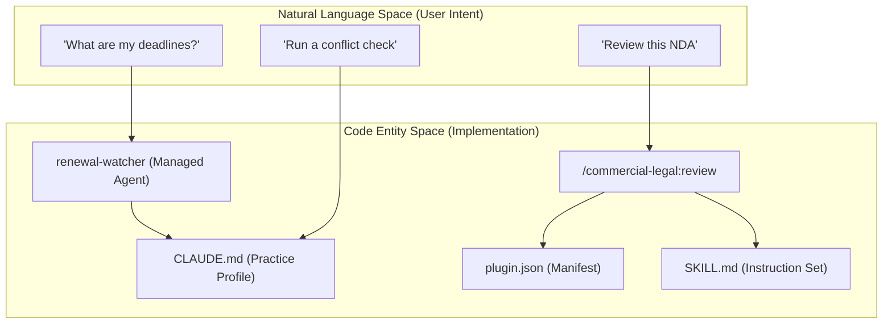
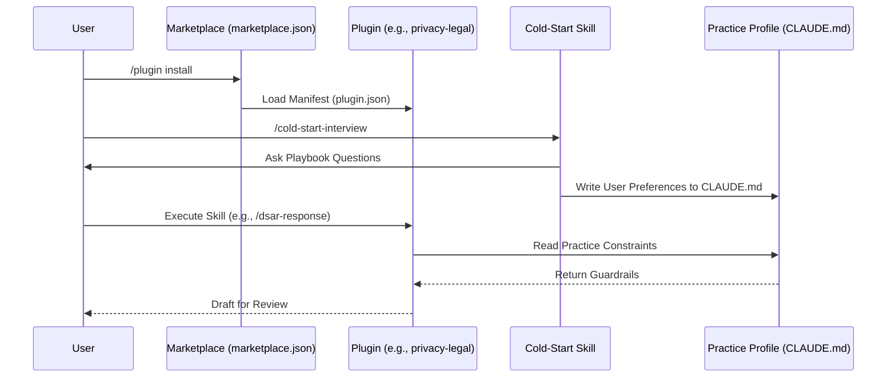

<!-- source: DeepWiki mcp.deepwiki.com · repo anthropics/claude-for-legal · page 1 Overview · fetched 2026-10-26 -->

# Overview

Relevant source files

The following files were used as context for generating this wiki page:

- [.claude-plugin/marketplace.json](.claude-plugin/marketplace.json)
- [QUICKSTART.md](QUICKSTART.md)
- [README.md](README.md)
- [ip-legal/skills/cold-start-interview/SKILL.md](ip-legal/skills/cold-start-interview/SKILL.md)

Claude for Legal is a suite of reference agents, skills, and data connectors designed to automate and accelerate legal workflows across in-house, law firm, and academic environments. It provides a unified architecture that can be deployed as a plugin for **Claude Cowork** and **Claude Code**, or as a fleet of **Claude Managed Agents** via API [README.md:1-8]().

The system is built on a "Human-in-the-Loop" philosophy: every output is a draft for attorney review. It incorporates explicit guardrails, including source attribution, jurisdiction surfacing, and mandatory verification gates before any legal action is taken [README.md:16-20]().

## System Architecture

The codebase bridges high-level legal intent (Natural Language Space) with executable automation (Code Entity Space). At its core, the system uses **Plugins** to define practice areas and **Skills** to execute specific tasks.

### Natural Language to Code Mapping
The following diagram illustrates how user-facing concepts map to specific codebase entities.

**Diagram: Legal Workflow Mapping**

Sources: [README.md:32-40](), [ip-legal/skills/cold-start-interview/SKILL.md:1-11](), [.claude-plugin/marketplace.json:1-112]()

### The Plugin Lifecycle
Every plugin follows a standardized lifecycle: installation via the central marketplace, a "cold-start" interview to learn the user's specific playbook, and execution of skills that reference a persistent practice profile.

**Diagram: Plugin Execution Flow**

Sources: [QUICKSTART.md:20-30](), [ip-legal/skills/cold-start-interview/SKILL.md:13-37](), [README.md:23-26]()

## Navigation Guide

The wiki is organized into the following major sections to help you navigate the codebase:

### 1.1 [Getting Started](#1.1)
Step-by-step instructions for installing plugins in Claude Cowork or Claude Code. Covers the critical distinction between **user-scoped** and **project-scoped** installations and how to verify MCP (Model Context Protocol) connector status [QUICKSTART.md:1-40]().

### 1.2 [Core Concepts and Terminology](#1.2)
Definitions of the foundational elements of the system:
*   **Practice Profile (`CLAUDE.md`)**: The living configuration file that stores a user's specific legal positions, risk appetite, and house style [ip-legal/skills/cold-start-interview/SKILL.md:60-65]().
*   **Skills**: Modular units of logic (defined in `SKILL.md` files) that perform specific legal tasks [README.md:23-24]().
*   **MCP Connectors**: The integration layer connecting Claude to external data sources like Google Drive, Ironclad, or CourtListener [README.md:25]().
*   **Cold-Start Interview**: The onboarding process that populates the practice profile [ip-legal/skills/cold-start-interview/SKILL.md:13-20]().

### 2. [Plugin Architecture](#2)
Overview of how plugins are structured, discovered, and configured. Covers the plugin manifest format, the marketplace registry, and the directory conventions for skills and agents [.claude-plugin/marketplace.json:8-126]().

### 3. [Practice-Area Plugins](#3)
Details on the twelve specialized plugins included in the repository, such as `commercial-legal`, `litigation-legal`, `ip-legal`, and `privacy-legal`. Each plugin is registered in the central marketplace manifest [.claude-plugin/marketplace.json:1-127]().

### 4. [Managed Agent Cookbooks](#4)
Technical guides for deploying "eyes-on-the-feed" workflows—scheduled agents that monitor external systems (e.g., a `docket-watcher` or `renewal-watcher`) and provide proactive alerts [README.md:37-38]().

### 5. [External Plugins](#5)
Covers third-party integrations, such as the `cocounsel-legal` plugin from Thomson Reuters, which extends the system with Westlaw Deep Research capabilities [.claude-plugin/marketplace.json:118-125]().

### 6. [Safety, Guardrails, and Output Quality](#6)
An overview of the security model, including the **Attorney-Review Model**, citation provenance tagging (e.g., `[verify]` markers), and the tiered security architecture for handling untrusted documents [README.md:16-20](), [QUICKSTART.md:73-74]().

### 7. [Developer and Contributor Guide](#7)
Instructions for contributors on how to write new skills, run validation scripts, and navigate the repository structure [README.md:21-27]().

---
**Sources:**
* [README.md:1-40]()
* [QUICKSTART.md:1-76]()
* [.claude-plugin/marketplace.json:1-127]()
* [ip-legal/skills/cold-start-interview/SKILL.md:1-100]()

---

