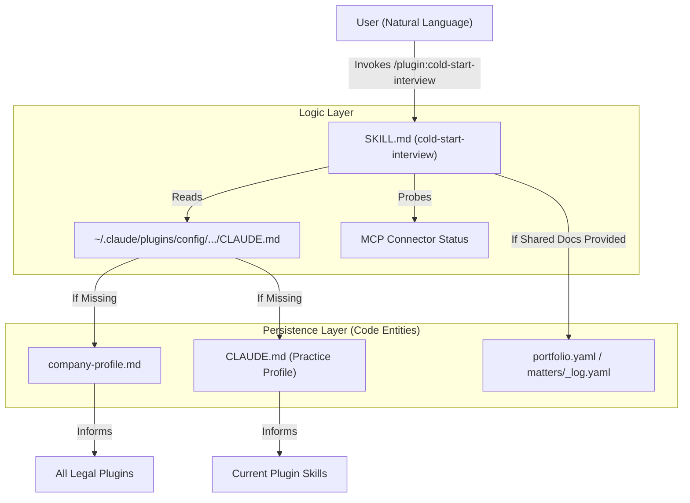
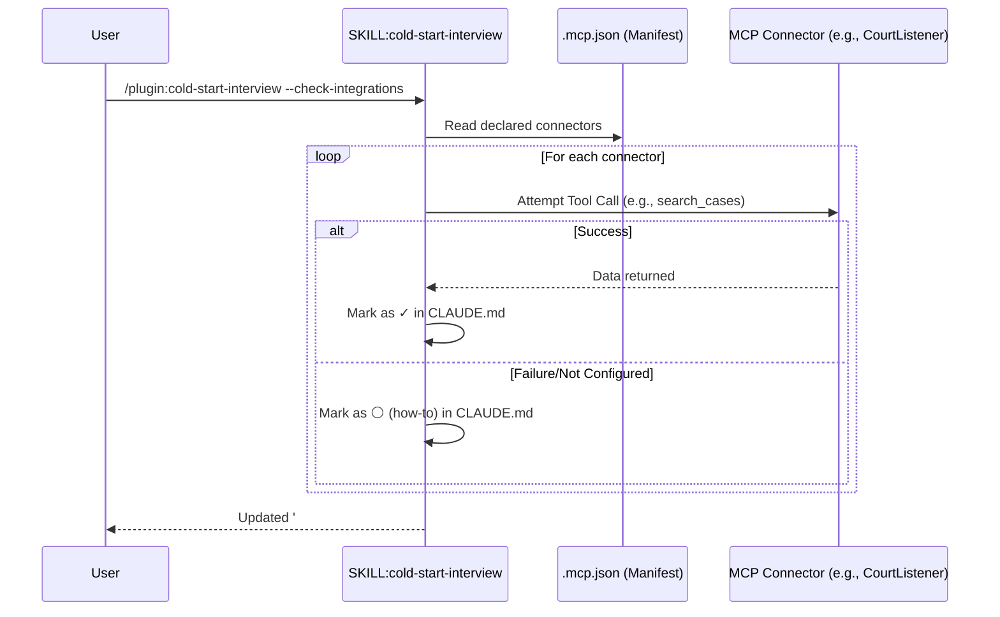

<!-- source: DeepWiki mcp.deepwiki.com · repo anthropics/claude-for-legal · page 1.1 Getting Started · fetched 2026-10-26 -->

# Getting Started

Relevant source files

The following files were used as context for generating this wiki page:

- [.claude-plugin/marketplace.json](.claude-plugin/marketplace.json)
- [QUICKSTART.md](QUICKSTART.md)
- [ip-legal/skills/cold-start-interview/SKILL.md](ip-legal/skills/cold-start-interview/SKILL.md)
- [regulatory-legal/skills/cold-start-interview/SKILL.md](regulatory-legal/skills/cold-start-interview/SKILL.md)

This page provides a technical guide for onboarding to the Claude for Legal platform. It covers the installation lifecycle, the critical "cold-start" configuration process, and the underlying security and integration models.

## Installation Overview

Claude for Legal is distributed as a suite of plugins that can be installed into **Claude Cowork** (Desktop/Web) or **Claude Code** (Terminal). While the core logic remains identical, the installation and discovery mechanisms differ slightly between environments.

### Marketplace Discovery
The platform uses a centralized manifest at `.claude-plugin/marketplace.json` [1-127]() to define available plugins. Each entry includes:
- **`name`**: The unique identifier used for installation (e.g., `commercial-legal`) [9-10]().
- **`source`**: The relative path to the plugin directory [12]().
- **`description`**: A functional summary of the plugin's capabilities [13]().

### Installation Steps (Claude Code)
1. **Register Marketplace**: Add the local repository as a plugin source.
   ` /plugin marketplace add <path-to-repo>` [QUICKSTART.md:16-18]()
2. **Install Plugin**: Target a specific practice area from the marketplace.
   ` /plugin install <plugin-name>@claude-for-legal` [QUICKSTART.md:22-23]()
3. **Restart**: A full restart of the Claude Code environment is required to load the new plugin manifest and skills [QUICKSTART.md:25]().

**Sources:**
- `.claude-plugin/marketplace.json:1-127`
- `QUICKSTART.md:16-25`

---

## User-Scoped vs. Project-Scoped Installs

A critical decision during installation is the **Scope**. This determines the filesystem boundaries of the plugin's execution environment.

| Scope | Filesystem Access | Recommended Use Case |
| :--- | :--- | :--- |
| **User-Scoped** | Can read files from any directory the user explicitly provides (e.g., `~/Downloads`, `~/Documents`). | **Recommended.** Essential for legal workflows where documents are scattered across local folders [QUICKSTART.md:38-39](). |
| **Project-Scoped** | Restricted to the current working directory only. | High-security environments where data must be siloed within a single folder [QUICKSTART.md:38](). |

> [!WARNING]
> Project-scoped installs will fail to read contract drafts or research memos located outside the immediate project root. If you encounter "I can't read [file]" errors, verify your scope [QUICKSTART.md:74-75]().

**Sources:**
- `QUICKSTART.md:34-41`
- `ip-legal/skills/cold-start-interview/SKILL.md:89-96`
- `regulatory-legal/skills/cold-start-interview/SKILL.md:43-50`

---

## The Cold-Start Interview

Every plugin requires a one-time configuration called the **Cold-Start Interview**. This process transforms the generic plugin into a tool calibrated to a specific legal practice's "playbook."

### Data Flow and Persistence
The interview populates two primary configuration files in the user's config directory (`~/.claude/plugins/config/claude-for-legal/`):
1. **`company-profile.md`**: Shared metadata (Company name, industry, jurisdictions, risk appetite) [regulatory-legal/skills/cold-start-interview/SKILL.md:36-42]().
2. **`CLAUDE.md`**: Plugin-specific practice profiles (Specific clauses, enforcement thresholds, approval chains) [regulatory-legal/skills/cold-start-interview/SKILL.md:9-12]().

### Logic Flow: `cold-start-interview`
The interview logic is defined in each plugin's `skills/cold-start-interview/SKILL.md`.

#### Cold-Start State Machine
The system checks the state of `CLAUDE.md` to determine the interview branch:
- **Missing/Placeholders**: Triggers the full interview [regulatory-legal/skills/cold-start-interview/SKILL.md:24-28]().
- **`<!-- SETUP PAUSED AT: -->`**: Resumes from the last saved state [regulatory-legal/skills/cold-start-interview/SKILL.md:26]().
- **Populated**: Skips interview unless `--redo` is passed [regulatory-legal/skills/cold-start-interview/SKILL.md:28]().

### Diagram: Configuration Initialization
This diagram bridges the Natural Language interaction of the interview to the Code Entity Space where configuration is persisted.

**Sources:**
- `regulatory-legal/skills/cold-start-interview/SKILL.md:9-42`
- `ip-legal/skills/cold-start-interview/SKILL.md:15-37`
- `QUICKSTART.md:61-62`

---

## Verifying MCP Connector Status

Model Context Protocol (MCP) connectors provide the "eyes" for the plugins, allowing them to see into external systems like Ironclad, iManage, or CourtListener.

### The Verification Mechanism
Citations generated by the model are flagged based on the presence of an active research connector:
- **`[verify]`**: Indicates a citation generated from the model's training data (unverified) [QUICKSTART.md:32-33]().
- **Verified Citations**: Occur only when an MCP tool call successfully returns data from a live database [regulatory-legal/skills/cold-start-interview/SKILL.md:14]().

### Running Integration Checks
To verify or refresh the status of connected tools without re-running the full interview, use the `--check-integrations` flag:
`/<plugin>:cold-start-interview --check-integrations` [regulatory-legal/skills/cold-start-interview/SKILL.md:9]().

### Diagram: Connector Verification Data Flow
This diagram illustrates how the `cold-start-interview` skill interacts with the MCP layer to verify tool availability.

**Sources:**
- `regulatory-legal/skills/cold-start-interview/SKILL.md:9-15`
- `ip-legal/skills/cold-start-interview/SKILL.md:38-43`
- `QUICKSTART.md:32-33`

---

## Troubleshooting Initial Setup

| Symptom | Cause | Resolution |
| :--- | :--- | :--- |
| `Command not found` | Plugin manifest not loaded. | Restart Claude Code [QUICKSTART.md:71](). |
| `Run setup first` | Missing `CLAUDE.md`. | Run `/<plugin>:cold-start-interview` [QUICKSTART.md:72](). |
| `[verify]` markers on every cite | No research MCP connected. | Connect a tool like CourtListener or Westlaw [QUICKSTART.md:73](). |
| `I can't read [file]` | Project-scope restriction. | Reinstall with user scope or move file to current folder [QUICKSTART.md:74-75](). |

**Sources:**
- `QUICKSTART.md:70-76`

---

