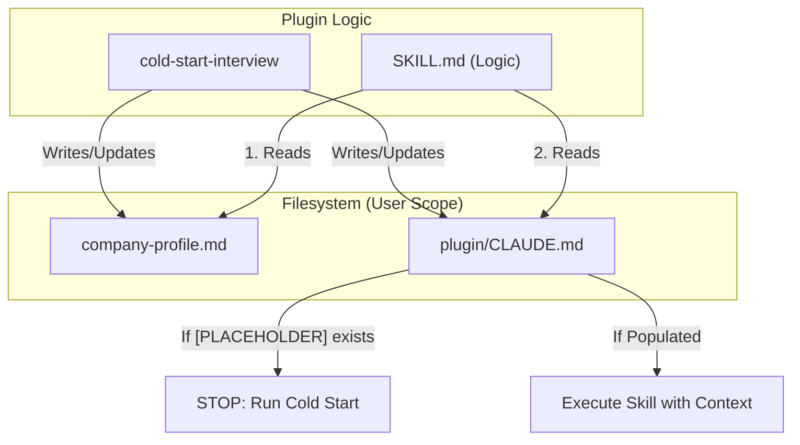
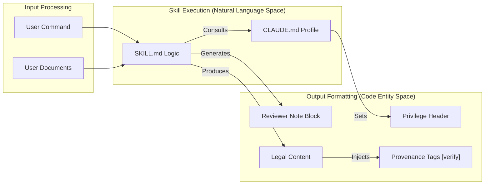

<!-- source: DeepWiki mcp.deepwiki.com · repo anthropics/claude-for-legal · page 1.2 Core Concepts and Terminology · fetched 2026-10-26 -->

# Core Concepts and Terminology

Relevant source files

The following files were used as context for generating this wiki page:

- [CLAUDE.md](CLAUDE.md)
- [README.md](README.md)
- [ai-governance-legal/README.md](ai-governance-legal/README.md)
- [ai-governance-legal/skills/customize/SKILL.md](ai-governance-legal/skills/customize/SKILL.md)
- [commercial-legal/skills/customize/SKILL.md](commercial-legal/skills/customize/SKILL.md)
- [references/company-profile-template.md](references/company-profile-template.md)

This page explains the foundational concepts shared across the Claude for Legal ecosystem. It serves as a technical primer for the architectural patterns, data structures, and safety models that underpin all twelve practice-area plugins.

## The Practice Profile (`CLAUDE.md`)

The **Practice Profile** is the central configuration mechanism for every plugin. It is a Markdown file named `CLAUDE.md` that defines the specific "playbook" for a legal team, including their risk appetite, preferred terms, and jurisdictional footprint [README.md:23-23]().

### Configuration Lifecycle
1.  **Template:** Each plugin ships with a template `CLAUDE.md` containing `[PLACEHOLDER]` markers [CLAUDE.md:15-15]().
2.  **User Config:** At runtime, skills read from a user-specific path: `~/.claude/plugins/config/claude-for-legal/<plugin-name>/CLAUDE.md` [commercial-legal/skills/customize/SKILL.md:24-25]().
3.  **Company Profile:** Global facts (company name, industry, jurisdictions) are stored in a shared `company-profile.md` one level above the plugin-specific config to ensure consistency across the suite [references/company-profile-template.md:1-4]().

### Data Flow: Profile Resolution
The following diagram illustrates how a skill resolves the final instructions by combining the static Skill logic with the dynamic Practice Profile.

**Practice Profile Resolution Flow**

Sources: [commercial-legal/skills/customize/SKILL.md:24-31](), [ai-governance-legal/skills/customize/SKILL.md:24-31]()

---

## Cold-Start Interview

The **Cold-Start Interview** is the mandatory onboarding process for every plugin. It is implemented as a specialized skill (e.g., `/commercial-legal:cold-start-interview`) that uses a "Socratic" approach to extract a user's legal preferences [ai-governance-legal/README.md:19-24]().

### Key Functions
*   **Integration Probing:** Checks for active MCP connectors (Slack, Google Drive, Ironclad, etc.) and updates the configuration [ai-governance-legal/skills/customize/SKILL.md:57-58]().
*   **Seed Document Extraction:** Requests and parses "seed" documents (like an AI policy or a reference impact assessment) to extract actual legal positions and house style [ai-governance-legal/README.md:21-24]().
*   **Practice Setting Calibration:** Determines the user's role (e.g., In-house, Firm, Clinic) to adjust the shared `company-profile.md` [references/company-profile-template.md:6-6]().

Sources: [ai-governance-legal/README.md:19-28](), [references/company-profile-template.md:1-32]()

---

## MCP Connectors

The **Model Context Protocol (MCP)** is the integration layer that allows Claude for Legal to interact with external systems. Connectors are declared in `.mcp.json` files within each plugin [CLAUDE.md:14-14]().

### Core Connector Types
| Type | Examples | Role in Codebase |
| :--- | :--- | :--- |
| **Productivity** | Google Drive, Slack, Box | Used for reading source files and sending alerts [README.md:25-25](). |
| **Legal-Specific** | Ironclad, DocuSign, iManage | Used for contract management and document storage [README.md:25-25](). |
| **Research** | CourtListener, Westlaw | Used for verifying citations and pulling case law [README.md:25-25](). |

### The `[verify]` Fallback
When a research tool is not connected, the system defaults to "Training Data" mode. Every citation is automatically tagged with `[verify]` to warn the attorney that the information was not pulled from a live legal database [ai-governance-legal/README.md:8-8](), [ai-governance-legal/skills/customize/SKILL.md:110-111]().

Sources: [README.md:25-25](), [CLAUDE.md:14-14](), [ai-governance-legal/skills/customize/SKILL.md:95-111]()

---

## Safety and the Attorney-Review Model

Claude for Legal operates on a "Human-in-the-loop" (HITL) model. No output is considered a final legal conclusion; every artifact is a **draft for attorney review** [README.md:17-17]().

### Provenance Tags and Markers
The system uses specific markers to communicate confidence and source:
*   **`[verify]`**: Information sourced from model training data, not a connected research tool [ai-governance-legal/README.md:8-8]().
*   **`[review]`**: Flags specific lines that require subjective legal judgment or "attorney calls" [ai-governance-legal/skills/customize/SKILL.md:106-108]().
*   **Privilege Markers**: Prepended to outputs to prevent accidental waiver of attorney-client privilege [ai-governance-legal/README.md:8-8]().

### The Reviewer Note
A standardized pre-flight block at the top of major deliverables. It explains the reasoning, risk posture used, and any missing information that needs verification [ai-governance-legal/README.md:8-8]().

**Output Generation Architecture**

Sources: [ai-governance-legal/README.md:8-9](), [ai-governance-legal/skills/customize/SKILL.md:95-111]()

---

## Managed Agents and Skills

The codebase distinguishes between **Skills** and **Managed Agents**:

*   **Skills:** Atomic units of functionality (e.g., `/vendor-ai-review`, `/use-case-triage`) that run within a user's active session [ai-governance-legal/README.md:32-42]().
*   **Managed Agents:** Scheduled or background workflows (e.g., "Renewal Watcher", "Policy Monitor") that run autonomously behind an API [README.md:37-37](), [ai-governance-legal/README.md:54-54](). They are defined via `agent.yaml` manifests in `managed-agent-cookbooks/` [CLAUDE.md:22-22]().

Sources: [README.md:7-7](), [CLAUDE.md:22-26](), [ai-governance-legal/README.md:44-57]()

---

