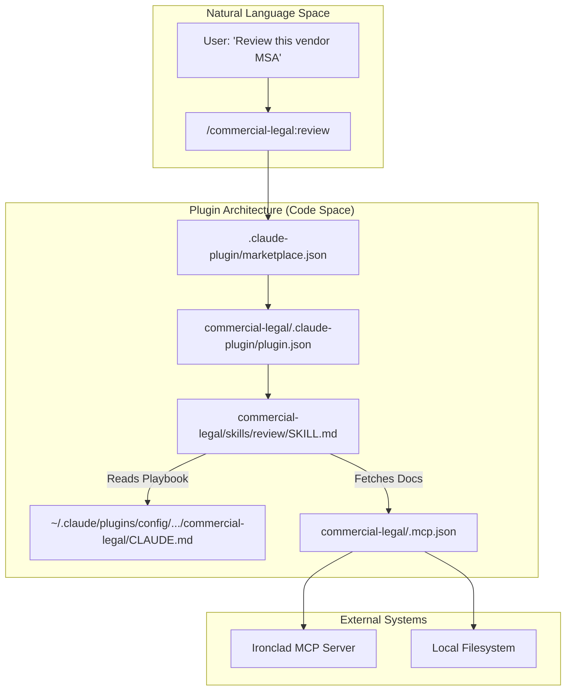
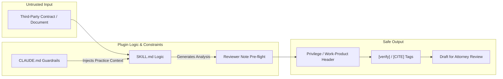

<!-- source: DeepWiki mcp.deepwiki.com · repo anthropics/claude-for-legal · page 2 Plugin Architecture · fetched 2026-10-26 -->

# Plugin Architecture

Relevant source files

The following files were used as context for generating this wiki page:

- [.claude-plugin/marketplace.json](.claude-plugin/marketplace.json)
- [CLAUDE.md](CLAUDE.md)
- [README.md](README.md)
- [ai-governance-legal/README.md](ai-governance-legal/README.md)
- [ai-governance-legal/skills/customize/SKILL.md](ai-governance-legal/skills/customize/SKILL.md)
- [commercial-legal/skills/customize/SKILL.md](commercial-legal/skills/customize/SKILL.md)

Claude for Legal is built on a modular, decentralized architecture where legal domain expertise is encapsulated into individual plugins. Each plugin is a self-contained unit containing the logic (Skills), configuration (Practice Profiles), and connectivity (MCP Connectors) required to handle specific legal workflows.

This architecture allows the system to run across multiple environments—as a **Claude Cowork** or **Claude Code** plugin, or as a **Managed Agent** via API—using the same underlying manifests and logic [README.md:7-7]().

## Core Components

The architecture relies on four primary pillars to bridge natural language legal requests with executable code and data:

1.  **Marketplace Registry**: A global manifest (`.claude-plugin/marketplace.json`) that catalogs all available plugins, their sources, and descriptions [CLAUDE.md:11-11](), [.claude-plugin/marketplace.json:1-127]().
2.  **Plugin Manifests**: Local `plugin.json` declarations within each plugin directory that define identity, versioning, and entry points [CLAUDE.md:13-13]().
3.  **Practice Profiles (CLAUDE.md)**: Markdown-based configuration templates that store user-specific playbooks, risk appetites, and jurisdictional settings [README.md:23-23](), [CLAUDE.md:90-94]().
4.  **Skills**: Task-specific instruction sets and tools (e.g., `/commercial-legal:review`) located in `skills/<name>/SKILL.md` that execute legal workflows [README.md:32-34](), [CLAUDE.md:17-17]().
5.  **MCP Connectors**: Standardized integrations via the Model Context Protocol declared in `.mcp.json` to connect to systems like Ironclad, CourtListener, or Google Drive [README.md:25-25](), [CLAUDE.md:14-14]().

### Natural Language to Code Mapping

The following diagram illustrates how a user's intent in "Natural Language Space" is routed through the architecture to specific code entities.

**Diagram: Intent Routing and Entity Association**

**Sources:** [README.md:23-35](), [CLAUDE.md:11-17](), [.claude-plugin/marketplace.json:9-17]()

---

## Plugin Structure and Manifests
Each plugin follows a strict directory convention to ensure interoperability. The `plugin.json` file serves as the local registry entry, while the `skills/` directory contains individual `SKILL.md` files that define the system prompts for specific legal tasks.

For details, see [Plugin Structure and Manifests](#2.1).

**Sources:** [CLAUDE.md:9-26](), [README.md:23-27]()

---

## Practice Profiles and Cold-Start System
A core innovation of the architecture is the **Practice Profile**, stored in `CLAUDE.md`. Unlike standard documentation, this file serves as a dynamic configuration layer populated via a **Cold-Start Interview**.

*   **Company Profile**: A shared `company-profile.md` (located in `references/` or user config) stores cross-plugin facts like entity name, industry, and jurisdictions [commercial-legal/skills/customize/SKILL.md:26-26](), [ai-governance-legal/skills/customize/SKILL.md:26-26]().
*   **Practice Profile**: A plugin-specific `CLAUDE.md` template is copied to the user's local config directory and updated to store domain-specific data, such as "NDA triage preferences" [CLAUDE.md:90-94](), [commercial-legal/skills/customize/SKILL.md:46-47]().
*   **Cold-Start**: A specialized skill (e.g., `/commercial-legal:cold-start-interview`) that interviews the user to replace `[PLACEHOLDER]` markers with actual practice data [commercial-legal/README.md:27-27](), [ai-governance-legal/README.md:34-34]().

For details, see [Practice Profiles and Cold-Start System](#2.2).

**Sources:** [CLAUDE.md:90-94](), [commercial-legal/skills/customize/SKILL.md:24-56](), [ai-governance-legal/skills/customize/SKILL.md:24-58]()

---

## MCP Connectors
The architecture uses the **Model Context Protocol (MCP)** to decouple legal logic from third-party APIs. Connectors are declared in `.mcp.json` and allow skills to perform research or document retrieval. The architecture supports both first-party connectors and external vendor plugins like **CoCounsel** [README.md:25-25](), [.claude-plugin/marketplace.json:118-125]().

For details, see [MCP Connectors](#2.3).

**Sources:** [README.md:25-25](), [CLAUDE.md:14-14](), [.claude-plugin/marketplace.json:118-125]()

---

## Security and Guardrails
The architecture enforces strict safety protocols including mandatory "Attorney Review" markers and citation provenance tagging. Skills are prohibited from removing these load-bearing guardrails [commercial-legal/skills/customize/SKILL.md:95-100](), [ai-governance-legal/skills/customize/SKILL.md:101-111]().

### Data Flow and Security Boundaries

**Diagram: Security and Data Lifecycle**

**Sources:** [README.md:16-19](), [commercial-legal/skills/customize/SKILL.md:95-100](), [ai-governance-legal/skills/customize/SKILL.md:101-111]()

---

## Plugin Lifecycle
1.  **Discovery**: The system reads `.claude-plugin/marketplace.json` to identify available plugins [CLAUDE.md:11-11]().
2.  **Installation**: Plugins are initialized in the user's environment, often involving the setup of a local configuration path [CLAUDE.md:90-92]().
3.  **Initialization**: The user runs the `cold-start-interview` to populate their `CLAUDE.md` practice profile from seed documents and interview responses [ai-governance-legal/README.md:19-24]().
4.  **Execution**: When a command is invoked, the corresponding skill reads the local `CLAUDE.md` to calibrate its legal analysis to the user's specific playbook [commercial-legal/skills/customize/SKILL.md:24-25]().

**Sources:** [README.md:9-12](), [CLAUDE.md:11-17](), [ai-governance-legal/README.md:19-24]()

---

