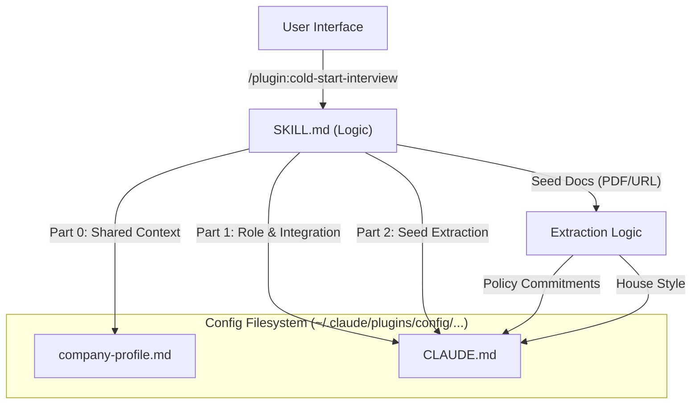
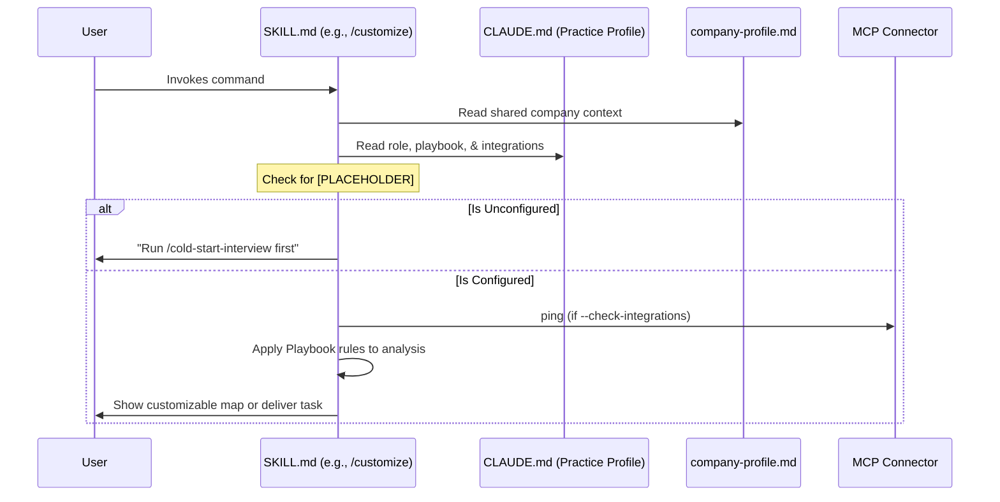

<!-- source: DeepWiki mcp.deepwiki.com · repo anthropics/claude-for-legal · page 2.2 Practice Profiles and Cold-Start System · fetched 2026-10-26 -->

# Practice Profiles and Cold-Start System

Relevant source files

The following files were used as context for generating this wiki page:

- [CLAUDE.md](CLAUDE.md)
- [ai-governance-legal/README.md](ai-governance-legal/README.md)
- [ai-governance-legal/skills/cold-start-interview/SKILL.md](ai-governance-legal/skills/cold-start-interview/SKILL.md)
- [ai-governance-legal/skills/customize/SKILL.md](ai-governance-legal/skills/customize/SKILL.md)
- [commercial-legal/skills/cold-start-interview/SKILL.md](commercial-legal/skills/cold-start-interview/SKILL.md)
- [commercial-legal/skills/customize/SKILL.md](commercial-legal/skills/customize/SKILL.md)
- [law-student/skills/cold-start-interview/SKILL.md](law-student/skills/cold-start-interview/SKILL.md)
- [litigation-legal/skills/cold-start-interview/SKILL.md](litigation-legal/skills/cold-start-interview/SKILL.md)
- [references/company-profile-template.md](references/company-profile-template.md)
- [regulatory-legal/skills/cold-start-interview/SKILL.md](regulatory-legal/skills/cold-start-interview/SKILL.md)

The **Practice Profile** system is the configuration backbone of Claude for Legal. It ensures that every skill across the twelve practice-area plugins operates with a consistent understanding of the user's organization, risk appetite, and jurisdictional constraints [regulatory-legal/skills/cold-start-interview/SKILL.md:20-22](). The **Cold-Start Interview** is the automated lifecycle process that initializes these profiles by interviewing the user and extracting data from seed documents [commercial-legal/skills/cold-start-interview/SKILL.md:71-75]().

## The Profile Hierarchy

Configuration is split into two layers to balance cross-plugin consistency with practice-specific depth.

### 1. Shared Company Profile (`company-profile.md`)
This file contains global facts shared by all 12 plugins. It is located at `~/.claude/plugins/config/claude-for-legal/company-profile.md` [regulatory-legal/skills/cold-start-interview/SKILL.md:36-39]().
*   **Fields:** Practice setting, company name, industry, products/services, size, jurisdictions, and regulators [references/company-profile-template.md:6-16]().
*   **Logic:** The first plugin a user sets up writes this file using the `references/company-profile-template.md` [regulatory-legal/skills/cold-start-interview/SKILL.md:39](). Subsequent plugins read it and skip redundant questions [ai-governance-legal/skills/cold-start-interview/SKILL.md:64-67]().

### 2. Practice-Area Profile (`CLAUDE.md`)
Each plugin maintains its own `CLAUDE.md` file in a dedicated config path (e.g., `~/.claude/plugins/config/claude-for-legal/commercial-legal/CLAUDE.md`) [commercial-legal/skills/cold-start-interview/SKILL.md:5-9]().
*   **Role:** Defines the user's specific role (e.g., in-house, firm associate, or solo in litigation), which routes the profile structure [litigation-legal/skills/cold-start-interview/SKILL.md:12-13]().
*   **Playbooks:** Stores substantive legal positions, such as sales-side vs. purchasing-side contract fallbacks [commercial-legal/skills/cold-start-interview/SKILL.md:42-49]().
*   **Integrations:** Tracks the status of MCP connectors (e.g., CLM, document storage, Slack) [commercial-legal/skills/cold-start-interview/SKILL.md:38-41]().

**Sources:** [regulatory-legal/skills/cold-start-interview/SKILL.md:34-42](), [references/company-profile-template.md:1-33](), [litigation-legal/skills/cold-start-interview/SKILL.md:11-15](), [commercial-legal/skills/cold-start-interview/SKILL.md:78-90]().

---

## Cold-Start Interview Lifecycle

The interview is triggered via the `/:cold-start-interview` command. It is a mandatory prerequisite; skills check for `[PLACEHOLDER]` markers or `<!-- SETUP PAUSED AT: -->` comments to determine if they should prompt the user to complete setup [ai-governance-legal/skills/cold-start-interview/SKILL.md:50-54]().

### Data Flow: Interview to Profile
The following diagram illustrates how the `cold-start-interview` skill populates the filesystem entities.

**Cold-Start Data Routing**

**Sources:** [regulatory-legal/skills/cold-start-interview/SKILL.md:7-14](), [ai-governance-legal/skills/cold-start-interview/SKILL.md:13-20](), [commercial-legal/skills/cold-start-interview/SKILL.md:13-35]().

### Branching Logic and Seed Extraction
The interview logic adapts based on the plugin's domain:
*   **Commercial:** Branches into "Sales-side" or "Purchasing-side" playbooks via the `--side` flag [commercial-legal/skills/cold-start-interview/SKILL.md:84-89]().
*   **Litigation:** Branches by role (In-house, Firm, Solo) and side (Plaintiff, Defense, Both) [litigation-legal/skills/cold-start-interview/SKILL.md:12-13]().
*   **Law Student:** Branches by learning style ("drill-me" vs. "explain-to-me") and current class year [law-student/skills/cold-start-interview/SKILL.md:80-82]().
*   **Seed Extraction:** The system reads provided documents (e.g., signed agreements, AI policies, or prior impact assessments) to extract actual playbook positions and house style, noting deltas between stated positions and reality [commercial-legal/skills/cold-start-interview/SKILL.md:23-26](), [ai-governance-legal/skills/cold-start-interview/SKILL.md:17-18]().

---

## Runtime Profile Integration

Every skill execution begins by reading the relevant profiles. This ensures that Claude's "Natural Language Space" is constrained by the "Code Entity Space" of the configuration files.

**Runtime Skill Execution Flow**

**Sources:** [commercial-legal/skills/customize/SKILL.md:24-31](), [ai-governance-legal/skills/customize/SKILL.md:24-31](), [regulatory-legal/skills/cold-start-interview/SKILL.md:22-29]().

### Data Migration and Pause/Resume
*   **Migration:** The system automatically checks for legacy profiles in `~/.claude/plugins/cache/`. If a populated profile exists there but not in the `config` path, it migrates the file forward to ensure persistence [ai-governance-legal/skills/cold-start-interview/SKILL.md:19](), [law-student/skills/cold-start-interview/SKILL.md:14]().
*   **Pause/Resume:** If an interview is interrupted, the system writes an `<!-- SETUP PAUSED AT: -->` comment in the `CLAUDE.md` template. Upon re-running, the skill offers to resume from that specific section [regulatory-legal/skills/cold-start-interview/SKILL.md:26-27]().
*   **Integration Verification:** The `--check-integrations` flag allows users to re-probe MCP connectors. The skill only reports a success (✓) if a tool call actually succeeds, preventing misleading "configured but broken" statuses [regulatory-legal/skills/cold-start-interview/SKILL.md:14](), [litigation-legal/skills/cold-start-interview/SKILL.md:26]().

**Sources:** [regulatory-legal/skills/cold-start-interview/SKILL.md:9-14](), [ai-governance-legal/skills/cold-start-interview/SKILL.md:25-27](), [commercial-legal/skills/customize/SKILL.md:15-20]().

---

