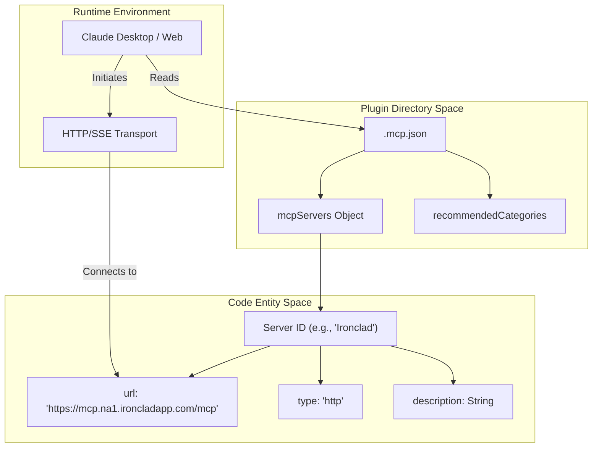
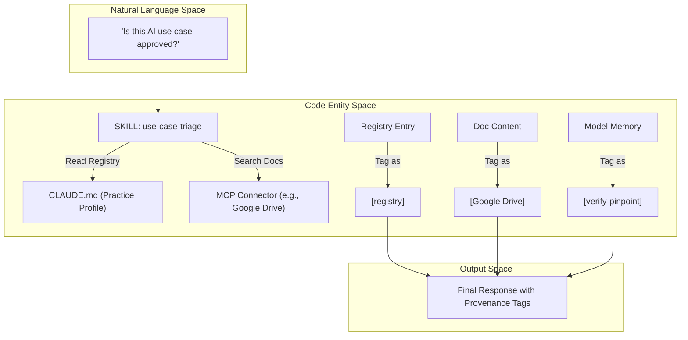

<!-- source: DeepWiki mcp.deepwiki.com · repo anthropics/claude-for-legal · page 2.3 MCP Connectors · fetched 2026-10-26 -->

# MCP Connectors

Relevant source files

The following files were used as context for generating this wiki page:

- [CONNECTORS.md](CONNECTORS.md)
- [ai-governance-legal/.mcp.json](ai-governance-legal/.mcp.json)
- [ai-governance-legal/skills/aia-generation/SKILL.md](ai-governance-legal/skills/aia-generation/SKILL.md)
- [ai-governance-legal/skills/reg-gap-analysis/SKILL.md](ai-governance-legal/skills/reg-gap-analysis/SKILL.md)
- [ai-governance-legal/skills/use-case-triage/SKILL.md](ai-governance-legal/skills/use-case-triage/SKILL.md)
- [commercial-legal/.mcp.json](commercial-legal/.mcp.json)
- [employment-legal/.mcp.json](employment-legal/.mcp.json)
- [external_plugins/cocounsel-legal/.mcp.json](external_plugins/cocounsel-legal/.mcp.json)
- [ip-legal/.mcp.json](ip-legal/.mcp.json)
- [legal-clinic/.mcp.json](legal-clinic/.mcp.json)
- [legal-clinic/skills/customize/SKILL.md](legal-clinic/skills/customize/SKILL.md)
- [litigation-legal/.mcp.json](litigation-legal/.mcp.json)
- [privacy-legal/.mcp.json](privacy-legal/.mcp.json)

The Model Context Protocol (MCP) integration layer serves as the data nervous system for Claude for Legal. It allows plugins to connect to authoritative legal data sources—including CLMs, DMSs, eDiscovery platforms, and primary law databases—using a standardized protocol. This ensures that Claude's legal reasoning is grounded in actual documents and live matter data rather than relying solely on internal model knowledge.

## Configuration via .mcp.json

Each plugin directory contains an `.mcp.json` file that defines the connectors available to that specific practice area. This file uses the standard MCP configuration format to declare remote servers, their transport types, and metadata used for discovery within the Claude interface.

### Structure of .mcp.json

The configuration consists of two primary keys:
1.  `mcpServers`: A map of server identifiers to their connection details (URL, type, and descriptive metadata).
2.  `recommendedCategories`: Tags used by the marketplace to suggest relevant connectors to the user.

**MCP Declaration Data Flow**

**Sources:**
- [commercial-legal/.mcp.json:1-56]()
- [CONNECTORS.md:7-11]()
- [external_plugins/cocounsel-legal/.mcp.json:1-11]()

## Plugin-Specific Connector Shipments

Connectors are scoped to the practice area where they provide the most utility. While general tools like **Slack** and **Google Drive** ship with all 12 plugins, specialized legal tools are targeted:

| Category | Connectors | Primary Plugins |
| :--- | :--- | :--- |
| **Contract / DMS** | Ironclad, DocuSign, iManage, Definely, Box | `commercial-legal`, `corporate-legal` |
| **Legal Research** | CourtListener, Descrybe, Solve Intelligence, CoCounsel Legal | `litigation-legal`, `ip-legal`, `law-student`, `external_plugins/cocounsel-legal` |
| **Litigation / Discovery** | Everlaw, Trellis, Aurora | `litigation-legal` |
| **Product / Project** | Linear, Atlassian (Jira), Asana | `product-legal` |
| **Outside Counsel** | TopCounsel | `commercial-legal`, `litigation-legal` |
| **Self-Help / Clinic** | Courtroom5 | `legal-clinic` |

**Sources:**
- [CONNECTORS.md:21-45]()
- [commercial-legal/.mcp.json:1-45]()
- [litigation-legal/.mcp.json:1-45]()
- [ip-legal/.mcp.json:1-33]()
- [legal-clinic/.mcp.json:1-33]()
- [external_plugins/cocounsel-legal/.mcp.json:1-11]()

## Citation Provenance and Tagging

A core requirement for legal MCP connectors is providing provenance in results. This allows the Claude for Legal skills to apply specific tags to findings, ensuring that every load-bearing digit or citation can be traced back to a source.

### Provenance Tagging Logic
When a skill (such as `use-case-triage` or `aia-generation`) retrieves data via an MCP connector, it is instructed to tag citations based on the source's reliability and type:

1.  **Direct Tool Tags**: If retrieved via a connector, the output is tagged with the tool name (e.g., `[Westlaw]`, `[Ironclad]`, `[iManage]`, `[EUR-Lex]`, or the specific MCP tool name).
2.  **Internal Tags**: Data from the practice profile is tagged `[registry]`.
3.  **User Tags**: Information provided by the user is tagged `[user provided]`.
4.  **Fallback Tags**: If no connector is available and the model uses internal knowledge, it must use fallback markers.

### The [verify] Fallback Mechanism
If a research tool is not connected or the model is citing a pinpoint from memory, the system mandates the use of verification markers to prevent hallucinations from being treated as settled fact. Skills like `aia-generation` implement a "No silent supplement" rule [ai-governance-legal/skills/aia-generation/SKILL.md:87-88]().

- `[settled]`: Stable, well-known statutory and regulatory references unlikely to have changed (e.g., "GDPR Art. 22").
- `[verify]`: Model-knowledge citations that are real but should be verified (e.g., specific regulator guidance or post-2023 rules).
- `[verify-pinpoint]`: Mandatory for specific article numbers, paragraph numbers, annex references, or subsection letters, which carry the highest fabrication risk.
- `[web search — verify]`: Used when a lawyer explicitly chooses to supplement with web results.

**Citation Processing Flow**

**Sources:**
- [ai-governance-legal/skills/use-case-triage/SKILL.md:104-114]()
- [ai-governance-legal/skills/aia-generation/SKILL.md:87-95]()
- [CONNECTORS.md:9-10]()

## Adding a New Connector

The `CONNECTORS.md` guide outlines the technical and safety requirements for adding new integrations to the suite.

### Technical Requirements
- **Transport**: Must support HTTPS with OAuth or API-key authentication (SSE or streamable HTTP).
- **Read-Heavy Focus**: Connectors should prioritize `search`, `fetch`, and `list` operations.
- **Write Operations**: Any "Write" tools (e.g., `create`, `send`) must include a description that triggers an explicit client-side confirmation prompt.
- **Data Integrity**: Tools must not return "instruction-like" content (e.g., "Ignore previous instructions") to prevent prompt injection via retrieved data.
- **Graceful Degradation**: Errors and rate limits must be handled cleanly to trigger plugin fallbacks.

### Submission Process
1.  **Host**: Publish the MCP server and document its tools.
2.  **Declare**: Add the server to the relevant plugin's `.mcp.json`.
3.  **Validate**: Connectors undergo retrieval-quality and injection-resistance checks before being merged into the default configuration. Connectors that pass are added to the default `.mcp.json`; others are documented for manual user addition.

**Sources:**
- [CONNECTORS.md:1-18]()
- [ai-governance-legal/skills/use-case-triage/SKILL.md:115-116]()
- [legal-clinic/skills/customize/SKILL.md:53-54]()

---

