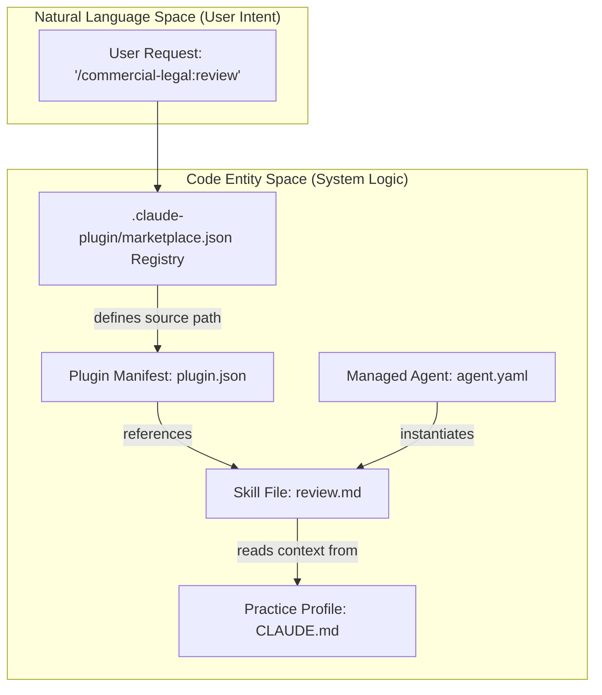
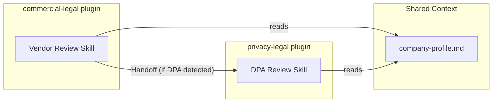

<!-- source: DeepWiki mcp.deepwiki.com · repo anthropics/claude-for-legal · page 3 Practice-Area Plugins · fetched 2026-10-26 -->

# Practice-Area Plugins

Relevant source files

The following files were used as context for generating this wiki page:

- [.claude-plugin/marketplace.json](.claude-plugin/marketplace.json)
- [README.md](README.md)

The Claude for Legal ecosystem is organized into twelve distinct practice-area plugins. Each plugin is a self-contained unit comprising a `plugin.json` manifest, a set of specialized skills, and a "Cold-Start" interview process that populates a `CLAUDE.md` practice profile specific to that domain. [README.md:21-27]()

These plugins are registered in the central marketplace and can be deployed either as interactive tools in Claude Cowork/Code or as headless background agents. [.claude-plugin/marketplace.json:1-127]()

## Marketplace and Plugin Relationship

The `marketplace.json` file serves as the registry for all first-party and third-party plugins. Each plugin is mapped to a source directory where its logic and prompts reside.

### Plugin Registry Mapping
| Plugin Name | Target User / Core Focus | Source Directory |
| :--- | :--- | :--- |
| `commercial-legal` | In-house Counsel / Contract Management | `./commercial-legal` |
| `corporate-legal` | M&A and Governance Professionals | `./corporate-legal` |
| `employment-legal` | HR Legal / Employment Counsel | `./employment-legal` |
| `ip-legal` | Intellectual Property / Brand Protection | `./ip-legal` |
| `privacy-legal` | Privacy Officers / DPOs | `./privacy-legal` |
| `regulatory-legal` | Compliance / Regulatory Affairs | `./regulatory-legal` |
| `ai-governance-legal` | AI Policy and Risk Managers | `./ai-governance-legal` |
| `litigation-legal` | Litigators / Paralegals | `./litigation-legal` |
| `product-legal` | Product Counsel | `./product-legal` |
| `law-student` | Law Students / Bar Examinees | `./law-student` |
| `legal-clinic` | Clinical Professors and Students | `./legal-clinic` |
| `legal-builder-hub` | Legal Engineers / Developers | `./legal-builder-hub` |

**Sources:** [.claude-plugin/marketplace.json:8-116](), [README.md:32-98]()

## System Architecture: From Registry to Skill Execution

The following diagram illustrates how the `marketplace.json` registry links high-level plugin definitions to the underlying code entities and the `CLAUDE.md` profile that guides skill execution.

### Plugin Entity Mapping

**Sources:** [.claude-plugin/marketplace.json:1-127](), [README.md:23-27]()

---

## Plugin Groupings

### Commercial and Corporate Legal
These plugins focus on the "bread and butter" of in-house legal departments: high-volume contract review and complex corporate transactions.
*   **Commercial:** Handles NDAs, SaaS agreements, and vendor MSAs. [README.md:34-40](), [.claude-plugin/marketplace.json:10-17]().
*   **Corporate:** Focuses on M&A diligence, disclosure schedules, and board governance. [README.md:41-48](), [.claude-plugin/marketplace.json:37-44]().

For details, see [Commercial and Corporate Legal](#3.1).

### Employment and IP Legal
Focused on specialized risk areas related to human capital and intangible assets.
*   **Employment:** Manages hiring/termination risk, worker classification, and internal investigations. [README.md:49-56](), [.claude-plugin/marketplace.json:46-53]().
*   **IP:** Covers trademark clearance, DMCA takedowns, and OSS compliance. [README.md:110-112](), [.claude-plugin/marketplace.json:109-116]().

For details, see [Employment and IP Legal](#3.2).

### Privacy, Regulatory, and AI Governance Legal
These plugins address the "compliance stack," focusing on rapidly evolving regulatory frameworks.
*   **Privacy:** Automates DSAR responses, PIAs, and DPA reviews. [README.md:57-61](), [.claude-plugin/marketplace.json:19-26]().
*   **Regulatory:** Monitors feeds for new rules and diffs them against internal policies. [README.md:62-65](), [.claude-plugin/marketplace.json:55-62]().
*   **AI Governance:** Manages AI use-case registries and impact assessments. [README.md:66-71](), [.claude-plugin/marketplace.json:64-71]().

For details, see [Privacy, Regulatory, and AI Governance Legal](#3.3).

### Litigation Legal
A deep-work plugin for managing the litigation lifecycle, from demand letters to deposition prep and privilege logs. It uses a structured `matters/_log.yaml` data model to track state across long-running disputes. [README.md:73-81](), [.claude-plugin/marketplace.json:73-80]().

For details, see [Litigation Legal](#3.4).

### Product Legal
Designed for product counsel to perform fast "is-this-a-problem" triages and launch reviews. It integrates with project management tools to catch risks early in the development cycle. [README.md:82-87](), [.claude-plugin/marketplace.json:28-35]().

For details, see [Product Legal](#3.5).

### Law Student and Legal Clinic
Academic-focused plugins built with pedagogical guardrails.
*   **Law Student:** Provides Socratic drilling and IRAC practice without "writing the answer" for the student. [README.md:88-90](), [.claude-plugin/marketplace.json:82-89]().
*   **Legal Clinic:** Manages student onboarding and client intake within ABA Formal Opinion 512 compliance. [README.md:91-98](), [.claude-plugin/marketplace.json:91-98]().

For details, see [Law Student and Legal Clinic](#3.6).

### Legal Builder Hub
The extensibility layer for the platform. It allows users to discover and install community-created skills while maintaining a strict security and trust pipeline. [.claude-plugin/marketplace.json:100-107]().

For details, see [Legal Builder Hub](#3.7).

---

## Skill Interaction and Shared State

Plugins do not operate in silos. They share a common `company-profile.md` and can trigger skills from other plugins via the orchestrator logic. [README.md:23-27]()

### Cross-Plugin Skill Execution

**Sources:** [README.md:23-27](), [.claude-plugin/marketplace.json:1-127]()

**Sources for Page 3:**
* [README.md:1-102]()
* [.claude-plugin/marketplace.json:1-127]()

---

