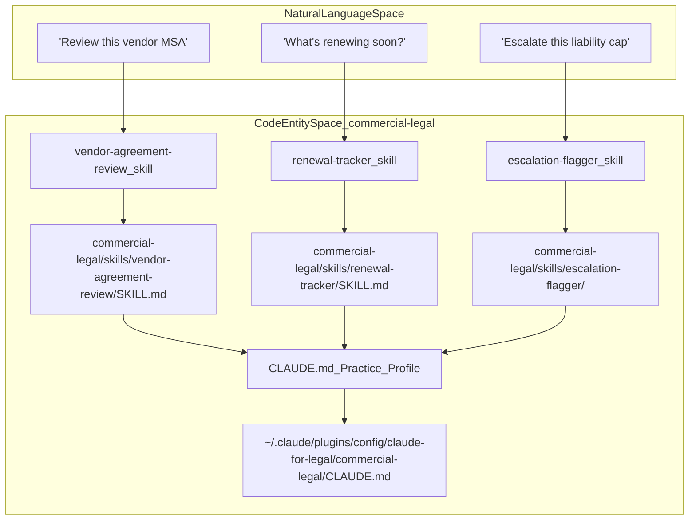
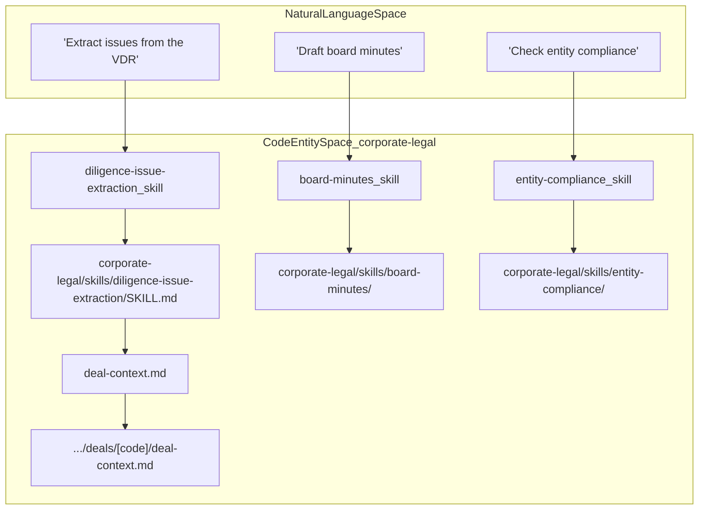

<!-- source: DeepWiki mcp.deepwiki.com · repo anthropics/claude-for-legal · page 3.1 Commercial and Corporate Legal · fetched 2026-10-26 -->

# Commercial and Corporate Legal

Relevant source files

The following files were used as context for generating this wiki page:

- [ai-governance-legal/references/currency-watch.md](ai-governance-legal/references/currency-watch.md)
- [commercial-legal/.claude-plugin/plugin.json](commercial-legal/.claude-plugin/plugin.json)
- [commercial-legal/README.md](commercial-legal/README.md)
- [commercial-legal/skills/renewal-tracker/SKILL.md](commercial-legal/skills/renewal-tracker/SKILL.md)
- [commercial-legal/skills/saas-msa-review/SKILL.md](commercial-legal/skills/saas-msa-review/SKILL.md)
- [commercial-legal/skills/vendor-agreement-review/SKILL.md](commercial-legal/skills/vendor-agreement-review/SKILL.md)
- [corporate-legal/.claude-plugin/plugin.json](corporate-legal/.claude-plugin/plugin.json)
- [corporate-legal/CLAUDE.md](corporate-legal/CLAUDE.md)
- [corporate-legal/README.md](corporate-legal/README.md)
- [corporate-legal/skills/diligence-issue-extraction/SKILL.md](corporate-legal/skills/diligence-issue-extraction/SKILL.md)

This section covers the `commercial-legal` and `corporate-legal` plugins, which provide automated workflows for in-house counsel and law firm practitioners. The `commercial-legal` plugin focuses on the contract lifecycle—from initial intake and playbook-based review to renewal tracking and escalation. The `corporate-legal` plugin addresses high-stakes M&A diligence, board governance, and multi-jurisdictional entity compliance.

## Commercial Legal Plugin

The `commercial-legal` plugin is designed to manage vendor agreements, NDAs, and SaaS subscriptions. It relies on a practice-specific playbook established during a cold-start interview to ensure reviews align with the organization's specific risk appetite [commercial-legal/README.md:1-5]().

### Implementation and Data Flow

The plugin follows a "Playbook-First" architecture. Every skill reads the `CLAUDE.md` practice profile to determine the "Active Side" (Sales-side vs. Purchasing-side) before processing a document [commercial-legal/skills/vendor-agreement-review/SKILL.md:45-47]().

**Key Data Flow:**
1. **Intake:** User provides a contract via `/commercial-legal:review [file]` [commercial-legal/README.md:33-33]().
2. **Context Loading:** The system reads the practice profile at `~/.claude/plugins/config/claude-for-legal/commercial-legal/CLAUDE.md` [commercial-legal/README.md:90-90]().
3. **Side Detection:** The `vendor-agreement-review` skill determines if the company is the Vendor (Sales-side) or Customer (Purchasing-side) [commercial-legal/skills/vendor-agreement-review/SKILL.md:45-47]().
4. **Deviation Analysis:** The contract is compared against the specific playbook positions (e.g., Limitation of Liability caps, Indemnity carveouts) [commercial-legal/skills/vendor-agreement-review/SKILL.md:49-54]().
5. **Output Generation:** A review memo is produced with redline recommendations and escalation routing based on the team's internal matrix [commercial-legal/skills/vendor-agreement-review/SKILL.md:25-27]().

### System-to-Code Entity Map: Commercial Legal

The following diagram maps the logical commercial legal operations to the specific code entities and file paths that implement them.

**Commercial Legal Entity Mapping**

Sources: [commercial-legal/README.md:30-52](), [commercial-legal/skills/vendor-agreement-review/SKILL.md:1-9](), [commercial-legal/skills/renewal-tracker/SKILL.md:1-10]()

### Skill Reference: Commercial

| Command | Skill Entity | Implementation Detail |
| :--- | :--- | :--- |
| `/commercial-legal:review` | `vendor-agreement-review` | Performs deviation analysis. If SaaS is detected, it triggers the `saas-msa-review` overlay [commercial-legal/skills/saas-msa-review/SKILL.md:1-7](). |
| `/commercial-legal:renewal-tracker` | `renewal-tracker` | Reads `renewal-register.yaml` and surfaces cancel-by deadlines [commercial-legal/skills/renewal-tracker/SKILL.md:18-20](). |
| `/commercial-legal:escalation-flagger` | `escalation-flagger` | Matches contract issues to the escalation matrix and drafts the approver ask [commercial-legal/README.md:49-49](). |
| `/commercial-legal:matter-workspace` | `matter-workspace` | Isolates context for multi-client practices via `matters/<slug>/matter.md` [commercial-legal/skills/vendor-agreement-review/SKILL.md:15-15](). |

Sources: [commercial-legal/README.md:30-52](), [commercial-legal/skills/vendor-agreement-review/SKILL.md:13-15](), [commercial-legal/skills/saas-msa-review/SKILL.md:1-7](), [commercial-legal/skills/renewal-tracker/SKILL.md:12-16]()

---

## Corporate Legal Plugin

The `corporate-legal` plugin handles M&A diligence, corporate secretarial tasks, and entity management. It is modular, allowing users to activate specific practice areas (e.g., Board & Secretary vs. M&A) during setup [corporate-legal/README.md:1-15]().

### M&A Diligence and Tabular Review

The core of the M&A module is the `diligence-issue-extraction` skill. It processes Virtual Data Room (VDR) documents against materiality thresholds defined in the deal context [corporate-legal/skills/diligence-issue-extraction/SKILL.md:27-29]().

**Data Flow for Diligence:**
1. **Inventory:** The skill uses MCP connectors (Box, Intralinks, Datasite) to pull a VDR index [corporate-legal/skills/diligence-issue-extraction/SKILL.md:41-43]().
2. **Filter:** Applies materiality filters (e.g., only contracts >$X) from `deal-context.md` [corporate-legal/skills/diligence-issue-extraction/SKILL.md:58-60]().
3. **Extraction:** Identifies Change of Control, Assignment, and IP ownership issues [corporate-legal/skills/diligence-issue-extraction/SKILL.md:68-87]().
4. **Handoff:** Consents identified during review are automatically routed to the `closing-checklist` [corporate-legal/skills/diligence-issue-extraction/SKILL.md:17-17]().

### System-to-Code Entity Map: Corporate Legal

The following diagram bridges corporate legal concepts to the underlying code structure.

**Corporate Legal Entity Mapping**

Sources: [corporate-legal/README.md:31-44](), [corporate-legal/skills/diligence-issue-extraction/SKILL.md:1-18](), [corporate-legal/skills/diligence-issue-extraction/SKILL.md:35-35]()

### Skill Reference: Corporate

| Command | Skill Entity | Implementation Detail |
| :--- | :--- | :--- |
| `/corporate-legal:diligence-issue-extraction` | `diligence-issue-extraction` | Reads VDR docs and extracts issues per house categories [corporate-legal/skills/diligence-issue-extraction/SKILL.md:1-7](). |
| `/corporate-legal:tabular-review` | `tabular-review` | Generates `.xlsx` or `.csv` outputs with cited cells for bulk document review [corporate-legal/README.md:57-57](). |
| `/corporate-legal:written-consent` | `written-consent` | Drafts board consents using precedent search from a local or connected repository [corporate-legal/README.md:63-63](). |
| `/corporate-legal:entity-compliance` | `entity-compliance` | Manages a YAML-based compliance calendar for entity filing deadlines [corporate-legal/README.md:64-64](). |

Sources: [corporate-legal/README.md:51-68](), [corporate-legal/skills/diligence-issue-extraction/SKILL.md:1-9]()

## Shared Infrastructure

Both plugins utilize the Model Context Protocol (MCP) for external data access and follow strict safety guardrails.

### MCP Connectors
The plugins ship with `.mcp.json` declarations for:
- **Contract/VDR Storage:** Google Drive, Box [commercial-legal/README.md:74-74](), [corporate-legal/README.md:86-86]().
- **Workflow/CLM:** Ironclad, DocuSign [commercial-legal/README.md:71-72]().
- **Communication:** Slack [commercial-legal/README.md:73-73]().

### Citation and Provenance
Skills in these plugins enforce a strict "No Silent Supplement" rule. If a connected research tool returns insufficient data, the skill must report the gap rather than hallucinating from model knowledge [commercial-legal/skills/saas-msa-review/SKILL.md:29-29](), [corporate-legal/skills/diligence-issue-extraction/SKILL.md:106-106](). Every citation is tagged by source (e.g., `[Westlaw]`, `[user provided]`, `[model knowledge — verify]`) to ensure the reviewer can distinguish verified data from model predictions [commercial-legal/skills/saas-msa-review/SKILL.md:31-31](), [corporate-legal/skills/diligence-issue-extraction/SKILL.md:102-102]().

Sources: [commercial-legal/README.md:69-79](), [corporate-legal/README.md:78-89](), [commercial-legal/skills/saas-msa-review/SKILL.md:29-31](), [corporate-legal/skills/diligence-issue-extraction/SKILL.md:102-106]()

---

