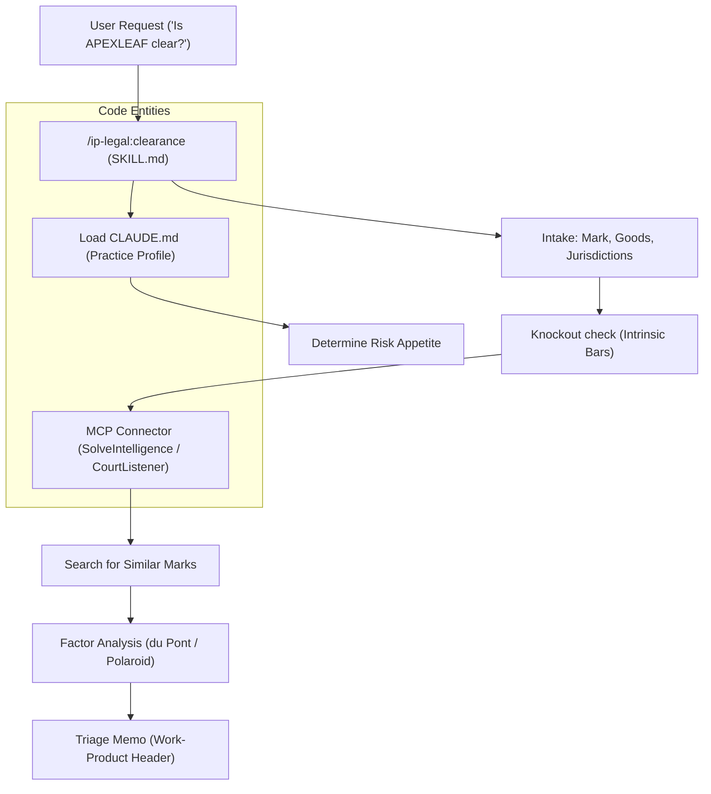
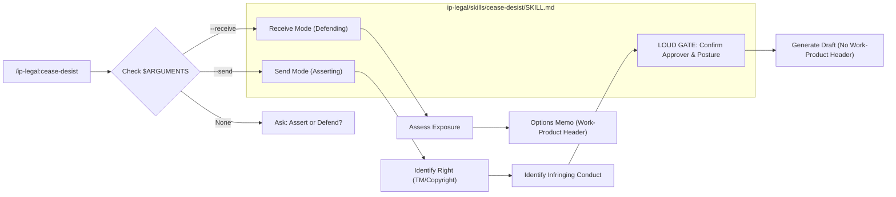

<!-- source: DeepWiki mcp.deepwiki.com · repo anthropics/claude-for-legal · page 3.2 Employment and IP Legal · fetched 2026-10-26 -->

# Employment and IP Legal

Relevant source files

The following files were used as context for generating this wiki page:

- [ai-governance-legal/CLAUDE.md](ai-governance-legal/CLAUDE.md)
- [commercial-legal/CLAUDE.md](commercial-legal/CLAUDE.md)
- [employment-legal/CLAUDE.md](employment-legal/CLAUDE.md)
- [employment-legal/skills/hiring-review/SKILL.md](employment-legal/skills/hiring-review/SKILL.md)
- [employment-legal/skills/termination-review/SKILL.md](employment-legal/skills/termination-review/SKILL.md)
- [employment-legal/skills/wage-hour-qa/SKILL.md](employment-legal/skills/wage-hour-qa/SKILL.md)
- [employment-legal/skills/worker-classification/SKILL.md](employment-legal/skills/worker-classification/SKILL.md)
- [ip-legal/CLAUDE.md](ip-legal/CLAUDE.md)
- [ip-legal/README.md](ip-legal/README.md)
- [ip-legal/skills/cease-desist/SKILL.md](ip-legal/skills/cease-desist/SKILL.md)
- [ip-legal/skills/clearance/SKILL.md](ip-legal/skills/clearance/SKILL.md)
- [ip-legal/skills/fto-triage/SKILL.md](ip-legal/skills/fto-triage/SKILL.md)
- [ip-legal/skills/infringement-triage/SKILL.md](ip-legal/skills/infringement-triage/SKILL.md)
- [ip-legal/skills/ip-clause-review/SKILL.md](ip-legal/skills/ip-clause-review/SKILL.md)
- [ip-legal/skills/oss-review/SKILL.md](ip-legal/skills/oss-review/SKILL.md)
- [ip-legal/skills/takedown/SKILL.md](ip-legal/skills/takedown/SKILL.md)

This section covers the `employment-legal` and `ip-legal` plugins, which provide specialized workflows for human resources, labor relations, and intellectual property management. Both plugins utilize a practice-profile-driven architecture where a "cold-start" interview populates a `CLAUDE.md` file that governs jurisdictional footprints, enforcement postures, and approval matrices.

## 1. Employment Legal Plugin

The `employment-legal` plugin handles the lifecycle of the employment relationship, from hiring and classification to leave management and termination review. It emphasizes jurisdiction-specific research, as employment laws vary significantly by state and country.

### 1.1 Key Skills and Implementation

| Skill | Implementation File | Purpose |
| :--- | :--- | :--- |
| `hiring-review` | [employment-legal/skills/hiring-review/SKILL.md]() | Reviews offer letters and restrictive covenants against jurisdictional rules. |
| `termination-review` | [employment-legal/skills/termination-review/SKILL.md]() | Detects high-risk flags (retaliation, discrimination) and final pay requirements. |
| `wage-hour-qa` | [employment-legal/skills/wage-hour-qa/SKILL.md]() | Provides researched answers on overtime, breaks, and regular-rate calculations. |
| `worker-classification` | [employment-legal/skills/worker-classification/SKILL.md]() | Runs ABC or Borello tests for IC vs. employee classification. |

### 1.2 Data Flow: Hiring and Termination
The employment skills follow a strict research-first pattern. Rather than relying on model weights for legal thresholds, the skills are instructed to research the specific jurisdiction at runtime.

**Hiring Review Workflow:**
1. **Jurisdiction Identification:** Determines where the employee *actually* works (home state for remote) [employment-legal/skills/hiring-review/SKILL.md:46-52]().
2. **Classification Check:** Validates exempt/non-exempt status against researched salary thresholds [employment-legal/skills/hiring-review/SKILL.md:58-74]().
3. **Covenant Analysis:** Researches the enforceability of non-competes or non-solicits in the specific state [employment-legal/skills/hiring-review/SKILL.md:76-94]().

**Termination Review Workflow:**
1. **High-Risk Scan:** Checks for "Recent complaint," "Protected leave," or "Thin documentation" flags defined in `CLAUDE.md` [employment-legal/skills/termination-review/SKILL.md:57-71]().
2. **Exempt Misclassification Flag:** Automatically triggers a warning if a salaried employee in a high-threshold state (CA, NY, WA, CO, AK) has a generic title like "Coordinator" or "Analyst" [employment-legal/skills/termination-review/SKILL.md:73-86]().
3. **Final Pay Research:** Researches state-specific timing for final paychecks [employment-legal/skills/termination-review/SKILL.md:118-128]().

### 1.3 Technical Guardrails: The Regular-Rate Scaffold
The `wage-hour-qa` skill implements a technical scaffold for calculating back-pay. It enforces the inclusion of non-discretionary bonuses and commissions into the "regular rate" per 29 U.S.C. §207(e) [employment-legal/skills/wage-hour-qa/SKILL.md:102-123]().

**Sources:**
- [employment-legal/CLAUDE.md]()
- [employment-legal/skills/hiring-review/SKILL.md]()
- [employment-legal/skills/termination-review/SKILL.md]()
- [employment-legal/skills/wage-hour-qa/SKILL.md]()
- [employment-legal/skills/worker-classification/SKILL.md]()

---

## 2. IP Legal Plugin

The `ip-legal` plugin manages trademark, copyright, patent, and open-source (OSS) workflows. It is built to support in-house counsel and brand protection managers in enforcement and clearance.

### 2.1 Technical Architecture: Enforcement Posture
The plugin's behavior is gated by the `Enforcement posture` defined in the practice profile. This posture (Aggressive, Measured, or Conservative) determines the default tone and demands in cease-and-desist drafts [ip-legal/README.md:32-33]().

### 2.2 Core IP Skills

| Skill | Implementation File | Logic Pattern |
| :--- | :--- | :--- |
| `cease-desist` | [ip-legal/skills/cease-desist/SKILL.md]() | Dispatcher for `--send` vs `--receive` modes. |
| `clearance` | [ip-legal/skills/clearance/SKILL.md]() | Knockout search + likelihood-of-confusion factor analysis. |
| `fto-triage` | [ip-legal/skills/fto-triage/SKILL.md]() | Element-by-element claim charting for Freedom-to-Operate. |
| `ip-clause-review` | [ip-legal/skills/ip-clause-review/SKILL.md]() | Specialized review for "Present-tense assignment" gaps. |
| `oss-review` | [ip-legal/skills/oss-review/SKILL.md]() | Checks open source licenses against company policy. |

### 2.3 System Diagram: IP Clearance and Triage
The following diagram bridges the user's natural language request to the internal skill logic and external MCP connectors.

**IP Clearance and Triage Flow**

**Sources:**
- [ip-legal/skills/clearance/SKILL.md:20-35]()
- [ip-legal/README.md:74-78]()

### 2.4 Cease-and-Desist Logic
The `cease-desist` skill features a "Loud Gate" that prevents final draft generation until the user confirms the right, the conduct, and the approval matrix [ip-legal/skills/cease-desist/SKILL.md:29-32]().

**C&D Dispatcher Flow**

**Sources:**
- [ip-legal/skills/cease-desist/SKILL.md:13-35]()
- [ip-legal/skills/cease-desist/SKILL.md:75-97]()

### 2.5 Freedom-to-Operate (FTO) Triage
The `fto-triage` skill performs a structured first look at potentially blocking patents. It is strictly separated from a formal legal opinion [ip-legal/skills/fto-triage/SKILL.md:15-20]().

1. **Intake:** Gathers technical detail and jurisdictions [ip-legal/skills/fto-triage/SKILL.md:27-28]().
2. **Search:** Utilizes `Solve Intelligence Patents` or other patent MCP connectors [ip-legal/skills/fto-triage/SKILL.md:29-31]().
3. **Claim Charting:** Builds an element-by-element first pass against independent claims [ip-legal/skills/fto-triage/SKILL.md:32-34]().
4. **Willfulness Note:** Includes a mandatory warning that knowledge of specific patents factors into willfulness [ip-legal/skills/fto-triage/SKILL.md:40-42]().

**Sources:**
- [ip-legal/CLAUDE.md]()
- [ip-legal/README.md]()
- [ip-legal/skills/cease-desist/SKILL.md]()
- [ip-legal/skills/clearance/SKILL.md]()
- [ip-legal/skills/fto-triage/SKILL.md]()
- [ip-legal/skills/ip-clause-review/SKILL.md]()

---

