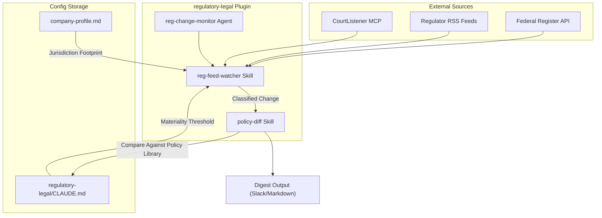
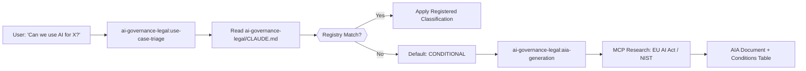

<!-- source: DeepWiki mcp.deepwiki.com · repo anthropics/claude-for-legal · page 3.3 Privacy, Regulatory, and AI Governance Legal · fetched 2026-10-26 -->

# Privacy, Regulatory, and AI Governance Legal

Relevant source files

The following files were used as context for generating this wiki page:

- [CLAUDE.md](CLAUDE.md)
- [CONNECTORS.md](CONNECTORS.md)
- [ai-governance-legal/.mcp.json](ai-governance-legal/.mcp.json)
- [ai-governance-legal/README.md](ai-governance-legal/README.md)
- [ai-governance-legal/skills/aia-generation/SKILL.md](ai-governance-legal/skills/aia-generation/SKILL.md)
- [ai-governance-legal/skills/cold-start-interview/SKILL.md](ai-governance-legal/skills/cold-start-interview/SKILL.md)
- [ai-governance-legal/skills/customize/SKILL.md](ai-governance-legal/skills/customize/SKILL.md)
- [ai-governance-legal/skills/reg-gap-analysis/SKILL.md](ai-governance-legal/skills/reg-gap-analysis/SKILL.md)
- [ai-governance-legal/skills/use-case-triage/SKILL.md](ai-governance-legal/skills/use-case-triage/SKILL.md)
- [commercial-legal/.mcp.json](commercial-legal/.mcp.json)
- [commercial-legal/skills/cold-start-interview/SKILL.md](commercial-legal/skills/cold-start-interview/SKILL.md)
- [commercial-legal/skills/customize/SKILL.md](commercial-legal/skills/customize/SKILL.md)
- [privacy-legal/CLAUDE.md](privacy-legal/CLAUDE.md)
- [privacy-legal/skills/dpa-review/SKILL.md](privacy-legal/skills/dpa-review/SKILL.md)
- [privacy-legal/skills/dsar-response/SKILL.md](privacy-legal/skills/dsar-response/SKILL.md)
- [privacy-legal/skills/pia-generation/SKILL.md](privacy-legal/skills/pia-generation/SKILL.md)
- [privacy-legal/skills/reg-gap-analysis/SKILL.md](privacy-legal/skills/reg-gap-analysis/SKILL.md)
- [regulatory-legal/CLAUDE.md](regulatory-legal/CLAUDE.md)
- [regulatory-legal/README.md](regulatory-legal/README.md)
- [regulatory-legal/agents/reg-change-monitor.md](regulatory-legal/agents/reg-change-monitor.md)
- [regulatory-legal/skills/cold-start-interview/SKILL.md](regulatory-legal/skills/cold-start-interview/SKILL.md)
- [regulatory-legal/skills/customize/SKILL.md](regulatory-legal/skills/customize/SKILL.md)
- [regulatory-legal/skills/reg-feed-watcher/SKILL.md](regulatory-legal/skills/reg-feed-watcher/SKILL.md)

This page details the implementation and technical workflows for the Privacy, Regulatory, and AI Governance legal plugins. These plugins are designed to handle high-velocity compliance tasks, including automated impact assessments, regulatory tracking, and AI use-case triage, while maintaining strict adherence to company-specific "house styles" and jurisdictional footprints.

## Privacy Legal Plugin

The `privacy-legal` plugin manages the lifecycle of data privacy compliance, from initial processing triage to statutory response drafting and regulatory gap analysis.

### Core Data Flow and Skills
The plugin relies on the practice profile located at `~/.claude/plugins/config/claude-for-legal/privacy-legal/CLAUDE.md` to define its DPA playbook, DSAR systems list, and PIA house style [privacy-legal/CLAUDE.md:6-10]().

| Skill | Key Function | Primary Data Source |
| :--- | :--- | :--- |
| `dpa-review` | Reviews DPAs as Processor or Controller. | `## DPA playbook` [privacy-legal/CLAUDE.md:62-85]() |
| `dsar-response` | Drafts responses for Access, Deletion, or Portability requests. | `## DSAR process` [privacy-legal/CLAUDE.md:108-116]() |
| `pia-generation` | Generates PIAs using a seed document's structure. | `## PIA house style` [privacy-legal/CLAUDE.md:99-106]() |
| `reg-gap-analysis` | Diffs new regulations against current policy commitments. | `## Privacy policy commitments` [privacy-legal/CLAUDE.md:87-97]() |

### Implementation Detail: DPA Review
The `dpa-review` skill utilizes a "direction-aware" logic. It must first establish if the user is the **Processor** (defending operational flexibility) or the **Controller** (protecting data flow) [privacy-legal/CLAUDE.md:64-80](). It also performs checks against the jurisdictional footprint defined in the shared `company-profile.md` to adjust work-product headers for non-US regions like the EU or UK [privacy-legal/CLAUDE.md:161-175]().

**Sources:**
- [privacy-legal/CLAUDE.md:1-175]()
- [privacy-legal/skills/dpa-review/SKILL.md:1-20]() (implied)
- [privacy-legal/skills/dsar-response/SKILL.md:1-20]() (implied)

---

## Regulatory Legal Plugin

The `regulatory-legal` plugin focuses on monitoring external legal changes and maintaining the internal policy library.

### Scheduled Agent: Reg Change Monitor
The `reg-change-monitor` is a managed agent that runs on a schedule defined in the plugin's `CLAUDE.md` [regulatory-legal/agents/reg-change-monitor.md:18-20](). It utilizes the `WebFetch` tool and MCP connectors to scan feeds [regulatory-legal/agents/reg-change-monitor.md:9-9]().

### Technical Data Flow: Regulatory Monitoring
Title: "Regulatory Monitoring and Policy Diff Workflow"

### Materiality Classification
The `reg-feed-watcher` skill filters noise by mapping regulatory items to the user's `Materiality threshold` [regulatory-legal/skills/reg-feed-watcher/SKILL.md:97-112]().
*   **Always Material:** Final rules, sector-specific enforcement actions [regulatory-legal/CLAUDE.md:72-74]().
*   **Review-worthy:** NPRMs, Guidance, Competitor enforcement [regulatory-legal/CLAUDE.md:75-77]().
*   **FYI:** Commissioner speeches, academic commentary [regulatory-legal/CLAUDE.md:79-80]().

**Sources:**
- [regulatory-legal/agents/reg-change-monitor.md:1-52]()
- [regulatory-legal/skills/reg-feed-watcher/SKILL.md:1-112]()
- [regulatory-legal/CLAUDE.md:1-125]()

---

## AI Governance Legal Plugin

The `ai-governance-legal` plugin provides a framework for triaging AI use cases and performing AI Impact Assessments (AIA).

### Skill Reference
*   **`use-case-triage`**: Classifies proposed AI systems (Approved, Conditional, Not Approved) against the company's internal registry.
*   **`aia-generation`**: Conducts a structured risk analysis, determining if a system is "high-risk" under regimes like the EU AI Act.
*   **`reg-gap-analysis`**: Diffs new AI laws against current governance posture.

### AI Triage and Impact Assessment Logic
The triage skill acts as a gateway. It establishes whether the company is an **AI Provider** or **AI Deployer**, as obligations differ significantly between these roles [ai-governance-legal/skills/cold-start-interview/SKILL.md:38-46]().

### System Architecture: AI Governance Triage
Title: "AI Governance Use Case Triage Implementation"

### Citation and Verification Tiers
These plugins use a specific `Source attribution tiering` system for citations. Citations retrieved through a connected research tool are marked ✓, while model-knowledge citations are tagged `[verify]` or `[verify-pinpoint]` [regulatory-legal/README.md:46-48]().

**Sources:**
- [ai-governance-legal/skills/cold-start-interview/SKILL.md:1-94]()
- [ai-governance-legal/skills/customize/SKILL.md:1-60]()
- [regulatory-legal/README.md:44-48]()

---

## MCP Connector Integration

These plugins leverage the Model Context Protocol (MCP) to access external legal databases and internal document repositories.

| Connector | Plugin Usage | Manifest Reference |
| :--- | :--- | :--- |
| **Slack** | Digest delivery and gap notifications | [regulatory-legal/agents/reg-change-monitor.md:9-9]() |
| **Google Drive** | Policy library indexing and PIA storage | [regulatory-legal/CLAUDE.md:48-48]() |
| **Federal Register** | Public API for US Federal regulatory tracking | [regulatory-legal/skills/reg-feed-watcher/SKILL.md:51-54]() |
| **CourtListener** | Case law and secondary regulatory feed enrichment | [regulatory-legal/skills/reg-feed-watcher/SKILL.md:74-76]() |

**Sources:**
- [regulatory-legal/CLAUDE.md:43-53]()
- [regulatory-legal/skills/reg-feed-watcher/SKILL.md:44-80]()
- [commercial-legal/.mcp.json:1-56]() (General MCP structure)

---

