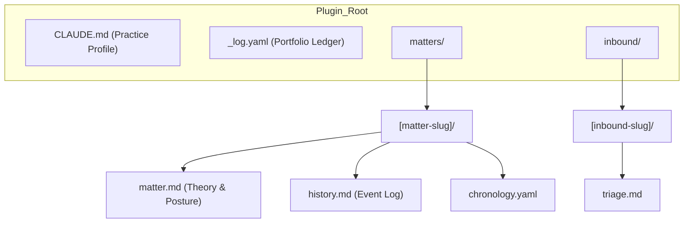
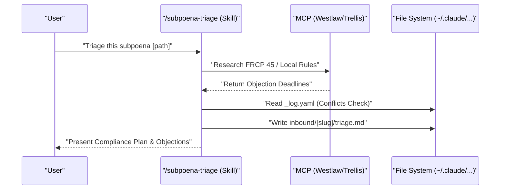
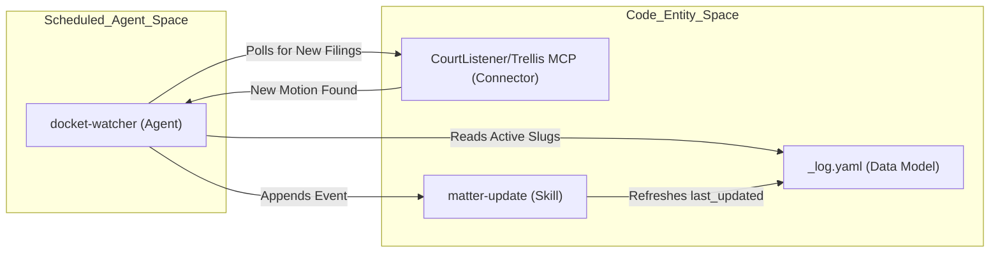

<!-- source: DeepWiki mcp.deepwiki.com · repo anthropics/claude-for-legal · page 3.4 Litigation Legal · fetched 2026-10-26 -->

# Litigation Legal

Relevant source files

The following files were used as context for generating this wiki page:

- [litigation-legal/CLAUDE.md](litigation-legal/CLAUDE.md)
- [litigation-legal/README.md](litigation-legal/README.md)
- [litigation-legal/skills/brief-section-drafter/SKILL.md](litigation-legal/skills/brief-section-drafter/SKILL.md)
- [litigation-legal/skills/cold-start-interview/SKILL.md](litigation-legal/skills/cold-start-interview/SKILL.md)
- [litigation-legal/skills/customize/SKILL.md](litigation-legal/skills/customize/SKILL.md)
- [litigation-legal/skills/demand-draft/SKILL.md](litigation-legal/skills/demand-draft/SKILL.md)
- [litigation-legal/skills/demand-received/SKILL.md](litigation-legal/skills/demand-received/SKILL.md)
- [litigation-legal/skills/deposition-prep/SKILL.md](litigation-legal/skills/deposition-prep/SKILL.md)
- [litigation-legal/skills/privilege-log-review/SKILL.md](litigation-legal/skills/privilege-log-review/SKILL.md)
- [litigation-legal/skills/subpoena-triage/SKILL.md](litigation-legal/skills/subpoena-triage/SKILL.md)

The Litigation Legal plugin (`litigation-legal`) provides a structured reasoning layer for managing a portfolio of disputes. It is designed for in-house counsel, firm associates, and solo practitioners, offering tools for matter intake, portfolio tracking, and high-stakes drafting tasks such as demand letters, deposition prep, and privilege log reviews.

## 1. Overview and Data Model

The plugin operates on a "house-level" practice profile that calibrates risk appetite, materiality thresholds, and jurisdictional posture before any matter-specific work begins [litigation-legal/CLAUDE.md:21-25]().

### 1.1. The Matters Log (`_log.yaml`)
The central data structure for the plugin is the `matters/_log.yaml` file. This serves as the portfolio ledger, enabling cross-matter analysis and status rollups [litigation-legal/README.md:90-94]().

| Field | Description |
|---|---|
| `slug` | Unique identifier for the matter (used in directory naming) [litigation-legal/README.md:95](). |
| `title` | Human-readable name of the dispute [litigation-legal/README.md:47](). |
| `status` | Current state (e.g., `active`, `stayed`, `closed`, `demand-only`) [litigation-legal/README.md:48](). |
| `risk_rating` | Calibrated against the practice profile's severity-likelihood matrix [litigation-legal/README.md:30-34](). |
| `last_updated` | Timestamp refreshed by the `matter-update` skill [litigation-legal/README.md:69](). |
| `legal_hold` | Status indicating if a hold notice is active or needs refresh [litigation-legal/README.md:75](). |
| `outside_counsel` | Lead firm and partner contact information for OC status sweeps [litigation-legal/README.md:58](). |

Sources: [litigation-legal/README.md:43-51](), [litigation-legal/README.md:90-98](), [litigation-legal/skills/matter-intake/SKILL.md:1-15]()

### 1.2. Directory Structure
Matters are organized into discrete workspaces to prevent context leakage and ensure privilege boundaries [litigation-legal/skills/privilege-log-review/SKILL.md:30-31]().

Sources: [litigation-legal/README.md:90-100](), [litigation-legal/skills/privilege-log-review/SKILL.md:30-31]()

---

## 2. Core Litigation Workflows

### 2.1. Matter Intake and Portfolio Management
The `/matter-intake` skill performs uniform intake to populate the `_log.yaml` and create the matter workspace [litigation-legal/README.md:47](). It branches based on the user's role defined in the practice profile [litigation-legal/skills/cold-start-interview/SKILL.md:12-13]().

*   **In-house:** Focuses on reserves (ASC 450), board reporting, and outside counsel oversight [litigation-legal/skills/cold-start-interview/SKILL.md:12]().
*   **Firm/Solo:** Focuses on case theory, pivot facts, and eDiscovery setup [litigation-legal/skills/cold-start-interview/SKILL.md:12]().

Sources: [litigation-legal/skills/matter-intake/SKILL.md:1-15](), [litigation-legal/skills/cold-start-interview/SKILL.md:12-15]()

### 2.2. Demand Letter Triage and Drafting
The plugin distinguishes between receiving and sending demands.

*   **`demand-received`**: Triages inbound letters by extracting facts, assessing merit (substantial/debatable/weak), and cross-checking the `_log.yaml` for related matters or repeat adversaries [litigation-legal/skills/demand-received/SKILL.md:52-78]().
*   **`demand-draft`**: A gated drafting skill. It refuses to generate a `.docx` until the attorney reviews a "Pre-draft Gate" covering privilege filters, admission risks, and FRE 408 posture [litigation-legal/skills/demand-draft/SKILL.md:12-15]().

Sources: [litigation-legal/skills/demand-received/SKILL.md:7-19](), [litigation-legal/skills/demand-draft/SKILL.md:21-26](), [litigation-legal/skills/demand-draft/SKILL.md:12-14]()

### 2.3. Subpoena Triage
The `/subpoena-triage` skill automates the classification of inbound process (Third-party, Party, CID, or Grand Jury) [litigation-legal/skills/subpoena-triage/SKILL.md:10-11]().

1.  **Rule Research**: It first uses MCP research tools to find the applicable rule (e.g., FRCP 45) and local variants [litigation-legal/skills/subpoena-triage/SKILL.md:42-44]().
2.  **Escalation**: Grand Jury subpoenas trigger an immediate stop-and-escalate instruction to criminal counsel [litigation-legal/skills/subpoena-triage/SKILL.md:58]().
3.  **Compliance Plan**: Generates an objections framework and deadline calendar based on the date of service [litigation-legal/skills/subpoena-triage/SKILL.md:14]().

Sources: [litigation-legal/skills/subpoena-triage/SKILL.md:10-14](), [litigation-legal/skills/subpoena-triage/SKILL.md:42-49]()

---

## 3. Evidence and Discovery Skills

### 3.1. Chronology Building
The `/chronology` skill extracts dated events from documents and eDiscovery exports [litigation-legal/README.md:76](). It tags entries by "Significance" relative to the case theory defined in the matter workspace [litigation-legal/README.md:57]().

Sources: [litigation-legal/README.md:57-57](), [litigation-legal/README.md:76-76]()

### 3.2. Deposition Prep
The `/deposition-prep` skill builds outlines by pulling witness-specific documents [litigation-legal/skills/deposition-prep/SKILL.md:11-12](). It branches logic based on **Witness Posture**:
*   **Adverse**: Closed, leading questions; "build the box" sequences [litigation-legal/skills/deposition-prep/SKILL.md:82]().
*   **Friendly**: Open questions to elicit narrative [litigation-legal/skills/deposition-prep/SKILL.md:83]().
*   **30(b)(6)**: Focuses on designated topics and binding entity testimony [litigation-legal/skills/deposition-prep/SKILL.md:85]().

Sources: [litigation-legal/skills/deposition-prep/SKILL.md:78-87]()

### 3.3. Privilege Log Review
A first-pass QA tool that categorizes entries as "Obvious Priv," "Obvious Not," or "Needs Attorney Review" [litigation-legal/skills/privilege-log-review/SKILL.md:11-12](). It is hard-gated to prevent automated "Close Calls" and requires an attorney to review every flagged entry [litigation-legal/skills/privilege-log-review/SKILL.md:38]().

Sources: [litigation-legal/skills/privilege-log-review/SKILL.md:34-38]()

---

## 4. Technical Implementation & Data Flow

### 4.1. Natural Language to Code Entity Mapping
This diagram shows how user commands map to specific skill implementations and data persistence layers.

Sources: [litigation-legal/skills/subpoena-triage/SKILL.md:9-15](), [litigation-legal/skills/subpoena-triage/SKILL.md:42-46]()

### 4.2. Multi-Agent Interaction: The Docket Watcher
The `docket-watcher` agent operates as a background process to maintain portfolio currency [litigation-legal/README.md:86]().

Sources: [litigation-legal/README.md:82-86](), [litigation-legal/README.md:43-51]()

---

## 5. Guardrails and Safety

### 5.1. Record Fidelity Rules
The plugin enforces strict "Record Fidelity" across all litigation skills (`brief-section-drafter`, `demand-draft`, `deposition-prep`):
1.  **Verbatim Quotes**: Quotation marks are forbidden unless the exact passage is in the immediate context [litigation-legal/skills/brief-section-drafter/SKILL.md:43]().
2.  **Placeholder Requirement**: If a quote is missing, the skill must use `[verify exact quote — record cite pending]` [litigation-legal/skills/brief-section-drafter/SKILL.md:46]().
3.  **Pinpoint Cites**: Cites must support the *entire* proposition; partial support must be flagged as "misgrounded" [litigation-legal/skills/brief-section-drafter/SKILL.md:51]().

Sources: [litigation-legal/skills/brief-section-drafter/SKILL.md:39-52](), [litigation-legal/skills/demand-draft/SKILL.md:27-38]()

### 5.2. PD 57AC Compliance (UK)
For matters involving England & Wales, the plugin includes a hard gate for trial witness statements. It will refuse to draft narrative "as the witness," instead offering to prepare question prompts to elicit actual recollection, complying with PD 57AC sanctions risks [litigation-legal/skills/brief-section-drafter/SKILL.md:18-24]().

Sources: [litigation-legal/skills/brief-section-drafter/SKILL.md:18-24](), [litigation-legal/skills/deposition-prep/SKILL.md:18-24]()

---

