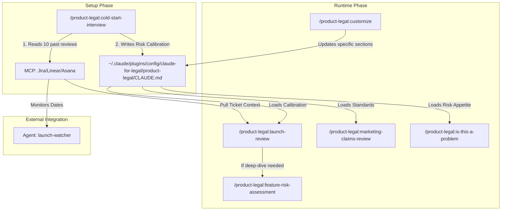
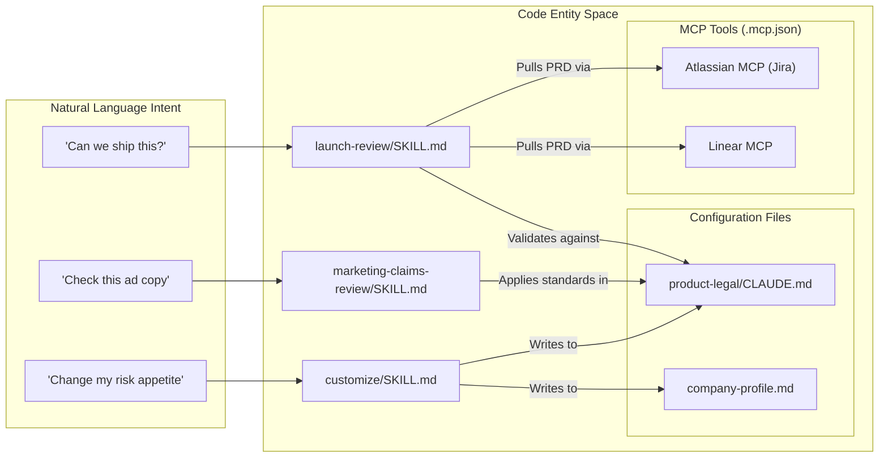

<!-- source: DeepWiki mcp.deepwiki.com · repo anthropics/claude-for-legal · page 3.5 Product Legal · fetched 2026-10-26 -->

# Product Legal

Relevant source files

The following files were used as context for generating this wiki page:

- [managed-agent-cookbooks/launch-radar/README.md](managed-agent-cookbooks/launch-radar/README.md)
- [managed-agent-cookbooks/launch-radar/agent.yaml](managed-agent-cookbooks/launch-radar/agent.yaml)
- [product-legal/.claude-plugin/plugin.json](product-legal/.claude-plugin/plugin.json)
- [product-legal/CLAUDE.md](product-legal/CLAUDE.md)
- [product-legal/skills/customize/SKILL.md](product-legal/skills/customize/SKILL.md)

The **product-legal** plugin provides a suite of tools designed to accelerate product counsel workflows. It calibrates to a company's specific risk history to review product launches, evaluate marketing claims, and provide rapid triage for feature-related legal questions. The plugin includes a scheduled agent, the `launch-watcher`, which monitors project management tools to flag upcoming launches requiring legal oversight.

## Core Implementation and Calibration

The plugin's intelligence is centered around a risk calibration table generated during the cold-start interview. Unlike generic legal checklists, this plugin learns what a specific company actually "blocks" versus what it "waves through" by analyzing past launch reviews [product-legal/README.md:16-18]().

### Data Flow: Calibration and Execution
The following diagram illustrates how the `cold-start-interview` skill populates the configuration used by all other skills in the plugin.

**System Configuration and Skill Execution Flow**

Sources: [product-legal/README.md:38-53](), [product-legal/CLAUDE.md:8-11](), [product-legal/skills/launch-review/SKILL.md:40-49](), [product-legal/skills/customize/SKILL.md:13-22]()

## Skill Reference

The plugin implements six primary skills, each serving a distinct phase of the product lifecycle.

| Skill | Command | Technical Role |
| :--- | :--- | :--- |
| **Launch Review** | `/product-legal:launch-review` | Performs category-by-category review (Privacy, IP, Regulatory, etc.) against the `Risk calibration` table in `CLAUDE.md` [product-legal/skills/launch-review/SKILL.md:42-49](). |
| **Marketing Claims** | `/product-legal:marketing-claims-review` | Classifies copy into a taxonomy: Puffery, Factual, Comparative, Implied, or Absolute [product-legal/skills/marketing-claims-review/SKILL.md:15](). |
| **Feature Risk Assessment** | `feature-risk-assessment` | Triggered when a launch review finds a "novel" risk or a "usually blocks" item. Produces a 2-4 page decision document [product-legal/skills/feature-risk-assessment/SKILL.md:25-31](). |
| **Triage** | `/product-legal:is-this-a-problem` | High-velocity "same-minute" answer for PMs, calibrated to the team's risk appetite [product-legal/README.md:77-81](). |
| **Matter Workspace** | `/product-legal:matter-workspace` | Manages `matter.md` files to isolate context between different product lines [product-legal/README.md:45](). |
| **Customize** | `/product-legal:customize` | Updates the practice profile (`CLAUDE.md`) or shared `company-profile.md` without a full re-interview [product-legal/skills/customize/SKILL.md:17-20](). |

Sources: [product-legal/README.md:38-45](), [product-legal/skills/launch-review/SKILL.md:1-8](), [product-legal/skills/marketing-claims-review/SKILL.md:1-8](), [product-legal/skills/customize/SKILL.md:1-11]()

## Integration and Agents

The plugin integrates with project management tools via the Model Context Protocol (MCP) to automate the discovery of legal work.

### Launch Watcher Agent & Launch Radar
The `launch-watcher` is the plugin-resident agent [product-legal/agents/launch-watcher.md:1-5](), while the `launch-radar` is the managed-agent (headless) cookbook implementation [managed-agent-cookbooks/launch-radar/README.md:1-5]().

**Security Tiering (Managed Agent):**
To handle untrusted tracker data (e.g., Jira tickets), the `launch-radar` uses a three-tier isolation model [managed-agent-cookbooks/launch-radar/README.md:32-39]():
1.  **`tracker-reader`**: Only subagent with MCP access to Jira/Linear/Asana. Returns schema-validated JSON.
2.  **`risk-classifier`**: No MCP or network access. Works from the validated list and the `CLAUDE.md` calibration.
3.  **`memo-writer`**: The only subagent with `Write` permissions to generate the final `./out/` markdown files.

### Mapping Natural Language to Code Entities
The following diagram bridges the user's intent to the underlying MCP tool calls and configuration keys.

**Product Legal Entity Mapping**

Sources: [product-legal/.mcp.json:15-26](), [product-legal/skills/launch-review/SKILL.md:11-18](), [product-legal/skills/marketing-claims-review/SKILL.md:11-17](), [product-legal/CLAUDE.md:38-41](), [product-legal/skills/customize/SKILL.md:73-75](), [managed-agent-cookbooks/launch-radar/agent.yaml:45-48]()

## Guardrails and Verification

The plugin enforces strict citation and privilege guardrails to ensure outputs are reliable for legal professionals.

### Citation Provenance
Every citation is tagged based on its source to surface verification needs [product-legal/skills/launch-review/SKILL.md:97-101]():
*   `[settled]`: Stable statutory references (e.g., GDPR Art. 33).
*   `[verify]`: Model-knowledge citations that require primary source checking.
*   `[verify-pinpoint]`: High-risk pinpoint references (specific subsections).
*   `[CourtListener]` / `[Westlaw]`: Verified via connected MCP research tools.

### Privilege Headers
The plugin automatically prepends headers based on the user's role defined in the Practice Profile [product-legal/CLAUDE.md:71-75]():
*   **Lawyers:** `PRIVILEGED & CONFIDENTIAL — ATTORNEY WORK PRODUCT`.
*   **Non-lawyers:** `RESEARCH NOTES — NOT LEGAL ADVICE`.

**Jurisdiction Note:** If the `Jurisdiction footprint` includes non-US regions (e.g., EU/UK), the plugin is instructed to adjust these headers, as "work product" is a US-specific doctrine [product-legal/CLAUDE.md:76-87]().

Sources: [product-legal/CLAUDE.md:21-44](), [product-legal/skills/launch-review/SKILL.md:95-101]()

---

