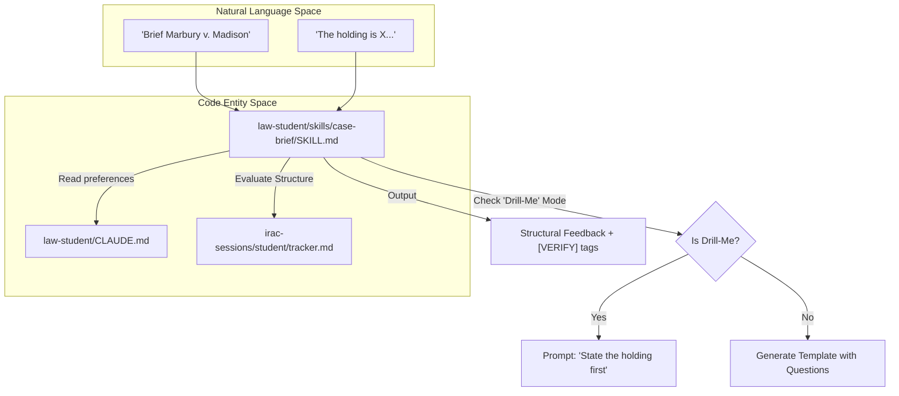
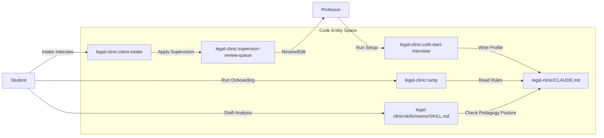

<!-- source: DeepWiki mcp.deepwiki.com · repo anthropics/claude-for-legal · page 3.6 Law Student and Legal Clinic · fetched 2026-10-26 -->

# Law Student and Legal Clinic

Relevant source files

The following files were used as context for generating this wiki page:

- [law-student/CLAUDE.md](law-student/CLAUDE.md)
- [law-student/README.md](law-student/README.md)
- [law-student/skills/bar-prep-questions/SKILL.md](law-student/skills/bar-prep-questions/SKILL.md)
- [law-student/skills/case-brief/SKILL.md](law-student/skills/case-brief/SKILL.md)
- [law-student/skills/cold-start-interview/SKILL.md](law-student/skills/cold-start-interview/SKILL.md)
- [law-student/skills/flashcards/SKILL.md](law-student/skills/flashcards/SKILL.md)
- [law-student/skills/irac-practice/SKILL.md](law-student/skills/irac-practice/SKILL.md)
- [law-student/skills/outline-builder/SKILL.md](law-student/skills/outline-builder/SKILL.md)
- [law-student/skills/study-plan/SKILL.md](law-student/skills/study-plan/SKILL.md)
- [legal-clinic/CLAUDE.md](legal-clinic/CLAUDE.md)
- [legal-clinic/README.md](legal-clinic/README.md)
- [legal-clinic/skills/client-intake/SKILL.md](legal-clinic/skills/client-intake/SKILL.md)
- [legal-clinic/skills/memo/SKILL.md](legal-clinic/skills/memo/SKILL.md)
- [legal-clinic/skills/research-start/SKILL.md](legal-clinic/skills/research-start/SKILL.md)

This section covers the `law-student` and `legal-clinic` plugins, designed to support the pedagogical and operational needs of legal education. The `law-student` plugin focuses on individual study, bar preparation, and Socratic drilling, while the `legal-clinic` plugin provides a structured environment for clinical legal education, ensuring compliance with ABA Formal Opinion 512 through rigorous supervision models and gated workflows.

## Law Student Plugin

The `law-student` plugin is designed for "learning mode," not "answer mode." Its primary architectural constraint is the refusal to generate final work product (briefs, outlines, or essays) for the student. Instead, it provides scaffolds, Socratic pushback, and structural feedback [law-student/README.md:3-5]().

### Socratic Drilling and IRAC Practice
The plugin implements a pedagogical layer that forces students to engage with legal reasoning. For example, the `case-brief` skill [law-student/skills/case-brief/SKILL.md:36-51]() and `irac-practice` skill [law-student/skills/irac-practice/SKILL.md:32-35]() are hard-coded to refuse requests for "model answers."

**Data Flow: Socratic Feedback Loop**
The diagram below illustrates how student input is processed through the pedagogical layer rather than a direct generation path.

**Student Interaction Logic**

Sources: [law-student/skills/case-brief/SKILL.md:12-15](), [law-student/skills/irac-practice/SKILL.md:1-18]()

### Bar Prep and Study Planning
The `bar-prep-questions` skill is jurisdiction-aware and handles the transition to the **NextGen Bar Exam** [law-student/skills/bar-prep-questions/SKILL.md:37-60](). It enforces a "Jurisdiction-rule gate" to ensure students are studying the correct rules (e.g., FRE vs. CA Evidence Code) [law-student/skills/bar-prep-questions/SKILL.md:17-19]().

The `study-plan` skill manages long-term preparation by tracking session history in `study-plan.yaml` [law-student/skills/study-plan/SKILL.md:12-22](). It includes a "Life-context sanity check" to ensure study hours are sustainable [law-student/skills/study-plan/SKILL.md:74-85]().

### Key Skills and Implementation
| Skill | Implementation Detail | File Path |
| :--- | :--- | :--- |
| `cold-start-interview` | Captures bar jurisdiction, learning style, and "Limited Data" flag if <10 materials provided. | [law-student/skills/cold-start-interview/SKILL.md:1-18]() |
| `case-brief` | Uses "drill-me" or "explain-to-me" forks; extracts court language if text is pasted but refuses summary-only requests. | [law-student/skills/case-brief/SKILL.md:53-63]() |
| `outline-builder` | Builds a "scaffold" (topic tree) from a syllabus; requires student notes to fill rule statements. | [law-student/skills/outline-builder/SKILL.md:23-41]() |
| `flashcards` | Implements a light Leitner-style system using markdown files and `study-plan.yaml` for session history. | [law-student/skills/flashcards/SKILL.md:11-21]() |
| `irac-practice` | Analyzes "Issue, Rule, Analysis, Conclusion" structure; appends patterns to a local `tracker.md`. | [law-student/skills/irac-practice/SKILL.md:71-111]() |
| `bar-prep-questions` | Supports UBE, NextGen, and State-specific (CA, FL, NY, etc.) rules with divergence explanations. | [law-student/skills/bar-prep-questions/SKILL.md:61-80]() |

Sources: [law-student/skills/cold-start-interview/SKILL.md:1-18](), [law-student/skills/case-brief/SKILL.md:53-63](), [law-student/skills/outline-builder/SKILL.md:23-41](), [law-student/skills/flashcards/SKILL.md:11-21](), [law-student/skills/irac-practice/SKILL.md:71-111](), [law-student/skills/bar-prep-questions/SKILL.md:37-80]()

---

## Legal Clinic Plugin

The `legal-clinic` plugin is built to facilitate clinical practice while adhering to the ethical requirements of ABA Formal Opinion 512 (2024). It manages the lifecycle of a clinic semester, from professor setup to student handoff.

### Supervision Models
A core feature of the clinic plugin is the `Supervision style` defined in the Practice Profile [legal-clinic/CLAUDE.md:78-97](). The professor selects one of three models during the `cold-start-interview`:

1.  **Formal Review Queue:** Student outputs are routed to a `supervisor-review-queue` skill for professor approval [legal-clinic/CLAUDE.md:91]().
2.  **Configurable Flags:** Specific triggers (e.g., "DV indicators", "deadlines") produce "CHECK WITH PROFESSOR" labels [legal-clinic/CLAUDE.md:92]().
3.  **Lighter-Touch:** Standard AI-assisted labels with verification prompts [legal-clinic/CLAUDE.md:93]().

### Clinical Pedagogy: Memo and Research
The `memo` skill implements a `pedagogy_posture` (assist, guide, or teach) which determines how much of the IRAC scaffold is filled by the AI versus left for the student [legal-clinic/skills/memo/SKILL.md:41-49](). 

The `research-start` skill provides a roadmap of statutes and case law areas but explicitly refuses to provide authoritative citations, forcing students to conduct the primary research themselves [legal-clinic/skills/research-start/SKILL.md:28-35](). It prioritizes clinic-specific **Seed documents** (e.g., local filing guides) uploaded by the professor [legal-clinic/skills/research-start/SKILL.md:42-51]().

**Clinic Operational Flow**

Sources: [legal-clinic/CLAUDE.md:23-40](), [legal-clinic/skills/memo/SKILL.md:41-49](), [legal-clinic/skills/research-start/SKILL.md:42-51]()

### Compliance and Guardrails
To comply with Model Rules 1.1, 1.4, 1.6, and 5.3, the plugin implements several "hard" guardrails:
*   **AI-Assisted Labeling:** Every output is prefixed with a mandatory header: `[AI-ASSISTED DRAFT — requires student analysis and attorney review]` [legal-clinic/README.md:57]().
*   **Real-Matter Check:** The `law-student` plugin includes a trigger to redirect users to the `legal-clinic` plugin or a lawyer referral service if real-world facts are detected [law-student/CLAUDE.md:34](), [law-student/skills/flashcards/SKILL.md:25-31]().
*   **Research Gaps:** The `memo` skill explicitly flags `[RESEARCH NEEDED]` and `[STUDENT ANALYSIS]` blocks to prevent silent reliance on AI knowledge [legal-clinic/skills/memo/SKILL.md:67-97]().
*   **Semester Handoff:** The `/semester-handoff` skill generates per-case memos to ensure continuity between student cohorts [legal-clinic/README.md:39]().

Sources: [legal-clinic/README.md:57](), [law-student/CLAUDE.md:34](), [legal-clinic/skills/memo/SKILL.md:67-97](), [law-student/skills/flashcards/SKILL.md:25-31]()

---

