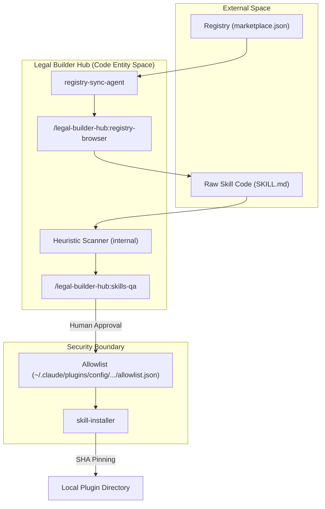
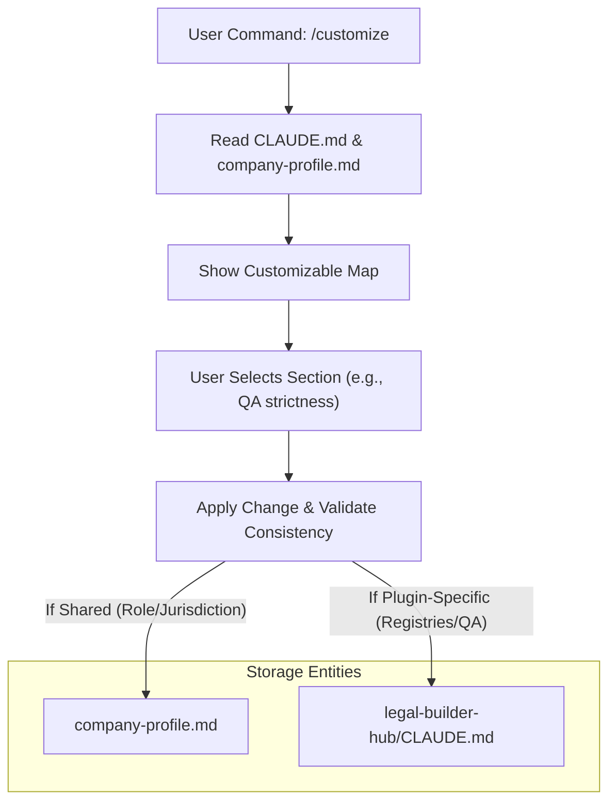
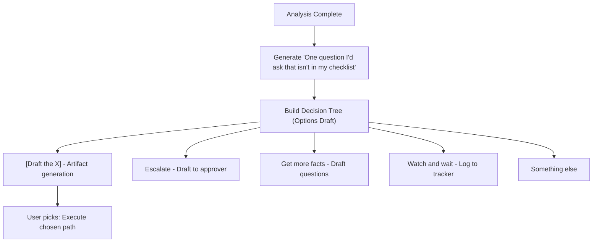

<!-- source: DeepWiki mcp.deepwiki.com · repo anthropics/claude-for-legal · page 3.7 Legal Builder Hub · fetched 2026-10-26 -->

# Legal Builder Hub

Relevant source files

The following files were used as context for generating this wiki page:

- [legal-builder-hub/.claude-plugin/plugin.json](legal-builder-hub/.claude-plugin/plugin.json)
- [legal-builder-hub/CLAUDE.md](legal-builder-hub/CLAUDE.md)
- [legal-builder-hub/skills/customize/SKILL.md](legal-builder-hub/skills/customize/SKILL.md)

The Legal Builder Hub (`legal-builder-hub`) is a specialized plugin designed to manage the lifecycle of legal skills within the Claude for Legal ecosystem. It serves as the discovery and security layer for community-contributed skills, providing a structured pipeline for finding, evaluating, installing, and updating skills while maintaining a strict "attorney-in-the-loop" security model.

## Overview and Purpose

The Hub addresses the challenge of extending the platform's capabilities with community content without compromising the security or legal integrity of the user's environment. It implements a trust pipeline that transitions untrusted code through heuristic scanning and human approval before it is permitted to execute against a user's practice profile or documents.

**Key Responsibilities:**
*   **Discovery:** Browsing the community skill registry via the `registry-browser` skill.
*   **Security Gatekeeping:** Enforcing an allowlist model and performing heuristic scans on raw skill code.
*   **Quality Assurance:** Evaluating new skills against the **Legal Skill Design Framework** (LSDF) using the `skills-qa` agent.
*   **Lifecycle Management:** Handling installation, SHA-pinned updates, and uninstallation workflows.

Sources: [legal-builder-hub/.claude-plugin/plugin.json:1-8](), [legal-builder-hub/CLAUDE.md:48-58]()

---

## The Skill-Installer Trust Pipeline

The Hub utilizes a multi-stage pipeline to move a community skill from a remote registry to a local, executable state. This process ensures that no third-party code is executed without explicit human review of its logic and security posture.

### Data Flow: Remote Registry to Local Install

Title: Skill Installation and Trust Verification Flow

Sources: [legal-builder-hub/CLAUDE.md:48-58](), [legal-builder-hub/.claude-plugin/plugin.json:1-8]()

### Pipeline Stages

1.  **Registry Sync:** The `registry-sync-agent` periodically fetches updates from the central marketplace registry to identify new or updated skills.
2.  **Raw Display:** Before installation, the Hub fetches the raw `SKILL.md` content and displays it to the user. This ensures the attorney can read the actual instructions the AI will follow.
3.  **Heuristic Scan:** An internal scanner checks for "red flag" patterns, such as attempts to bypass the `CLAUDE.md` safety net, hardcoded external URLs not in the allowlist, or prompts that suppress the "not legal advice" disclaimer.
4.  **Skills-QA:** The skill is evaluated against the Legal Skill Design Framework. This agent checks for:
    *   **Jurisdiction Awareness:** Does the skill handle non-US contexts correctly? [legal-builder-hub/CLAUDE.md:54-55]()
    *   **Output Formatting:** Does it include the required "What Next?" decision tree? [legal-builder-hub/CLAUDE.md:60-71]()
    *   **Role Sensitivity:** Does it adapt its output if the user is a non-lawyer? [legal-builder-hub/CLAUDE.md:56-57]()
5.  **Human Approval:** The user must explicitly confirm the installation after reviewing the QA report and the raw code.

---

## Security Model and Allowlist

The Hub operates on a strict **allowlist security model**. No skill outside of the core `claude-for-legal` first-party set is permitted to run unless it has been registered in the user's local configuration.

### Configuration and Persistence
User-specific configuration and the allowlist are stored in a version-independent path to ensure they survive plugin updates.

*   **Config Path:** `~/.claude/plugins/config/claude-for-legal/legal-builder-hub/CLAUDE.md` [legal-builder-hub/CLAUDE.md:4-6]()
*   **Shared Profile:** The Hub reads from the shared `company-profile.md` to understand the user's role and risk posture before recommending or QA'ing skills. [legal-builder-hub/CLAUDE.md:18-19]()

### Customization and Profile Management
The `/customize` skill allows users to modify their Hub configuration without re-running the full cold-start interview. This includes adjusting "Watched registries", "QA strictness", and "Update preferences".

Title: Customization Logic and Data Persistence

Sources: [legal-builder-hub/skills/customize/SKILL.md:12-79](), [legal-builder-hub/CLAUDE.md:4-19]()

### Non-Lawyer Safeguards
If the practice profile identifies the user as a non-lawyer, the Hub modifies its own output structure:
*   **Attorney Brief:** Summaries of proposed installs are placed at the top for supervising attorneys. [legal-builder-hub/CLAUDE.md:56-56]()
*   **Plain-English Gloss:** Legal shorthand and statutory citations (e.g., Cal. Lab. Code §1400) are accompanied by simplified explanations in parentheses. [legal-builder-hub/CLAUDE.md:56-56]()

Sources: [legal-builder-hub/CLAUDE.md:4-19](), [legal-builder-hub/CLAUDE.md:56-57](), [legal-builder-hub/skills/customize/SKILL.md:35-37]()

---

## Auto-Updater and SHA Pinning

To prevent "supply chain" attacks where a community skill is updated with malicious instructions after initial approval, the Hub implements an **Auto-Updater with SHA Pinning**.

1.  **Pinning:** During installation, the Hub records the SHA-256 hash of the skill's source code.
2.  **Verification:** The `auto-updater` skill compares the current remote hash with the pinned local hash.
3.  **Diff Review:** If a change is detected, the Hub does not automatically update. Instead, it presents a diff of the changes to the user.
4.  **Re-Approval:** The user must re-run the `skills-qa` process or manually approve the new version before the local code is replaced.

Sources: [legal-builder-hub/CLAUDE.md:42-43](), [legal-builder-hub/.claude-plugin/plugin.json:4-4]()

---

## Implementation Details: Key Skills

| Skill / Agent | Function |
|---|---|
| `/legal-builder-hub:cold-start-interview` | Initializes the practice profile and sets the user's role (Lawyer/Non-lawyer). [legal-builder-hub/CLAUDE.md:10-10]() |
| `/legal-builder-hub:registry-browser` | Interface for searching the community marketplace. [legal-builder-hub/CLAUDE.md:42-42]() |
| `/legal-builder-hub:skills-qa` | Agent that audits a skill's logic against LSDF safety and quality standards. [legal-builder-hub/CLAUDE.md:54-57]() |
| `/legal-builder-hub:auto-updater` | Manages SHA-pinned updates for all installed community skills. [legal-builder-hub/CLAUDE.md:42-42]() |
| `/legal-builder-hub:customize` | Guided adjustment of registries, update cadence, and QA strictness. [legal-builder-hub/skills/customize/SKILL.md:2-10]() |

### Decision Tree Generation
Every skill managed or evaluated by the Hub is required to conclude with a "Next steps decision tree." This ensures that the AI never makes a final legal decision, but instead provides a menu of options for the attorney to select from.

Title: Decision Tree Logic in legal-builder-hub

Sources: [legal-builder-hub/CLAUDE.md:60-71]()

---

## Registry-Sync Agent

The `registry-sync-agent` is a background process that maintains parity between the local marketplace cache and the remote `marketplace.json` registry.

**Data Flow:**
1.  **Trigger:** Scheduled execution or manual call to `--check-integrations`. [legal-builder-hub/CLAUDE.md:44-44]()
2.  **Fetch:** Downloads the latest `marketplace.json`.
3.  **Notify:** If Slack integration is enabled (`Status: [✓]`), it posts notifications about new skills or available updates. [legal-builder-hub/CLAUDE.md:40-42]()
4.  **Cache:** Updates the local metadata used by the `registry-browser`.

Sources: [legal-builder-hub/CLAUDE.md:40-44](), [legal-builder-hub/CLAUDE.md:10-10]()

---

