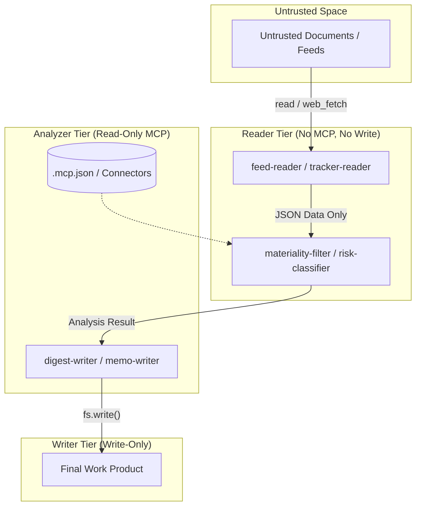
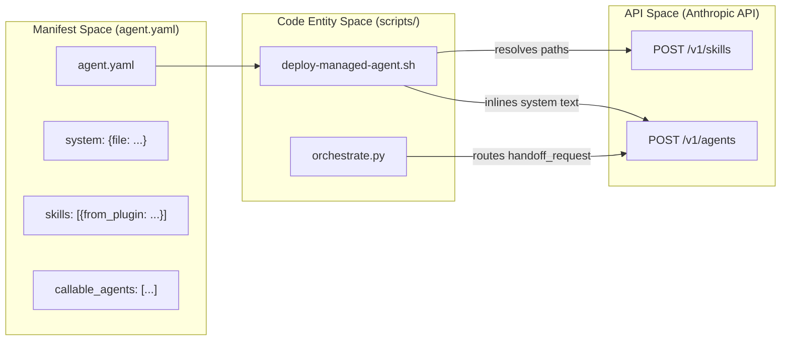

<!-- source: DeepWiki mcp.deepwiki.com · repo anthropics/claude-for-legal · page 4 Managed Agent Cookbooks · fetched 2026-10-26 -->

# Managed Agent Cookbooks

Relevant source files

The following files were used as context for generating this wiki page:

- [managed-agent-cookbooks/README.md](managed-agent-cookbooks/README.md)
- [managed-agent-cookbooks/launch-radar/README.md](managed-agent-cookbooks/launch-radar/README.md)
- [managed-agent-cookbooks/reg-monitor/README.md](managed-agent-cookbooks/reg-monitor/README.md)
- [managed-agent-cookbooks/reg-monitor/agent.yaml](managed-agent-cookbooks/reg-monitor/agent.yaml)

Managed Agent Cookbooks are deployment templates that allow the legal-specific agents found in this repository to run as **Claude Managed Agents**. While the core plugins are designed for interactive use via Claude Code, these cookbooks provide a path for platform teams to deploy the same logic behind a workflow engine for automated, headless operations.

Each cookbook directory contains a deploy manifest (`agent.yaml`) that references the canonical system prompts and skills from its parent plugin, ensuring a single source of truth across both interactive and automated surfaces [managed-agent-cookbooks/README.md:1-5]().

## Five Core Templates

The repository provides five specialized templates corresponding to high-value legal automation tasks. Each template maps to a specific practice-area plugin and defines a set of "leaf workers" to handle the task.

| Agent | Parent Plugin | Monitoring Target | Leaf Workers |
|---|---|---|---|
| `reg-monitor` | `regulatory-legal` | Regulatory feeds (Federal Register, agency RSS) | `feed-reader`, `materiality-filter`, **`digest-writer`** |
| `renewal-watcher` | `commercial-legal` | Contract repositories (e.g., Ironclad) | `repo-reader`, `deadline-calculator`, **`alert-writer`** |
| `diligence-grid` | `corporate-legal` | Virtual Data Rooms (e.g., Box, iManage) | `doc-reader`, `extractor`, `normalizer`, **`grid-writer`** |
| `launch-radar` | `product-legal` | Product roadmaps (e.g., Jira, Linear) | `tracker-reader`, `risk-classifier`, **`memo-writer`** |
| `docket-watcher` | `litigation-legal` | Court dockets (e.g., Trellis, CourtListener) | `docket-reader`, `deadline-mapper`, **`tracker-writer`** |

*Note: **Bold** workers are the only ones granted `Write` permissions.* [managed-agent-cookbooks/README.md:9-17]().

Sources: [managed-agent-cookbooks/README.md:9-17](), [managed-agent-cookbooks/reg-monitor/README.md:1-6]()

## Security Model: Three-Tier Worker Split

Legal documents and court filings are considered **untrusted input**. To mitigate risks like prompt injection, all cookbooks follow a strict three-tier security model that separates document reading from final output generation [managed-agent-cookbooks/README.md:37-39]().

### The Tiered Architecture

1.  **Readers**: These workers interact directly with untrusted documents. They are restricted to `Read` and `Grep` tools and have no MCP or Network access. They output length-capped, structured JSON where instructions are treated as data, not commands [managed-agent-cookbooks/README.md:41](), [managed-agent-cookbooks/reg-monitor/README.md:32]().
2.  **Analyzers**: These workers (often the Orchestrator or a specialized filter) process the structured JSON from Readers. They apply business rules and may have MCP read-only access for verification (e.g., checking a policy library), but they cannot write to the filesystem [managed-agent-cookbooks/README.md:42](), [managed-agent-cookbooks/reg-monitor/README.md:33]().
3.  **Writers**: These are the only workers granted `Write` permissions. They produce the final work product (e.g., a digest or memo) based on the analysis. Crucially, they never see the raw, untrusted documents [managed-agent-cookbooks/README.md:43](), [managed-agent-cookbooks/reg-monitor/README.md:34]().

### Security Flow Diagram
"Worker Privilege Separation"

Sources: [managed-agent-cookbooks/README.md:37-45](), [managed-agent-cookbooks/reg-monitor/README.md:28-36](), [managed-agent-cookbooks/launch-radar/README.md:32-40]()

## Deployment and Manifests

The `agent.yaml` manifest serves as the configuration blueprint for the `POST /v1/agents` API. It uses specific conventions to resolve local file paths and plugin skills into a flat API payload [managed-agent-cookbooks/README.md:19-21]().

*   **Skill Resolution**: Using `from_plugin: ../../<plugin>` automatically uploads all skills found in that plugin's directory [managed-agent-cookbooks/README.md:27]().
*   **System Prompts**: The `system: {file: ...}` convention allows managed agents to inherit the exact same instructions used by the interactive Claude Code agents [managed-agent-cookbooks/README.md:25]().
*   **Subagent Creation**: The `callable_agents` field defines the hierarchy of Readers, Analyzers, and Writers [managed-agent-cookbooks/README.md:29]().

For detailed information on the manifest format and the deployment script, see [Agent Manifest Format and Deployment](#4.1).

Sources: [managed-agent-cookbooks/README.md:19-31](), [managed-agent-cookbooks/reg-monitor/agent.yaml:1-39]()

## Orchestration and Handoffs

Managed agents do not call each other directly to maintain security boundaries. Instead, when an agent requires action from another (e.g., a `launch-radar` surfaces a launch that needs a full review memo), it emits a `handoff_request` [managed-agent-cookbooks/README.md:33-35](), [managed-agent-cookbooks/launch-radar/README.md:42]().

A central orchestrator (referencing `scripts/orchestrate.py`) captures these requests and routes them as new steering events to the appropriate target session [managed-agent-cookbooks/README.md:35](). This ensures that the orchestrator can enforce an allowlist of targets and validate payloads against a strict schema [managed-agent-cookbooks/reg-monitor/README.md:38]().

For details on the handoff schema and routing logic, see [Cross-Agent Handoff and Orchestration](#4.2).

### Agent-to-Code Mapping
"Manifest to API Resolution"

Sources: [managed-agent-cookbooks/README.md:19-35](), [managed-agent-cookbooks/reg-monitor/agent.yaml:1-39]()

## Attorney-in-the-Loop Requirement

Every cookbook is configured with a "headless append" that reinforces the **attorney-review model**. The agents are instructed to prepend work-product headers and to frame all outputs as "leads" or "screened items" rather than legal conclusions [managed-agent-cookbooks/README.md:47-49](), [managed-agent-cookbooks/reg-monitor/agent.yaml:8-17]().

Deployment teams must adapt these templates to their specific environments by:
1.  **Wiring MCP connectors**: Point the connectors at your internal systems (e.g., Ironclad, Jira, GDrive) [managed-agent-cookbooks/README.md:53-54](), [managed-agent-cookbooks/launch-radar/README.md:48]().
2.  **Configuring notification targets**: Update the `handoff_request` logic to point to specific Slack channels or email endpoints [managed-agent-cookbooks/reg-monitor/README.md:47]().
3.  **Tuning thresholds**: Calibrate the materiality thresholds and risk keywords within the `CLAUDE.md` practice profile or system prompts [managed-agent-cookbooks/reg-monitor/README.md:48-49](), [managed-agent-cookbooks/launch-radar/README.md:52]().

Sources: [managed-agent-cookbooks/README.md:47-56](), [managed-agent-cookbooks/reg-monitor/README.md:7-13](), [managed-agent-cookbooks/launch-radar/README.md:44-54]()

---

