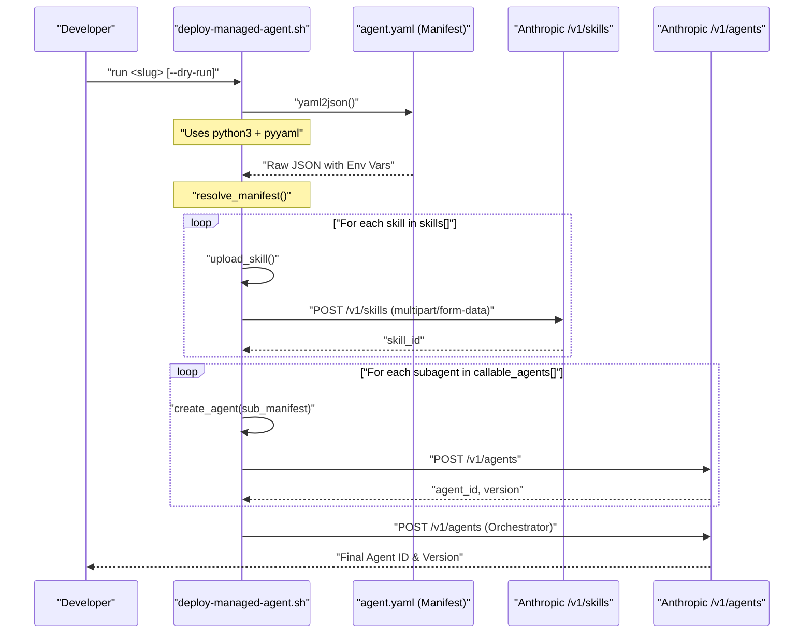
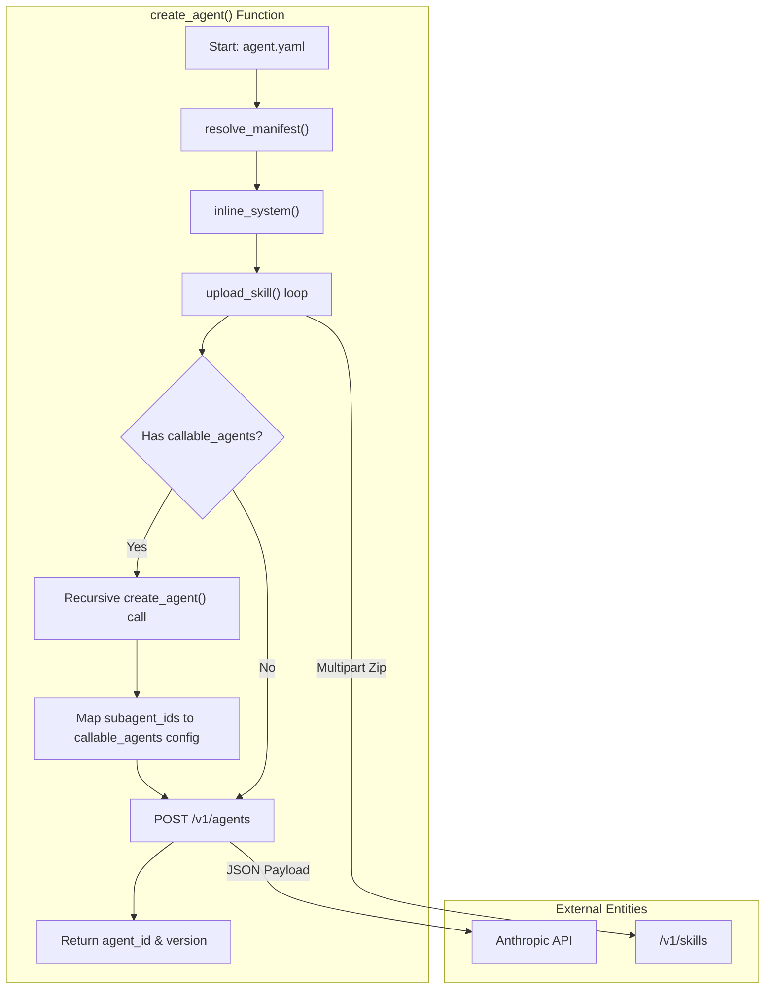

<!-- source: DeepWiki mcp.deepwiki.com · repo anthropics/claude-for-legal · page 4.1 Agent Manifest Format and Deployment · fetched 2026-10-26 -->

# Agent Manifest Format and Deployment

Relevant source files

The following files were used as context for generating this wiki page:

- [managed-agent-cookbooks/launch-radar/agent.yaml](managed-agent-cookbooks/launch-radar/agent.yaml)
- [managed-agent-cookbooks/reg-monitor/agent.yaml](managed-agent-cookbooks/reg-monitor/agent.yaml)
- [managed-agent-cookbooks/reg-monitor/subagents/feed-reader.yaml](managed-agent-cookbooks/reg-monitor/subagents/feed-reader.yaml)
- [managed-agent-cookbooks/reg-monitor/subagents/materiality-filter.yaml](managed-agent-cookbooks/reg-monitor/subagents/materiality-filter.yaml)
- [scripts/deploy-managed-agent.sh](scripts/deploy-managed-agent.sh)

This page details the `agent.yaml` manifest conventions used in the Claude for Legal managed-agent cookbooks and the deployment pipeline that transforms these manifests into production-ready Claude Managed Agents via the Anthropic API.

## Overview

The deployment process bridges the gap between the local plugin architecture and the Anthropic Managed Agents API. It allows legal engineering teams to take the same skills and prompts used in interactive sessions and deploy them as headless workers.

The core of this system is `scripts/deploy-managed-agent.sh`, which resolves manifest conveniences—such as file references and plugin skill imports—into the final JSON payloads required by the `/v1/agents` and `/v1/skills` endpoints [scripts/deploy-managed-agent.sh:6-12]().

## Manifest Format (`agent.yaml`)

The `agent.yaml` file follows the structure of the `POST /v1/agents` payload but introduces several "convenience keys" that the deployment script expands at runtime.

### System Prompt Resolution
The `system` field can be a string or an object that references external files. This ensures the managed agent uses the exact same prompt logic as the local plugin.

| Key | Description |
|---|---|
| `file` | Path to a markdown file containing the base system prompt [scripts/deploy-managed-agent.sh:136-143](). |
| `text` | Inline string content for the system prompt [scripts/deploy-managed-agent.sh:134-135](). |
| `append` | Additional instructions (e.g., headless-specific constraints) appended to the resolved text [scripts/deploy-managed-agent.sh:144-144](). |

### Skill Management
Managed agents use "Skills" (zipped bundles of code and prompts). The manifest supports two ways to reference them:
1.  **`from_plugin`**: Automatically discovers and uploads every skill directory found within a specific practice-area plugin [scripts/deploy-managed-agent.sh:114-124]().
2.  **`path`**: References a specific skill directory relative to the manifest [scripts/deploy-managed-agent.sh:127-127]().

### Subagent Delegation (`callable_agents`)
The manifest allows for delegation. An orchestrator agent defines `callable_agents` by referencing their sub-manifest files [scripts/deploy-managed-agent.sh:172-172](). The deployment script ensures that all subagents are created first so their generated `agent_id` can be injected into the orchestrator's configuration [scripts/deploy-managed-agent.sh:165-172]().

**Sources:** [scripts/deploy-managed-agent.sh:6-12](), [scripts/deploy-managed-agent.sh:107-131](), [scripts/deploy-managed-agent.sh:133-149](), [managed-agent-cookbooks/reg-monitor/agent.yaml:6-38]()

---

## Deployment Logic and Data Flow

The `deploy-managed-agent.sh` script coordinates the transformation from YAML to API calls.

### Deployment Sequence Diagram

"Natural Language Space" (Manifests) to "Code Entity Space" (API & Scripts)

**Sources:** [scripts/deploy-managed-agent.sh:19-50](), [scripts/deploy-managed-agent.sh:55-71](), [scripts/deploy-managed-agent.sh:75-105](), [scripts/deploy-managed-agent.sh:151-184]()

---

## Implementation Details

### Skill Uploading (`upload_skill`)
The `upload_skill` function handles the packaging of skill directories into `.zip` files. It uses a `SKILL_CACHE_FILE` to avoid redundant uploads of the same skill during a multi-agent deployment [scripts/deploy-managed-agent.sh:73-79]().
*   **API Version:** `2023-06-01` [scripts/deploy-managed-agent.sh:91-91]()
*   **Beta Header:** `skills-2025-10-02` [scripts/deploy-managed-agent.sh:92-92]()
*   **Naming:** Skills are prefixed with `SKILL_TITLE_PREFIX` (if set) to allow environment-specific namespacing [scripts/deploy-managed-agent.sh:93-93]().

### Environment Variable Substitution
The script supports `${VAR}` syntax within `agent.yaml`. This is primarily used for injecting MCP server URLs and API keys into the agent configuration [scripts/deploy-managed-agent.sh:67-68]().
*   **Security:** A `SAFE` regex (`^[A-Za-z0-9._/:@-]*$`) is enforced on all substituted values to prevent shell injection or malicious payload manipulation [scripts/deploy-managed-agent.sh:58-66]().

### Dry-Run Mode
When invoked with `--dry-run`, the script performs all resolutions (including zip creation) but mocks the API responses. It outputs the final JSON bodies that would have been sent to the Anthropic API, ordered from "leaf" subagents to the "root" orchestrator [scripts/deploy-managed-agent.sh:177-180]().

### Deployment Requirements
| Requirement | Detail |
|---|---|
| **Tools** | `jq`, `python3`, `pyyaml`, `curl`, `zip` [scripts/deploy-managed-agent.sh:53-54](), [scripts/deploy-managed-agent.sh:87-87]() |
| **Env Vars** | `ANTHROPIC_API_KEY`, `ANTHROPIC_API_BASE` (optional) [scripts/deploy-managed-agent.sh:23-24]() |
| **Permissions** | The API key must have permissions for both `managed-agents` and `skills` betas [scripts/deploy-managed-agent.sh:48-92]() |

**Sources:** [scripts/deploy-managed-agent.sh:17-105](), [scripts/deploy-managed-agent.sh:177-180]()

---

## Agent Creation Flow

The following diagram illustrates how the `create_agent` function recursively resolves dependencies.

### Agent Resolution Logic

**Sources:** [scripts/deploy-managed-agent.sh:151-184](), [scripts/deploy-managed-agent.sh:107-131](), [scripts/deploy-managed-agent.sh:133-149]()

---

