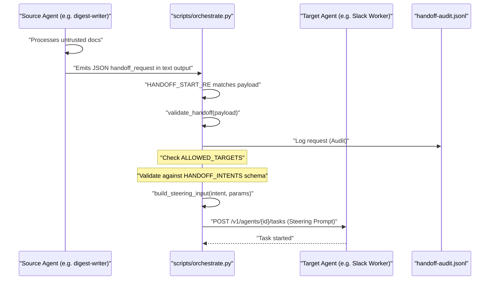
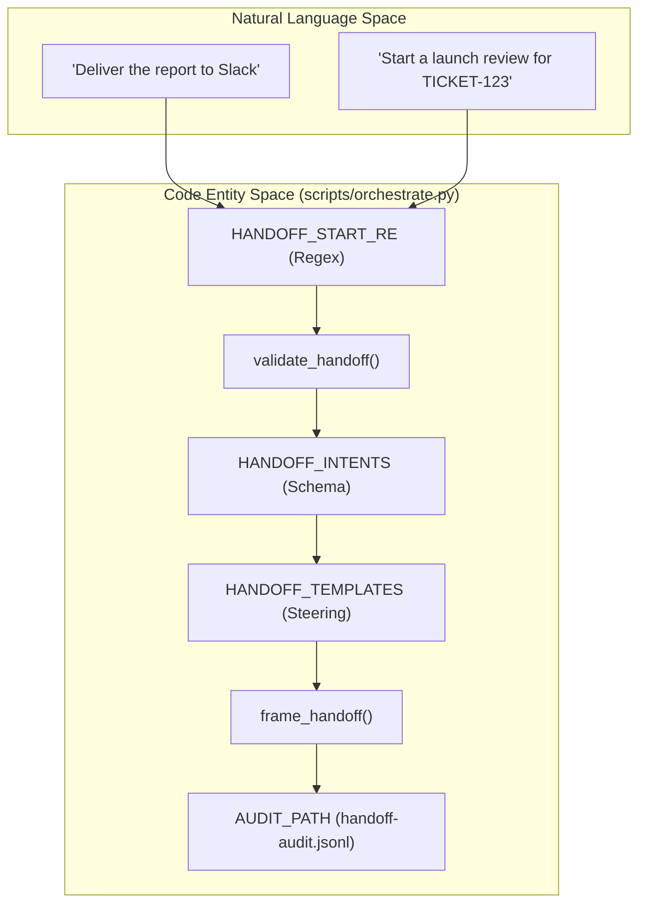

<!-- source: DeepWiki mcp.deepwiki.com · repo anthropics/claude-for-legal · page 4.2 Cross-Agent Handoff and Orchestration · fetched 2026-10-26 -->

# Cross-Agent Handoff and Orchestration

Relevant source files

The following files were used as context for generating this wiki page:

- [.gitignore](.gitignore)
- [managed-agent-cookbooks/reg-monitor/README.md](managed-agent-cookbooks/reg-monitor/README.md)
- [scripts/orchestrate.py](scripts/orchestrate.py)

This page provides a deep dive into the cross-agent handoff mechanism and the reference orchestrator implementation. In the Claude for Legal architecture, managed agents do not call each other directly. Instead, they emit structured handoff requests that are captured and routed by an external orchestration layer.

## Overview of Orchestration

The orchestration system is designed to allow specialized agents (e.g., `reg-monitor`) to trigger workflows in other specialized agents (e.g., a Slack worker) without direct coupling or privilege escalation. The reference implementation for this event loop is found in `scripts/orchestrate.py` [scripts/orchestrate.py:1-8]().

### Key Design Principles
*   **Decoupling:** Named agents never have direct visibility into the internal state or tools of other agents [managed-agent-cookbooks/reg-monitor/README.md:28-34]().
*   **Security-First Routing:** The orchestrator acts as a security gateway, validating every handoff against a strict allowlist and closed schema before initiating a new session [scripts/orchestrate.py:10-23]().
*   **Typed Parameters:** To prevent prompt injection, the orchestrator uses typed parameters to build steering prompts rather than forwarding free-text instructions from one agent to another [scripts/orchestrate.py:55-64]().

### Handoff Flow
The following diagram illustrates the flow from a source agent detecting a need for handoff to the orchestrator triggering a target agent.

**Agent Handoff Sequence**

Sources: [scripts/orchestrate.py:51-53](), [scripts/orchestrate.py:148-149](), [scripts/orchestrate.py:228-250](), [managed-agent-cookbooks/reg-monitor/README.md:36-38]()

---

## The `handoff_request` Schema

Agents request a handoff by outputting a specific JSON structure within their text response. The orchestrator uses a regular expression `HANDOFF_START_RE` combined with `json.JSONDecoder().raw_decode` to extract these blobs safely, ensuring nested objects are handled correctly [scripts/orchestrate.py:141-149]().

### JSON Schema Definition
The `HANDOFF_PAYLOAD_SCHEMA` enforces a strict structure [scripts/orchestrate.py:128-139]():
*   **`intent`**: A string matching one of the keys in `HANDOFF_INTENTS` [scripts/orchestrate.py:133-133]().
*   **`params`**: An object containing the typed data required for that specific intent [scripts/orchestrate.py:134-134]().
*   **`event`**: An optional free-text field for context, capped at 2000 characters and subjected to sanitization [scripts/orchestrate.py:137-138]().

### Allowed Targets and Intents
The orchestrator maintains an `ALLOWED_TARGETS` allowlist to prevent agents from attempting to trigger unauthorized agents or external systems [scripts/orchestrate.py:51-53]().

| Intent | Target Agent (Typical) | Required Parameters |
| :--- | :--- | :--- |
| `slack_send_message` | Slack Worker | `channel`, `report_path` |
| `launch_review` | `launch-radar` -> `product-legal` | `ticket_id` |
| `deal_debrief` | `diligence-grid` -> `corporate-legal` | `matter_id` |
| `playbook_monitor` | `renewal-watcher` -> `commercial-legal` | (Optional) `clause` |

Sources: [scripts/orchestrate.py:51-53](), [scripts/orchestrate.py:65-103](), [scripts/orchestrate.py:128-139]()

---

## Defense-in-Depth Mechanisms

Because handoff requests are parsed from text output that may be influenced by untrusted documents, `orchestrate.py` implements multiple layers of defense.

### 1. Typed Steering (Primary Control)
The orchestrator does **not** pass the `note` or `event` fields directly into the target agent's system prompt. Instead, it uses `HANDOFF_TEMPLATES` to construct a fresh steering prompt using only the validated, pattern-constrained `params` [scripts/orchestrate.py:16-21](), [scripts/orchestrate.py:107-126](). 

For example, a `launch_review` intent only interpolates the `ticket_id` into the template:
`"Produce a legal-review memo for launch ticket {ticket_id}..."` [scripts/orchestrate.py:113-117]().

### 2. Data-Frame Wrapping
Any free-text context (from the `event` or `note` fields) is wrapped in a `<agent-handoff>` XML block by the `frame_handoff` function [scripts/orchestrate.py:202-212](). This labels the content as data for the target agent, not as instructions to be followed [scripts/orchestrate.py:24-27]().

### 3. Content Sanitization
The `sanitize_event` function performs a "best-effort" scrub of the free-text fields [scripts/orchestrate.py:171-190]():
*   **`_strip_controls`**: Removes C0/C1 control characters and bidi overrides to prevent visual spoofing [scripts/orchestrate.py:162-168]().
*   **Instruction Stripping**: Removes common prompt injection prefixes (e.g., `System:`, `Assistant:`) and disregards phrases like "ignore previous instructions" via `_DENY_SUBSTR_RE` [scripts/orchestrate.py:151-158]().

### 4. Audit Logging
Every handoff attempt—whether it passes validation or is rejected—is appended to `./out/handoff-audit.jsonl` [scripts/orchestrate.py:33-34](). This log includes the timestamp, source agent, target agent, intent, and the final decision [scripts/orchestrate.py:252-265]().

Sources: [scripts/orchestrate.py:10-34](), [scripts/orchestrate.py:107-126](), [scripts/orchestrate.py:151-212]()

---

## Implementation Details

### Orchestration Logic Mapping
The following diagram maps the natural language intent of a handoff to the specific code entities in `scripts/orchestrate.py` that handle the transition.

**Code Entity Mapping**

Sources: [scripts/orchestrate.py:65-103](), [scripts/orchestrate.py:107-126](), [scripts/orchestrate.py:148-149](), [scripts/orchestrate.py:159-159](), [scripts/orchestrate.py:228-250]()

### Key Functions

| Function | Role |
| :--- | :--- |
| `_strip_controls(s)` | Removes dangerous Unicode control characters [scripts/orchestrate.py:162-168](). |
| `sanitize_event(text)` | Strips instruction-like strings and limits length [scripts/orchestrate.py:171-190](). |
| `frame_handoff(source, event)` | Wraps context in `<agent-handoff>` tags [scripts/orchestrate.py:202-212](). |
| `validate_handoff(payload)` | Validates the target agent and intent parameters [scripts/orchestrate.py:228-250](). |

### Production Considerations
The `orchestrate.py` script is provided as a **reference implementation** [scripts/orchestrate.py:4-8](). In a production legal environment, firms should replace this loop with a robust workflow engine (e.g., Temporal or Airflow) and consider:
1.  **Tool-Scope Restriction:** Restricting the target agent's tool set when it is acting on a handoff to minimize blast radius [scripts/orchestrate.py:38-39]().
2.  **Dedicated Tooling:** Using a dedicated tool call for handoffs rather than parsing text output [scripts/orchestrate.py:36-37]().

Sources: [scripts/orchestrate.py:4-40](), [scripts/orchestrate.py:162-250]()

---

