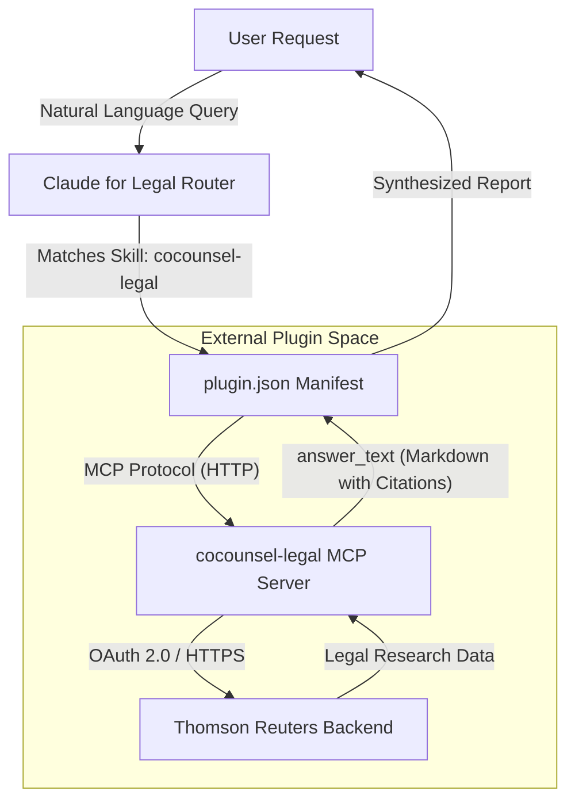
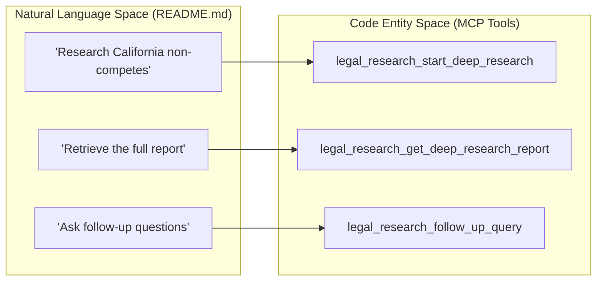

<!-- source: DeepWiki mcp.deepwiki.com · repo anthropics/claude-for-legal · page 5 External Plugins · fetched 2026-10-26 -->

# External Plugins

Relevant source files

The following files were used as context for generating this wiki page:

- [external_plugins/cocounsel-legal/.claude-plugin/plugin.json](external_plugins/cocounsel-legal/.claude-plugin/plugin.json)
- [external_plugins/cocounsel-legal/.mcp.json](external_plugins/cocounsel-legal/.mcp.json)
- [external_plugins/cocounsel-legal/README.md](external_plugins/cocounsel-legal/README.md)

The Claude for Legal ecosystem is designed with an open plugin architecture that allows third-party legal technology providers to integrate their specialized capabilities directly into the Claude interface. These external plugins follow the same manifest and skill conventions as first-party plugins but are hosted and maintained by external partners.

External plugins are registered in the global `marketplace.json` and utilize the Model Context Protocol (MCP) to securely connect Claude to external legal databases and proprietary reasoning engines.

## CoCounsel Legal (Thomson Reuters)

The primary external plugin currently supported is **CoCounsel Legal** by Thomson Reuters. This plugin integrates **Westlaw Deep Research** capabilities, allowing users to conduct sophisticated legal research across U.S. federal and state jurisdictions without leaving the Claude environment.

### Core Capabilities
The plugin provides a comprehensive research lifecycle—from query framing to final report generation—utilizing Westlaw's database of case law, statutes, and administrative materials.

*   **Deep Research Reports:** Generates synthesized reports with inline, linked citations to Westlaw and Practical Law sources [external_plugins/cocounsel-legal/.claude-plugin/plugin.json:4-4]().
*   **Jurisdictional Support:** Supports research in up to three U.S. jurisdictions (federal or state) simultaneously [external_plugins/cocounsel-legal/README.md:6-6]().
*   **Follow-up Support:** Allows users to ask subsequent questions about a research report within the same conversation thread without restarting the research process [external_plugins/cocounsel-legal/README.md:8-8]().
*   **Source Coverage:** Reports cite case law, statutes, regulations, administrative materials, secondary sources, and current awareness content like JD Supra [external_plugins/cocounsel-legal/README.md:3-3](), [external_plugins/cocounsel-legal/README.md:18-18]().

### Technical Integration
The plugin is defined by a standard manifest [external_plugins/cocounsel-legal/.claude-plugin/plugin.json:1-9]() and connects to Thomson Reuters via an HTTP-based MCP server [external_plugins/cocounsel-legal/.mcp.json:1-11](). Authentication is handled via OAuth using a specific `clientId` [external_plugins/cocounsel-legal/.mcp.json:6-8]().

For detailed usage guidelines, supported jurisdictions, and skill entrypoints, see [CoCounsel Legal (Thomson Reuters)](#5.1).

**Sources:**
- [external_plugins/cocounsel-legal/.claude-plugin/plugin.json:1-9]()
- [external_plugins/cocounsel-legal/.mcp.json:1-11]()
- [external_plugins/cocounsel-legal/README.md:1-15]()

---

## Plugin Architecture and Registration

External plugins differ from first-party plugins primarily in their authorship and the location of their underlying logic. While first-party skills often execute logic via local scripts or internal prompts, external plugins typically act as orchestrators for remote MCP services.

### External Plugin Registration
Plugins are registered with the following metadata:
*   **Name and Version:** Unique identifier used for skill routing (e.g., `cocounsel-legal`, version `0.1.0`) [external_plugins/cocounsel-legal/.claude-plugin/plugin.json:2-3]().
*   **MCP Configuration:** The `.mcp.json` file defines the remote endpoint (`https://legal-mcp.thomsonreuters.com/mcp`) and OAuth credentials required to access the third-party service [external_plugins/cocounsel-legal/.mcp.json:5-8]().
*   **Author Information:** Includes the organization name and support email for troubleshooting [external_plugins/cocounsel-legal/.claude-plugin/plugin.json:5-8]().

### System Flow: Natural Language to External MCP
The following diagram illustrates how a user request for legal research is routed through the `cocounsel-legal` plugin to the external Thomson Reuters MCP server.

**CoCounsel External Integration Flow**

**Sources:**
- [external_plugins/cocounsel-legal/.claude-plugin/plugin.json:1-9]()
- [external_plugins/cocounsel-legal/.mcp.json:1-11]()
- [external_plugins/cocounsel-legal/README.md:1-9]()

---

## Skill Implementation: Westlaw Deep Research

The external plugin architecture maps natural language intents to specific remote tool calls. In the case of CoCounsel, this facilitates a research workflow that can span multiple turns if necessary.

### Entity Mapping: Research Intent to MCP Tools
This diagram maps the logical research requirements described in the plugin documentation to the specific MCP tool identifiers used by the system.

**Skill to Tool Mapping**

### Usage Constraints
External plugins often define specific "When Not to Use" boundaries to ensure output quality and avoid unsupported operations. For CoCounsel Legal, these include:
*   **No Analytics:** Requests for judge or attorney analytics are not supported [external_plugins/cocounsel-legal/README.md:29-29]().
*   **No Calculations:** Filing date or outcome prediction calculations are excluded [external_plugins/cocounsel-legal/README.md:30-31]().
*   **Jurisdiction Limits:** Limited to three U.S. jurisdictions per run; foreign law is not supported [external_plugins/cocounsel-legal/README.md:36-39]().

**Sources:**
- [external_plugins/cocounsel-legal/README.md:16-41]()
- [external_plugins/cocounsel-legal/.mcp.json:1-11]()

---

