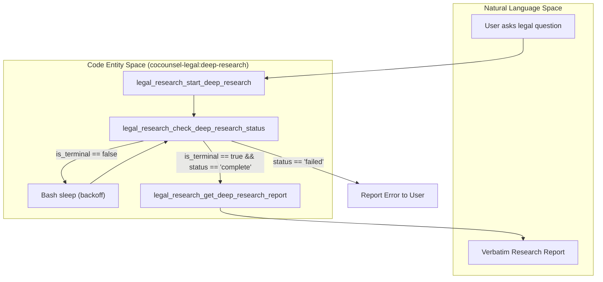
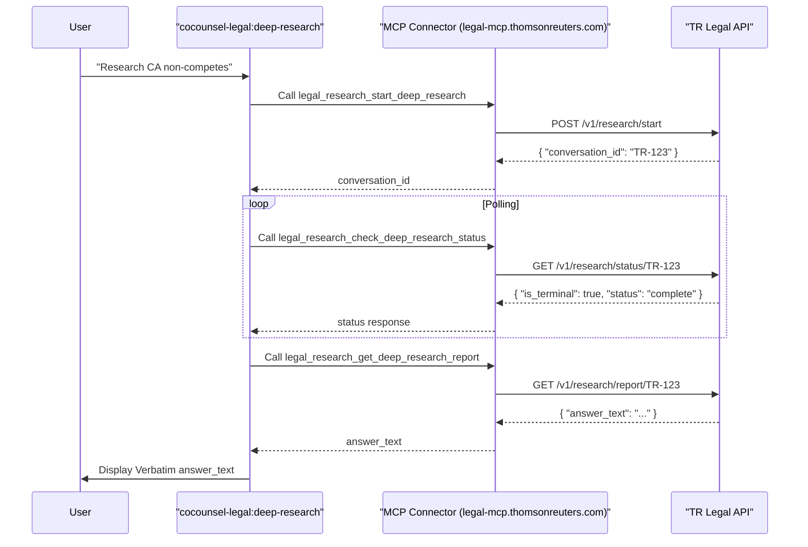

<!-- source: DeepWiki mcp.deepwiki.com · repo anthropics/claude-for-legal · page 5.1 CoCounsel Legal (Thomson Reuters) · fetched 2026-10-26 -->

# CoCounsel Legal (Thomson Reuters)

<details>
<summary>Relevant source files</summary>

The following files were used as context for generating this wiki page:

- [external_plugins/cocounsel-legal/.claude-plugin/plugin.json](external_plugins/cocounsel-legal/.claude-plugin/plugin.json)
- [external_plugins/cocounsel-legal/.mcp.json](external_plugins/cocounsel-legal/.mcp.json)
- [external_plugins/cocounsel-legal/README.md](external_plugins/cocounsel-legal/README.md)
- [external_plugins/cocounsel-legal/skills/deep-research/SKILL.md](external_plugins/cocounsel-legal/skills/deep-research/SKILL.md)

</details>


The `cocounsel-legal` plugin integrates Thomson Reuters' Westlaw Deep Research capabilities directly into the Claude for Legal environment. It allows users to perform sophisticated, jurisdiction-specific legal research across U.S. federal and state law, returning comprehensive reports that include inline, linked citations to Westlaw and Practical Law sources.

## Overview and Capabilities

This plugin acts as a bridge to the CoCounsel Legal agentic research engine. Unlike standard search tools, it mirrors the methodology of human researchers by systematically analyzing trusted content, including case law, statutes, regulations, administrative materials, and secondary sources [external_plugins/cocounsel-legal/README.md:1-3]().

### Key Features
*   **Multi-Jurisdictional Research:** Supports research in up to three U.S. jurisdictions in a single run [external_plugins/cocounsel-legal/README.md:6-6]().
*   **Persistent Conversations:** Users can retrieve reports from previous research sessions or ask follow-up questions within the same thread [external_plugins/cocounsel-legal/README.md:7-8]().
*   **Verified Citations:** Reports include verbatim source excerpts and linked citations to Westlaw and Practical Law [external_plugins/cocounsel-legal/skills/deep-research/SKILL.md:120-121]().
*   **Agentic Workflow:** The plugin autonomously manages the research lifecycle: initiation, status polling, and report retrieval [external_plugins/cocounsel-legal/skills/deep-research/SKILL.md:17-17]().

### Use Case Guidance

| Use These Capabilities | Do Not Use For |
| :--- | :--- |
| Analyzing how courts treat specific issues (e.g., non-competes) [external_plugins/cocounsel-legal/README.md:12-12]() | Retrieving the full text of a specific document [external_plugins/cocounsel-legal/README.md:27-27]() |
| Determining elements or defenses of a legal claim [external_plugins/cocounsel-legal/README.md:21-21]() | Analytics requests (e.g., judge ruling frequencies) [external_plugins/cocounsel-legal/README.md:29-29]() |
| Synthesizing arguments on unsettled legal questions [external_plugins/cocounsel-legal/README.md:23-23]() | Outcome predictions or filing date calculations [external_plugins/cocounsel-legal/README.md:30-31]() |
| Researching U.S. Federal and State law [external_plugins/cocounsel-legal/README.md:3-3]() | Foreign or non-U.S. law [external_plugins/cocounsel-legal/README.md:36-36]() |

**Sources:** [external_plugins/cocounsel-legal/README.md:1-41](), [external_plugins/cocounsel-legal/skills/deep-research/SKILL.md:23-62]()

---

## Technical Implementation

The plugin is implemented as an external extension using the Model Context Protocol (MCP). It communicates with Thomson Reuters' infrastructure via a secure HTTP-based MCP server [external_plugins/cocounsel-legal/.mcp.json:3-5]().

### Plugin Manifest and Configuration
The plugin is identified by the name `cocounsel-legal` [external_plugins/cocounsel-legal/.claude-plugin/plugin.json:2-2](). Its MCP configuration defines the endpoint and OAuth credentials required for communication.

**CoCounsel Legal MCP Configuration**
```json
{
    "mcpServers": {
        "cocounsel-legal": {
            "type": "http",
            "url": "https://legal-mcp.thomsonreuters.com/mcp",
            "oauth": {
                "clientId": "QCgP4IGN5JiLqXRHxiAVr3wu1ySo2nQx"
            }
        }
    }
}
```
**Sources:** [external_plugins/cocounsel-legal/.claude-plugin/plugin.json:1-9](), [external_plugins/cocounsel-legal/.mcp.json:1-11]()

### Data Flow: Deep Research Lifecycle

The research process follows a strictly defined state machine managed by the `deep-research` skill.

**Deep Research Process Flow**


**Sources:** [external_plugins/cocounsel-legal/skills/deep-research/SKILL.md:70-115]()

---

## Key Skill: deep-research

The `deep-research` skill is the primary entry point for the plugin. It is triggered by requests involving Westlaw, CoCounsel, or complex U.S. legal analysis [external_plugins/cocounsel-legal/skills/deep-research/SKILL.md:4-5]().

### Core Functions (MCP Tools)

| Tool Name | Purpose | Key Parameters |
| :--- | :--- | :--- |
| `legal_research_start_deep_research` | Initiates a new research session. | `query`, `jurisdictions` (max 3) [external_plugins/cocounsel-legal/skills/deep-research/SKILL.md:80-83]() |
| `legal_research_check_deep_research_status` | Polls the engine for progress. | `conversation_id` [external_plugins/cocounsel-legal/skills/deep-research/SKILL.md:95-95]() |
| `legal_research_get_deep_research_report` | Retrieves the final `answer_text`. | `conversation_id` [external_plugins/cocounsel-legal/skills/deep-research/SKILL.md:113-113]() |
| `follow_up_deep_research` | Continues research on the same topic. | `conversation_id`, `query` [external_plugins/cocounsel-legal/skills/deep-research/SKILL.md:116-116]() |

### Implementation Details

1.  **Initialization:** The skill extracts the legal question and up to three jurisdictions. If jurisdictions are missing, it must prompt the user before calling `legal_research_start_deep_research` [external_plugins/cocounsel-legal/skills/deep-research/SKILL.md:72-77]().
2.  **Polling Logic:** The skill implements a polling loop with mandatory backoff. It uses the `next_action_poll_backoff_ms` value provided by the server and adds an additional 5 seconds if `percent_complete` stalls across two checks [external_plugins/cocounsel-legal/skills/deep-research/SKILL.md:95-102]().
3.  **Output Integrity:** The skill is strictly forbidden from editing the `answer_text`. It must render the report verbatim, preserving all HTML anchors, markdown formatting, and horizontal rules [external_plugins/cocounsel-legal/skills/deep-research/SKILL.md:118-121]().
4.  **Communication Guardrails:** The skill must hide implementation details (like `conversation_id` or polling status) from the user, instead narrating the process in professional language [external_plugins/cocounsel-legal/skills/deep-research/SKILL.md:64-68]().

**Sources:** [external_plugins/cocounsel-legal/skills/deep-research/SKILL.md:1-127]()

---

## Integration Architecture

The following diagram illustrates how the `cocounsel-legal` plugin connects the Claude for Legal interface to the Thomson Reuters backend via the MCP server defined in `.mcp.json` [external_plugins/cocounsel-legal/.mcp.json:1-11]().

**System Integration Diagram**


**Sources:** [external_plugins/cocounsel-legal/.mcp.json:1-11](), [external_plugins/cocounsel-legal/skills/deep-research/SKILL.md:70-121]()

---

