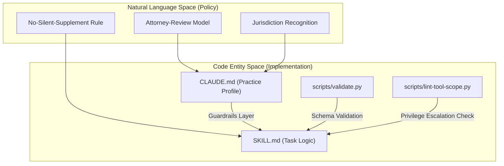
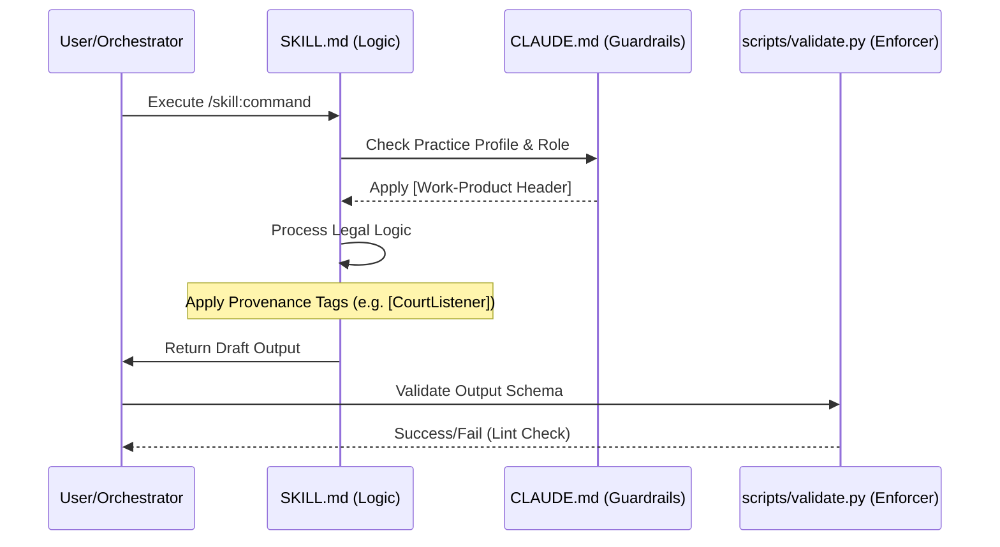

<!-- source: DeepWiki mcp.deepwiki.com · repo anthropics/claude-for-legal · page 6 Safety, Guardrails, and Output Quality · fetched 2026-10-26 -->

# Safety, Guardrails, and Output Quality

Relevant source files

The following files were used as context for generating this wiki page:

- [CLAUDE.md](CLAUDE.md)
- [README.md](README.md)
- [ai-governance-legal/README.md](ai-governance-legal/README.md)
- [ai-governance-legal/skills/customize/SKILL.md](ai-governance-legal/skills/customize/SKILL.md)
- [commercial-legal/skills/customize/SKILL.md](commercial-legal/skills/customize/SKILL.md)
- [regulatory-legal/CLAUDE.md](regulatory-legal/CLAUDE.md)
- [regulatory-legal/README.md](regulatory-legal/README.md)
- [regulatory-legal/agents/reg-change-monitor.md](regulatory-legal/agents/reg-change-monitor.md)
- [regulatory-legal/skills/customize/SKILL.md](regulatory-legal/skills/customize/SKILL.md)
- [regulatory-legal/skills/reg-feed-watcher/SKILL.md](regulatory-legal/skills/reg-feed-watcher/SKILL.md)

The Claude for Legal system is built on an **attorney-review model**, where the AI acts as a sophisticated drafting and analysis assistant rather than a substitute for legal counsel. This page provides a high-level overview of the system-wide safety architecture that ensures output quality, maintains privilege, and enforces rigorous citation standards.

## The Attorney-Review Model

Every output generated by the system is explicitly framed as a draft for professional review. This is enforced through a multi-layered safety architecture that combines system-level instructions, practice-specific profiles, and hard-coded UI/UX patterns.

### Work-Product Headers and Privilege
The system automatically prepends a work-product header to every analysis based on the user's role defined during the cold-start interview.
*   **Lawyers:** Receive `PRIVILEGED & CONFIDENTIAL — ATTORNEY WORK PRODUCT — PREPARED AT THE DIRECTION OF COUNSEL`.
*   **Non-lawyers:** Receive `RESEARCH NOTES — NOT LEGAL ADVICE — REVIEW WITH A LICENSED ATTORNEY BEFORE ACTING`.

The system also includes jurisdiction-specific warnings, noting that doctrines like "work product" are US-specific and may not apply in the EU or UK [regulatory-legal/CLAUDE.md:103-121]().

### The Reviewer Note Pre-flight
Before the substantive content of any deliverable, the system must provide a **Reviewer Note**. This block summarizes the "pre-flight" status of the output, including source verification, document coverage, and specific items flagged for human judgment [regulatory-legal/CLAUDE.md:125-135]().

| Marker | Meaning |
| :--- | :--- |
| `[verify]` | General instruction to check a legal claim against primary sources. |
| `[CITE]` | A placeholder indicating where a specific citation is required but missing. |
| `[SME VERIFY]` | Indicates a high-complexity legal conclusion that requires Subject Matter Expert review. |
| `[review]` | Inline tag for specific lines requiring attorney judgment [regulatory-legal/CLAUDE.md:130-130](). |

Sources: [README.md:16-20](), [regulatory-legal/CLAUDE.md:103-135](), [ai-governance-legal/README.md:8-8]()

---

## Safety Architecture Overview

The safety architecture bridges the gap between natural language legal requirements and the code-level execution of skills.

### System-Wide Safety Logic

Sources: [regulatory-legal/CLAUDE.md:8-19](), [CLAUDE.md:28-44](), [CLAUDE.md:111-121]()

---

## Core Guardrail Subsystems

### 1. Citation and Provenance Tagging
The system follows a **no-silent-supplement rule**: it cannot invent facts or citations not present in the provided context or verified via MCP connectors. If a feed pull or research query returns no results, the system must report the gap rather than filling it with model knowledge [regulatory-legal/skills/reg-feed-watcher/SKILL.md:81-81]().

Provenance tags are mandatory for every citation:
*   **Verified:** `[Federal Register]`, `[CourtListener]`, or specific MCP tool names.
*   **Unverified:** `[web search — verify]`, `[model knowledge — verify]`.
*   **Secondary:** `[secondary source]` for aggregators like IAPP or Lexology [regulatory-legal/skills/reg-feed-watcher/SKILL.md:83-85]().

### 2. Jurisdiction Recognition
Skills are designed to be jurisdiction-aware. If a user's practice profile or a specific query involves a jurisdiction outside the US, the system triggers a "severity floor" that adjusts headers and increases the frequency of verification warnings [regulatory-legal/CLAUDE.md:114-117]().

### 3. Two-Layer Instruction Model
Safety is implemented in two distinct layers:
*   **Skill Layer (`SKILL.md`):** Encodes specific task logic and local guardrails (e.g., "One change at a time" in `/customize`) [regulatory-legal/skills/customize/SKILL.md:89-103]().
*   **Guardrail Layer (`CLAUDE.md`):** Provides the system-wide safety net, including the mandatory Reviewer Note and Role-based headers [regulatory-legal/CLAUDE.md:8-10]().

### 4. Cross-Skill Severity Floors
The system maintains a minimum safety standard across all plugins. For example, the `reg-feed-watcher` skill is prohibited from classifying secondary-source items as "Always material" until the primary source is located [regulatory-legal/skills/reg-feed-watcher/SKILL.md:85-85]().

---

## Technical Guardrail Implementation

The following diagram illustrates how safety rules are enforced during the execution of a managed agent or plugin skill.

### Safety Enforcement Pipeline

Sources: [CLAUDE.md:33-44](), [regulatory-legal/CLAUDE.md:125-135](), [regulatory-legal/skills/reg-feed-watcher/SKILL.md:83-83]()

---

## Child Pages

For detailed technical specifications of individual guardrail subsystems, see:

*   **[Skill Design Principles and CLAUDE.md Guardrails](#6.1)**: Explains the two-layer instruction model, provenance tag placement on load-bearing digits, and hard gate patterns for contributors.
*   **[Prompt Injection Defense and Security Model](#6.2)**: Covers the security architecture for untrusted document handling, the three-tier reader/analyzer/writer split, and the orchestrator tool-scope rules.

Sources: [CLAUDE.md:1-140](), [regulatory-legal/README.md:5-5]()

---

