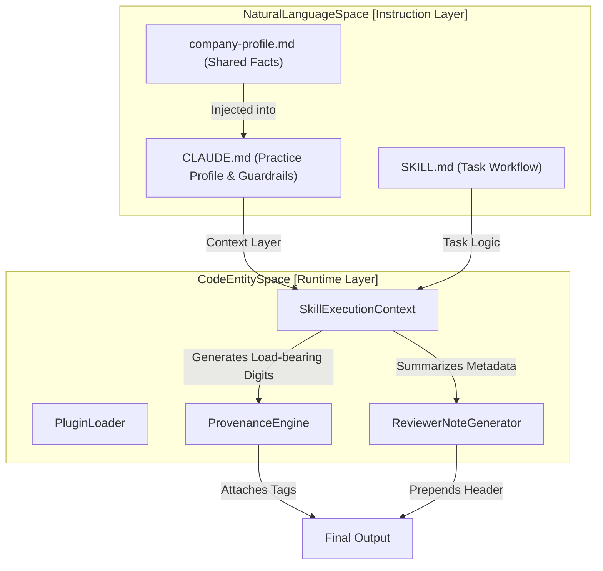
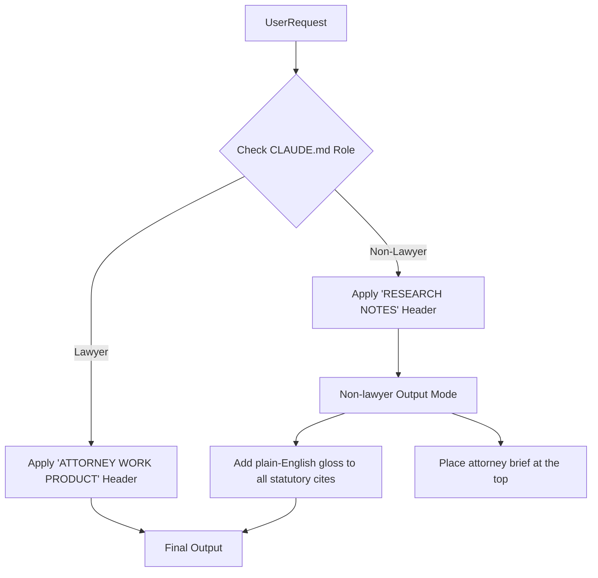

<!-- source: DeepWiki mcp.deepwiki.com · repo anthropics/claude-for-legal · page 6.1 Skill Design Principles and CLAUDE.md Guardrails · fetched 2026-10-26 -->

# Skill Design Principles and CLAUDE.md Guardrails

Relevant source files

The following files were used as context for generating this wiki page:

- [CLAUDE.md](CLAUDE.md)
- [ai-governance-legal/README.md](ai-governance-legal/README.md)
- [ai-governance-legal/skills/customize/SKILL.md](ai-governance-legal/skills/customize/SKILL.md)
- [commercial-legal/skills/customize/SKILL.md](commercial-legal/skills/customize/SKILL.md)
- [legal-builder-hub/CLAUDE.md](legal-builder-hub/CLAUDE.md)
- [legal-clinic/CLAUDE.md](legal-clinic/CLAUDE.md)
- [litigation-legal/CLAUDE.md](litigation-legal/CLAUDE.md)
- [privacy-legal/CLAUDE.md](privacy-legal/CLAUDE.md)
- [product-legal/CLAUDE.md](product-legal/CLAUDE.md)
- [regulatory-legal/CLAUDE.md](regulatory-legal/CLAUDE.md)
- [regulatory-legal/README.md](regulatory-legal/README.md)
- [regulatory-legal/agents/reg-change-monitor.md](regulatory-legal/agents/reg-change-monitor.md)
- [regulatory-legal/skills/customize/SKILL.md](regulatory-legal/skills/customize/SKILL.md)
- [regulatory-legal/skills/reg-feed-watcher/SKILL.md](regulatory-legal/skills/reg-feed-watcher/SKILL.md)

The Claude for Legal framework employs a two-layer instruction model to ensure high-quality, legally sound outputs while maintaining a robust safety net. This page details the relationship between task-specific logic (`SKILL.md`) and the practice-level guardrails (`CLAUDE.md`), the design principles for creating resilient legal skills, and the technical implementation of provenance and gating.

## The Two-Layer Instruction Model

Every plugin in the repository is architected with a strict separation of concerns between the task logic and the safety infrastructure.

1.  **Task Logic (`<plugin>/skills/<skill>/SKILL.md`)**: Defines the specific step-by-step workflow for a legal task (e.g., checking regulatory feeds or redrafting policies). It is the narrow, task-specific scaffold [regulatory-legal/skills/reg-feed-watcher/SKILL.md:7-13]().
2.  **Safety Net (`<plugin>/CLAUDE.md`)**: Contains shared guardrails, the user's practice profile, and cross-skill severity floors. It handles source-tag discipline, premise verification, and pre-flight citation banners [regulatory-legal/CLAUDE.md:8-16]().

### Design Principle: No Reliance on Guardrails

A core principle of the framework is that **skills should not rely on guardrails to rescue them**. If a skill's correct output depends on a `CLAUDE.md` guardrail catching a mistake the `SKILL.md` would have made, it is considered a "design smell".

*   **Direct Instruction**: The `SKILL.md` must encode the correct legal behavior directly. For example, the `reg-feed-watcher` skill explicitly instructs on de-duplication and de-noising rather than relying on a general "be concise" guardrail [regulatory-legal/skills/reg-feed-watcher/SKILL.md:78-81]().
*   **Belt and Suspenders**: Guardrails stay in place to catch what the skill might miss, but they should not be the primary driver of correct logic.
*   **QA Invariant**: If a QA test passes only because a guardrail fired, the behavior must be added to the `SKILL.md` directly.

### Logic Flow: Natural Language Space to Code Entity Space

The following diagram illustrates how instructions from different files are synthesized during execution.

**Instruction Synthesis and Execution Flow**

Sources: [regulatory-legal/CLAUDE.md:18-19](), [regulatory-legal/skills/customize/SKILL.md:24-27](), [CLAUDE.md:88-95]()

## Provenance and Tagging

The framework enforces strict "provenance tag" placement to ensure users can verify high-risk data points.

### Load-Bearing Digits
Instructions require that provenance tags be attached directly to **load-bearing digits** (dates, amounts, specific statutory sections).

*   **Source Attribution**: Skills must tag every citation with its origin: `[Federal Register]`, `[CourtListener]`, or `[web search — verify]` [regulatory-legal/skills/reg-feed-watcher/SKILL.md:83-84]().
*   **No Silent Supplement**: If a tool returns no results, the skill must report the gap rather than filling it from model knowledge without a `[model knowledge — verify]` tag [regulatory-legal/skills/reg-feed-watcher/SKILL.md:81-82]().

### The Reviewer Note Pre-flight
Every deliverable is preceded by a **Reviewer Note** block. This is a hard-coded requirement in the `CLAUDE.md` of all legal plugins to prevent meta-commentary from cluttering the legal work product [regulatory-legal/CLAUDE.md:125-131](), [product-legal/CLAUDE.md:94-101]().

| Component | Purpose | Implementation Rule |
| :--- | :--- | :--- |
| **Sources** | Identifies research connector status | Must state if `CourtListener` is verified vs. training knowledge [regulatory-legal/CLAUDE.md:128]() |
| **Read** | Scope of document review | Specify pages, document counts, or register items read [regulatory-legal/CLAUDE.md:129]() |
| **Flagged** | Items for human judgment | Count items marked `[review]` inline [regulatory-legal/CLAUDE.md:130]() |
| **Currency** | Date of last legal update | Note the date range searched [product-legal/CLAUDE.md:100]() |

Sources: [regulatory-legal/CLAUDE.md:125-131](), [regulatory-legal/skills/reg-feed-watcher/SKILL.md:81-86](), [product-legal/CLAUDE.md:94-105]()

## Hard Gate Patterns

Skills are designed with "hard gates"—non-overridable decline pathways for high-risk scenarios.

### Implementation of Gates
1.  **Cold-Start Gate**: Every skill (except the interview itself) must check for `[PLACEHOLDER]` values in the practice profile and stop if the plugin is not configured [regulatory-legal/CLAUDE.md:10]().
2.  **Non-Lawyer Output Mode**: When the role is a non-lawyer, the system triggers a different output structure including an "attorney brief" and plain-English glosses for legal shorthand [legal-builder-hub/CLAUDE.md:56-57]().

**Gate Logic for Non-Lawyer Users**

Sources: [regulatory-legal/CLAUDE.md:34-40](), [legal-builder-hub/CLAUDE.md:56-57](), [litigation-legal/CLAUDE.md:58-62]()

## Jurisdiction and Privilege Warnings

The `CLAUDE.md` template across plugins contains mandatory logic for handling the lack of "Work Product" protection outside the United States.

*   **US Context**: Skills apply `ATTORNEY WORK PRODUCT` markings based on the role defined in the Practice Profile [regulatory-legal/CLAUDE.md:105]().
*   **Non-US Context**: If the jurisdiction is EU, UK, or others, the model is instructed to adjust the header to `CONFIDENTIAL — INTERNAL LEGAL ANALYSIS` and add a jurisdiction-specific note explaining that US-style "work product" protection does not exist [regulatory-legal/CLAUDE.md:114-117](), [litigation-legal/CLAUDE.md:111-117]().

## Contributor Requirements

Contributors must adhere to the following workflow defined in `CONTRIBUTING.md` and the repo-level `CLAUDE.md`:

1.  **Read CLAUDE.md First**: The practice profile and integrations table shape what the skill should omit or emphasize [regulatory-legal/skills/customize/SKILL.md:24-28]().
2.  **Load-Bearing Tags**: The `[review]` flag, source attribution tags, and `[verify]` tags on cited statutes are load-bearing and must not be removed during skill customization [regulatory-legal/skills/customize/SKILL.md:98-102]().
3.  **Validation**: All changes must pass `claude plugin validate` (structural invariants) and `scripts/lint-tool-scope.py` (security/privilege checks) [CLAUDE.md:33-40]().

Sources: [CLAUDE.md:1-131](), [regulatory-legal/CLAUDE.md:1-131](), [regulatory-legal/skills/customize/SKILL.md:87-104](), [legal-builder-hub/CLAUDE.md:48-57]()

---

