<!-- source: DeepWiki mcp.deepwiki.com · repo anthropics/claude-for-legal · page 6.2 Prompt Injection Defense and Security Model · fetched 2026-10-26 -->

# Prompt Injection Defense and Security Model

<details>
<summary>Relevant source files</summary>

The following files were used as context for generating this wiki page:

- [.gitignore](.gitignore)
- [legal-builder-hub/CLAUDE.md](legal-builder-hub/CLAUDE.md)
- [managed-agent-cookbooks/reg-monitor/subagents/feed-reader.yaml](managed-agent-cookbooks/reg-monitor/subagents/feed-reader.yaml)
- [scripts/lint-tool-scope.py](scripts/lint-tool-scope.py)
- [scripts/orchestrate.py](scripts/orchestrate.py)

</details>


This page details the security architecture of the Claude for Legal codebase, focusing on the protection of the system against malicious or malformed untrusted documents. Given that legal documents, court filings, and regulatory feeds are inherently untrusted inputs, the system employs a multi-layered defense strategy involving architectural isolation, tool-scope restriction, and strict handoff sanitization.

## Architectural Isolation: The Three-Tier Model

Managed agents in the Claude for Legal ecosystem follow a strict three-tier worker split to prevent "jailbreak" or prompt injection attempts embedded in documents from escalating privileges. This model ensures that the agent which "sees" the raw, untrusted text is never the same agent that has the power to "write" to the filesystem or "send" messages to external channels.

### Data Flow and Tier Responsibilities

| Tier | Role | Capabilities (Tool Scope) | Input Source |
| :--- | :--- | :--- | :--- |
| **Reader** | Document ingestion and extraction. | `Read`, `Grep`, `web_fetch` (restricted). No MCP, no Write. | Raw untrusted documents (PDF, DOCX, TXT) or RSS feeds. |
| **Analyzer** | Logic, rule application, and verification. | MCP Read-only (e.g., Westlaw, iManage). No Write. | Structured JSON from Reader. |
| **Writer** | Final work product generation. | **Write** access, Slack/Notification tools. | Summaries/Analysis from Analyzer. |

The **Reader** tier (e.g., `reg-feed-reader`) is explicitly instructed to treat any instruction inside document text as data and never act on text that attempts to change behavior [managed-agent-cookbooks/reg-monitor/subagents/feed-reader.yaml:5-9](). It is strictly read-only: no Write, no MCP, no Slack [managed-agent-cookbooks/reg-monitor/subagents/feed-reader.yaml:12-13]().

### Natural Language to Code Entity Mapping: Agent Tiers

The following diagram illustrates how the conceptual tiers map to specific `agent.yaml` configurations and the `scripts/orchestrate.py` loop.

Title: Agent Tier Isolation and Tool Mapping
```mermaid
graph TD
    subgraph "Untrusted_Space"
        RAW_DOCS["Raw Legal Documents / RSS Feeds"]
    end

    subgraph "Orchestrator_Scope"
        ORCH["orchestrate.py (Loop)"]
        AGENT_YAML["agent.yaml (Orchestrator)"]
    end

    subgraph "Leaf_Worker_Scope"
        READER["Reader Leaf (feed-reader.yaml)"]
        ANALYZER["Analyzer Leaf (e.g. materiality-filter)"]
        WRITER["Writer Leaf (e.g. digest-writer)"]
    end

    RAW_DOCS -->|"Read-Only / web_fetch"| READER
    READER -->|"Structured JSON Output"| ANALYZER
    ANALYZER -->|"Analysis"| WRITER
    WRITER -->|"File/Slack"| OUT["Final Work Product"]

    ORCH -.->|"POST /v1/agents"| AGENT_YAML
    AGENT_YAML -.->|"Defines"| READER
    AGENT_YAML -.->|"Defines"| ANALYZER
    AGENT_YAML -.->|"Defines"| WRITER

    %% Tool Restrictions
    READER -.->| "Restriction: No Write / No MCP" | READER
    ANALYZER -.->| "Restriction: No Write" | ANALYZER
    WRITER -.->| "Privilege: Write/Slack" | WRITER
```
Sources: [managed-agent-cookbooks/reg-monitor/subagents/feed-reader.yaml:5-13](), [scripts/orchestrate.py:10-34](), [scripts/lint-tool-scope.py:4-19]()

## Orchestrator Tool-Scope Rules

To prevent privilege escalation, the orchestrator agent is strictly limited in its tool access. These rules are enforced at build/deploy time by the `scripts/lint-tool-scope.py` validator [scripts/lint-tool-scope.py:1-19]().

1.  **No MCP:** The orchestrator must not carry `mcp_toolset` entries. MCP clients (like Westlaw or iManage) must live on the subagent leaves [scripts/lint-tool-scope.py:10-11](), [scripts/lint-tool-scope.py:43-49]().
2.  **No Write:** The `write` tool must not be enabled in any `agent_toolset` config for the orchestrator. Only designated "Writer" leaves hold this privilege [scripts/lint-tool-scope.py:12-13](), [scripts/lint-tool-scope.py:63-67]().
3.  **No External Channels:** The orchestrator is prohibited from using Slack tools (`slack_send_message`, etc.). It must instead emit a `handoff_request` to be processed by the event loop [scripts/lint-tool-scope.py:14-15](), [scripts/lint-tool-scope.py:68-72]().
4.  **Explicit Tool Defaults:** Orchestrator `agent_toolset` configurations must have `default_config.enabled=false` to prevent accidental exposure of privileged tools [scripts/lint-tool-scope.py:76-80]().

Sources: [scripts/lint-tool-scope.py:32-81](), [managed-agent-cookbooks/reg-monitor/subagents/feed-reader.yaml:33-41]()

## Handoff Sanitization Pipeline

When agents communicate (e.g., a Reader handing off to an Analyzer), they do so via a `handoff_request`. The `scripts/orchestrate.py` script implements a defense-in-depth pipeline to ensure these requests cannot be forged by document-embedded text.

### Sanitization Logic

The system uses a five-layer control model [scripts/orchestrate.py:13-34]():

1.  **Closed-Schema Intents (Primary):** Handoffs must use a fixed enum of intents defined in `HANDOFF_INTENTS` (e.g., `slack_send_message`, `launch_review`) [scripts/orchestrate.py:65-103](). The orchestrator builds the steering prompt from a local template (`HANDOFF_TEMPLATES`) rather than passing free-text from the source agent [scripts/orchestrate.py:107-126]().
2.  **Target Allowlist (Primary):** The `target_agent` must match a slug in the `ALLOWED_TARGETS` set [scripts/orchestrate.py:51-53]().
3.  **Data-Frame Wrapping (Defense-in-Depth):** Any free-text context (the `event` or `note` fields) is wrapped in an `<agent-handoff source="...">` XML-style block. This labels the content as data for the model, not instructions [scripts/orchestrate.py:24-27]().
4.  **Control Stripping:** The `_strip_controls` function removes C0/C1 control characters and bidi overrides (except `\n` and `\t`) to prevent visual spoofing or terminal injection [scripts/orchestrate.py:162-169]().
5.  **Instruction Denylist:** A low-assurance denylist (`_DENY_PREFIX` and `_DENY_SUBSTR_RE`) removes obvious injection phrases like "ignore previous instructions" or "disregard" [scripts/orchestrate.py:152-157]().

Title: Handoff Request Processing and Code Entities

```mermaid
graph LR
    subgraph "Source_Agent_Output"
        RE["Regex: HANDOFF_START_RE"]
        DECODE["_JSON_DECODER.raw_decode"]
    end

    subgraph "Validation_Logic (orchestrate.py)"
        JSON["JSON Load"]
        SCHEMA["jsonschema: HANDOFF_PAYLOAD_SCHEMA"]
        INTENT["Lookup: HANDOFF_INTENTS"]
        SANI["_strip_controls()"]
    end

    subgraph "Steering_Generation"
        TEMP["HANDOFF_TEMPLATES"]
        FRAME["frame_handoff()"]
    end

    RE --> DECODE
    DECODE --> JSON
    JSON --> SCHEMA
    SCHEMA --> INTENT
    INTENT --> SANI
    SANI --> TEMP
    TEMP --> FRAME
    FRAME -->|"New Steering Event"| TARGET["Target Agent"]
```

Sources: [scripts/orchestrate.py:65-103](), [scripts/orchestrate.py:128-143](), [scripts/orchestrate.py:148-149](), [scripts/orchestrate.py:162-169]()

## Legal Builder Hub Trust Layer

The `legal-builder-hub` plugin manages the installation of community-contributed skills. It implements a security review gate to prevent malicious code from entering the environment [legal-builder-hub/CLAUDE.md:50-51]().

### Security Pipeline for External Skills

1.  **Allowlist:** The hub maintains an allowlist security model for community skill discovery.
2.  **Raw Display:** Before installation, the hub provides a raw display of the skill content for user review.
3.  **Heuristic Scans:** The `skills-qa` mechanism evaluates skills against the Legal Skill Design Framework, flagging issues like false assurances of privilege [legal-builder-hub/CLAUDE.md:54-55]().
4.  **SHA Pinning:** The auto-updater uses SHA pinning to ensure the integrity of installed skills.
5.  **Audit Trail:** Every handoff, including those triggered by installed skills, is appended to `handoff-audit.jsonl` for post-hoc review [scripts/orchestrate.py:33-34](), [scripts/orchestrate.py:159]().

Sources: [legal-builder-hub/CLAUDE.md:50-57](), [scripts/orchestrate.py:33-34](), [scripts/orchestrate.py:159]()

---

