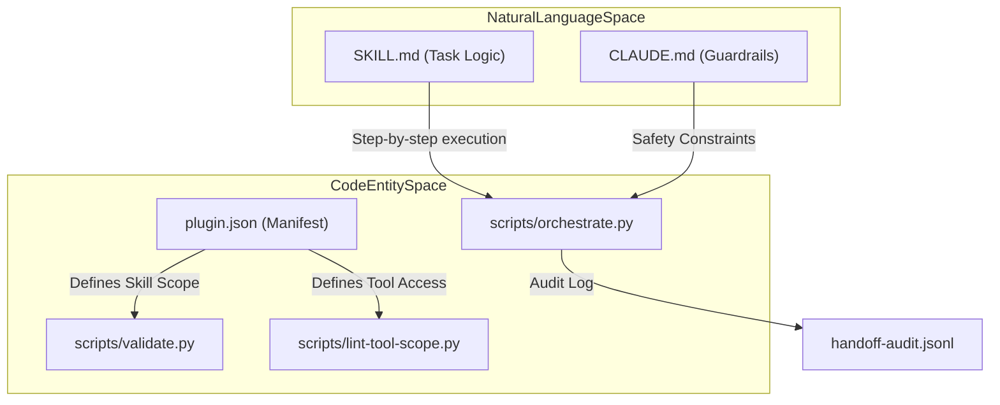
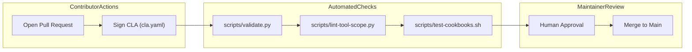

<!-- source: DeepWiki mcp.deepwiki.com · repo anthropics/claude-for-legal · page 7 Developer and Contributor Guide · fetched 2026-10-26 -->

# Developer and Contributor Guide

Relevant source files

The following files were used as context for generating this wiki page:

- [.github/workflows/cla.yaml](.github/workflows/cla.yaml)
- [CLA.md](CLA.md)
- [CODE_OF_CONDUCT.md](CODE_OF_CONDUCT.md)
- [CONTRIBUTING.md](CONTRIBUTING.md)
- [README.md](README.md)

This guide provides a high-level overview for developers, platform engineers, and community contributors looking to extend or maintain the Claude for Legal repository. It covers the repository's structural conventions, the multi-layered instruction model for skills, and the validation pipeline used to ensure safety and structural integrity.

## Repository Structure and Skill Development

The repository is organized into practice-area plugins, each containing its own logic, guardrails, and automated agents [README.md:21-27]().

### Skill Design Principles
Claude for Legal utilizes a two-layer instruction model to ensure high-quality legal outputs. This separation of concerns is fundamental to the architecture:

1.  **Skill-Level Logic (`SKILL.md`)**: Defines the step-by-step task logic and legal doctrine. Developers must bake specific legal checklists (e.g., FLSA back-pay formulas or patent infringement tests) directly into the skill [CONTRIBUTING.md:19-20]().
2.  **Plugin-Level Guardrails (`CLAUDE.md`)**: Acts as a safety net, enforcing shared constraints like provenance tagging, premise verification, and the "no-silent-supplement" rule [CONTRIBUTING.md:21-24]().

**The Golden Rule:** A skill should never rely on a guardrail to catch a mistake the skill's own instructions should have prevented. If a QA test only passes because a guardrail fired, the logic must be moved into the `SKILL.md` [CONTRIBUTING.md:26-36]().

### Adding New Skills
When contributing a new skill, follow these conventions:
*   **Provenance Tags**: Attach tags like `[verify]` or `[model calculation]` directly to load-bearing digits or dates, not to general paragraphs [CONTRIBUTING.md:58-62]().
*   **Hard Gates**: Use "decline pathways" as non-overridable scaffolds for high-risk computations (e.g., statutory deadlines in `legal-clinic`) [CONTRIBUTING.md:63-66]().
*   **Versioning**: Increment the plugin version in the manifest for material changes—patch bumps for behavior tweaks and minor bumps for new skills or new required inputs [CONTRIBUTING.md:77-78]().

## System Integration and Tooling

The codebase includes a suite of scripts in the `scripts/` directory to manage deployments and maintain security boundaries.

### Validation and Deployment
The validation pipeline ensures that all plugins and managed agents adhere to the expected schemas and security postures.

*   **`validate.py`**: Validates JSON and YAML schemas for subagent outputs and manifests [CONTRIBUTING.md:79-80]().
*   **`lint-tool-scope.py`**: Performs privilege-escalation checks, ensuring that orchestrators do not have unauthorized access to sensitive tools [CONTRIBUTING.md:79-80]().
*   **`deploy-managed-agent.sh`**: The primary utility for resolving `agent.yaml` manifests and deploying them to the Claude Managed Agents API [README.md:7]().

For detailed usage and CI integration, see **[Validation and Testing Scripts](#7.1)**.

### Bridging Natural Language to Code Entities

The following diagram illustrates how the natural language instructions in `SKILL.md` and `CLAUDE.md` interact with the underlying execution environment and validation scripts.

**Figure 1: Instruction Execution and Validation Flow**

Sources: [CONTRIBUTING.md:14-25](), [CONTRIBUTING.md:79-80]()

## Community Contribution Process

We welcome contributions from legal technologists and developers. To maintain the safety and quality standards of the project, all contributors must follow a standardized workflow.

### Contribution Workflow
1.  **CLA Signing**: All contributors must sign the Contributor License Agreement via the `CLA Assistant` bot. The bot monitors pull requests and requires a specific signature phrase: `I have read the CLA Document and I hereby sign the CLA` [.github/workflows/cla.yaml:21](), [CONTRIBUTING.md:9-12]().
2.  **Code of Conduct**: All participants are expected to adhere to the project's standards for inclusive and respectful behavior [CODE_OF_CONDUCT.md:7-21]().
3.  **MCP Connectors**: New data sources (e.g., Ironclad, CourtListener) can be added by following the `CONNECTORS.md` guide to implement Model Context Protocol integrations [README.md:25]().

For details on PR requirements and versioning conventions, see **[Community Contributions and CLA](#7.2)**.

### Contributor Pipeline

**Figure 2: Contributor Submission Pipeline**

Sources: [.github/workflows/cla.yaml:1-43](), [CONTRIBUTING.md:7-13](), [CONTRIBUTING.md:79-80]()

## Child Pages
*   **[Validation and Testing Scripts](#7.1)**: Deep dive into the `scripts/` directory, schema validation, and CI/CD integration.
*   **[Community Contributions and CLA](#7.2)**: Detailed guide on the CLA process, PR standards, and adding new MCP connectors.

Sources: [CONTRIBUTING.md:1-83](), [CODE_OF_CONDUCT.md:1-38](), [.github/workflows/cla.yaml:1-43](), [CLA.md:1-40]()

---

