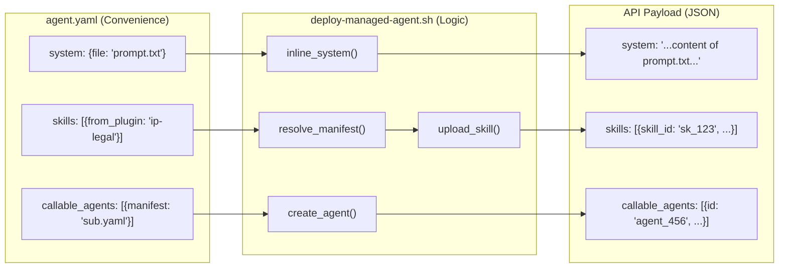

<!-- source: DeepWiki mcp.deepwiki.com · repo anthropics/claude-for-legal · page 7.1 Validation and Testing Scripts · fetched 2026-10-26 -->

# Validation and Testing Scripts

<details>
<summary>Relevant source files</summary>

The following files were used as context for generating this wiki page:

- [scripts/deploy-managed-agent.sh](scripts/deploy-managed-agent.sh)
- [scripts/lint-tool-scope.py](scripts/lint-tool-scope.py)
- [scripts/test-cookbooks.sh](scripts/test-cookbooks.sh)
- [scripts/validate.py](scripts/validate.py)

</details>


The `scripts/` directory contains the tooling required to validate, lint, and deploy the Claude for Legal managed agent infrastructure. These scripts ensure that the multi-agent "cookbooks" adhere to security invariants, follow structural schemas, and can be correctly resolved into API payloads for the Anthropic Managed Agents API.

## Overview of Validation Pipeline

The validation pipeline consists of three main stages: static linting of agent definitions, structural dry-runs of the deployment process, and runtime schema validation for subagent outputs.

### Data Flow and Script Integration

The following diagram illustrates how the various scripts interact with the `managed-agent-cookbooks/` directory and the external API.

**Managed Agent Validation and Deployment Flow**
```mermaid
graph TD
    subgraph "Local Workspace"
        ["agent.yaml"] --> |"Input"| LINT["scripts/lint-tool-scope.py"]
        ["agent.yaml"] --> |"Input"| TEST["scripts/test-cookbooks.sh"]
        ["agent.yaml"] --> |"Input"| DEPLOY["scripts/deploy-managed-agent.sh"]
        
        TEST --> |"Calls"| LINT
        TEST --> |"Calls (dry-run)"| DEPLOY
    end

    subgraph "CI/CD Environment"
        LINT --> |"Asserts"| PRIV["No Orchestrator Privilege Escalation"]
        TEST --> |"Asserts"| STRUCT["Structural Invariants (Depth, JSON, Prompts)"]
    end

    subgraph "Deployment"
        DEPLOY --> |"POST /v1/skills"| SKILLS_API["Anthropic Skills API"]
        DEPLOY --> |"POST /v1/agents"| AGENTS_API["Anthropic Agents API"]
    end

    subgraph "Runtime"
        SUB_OUT["Subagent JSON Output"] --> |"Input"| VALIDATE["scripts/validate.py"]
        SUB_SCHEMA["Subagent output_schema"] --> |"Input"| VALIDATE
    end
```
Sources: [scripts/test-cookbooks.sh:7-16](), [scripts/deploy-managed-agent.sh:4-15](), [scripts/validate.py:4-12]()

---

## Script Details

### 1. `lint-tool-scope.py`
This script performs static analysis on `agent.yaml` manifests to prevent privilege escalation. It focuses on the "Orchestrator" agent, ensuring it does not possess tools that should be restricted to specialized "Worker" agents (Readers/Writers).

**Key Security Checks:**
*   **No MCP on Orchestrator**: Model Context Protocol (`mcp_toolset`) connectors must reside on subagent leaves, not the parent orchestrator [scripts/lint-tool-scope.py:10-11]().
*   **No Orchestrator Write**: The `write` tool must not be enabled in any `agent_toolset` on the orchestrator; it is reserved for designated writer leaves [scripts/lint-tool-scope.py:12-13](), [scripts/lint-tool-scope.py:63-67]().
*   **No Direct Slack Access**: Orchestrators are prohibited from using `slack_send_message` or any `slack_*` tool. They must instead emit a `handoff_request` to be handled by the platform [scripts/lint-tool-scope.py:14-15](), [scripts/lint-tool-scope.py:68-72]().
*   **Default Deny**: The script rejects any `agent_toolset` where `default_config.enabled` is set to `true`, forcing explicit tool opt-in to avoid accidental exposure of privileged tools [scripts/lint-tool-scope.py:73-80]().

Sources: [scripts/lint-tool-scope.py:4-19](), [scripts/lint-tool-scope.py:32-81]()

### 2. `deploy-managed-agent.sh`
This bash script handles the complex task of resolving manifest conveniences into the final JSON payloads required by the Anthropic API.

**Implementation Logic:**
*   **Skill Uploading**: The `upload_skill` function iterates through the `skills` block. If a `path` is provided, it zips the directory and calls `POST /v1/skills` to obtain a `skill_id` [scripts/deploy-managed-agent.sh:75-105]().
*   **System Prompt Inlining**: The `inline_system` function resolves `system.file`, `system.text`, and `system.append` keys into a single flattened `system` string [scripts/deploy-managed-agent.sh:133-149]().
*   **Recursive Agent Creation**: If `callable_agents` contains manifest paths, the `create_agent` function recursively calls itself to ensure subagents are created first, so their generated IDs can be injected into the parent orchestrator's manifest [scripts/deploy-managed-agent.sh:151-174]().
*   **Environment Substitution**: Uses a Python helper (`yaml2json`) to perform safe `${VAR}` substitution for sensitive or environment-specific values, such as API endpoints or prefixes [scripts/deploy-managed-agent.sh:55-71]().
*   **Security Validation**: Validates `SKILL_TITLE_PREFIX` against an allowlist to prevent multipart injection or newline smuggling in API requests [scripts/deploy-managed-agent.sh:38-43]().

**Entity Mapping: Manifest to API Payload**

Sources: [scripts/deploy-managed-agent.sh:6-12](), [scripts/deploy-managed-agent.sh:107-131](), [scripts/deploy-managed-agent.sh:151-174]()

### 3. `test-cookbooks.sh`
The primary CI entry point. It orchestrates the testing of all cookbooks located in `managed-agent-cookbooks/`.

**Structural Invariants Asserted:**
*   **Depth-1 Limitation**: Asserts that subagents do not themselves have `callable_agents`, maintaining a flat orchestrator-worker hierarchy for security and predictability [scripts/test-cookbooks.sh:26-26]().
*   **Non-empty Prompts**: Ensures every agent in the tree has a resolved `system` prompt [scripts/test-cookbooks.sh:25-25]().
*   **No Schema Leakage**: Verifies that the internal `output_schema` (used for harness-side validation) is stripped before the payload is sent to the Anthropic API [scripts/test-cookbooks.sh:27-27]().

Sources: [scripts/test-cookbooks.sh:4-6](), [scripts/test-cookbooks.sh:18-36]()

### 4. `validate.py`
A Python utility using `jsonschema` to validate JSON or YAML output against a schema. In the Claude for Legal architecture, this is used to bridge the gap between subagent outputs and orchestrator expectations.

*   **Functionality**: It loads an instance (the model output) and a schema using `_load`, then performs `jsonschema.validate` [scripts/validate.py:20-37]().
*   **Integration**: While the Managed Agents API does not natively enforce schemas, the deployment harness identifies subagents with an `output_schema` block and prepares them for schema-checking before the orchestrator consumes their output [scripts/deploy-managed-agent.sh:11-12]().

Sources: [scripts/validate.py:4-12](), [scripts/validate.py:20-25]()

---

## Integration into CI

The validation suite is designed to run in a standard CI environment to prevent regressions in agent configuration.

1.  **Static Analysis**: `lint-tool-scope.py` is executed first to catch security misconfigurations [scripts/test-cookbooks.sh:13-16]().
2.  **Dry-Run Validation**: `test-cookbooks.sh` iterates through every cookbook, invoking `deploy-managed-agent.sh --dry-run`. This ensures that all local file references (`system.file`, `skills.path`) are valid and that the resulting JSON structure is correct [scripts/test-cookbooks.sh:18-36]().
3.  **Deployment**: In a production CD pipeline, `deploy-managed-agent.sh` is called without the `--dry-run` flag, requiring `ANTHROPIC_API_KEY` to be set to perform actual skill uploads and agent creation [scripts/deploy-managed-agent.sh:24-24]().

Sources: [scripts/test-cookbooks.sh:7-37](), [scripts/deploy-managed-agent.sh:17-26]()

---

