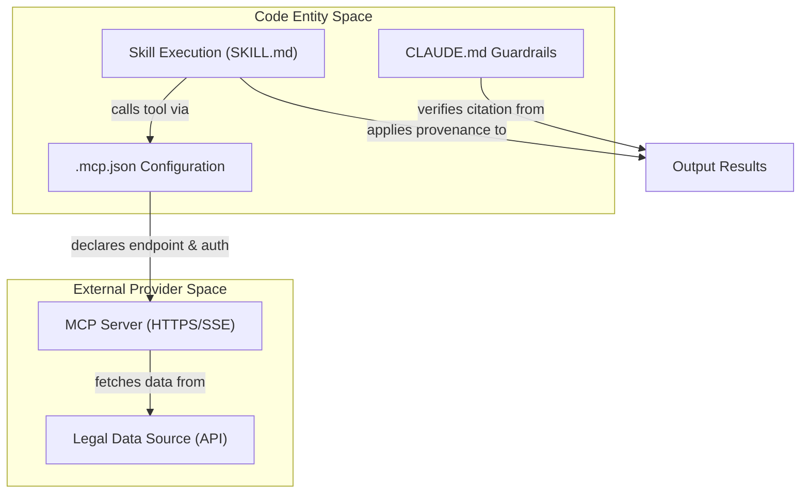
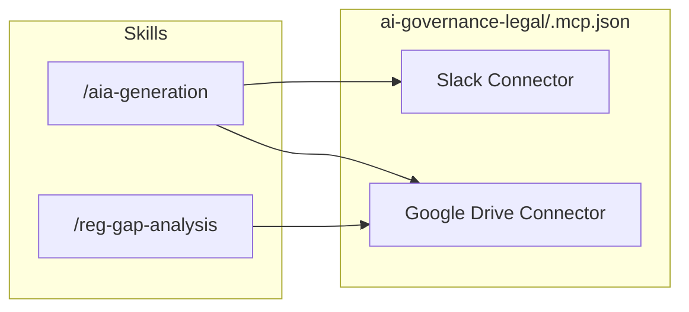

<!-- source: DeepWiki mcp.deepwiki.com · repo anthropics/claude-for-legal · page 7.2 Community Contributions and CLA · fetched 2026-10-26 -->

# Community Contributions and CLA

Relevant source files

The following files were used as context for generating this wiki page:

- [.github/workflows/cla.yaml](.github/workflows/cla.yaml)
- [CLA.md](CLA.md)
- [CODE_OF_CONDUCT.md](CODE_OF_CONDUCT.md)
- [CONNECTORS.md](CONNECTORS.md)
- [CONTRIBUTING.md](CONTRIBUTING.md)
- [ai-governance-legal/.mcp.json](ai-governance-legal/.mcp.json)
- [ai-governance-legal/skills/aia-generation/SKILL.md](ai-governance-legal/skills/aia-generation/SKILL.md)
- [ai-governance-legal/skills/reg-gap-analysis/SKILL.md](ai-governance-legal/skills/reg-gap-analysis/SKILL.md)
- [ai-governance-legal/skills/use-case-triage/SKILL.md](ai-governance-legal/skills/use-case-triage/SKILL.md)
- [commercial-legal/.mcp.json](commercial-legal/.mcp.json)

This page outlines the technical and administrative requirements for contributing to the Claude for Legal codebase. It covers the Contributor License Agreement (CLA) automation, the Code of Conduct, the structural design principles for new skills, and the process for integrating third-party data sources via the Model Context Protocol (MCP).

## Contribution Workflow and CLA

To ensure intellectual property clarity, all contributors must sign a Contributor License Agreement (CLA) before their pull requests can be merged. This process is automated via a GitHub Action integration.

### CLA Assistant Implementation
The repository uses the **CLA Assistant** bot to manage signatures. When a PR is opened, the bot checks the `signatures/cla.json` file on the `cla-signatures` branch to verify if the author has already signed [CONTRIBUTING.md:9-12]().

The workflow is implemented in `.github/workflows/cla.yaml` and includes several security and reliability enhancements:
*   **Impersonation Guard**: The PR opener must be an author or co-author of at least one commit in the PR [.github/workflows/cla.yaml:24-27]().
*   **AI Allowlist**: Synthetic co-authors used by AI assistants (e.g., `noreply@anthropic.com`) and specific bots are allowlisted to prevent them from blocking the CLA check, provided the human opener has signed [.github/workflows/cla.yaml:35-43]().
*   **Signature Trigger**: Users sign by commenting: `I have read the CLA Document and I hereby sign the CLA` [.github/workflows/cla.yaml:21]().

### PR Submission Process
1.  **Sign the CLA**: Complete the automated check on your first PR [CONTRIBUTING.md:9-12]().
2.  **Validation**: Run `scripts/validate.py` to check JSON/YAML schemas and `scripts/lint-tool-scope.py` to verify tool-access invariants [CONTRIBUTING.md:79-80]().
3.  **Versioning**: 
    *   **Patch Bumps**: For material behavior additions [CONTRIBUTING.md:77-78]().
    *   **Minor Bumps**: For new skills or changes to required inputs [CONTRIBUTING.md:78]().

**Sources:** [.github/workflows/cla.yaml:1-44](), [CONTRIBUTING.md:7-13](), [CONTRIBUTING.md:77-80]()

---

## Skill Design Framework

Contributors adding new skills must adhere to the "Belt and Suspenders" design principle. The logic should be self-contained within the skill, while `CLAUDE.md` provides a system-wide safety net.

### The Two-Layer Instruction Model
| Layer | File | Role |
| :--- | :--- | :--- |
| **Task Logic** | `<plugin>/skills/<skill>/SKILL.md` | Step-by-step instructions for the specific legal task. Must be "default-on" with hard gates [CONTRIBUTING.md:19-20](). |
| **Safety Net** | `<plugin>/CLAUDE.md` | Shared guardrails, practice profiles, and citation requirements [CONTRIBUTING.md:21-24](). |

### Implementation Requirements
*   **Doctrine Placement**: Substantive legal doctrine (e.g., FLSA regular-rate formulas or patent infringement tests) must be encoded directly in the `SKILL.md` checklist, not left to general model knowledge [CONTRIBUTING.md:48-51]().
*   **Provenance Tagging**: Tags must be attached to the **load-bearing digit** (numbers/dates) rather than paragraphs to prevent loss during model summarization [CONTRIBUTING.md:58-62]().
*   **Hard Gates**: Use non-overridable "do-not-compute" rules for high-risk outputs, such as the `legal-clinic` plugin's `/deadlines` rule [CONTRIBUTING.md:63-66]().
*   **No Silent Supplement**: Skills must not fill research gaps with model knowledge without user consent. If a tool returns no results, the model must stop and offer options (broaden search, try different tool, etc.) [ai-governance-legal/skills/aia-generation/SKILL.md:87]().

**Sources:** [CONTRIBUTING.md:14-37](), [CONTRIBUTING.md:53-71](), [ai-governance-legal/skills/aia-generation/SKILL.md:87-95]()

---

## Adding MCP Connectors

The project encourages the addition of new Model Context Protocol (MCP) connectors to link Claude to authoritative legal data sources (e.g., CLM, DMS, or court dockets).

### Connector Integration Flow
The following diagram illustrates how a new connector is integrated into a plugin's toolset and utilized by skills.

**Connector Data Flow and Skill Integration**

*Sources: [CONNECTORS.md:7-11](), [CONTRIBUTING.md:19-24]()*

### Requirements for New Connectors
*   **Transport**: Must use HTTPS with OAuth or API-key auth (SSE or streamable HTTP) [CONNECTORS.md:7]().
*   **Provenance**: Results must return a source, retrieval date, and citation-ready identifier [CONNECTORS.md:9]().
*   **Safety**: Tools that perform "Write" actions (create, send, file) must include an explicit confirmation prompt in their tool description [CONNECTORS.md:8]().
*   **Submission**: Add the server details to the relevant plugin's `.mcp.json` file [CONNECTORS.md:15-18]().

### Connector Mapping Example
Each plugin defines its supported connectors in a local `.mcp.json` file.

**MCP Connector Mapping (ai-governance-legal)**

*Sources: [ai-governance-legal/.mcp.json:1-21](), [ai-governance-legal/skills/aia-generation/SKILL.md:1-12](), [ai-governance-legal/skills/reg-gap-analysis/SKILL.md:1-11]()*

**Sources:** [CONNECTORS.md:1-67](), [commercial-legal/.mcp.json:1-56](), [ai-governance-legal/.mcp.json:1-21]()

---

## Code of Conduct

All contributors are expected to follow the project's Code of Conduct, which is adapted from the Contributor Covenant.

### Expected vs. Unacceptable Behavior
| Expected Behavior | Unacceptable Behavior |
| :--- | :--- |
| Use inclusive language [CODE_OF_CONDUCT.md:9]() | Harassment or discrimination [CODE_OF_CONDUCT.md:17]() |
| Respect differing viewpoints [CODE_OF_CONDUCT.md:10]() | Trolling or personal attacks [CODE_OF_CONDUCT.md:18]() |
| Accept constructive criticism [CODE_OF_CONDUCT.md:11]() | Publishing private info without consent [CODE_OF_CONDUCT.md:20]() |

### Enforcement
The Code of Conduct applies to all project spaces (Issues, PRs, Discussions). Violations may result in warnings or permanent removal from the project, as determined by maintainers [CODE_OF_CONDUCT.md:23-33]().

**Sources:** [CODE_OF_CONDUCT.md:1-37]()

---

