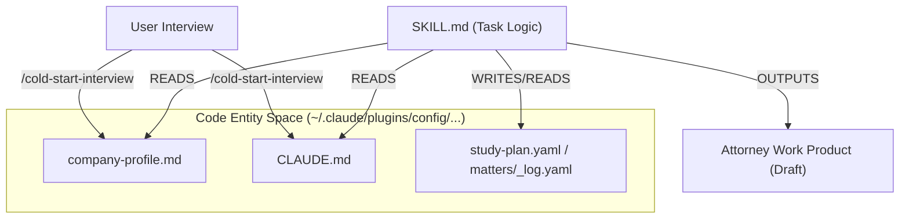
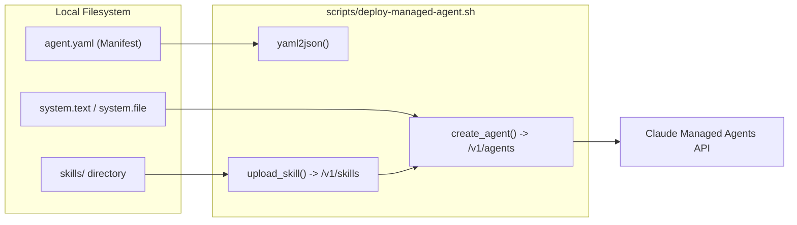

<!-- source: DeepWiki mcp.deepwiki.com · repo anthropics/claude-for-legal · page 8 Glossary · fetched 2026-10-26 -->

# Glossary

Relevant source files

The following files were used as context for generating this wiki page:

- [.claude-plugin/marketplace.json](.claude-plugin/marketplace.json)
- [.gitignore](.gitignore)
- [README.md](README.md)
- [law-student/skills/bar-prep-questions/SKILL.md](law-student/skills/bar-prep-questions/SKILL.md)
- [law-student/skills/study-plan/SKILL.md](law-student/skills/study-plan/SKILL.md)
- [managed-agent-cookbooks/reg-monitor/README.md](managed-agent-cookbooks/reg-monitor/README.md)
- [regulatory-legal/CLAUDE.md](regulatory-legal/CLAUDE.md)
- [regulatory-legal/README.md](regulatory-legal/README.md)
- [regulatory-legal/agents/reg-change-monitor.md](regulatory-legal/agents/reg-change-monitor.md)
- [regulatory-legal/skills/customize/SKILL.md](regulatory-legal/skills/customize/SKILL.md)
- [regulatory-legal/skills/reg-feed-watcher/SKILL.md](regulatory-legal/skills/reg-feed-watcher/SKILL.md)
- [scripts/deploy-managed-agent.sh](scripts/deploy-managed-agent.sh)
- [scripts/orchestrate.py](scripts/orchestrate.py)

This glossary provides technical and domain-specific definitions for terms used throughout the Claude for Legal codebase. It serves as a bridge between legal concepts and their implementation as code entities, configuration keys, and agent behaviors.

## Core System Terms

### CLAUDE.md (Practice Profile)
The primary configuration file for a plugin that defines the "playbook" for a specific legal practice area. It is stored at `~/.claude/plugins/config/claude-for-legal/<plugin-name>/CLAUDE.md` [regulatory-legal/CLAUDE.md:4-7](). Every skill within a plugin reads this file at runtime to ensure outputs align with the user's specific risk posture, jurisdiction, and house style [regulatory-legal/CLAUDE.md:8-10]().
*   **Template:** A versioned template ships with the plugin [regulatory-legal/CLAUDE.md:15-16]().
*   **Active Config:** The interview-populated version resides in the user's `.claude` config directory to survive plugin updates [regulatory-legal/CLAUDE.md:4-7]().

### Cold-Start Interview
The onboarding process that populates a plugin's `CLAUDE.md`. It is implemented as a specialized skill (`/cold-start-interview`) that asks the user about their practice setting, industry, and specific legal positions [regulatory-legal/README.md:15-21]().
*   **Mechanism:** It establishes the materiality threshold, watched regulators, and policy index [regulatory-legal/skills/reg-feed-watcher/SKILL.md:9-12]().
*   **Integrations:** Includes a `--check-integrations` flag to verify MCP connector status [regulatory-legal/CLAUDE.md:53]().

### Company Profile (`company-profile.md`)
A shared configuration file located one level above individual practice profiles (`~/.claude/plugins/config/claude-for-legal/company-profile.md`) [regulatory-legal/CLAUDE.md:18](). It contains facts applicable across all 12 plugins, such as company name, industry, and jurisdictions [regulatory-legal/skills/customize/SKILL.md:36-38]().

### Managed Agent
An agent deployed via the Claude Managed Agents API, designed for long-running or scheduled workflows (e.g., "Reg Monitor") [README.md:7](). These are deployed using `scripts/deploy-managed-agent.sh` [scripts/deploy-managed-agent.sh:1-15]() and often run in a "Reader/Analyzer/Writer" architecture to safely handle untrusted documents [managed-agent-cookbooks/reg-monitor/README.md:28-36]().

### Skill (`SKILL.md`)
A task-specific instruction set (scaffold) that defines a single command or capability within a plugin. Each skill includes a name, description, and argument hints [law-student/skills/bar-prep-questions/SKILL.md:1-9]().

---

## Technical and Security Terms

### Data-Frame Wrapping
A defense-in-depth security measure where untrusted free-text context passed between agents is wrapped in `<agent-handoff source="...">` blocks [scripts/orchestrate.py:24-27](). This labels the content as data for the model, distinguishing it from system instructions.

### Handoff Request
A JSON blob used by agents to request action from another agent. In the orchestrator, these are validated against a `HANDOFF_PAYLOAD_SCHEMA` [scripts/orchestrate.py:128-139]().
*   **Intent:** A fixed enum (e.g., `slack_send_message`, `launch_review`) that maps to a trusted steering template [scripts/orchestrate.py:65-103]().
*   **Params:** Typed parameters that must match specific regex patterns (e.g., Slack channel IDs `^[CGD][A-Z0-9]{8,}$`) [scripts/orchestrate.py:70-71]().

### MCP (Model Context Protocol) Connector
An integration layer that allows Claude to interact with external tools like Google Drive, Slack, or legal-specific databases like CourtListener [README.md:25](). Connectors are declared in a plugin's `.mcp.json` and verified during cold-start [regulatory-legal/README.md:52-57]().

### Provenance Tags
Inline markers used to attribute information to its source.
*   **`[verify]`**: Indicates information sourced from model training data rather than a connected research tool [regulatory-legal/README.md:45-48]().
*   **`[secondary source]`**: Applied to items from aggregators like IAPP or Lexology, signaling the need to trace to a primary source [regulatory-legal/skills/reg-feed-watcher/SKILL.md:83-85]().
*   **`[web search — verify]`**: Applied to items retrieved via web search rather than a structured tool [regulatory-legal/skills/reg-feed-watcher/SKILL.md:81-83]().

---

## Mapping: Natural Language to Code Entities

The following diagrams illustrate how conceptual terms used by legal professionals map to specific code artifacts and execution flows.

### Data Flow: From Interview to Execution
"Natural Language Space" (The User's Practice) is codified into "Code Entity Space" (Markdown and YAML) to drive Skill behavior.

*Sources: [regulatory-legal/CLAUDE.md:8-18](), [law-student/skills/study-plan/SKILL.md:13-21](), [regulatory-legal/skills/customize/SKILL.md:77-82]()*

### Deployment Architecture: Managed Agents
This diagram shows how a Managed Agent cookbook is transformed from local files into a deployed API entity.

*Sources: [scripts/deploy-managed-agent.sh:4-15](), [scripts/deploy-managed-agent.sh:75-105](), [scripts/deploy-managed-agent.sh:151-180]()*

---

## Domain Concepts (Legal Tech)

| Term | Definition | Code Pointer |
| :--- | :--- | :--- |
| **Attorney-Review Model** | The requirement that all outputs are drafts requiring verification; enforced via mandatory headers. | [README.md:16-19]() |
| **Materiality Threshold** | Logic that determines when a regulatory change rises to "notable" vs. "digest only". | [regulatory-legal/CLAUDE.md:68-80]() |
| **Jurisdiction Handling** | The logic used to distinguish between UBE, state-specific, and NextGen bar exam rules. | [law-student/skills/bar-prep-questions/SKILL.md:61-74]() |
| **Privilege Marker** | Standardized headers (e.g., `ATTORNEY WORK PRODUCT`) applied based on the user's role. | [regulatory-legal/CLAUDE.md:103-121]() |
| **Reviewer Note** | A mandatory "pre-flight" block summarizing source verification and flags before the main deliverable. | [regulatory-legal/CLAUDE.md:124-132]() |
| **Steering Prompt** | A trusted template used by the orchestrator to instruct a target agent during a handoff. | [scripts/orchestrate.py:107-126]() |

*Sources: [README.md:17-19](), [regulatory-legal/CLAUDE.md:68-132](), [law-student/skills/bar-prep-questions/SKILL.md:61-74](), [scripts/orchestrate.py:107-126]()*