# Page: Overview

# Overview

<details>
<summary>Relevant source files</summary>

The following files were used as context for generating this wiki page:

- [.claude-plugin/marketplace.json](.claude-plugin/marketplace.json)
- [QUICKSTART.md](QUICKSTART.md)
- [README.md](README.md)
- [ip-legal/skills/cold-start-interview/SKILL.md](ip-legal/skills/cold-start-interview/SKILL.md)

</details>


Claude for Legal is a suite of reference agents, skills, and data connectors designed to automate and accelerate legal workflows across in-house, law firm, and academic environments. It provides a unified architecture that can be deployed as a plugin for **Claude Cowork** and **Claude Code**, or as a fleet of **Claude Managed Agents** via API [README.md:1-8]().

The system is built on a "Human-in-the-Loop" philosophy: every output is a draft for attorney review. It incorporates explicit guardrails, including source attribution, jurisdiction surfacing, and mandatory verification gates before any legal action is taken [README.md:16-20]().

## System Architecture

The codebase bridges high-level legal intent (Natural Language Space) with executable automation (Code Entity Space). At its core, the system uses **Plugins** to define practice areas and **Skills** to execute specific tasks.

### Natural Language to Code Mapping
The following diagram illustrates how user-facing concepts map to specific codebase entities.

**Diagram: Legal Workflow Mapping**
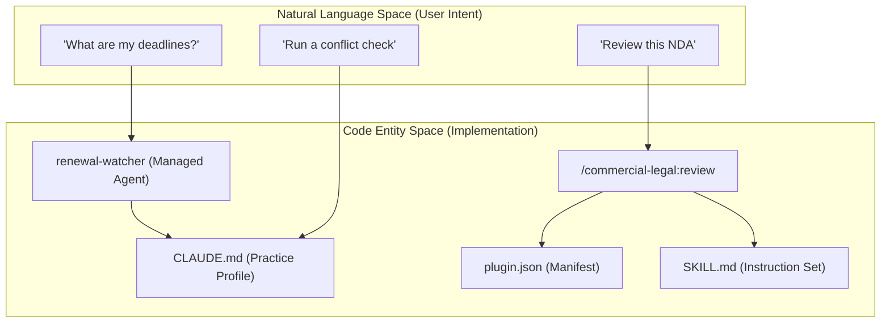
Sources: [README.md:32-40](), [ip-legal/skills/cold-start-interview/SKILL.md:1-11](), [.claude-plugin/marketplace.json:1-112]()

### The Plugin Lifecycle
Every plugin follows a standardized lifecycle: installation via the central marketplace, a "cold-start" interview to learn the user's specific playbook, and execution of skills that reference a persistent practice profile.

**Diagram: Plugin Execution Flow**
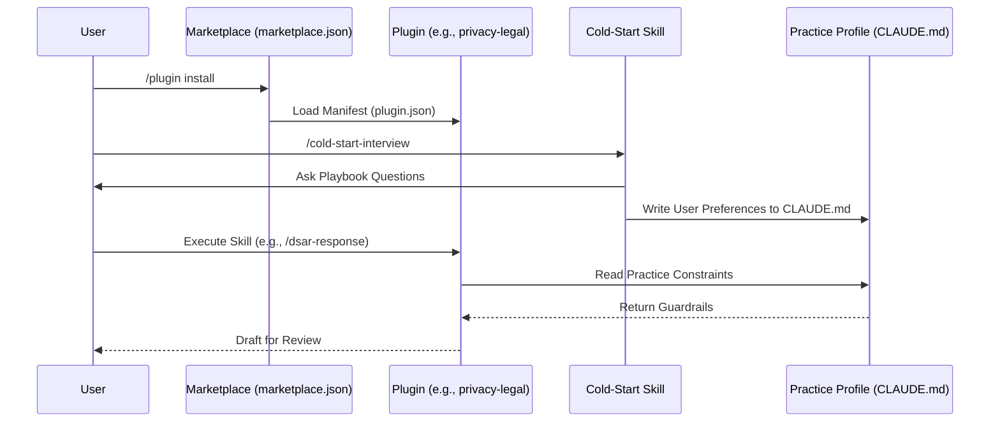
Sources: [QUICKSTART.md:20-30](), [ip-legal/skills/cold-start-interview/SKILL.md:13-37](), [README.md:23-26]()

## Navigation Guide

The wiki is organized into the following major sections to help you navigate the codebase:

### 1.1 [Getting Started](#1.1)
Step-by-step instructions for installing plugins in Claude Cowork or Claude Code. Covers the critical distinction between **user-scoped** and **project-scoped** installations and how to verify MCP (Model Context Protocol) connector status [QUICKSTART.md:1-40]().

### 1.2 [Core Concepts and Terminology](#1.2)
Definitions of the foundational elements of the system:
*   **Practice Profile (`CLAUDE.md`)**: The living configuration file that stores a user's specific legal positions, risk appetite, and house style [ip-legal/skills/cold-start-interview/SKILL.md:60-65]().
*   **Skills**: Modular units of logic (defined in `SKILL.md` files) that perform specific legal tasks [README.md:23-24]().
*   **MCP Connectors**: The integration layer connecting Claude to external data sources like Google Drive, Ironclad, or CourtListener [README.md:25]().
*   **Cold-Start Interview**: The onboarding process that populates the practice profile [ip-legal/skills/cold-start-interview/SKILL.md:13-20]().

### 2. [Plugin Architecture](#2)
Overview of how plugins are structured, discovered, and configured. Covers the plugin manifest format, the marketplace registry, and the directory conventions for skills and agents [.claude-plugin/marketplace.json:8-126]().

### 3. [Practice-Area Plugins](#3)
Details on the twelve specialized plugins included in the repository, such as `commercial-legal`, `litigation-legal`, `ip-legal`, and `privacy-legal`. Each plugin is registered in the central marketplace manifest [.claude-plugin/marketplace.json:1-127]().

### 4. [Managed Agent Cookbooks](#4)
Technical guides for deploying "eyes-on-the-feed" workflows—scheduled agents that monitor external systems (e.g., a `docket-watcher` or `renewal-watcher`) and provide proactive alerts [README.md:37-38]().

### 5. [External Plugins](#5)
Covers third-party integrations, such as the `cocounsel-legal` plugin from Thomson Reuters, which extends the system with Westlaw Deep Research capabilities [.claude-plugin/marketplace.json:118-125]().

### 6. [Safety, Guardrails, and Output Quality](#6)
An overview of the security model, including the **Attorney-Review Model**, citation provenance tagging (e.g., `[verify]` markers), and the tiered security architecture for handling untrusted documents [README.md:16-20](), [QUICKSTART.md:73-74]().

### 7. [Developer and Contributor Guide](#7)
Instructions for contributors on how to write new skills, run validation scripts, and navigate the repository structure [README.md:21-27]().

---
**Sources:**
* [README.md:1-40]()
* [QUICKSTART.md:1-76]()
* [.claude-plugin/marketplace.json:1-127]()
* [ip-legal/skills/cold-start-interview/SKILL.md:1-100]()

---

# Page: Getting Started

# Getting Started

<details>
<summary>Relevant source files</summary>

The following files were used as context for generating this wiki page:

- [.claude-plugin/marketplace.json](.claude-plugin/marketplace.json)
- [QUICKSTART.md](QUICKSTART.md)
- [ip-legal/skills/cold-start-interview/SKILL.md](ip-legal/skills/cold-start-interview/SKILL.md)
- [regulatory-legal/skills/cold-start-interview/SKILL.md](regulatory-legal/skills/cold-start-interview/SKILL.md)

</details>


This page provides a technical guide for onboarding to the Claude for Legal platform. It covers the installation lifecycle, the critical "cold-start" configuration process, and the underlying security and integration models.

## Installation Overview

Claude for Legal is distributed as a suite of plugins that can be installed into **Claude Cowork** (Desktop/Web) or **Claude Code** (Terminal). While the core logic remains identical, the installation and discovery mechanisms differ slightly between environments.

### Marketplace Discovery
The platform uses a centralized manifest at `.claude-plugin/marketplace.json` [1-127]() to define available plugins. Each entry includes:
- **`name`**: The unique identifier used for installation (e.g., `commercial-legal`) [9-10]().
- **`source`**: The relative path to the plugin directory [12]().
- **`description`**: A functional summary of the plugin's capabilities [13]().

### Installation Steps (Claude Code)
1. **Register Marketplace**: Add the local repository as a plugin source.
   ` /plugin marketplace add <path-to-repo>` [QUICKSTART.md:16-18]()
2. **Install Plugin**: Target a specific practice area from the marketplace.
   ` /plugin install <plugin-name>@claude-for-legal` [QUICKSTART.md:22-23]()
3. **Restart**: A full restart of the Claude Code environment is required to load the new plugin manifest and skills [QUICKSTART.md:25]().

**Sources:**
- `.claude-plugin/marketplace.json:1-127`
- `QUICKSTART.md:16-25`

---

## User-Scoped vs. Project-Scoped Installs

A critical decision during installation is the **Scope**. This determines the filesystem boundaries of the plugin's execution environment.

| Scope | Filesystem Access | Recommended Use Case |
| :--- | :--- | :--- |
| **User-Scoped** | Can read files from any directory the user explicitly provides (e.g., `~/Downloads`, `~/Documents`). | **Recommended.** Essential for legal workflows where documents are scattered across local folders [QUICKSTART.md:38-39](). |
| **Project-Scoped** | Restricted to the current working directory only. | High-security environments where data must be siloed within a single folder [QUICKSTART.md:38](). |

> [!WARNING]
> Project-scoped installs will fail to read contract drafts or research memos located outside the immediate project root. If you encounter "I can't read [file]" errors, verify your scope [QUICKSTART.md:74-75]().

**Sources:**
- `QUICKSTART.md:34-41`
- `ip-legal/skills/cold-start-interview/SKILL.md:89-96`
- `regulatory-legal/skills/cold-start-interview/SKILL.md:43-50`

---

## The Cold-Start Interview

Every plugin requires a one-time configuration called the **Cold-Start Interview**. This process transforms the generic plugin into a tool calibrated to a specific legal practice's "playbook."

### Data Flow and Persistence
The interview populates two primary configuration files in the user's config directory (`~/.claude/plugins/config/claude-for-legal/`):
1. **`company-profile.md`**: Shared metadata (Company name, industry, jurisdictions, risk appetite) [regulatory-legal/skills/cold-start-interview/SKILL.md:36-42]().
2. **`CLAUDE.md`**: Plugin-specific practice profiles (Specific clauses, enforcement thresholds, approval chains) [regulatory-legal/skills/cold-start-interview/SKILL.md:9-12]().

### Logic Flow: `cold-start-interview`
The interview logic is defined in each plugin's `skills/cold-start-interview/SKILL.md`.

#### Cold-Start State Machine
The system checks the state of `CLAUDE.md` to determine the interview branch:
- **Missing/Placeholders**: Triggers the full interview [regulatory-legal/skills/cold-start-interview/SKILL.md:24-28]().
- **`<!-- SETUP PAUSED AT: -->`**: Resumes from the last saved state [regulatory-legal/skills/cold-start-interview/SKILL.md:26]().
- **Populated**: Skips interview unless `--redo` is passed [regulatory-legal/skills/cold-start-interview/SKILL.md:28]().

### Diagram: Configuration Initialization
This diagram bridges the Natural Language interaction of the interview to the Code Entity Space where configuration is persisted.

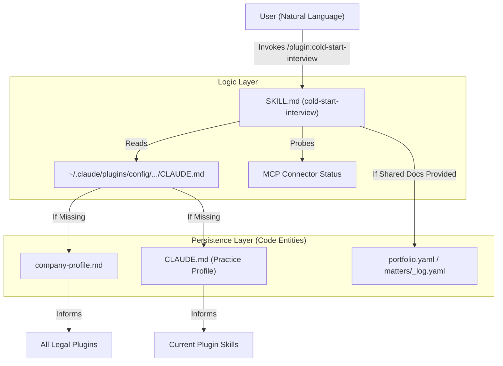

**Sources:**
- `regulatory-legal/skills/cold-start-interview/SKILL.md:9-42`
- `ip-legal/skills/cold-start-interview/SKILL.md:15-37`
- `QUICKSTART.md:61-62`

---

## Verifying MCP Connector Status

Model Context Protocol (MCP) connectors provide the "eyes" for the plugins, allowing them to see into external systems like Ironclad, iManage, or CourtListener.

### The Verification Mechanism
Citations generated by the model are flagged based on the presence of an active research connector:
- **`[verify]`**: Indicates a citation generated from the model's training data (unverified) [QUICKSTART.md:32-33]().
- **Verified Citations**: Occur only when an MCP tool call successfully returns data from a live database [regulatory-legal/skills/cold-start-interview/SKILL.md:14]().

### Running Integration Checks
To verify or refresh the status of connected tools without re-running the full interview, use the `--check-integrations` flag:
`/<plugin>:cold-start-interview --check-integrations` [regulatory-legal/skills/cold-start-interview/SKILL.md:9]().

### Diagram: Connector Verification Data Flow
This diagram illustrates how the `cold-start-interview` skill interacts with the MCP layer to verify tool availability.

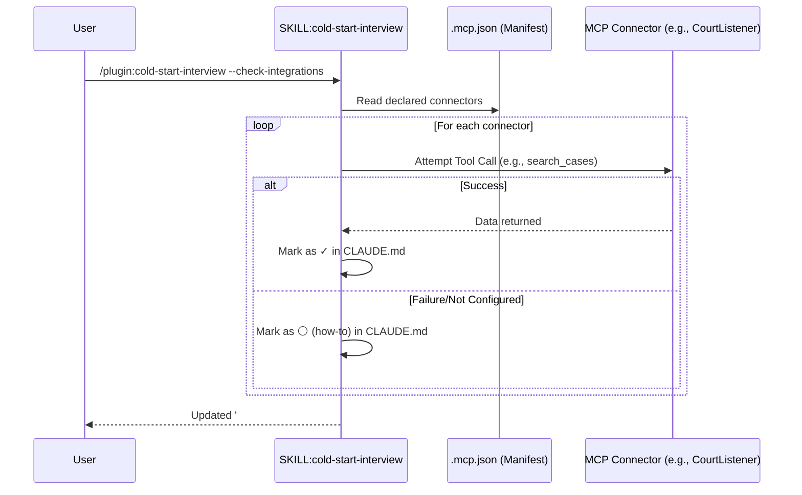

**Sources:**
- `regulatory-legal/skills/cold-start-interview/SKILL.md:9-15`
- `ip-legal/skills/cold-start-interview/SKILL.md:38-43`
- `QUICKSTART.md:32-33`

---

## Troubleshooting Initial Setup

| Symptom | Cause | Resolution |
| :--- | :--- | :--- |
| `Command not found` | Plugin manifest not loaded. | Restart Claude Code [QUICKSTART.md:71](). |
| `Run setup first` | Missing `CLAUDE.md`. | Run `/<plugin>:cold-start-interview` [QUICKSTART.md:72](). |
| `[verify]` markers on every cite | No research MCP connected. | Connect a tool like CourtListener or Westlaw [QUICKSTART.md:73](). |
| `I can't read [file]` | Project-scope restriction. | Reinstall with user scope or move file to current folder [QUICKSTART.md:74-75](). |

**Sources:**
- `QUICKSTART.md:70-76`

---

# Page: Core Concepts and Terminology

# Core Concepts and Terminology

<details>
<summary>Relevant source files</summary>

The following files were used as context for generating this wiki page:

- [CLAUDE.md](CLAUDE.md)
- [README.md](README.md)
- [ai-governance-legal/README.md](ai-governance-legal/README.md)
- [ai-governance-legal/skills/customize/SKILL.md](ai-governance-legal/skills/customize/SKILL.md)
- [commercial-legal/skills/customize/SKILL.md](commercial-legal/skills/customize/SKILL.md)
- [references/company-profile-template.md](references/company-profile-template.md)

</details>


This page explains the foundational concepts shared across the Claude for Legal ecosystem. It serves as a technical primer for the architectural patterns, data structures, and safety models that underpin all twelve practice-area plugins.

## The Practice Profile (`CLAUDE.md`)

The **Practice Profile** is the central configuration mechanism for every plugin. It is a Markdown file named `CLAUDE.md` that defines the specific "playbook" for a legal team, including their risk appetite, preferred terms, and jurisdictional footprint [README.md:23-23]().

### Configuration Lifecycle
1.  **Template:** Each plugin ships with a template `CLAUDE.md` containing `[PLACEHOLDER]` markers [CLAUDE.md:15-15]().
2.  **User Config:** At runtime, skills read from a user-specific path: `~/.claude/plugins/config/claude-for-legal/<plugin-name>/CLAUDE.md` [commercial-legal/skills/customize/SKILL.md:24-25]().
3.  **Company Profile:** Global facts (company name, industry, jurisdictions) are stored in a shared `company-profile.md` one level above the plugin-specific config to ensure consistency across the suite [references/company-profile-template.md:1-4]().

### Data Flow: Profile Resolution
The following diagram illustrates how a skill resolves the final instructions by combining the static Skill logic with the dynamic Practice Profile.

**Practice Profile Resolution Flow**
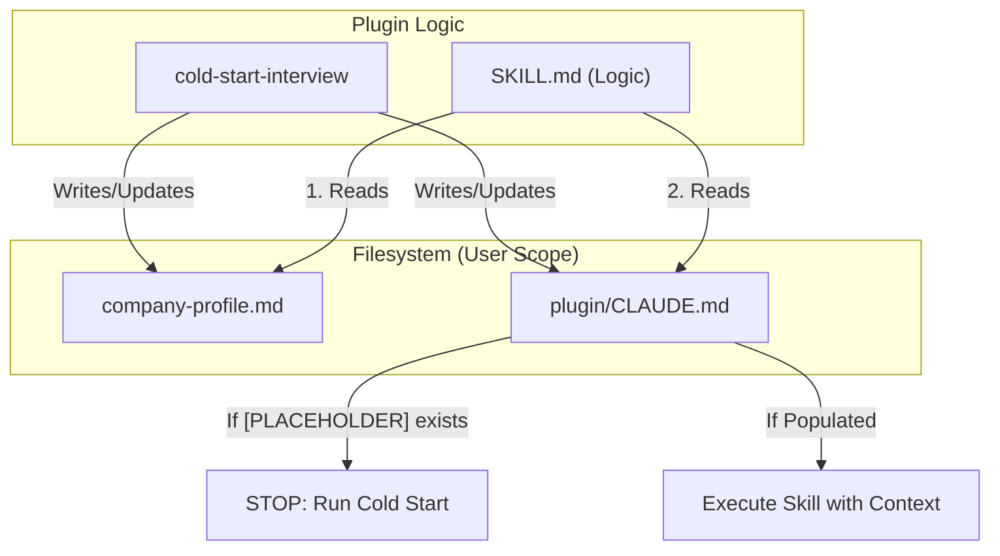
Sources: [commercial-legal/skills/customize/SKILL.md:24-31](), [ai-governance-legal/skills/customize/SKILL.md:24-31]()

---

## Cold-Start Interview

The **Cold-Start Interview** is the mandatory onboarding process for every plugin. It is implemented as a specialized skill (e.g., `/commercial-legal:cold-start-interview`) that uses a "Socratic" approach to extract a user's legal preferences [ai-governance-legal/README.md:19-24]().

### Key Functions
*   **Integration Probing:** Checks for active MCP connectors (Slack, Google Drive, Ironclad, etc.) and updates the configuration [ai-governance-legal/skills/customize/SKILL.md:57-58]().
*   **Seed Document Extraction:** Requests and parses "seed" documents (like an AI policy or a reference impact assessment) to extract actual legal positions and house style [ai-governance-legal/README.md:21-24]().
*   **Practice Setting Calibration:** Determines the user's role (e.g., In-house, Firm, Clinic) to adjust the shared `company-profile.md` [references/company-profile-template.md:6-6]().

Sources: [ai-governance-legal/README.md:19-28](), [references/company-profile-template.md:1-32]()

---

## MCP Connectors

The **Model Context Protocol (MCP)** is the integration layer that allows Claude for Legal to interact with external systems. Connectors are declared in `.mcp.json` files within each plugin [CLAUDE.md:14-14]().

### Core Connector Types
| Type | Examples | Role in Codebase |
| :--- | :--- | :--- |
| **Productivity** | Google Drive, Slack, Box | Used for reading source files and sending alerts [README.md:25-25](). |
| **Legal-Specific** | Ironclad, DocuSign, iManage | Used for contract management and document storage [README.md:25-25](). |
| **Research** | CourtListener, Westlaw | Used for verifying citations and pulling case law [README.md:25-25](). |

### The `[verify]` Fallback
When a research tool is not connected, the system defaults to "Training Data" mode. Every citation is automatically tagged with `[verify]` to warn the attorney that the information was not pulled from a live legal database [ai-governance-legal/README.md:8-8](), [ai-governance-legal/skills/customize/SKILL.md:110-111]().

Sources: [README.md:25-25](), [CLAUDE.md:14-14](), [ai-governance-legal/skills/customize/SKILL.md:95-111]()

---

## Safety and the Attorney-Review Model

Claude for Legal operates on a "Human-in-the-loop" (HITL) model. No output is considered a final legal conclusion; every artifact is a **draft for attorney review** [README.md:17-17]().

### Provenance Tags and Markers
The system uses specific markers to communicate confidence and source:
*   **`[verify]`**: Information sourced from model training data, not a connected research tool [ai-governance-legal/README.md:8-8]().
*   **`[review]`**: Flags specific lines that require subjective legal judgment or "attorney calls" [ai-governance-legal/skills/customize/SKILL.md:106-108]().
*   **Privilege Markers**: Prepended to outputs to prevent accidental waiver of attorney-client privilege [ai-governance-legal/README.md:8-8]().

### The Reviewer Note
A standardized pre-flight block at the top of major deliverables. It explains the reasoning, risk posture used, and any missing information that needs verification [ai-governance-legal/README.md:8-8]().

**Output Generation Architecture**
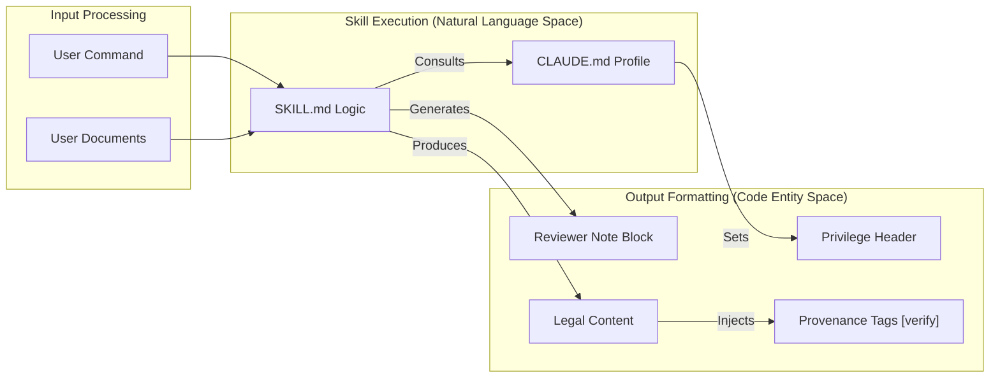
Sources: [ai-governance-legal/README.md:8-9](), [ai-governance-legal/skills/customize/SKILL.md:95-111]()

---

## Managed Agents and Skills

The codebase distinguishes between **Skills** and **Managed Agents**:

*   **Skills:** Atomic units of functionality (e.g., `/vendor-ai-review`, `/use-case-triage`) that run within a user's active session [ai-governance-legal/README.md:32-42]().
*   **Managed Agents:** Scheduled or background workflows (e.g., "Renewal Watcher", "Policy Monitor") that run autonomously behind an API [README.md:37-37](), [ai-governance-legal/README.md:54-54](). They are defined via `agent.yaml` manifests in `managed-agent-cookbooks/` [CLAUDE.md:22-22]().

Sources: [README.md:7-7](), [CLAUDE.md:22-26](), [ai-governance-legal/README.md:44-57]()

---

# Page: Plugin Architecture

# Plugin Architecture

<details>
<summary>Relevant source files</summary>

The following files were used as context for generating this wiki page:

- [.claude-plugin/marketplace.json](.claude-plugin/marketplace.json)
- [CLAUDE.md](CLAUDE.md)
- [README.md](README.md)
- [ai-governance-legal/README.md](ai-governance-legal/README.md)
- [ai-governance-legal/skills/customize/SKILL.md](ai-governance-legal/skills/customize/SKILL.md)
- [commercial-legal/skills/customize/SKILL.md](commercial-legal/skills/customize/SKILL.md)

</details>


Claude for Legal is built on a modular, decentralized architecture where legal domain expertise is encapsulated into individual plugins. Each plugin is a self-contained unit containing the logic (Skills), configuration (Practice Profiles), and connectivity (MCP Connectors) required to handle specific legal workflows.

This architecture allows the system to run across multiple environments—as a **Claude Cowork** or **Claude Code** plugin, or as a **Managed Agent** via API—using the same underlying manifests and logic [README.md:7-7]().

## Core Components

The architecture relies on four primary pillars to bridge natural language legal requests with executable code and data:

1.  **Marketplace Registry**: A global manifest (`.claude-plugin/marketplace.json`) that catalogs all available plugins, their sources, and descriptions [CLAUDE.md:11-11](), [.claude-plugin/marketplace.json:1-127]().
2.  **Plugin Manifests**: Local `plugin.json` declarations within each plugin directory that define identity, versioning, and entry points [CLAUDE.md:13-13]().
3.  **Practice Profiles (CLAUDE.md)**: Markdown-based configuration templates that store user-specific playbooks, risk appetites, and jurisdictional settings [README.md:23-23](), [CLAUDE.md:90-94]().
4.  **Skills**: Task-specific instruction sets and tools (e.g., `/commercial-legal:review`) located in `skills/<name>/SKILL.md` that execute legal workflows [README.md:32-34](), [CLAUDE.md:17-17]().
5.  **MCP Connectors**: Standardized integrations via the Model Context Protocol declared in `.mcp.json` to connect to systems like Ironclad, CourtListener, or Google Drive [README.md:25-25](), [CLAUDE.md:14-14]().

### Natural Language to Code Mapping

The following diagram illustrates how a user's intent in "Natural Language Space" is routed through the architecture to specific code entities.

**Diagram: Intent Routing and Entity Association**
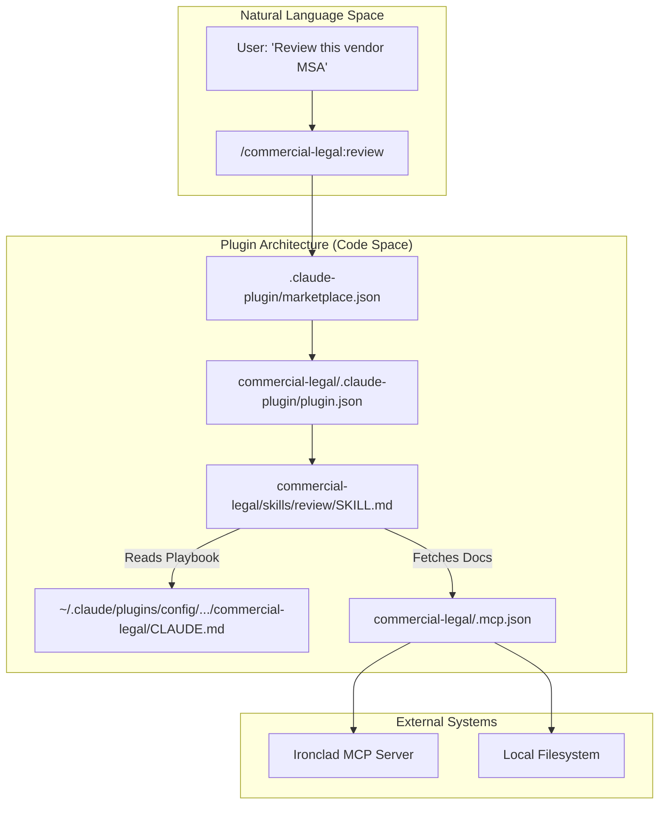
**Sources:** [README.md:23-35](), [CLAUDE.md:11-17](), [.claude-plugin/marketplace.json:9-17]()

---

## Plugin Structure and Manifests
Each plugin follows a strict directory convention to ensure interoperability. The `plugin.json` file serves as the local registry entry, while the `skills/` directory contains individual `SKILL.md` files that define the system prompts for specific legal tasks.

For details, see [Plugin Structure and Manifests](#2.1).

**Sources:** [CLAUDE.md:9-26](), [README.md:23-27]()

---

## Practice Profiles and Cold-Start System
A core innovation of the architecture is the **Practice Profile**, stored in `CLAUDE.md`. Unlike standard documentation, this file serves as a dynamic configuration layer populated via a **Cold-Start Interview**.

*   **Company Profile**: A shared `company-profile.md` (located in `references/` or user config) stores cross-plugin facts like entity name, industry, and jurisdictions [commercial-legal/skills/customize/SKILL.md:26-26](), [ai-governance-legal/skills/customize/SKILL.md:26-26]().
*   **Practice Profile**: A plugin-specific `CLAUDE.md` template is copied to the user's local config directory and updated to store domain-specific data, such as "NDA triage preferences" [CLAUDE.md:90-94](), [commercial-legal/skills/customize/SKILL.md:46-47]().
*   **Cold-Start**: A specialized skill (e.g., `/commercial-legal:cold-start-interview`) that interviews the user to replace `[PLACEHOLDER]` markers with actual practice data [commercial-legal/README.md:27-27](), [ai-governance-legal/README.md:34-34]().

For details, see [Practice Profiles and Cold-Start System](#2.2).

**Sources:** [CLAUDE.md:90-94](), [commercial-legal/skills/customize/SKILL.md:24-56](), [ai-governance-legal/skills/customize/SKILL.md:24-58]()

---

## MCP Connectors
The architecture uses the **Model Context Protocol (MCP)** to decouple legal logic from third-party APIs. Connectors are declared in `.mcp.json` and allow skills to perform research or document retrieval. The architecture supports both first-party connectors and external vendor plugins like **CoCounsel** [README.md:25-25](), [.claude-plugin/marketplace.json:118-125]().

For details, see [MCP Connectors](#2.3).

**Sources:** [README.md:25-25](), [CLAUDE.md:14-14](), [.claude-plugin/marketplace.json:118-125]()

---

## Security and Guardrails
The architecture enforces strict safety protocols including mandatory "Attorney Review" markers and citation provenance tagging. Skills are prohibited from removing these load-bearing guardrails [commercial-legal/skills/customize/SKILL.md:95-100](), [ai-governance-legal/skills/customize/SKILL.md:101-111]().

### Data Flow and Security Boundaries

**Diagram: Security and Data Lifecycle**
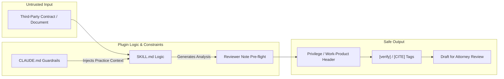
**Sources:** [README.md:16-19](), [commercial-legal/skills/customize/SKILL.md:95-100](), [ai-governance-legal/skills/customize/SKILL.md:101-111]()

---

## Plugin Lifecycle
1.  **Discovery**: The system reads `.claude-plugin/marketplace.json` to identify available plugins [CLAUDE.md:11-11]().
2.  **Installation**: Plugins are initialized in the user's environment, often involving the setup of a local configuration path [CLAUDE.md:90-92]().
3.  **Initialization**: The user runs the `cold-start-interview` to populate their `CLAUDE.md` practice profile from seed documents and interview responses [ai-governance-legal/README.md:19-24]().
4.  **Execution**: When a command is invoked, the corresponding skill reads the local `CLAUDE.md` to calibrate its legal analysis to the user's specific playbook [commercial-legal/skills/customize/SKILL.md:24-25]().

**Sources:** [README.md:9-12](), [CLAUDE.md:11-17](), [ai-governance-legal/README.md:19-24]()

---

# Page: Plugin Structure and Manifests

# Plugin Structure and Manifests

<details>
<summary>Relevant source files</summary>

The following files were used as context for generating this wiki page:

- [ai-governance-legal/.claude-plugin/plugin.json](ai-governance-legal/.claude-plugin/plugin.json)
- [commercial-legal/.claude-plugin/plugin.json](commercial-legal/.claude-plugin/plugin.json)
- [corporate-legal/.claude-plugin/plugin.json](corporate-legal/.claude-plugin/plugin.json)
- [employment-legal/.claude-plugin/plugin.json](employment-legal/.claude-plugin/plugin.json)
- [ip-legal/.claude-plugin/plugin.json](ip-legal/.claude-plugin/plugin.json)
- [law-student/.claude-plugin/plugin.json](law-student/.claude-plugin/plugin.json)
- [legal-builder-hub/.claude-plugin/plugin.json](legal-builder-hub/.claude-plugin/plugin.json)
- [legal-clinic/.claude-plugin/plugin.json](legal-clinic/.claude-plugin/plugin.json)
- [litigation-legal/.claude-plugin/plugin.json](litigation-legal/.claude-plugin/plugin.json)
- [privacy-legal/.claude-plugin/plugin.json](privacy-legal/.claude-plugin/plugin.json)
- [product-legal/.claude-plugin/plugin.json](product-legal/.claude-plugin/plugin.json)
- [regulatory-legal/.claude-plugin/plugin.json](regulatory-legal/.claude-plugin/plugin.json)

</details>


This page provides a technical deep dive into the directory layout and configuration standards for Claude for Legal plugins. Each plugin follows a strict structural convention to ensure interoperability with the marketplace, the cold-start interview system, and the Model Context Protocol (MCP) integration layer.

## Plugin Directory Layout

Every practice-area plugin (e.g., `commercial-legal`, `litigation-legal`) adheres to a standard hierarchy. This uniformity allows the system to discover skills, configure background agents, and initialize the practice profile consistently.

### Standard Hierarchy
```text
<plugin-name>/
├── .claude-plugin/
│   ├── plugin.json          # Metadata: name, version, description
│   └── hooks/
│       └── hooks.json       # Lifecycle triggers (e.g., post-install)
├── skills/
│   ├── <skill-name>.md      # Task-specific logic and prompts
│   └── ...
├── agents/
│   ├── <agent-name>/        # Background managed agents
│   │   └── agent.yaml       # Agent manifest
│   └── ...
├── .mcp.json                # MCP connector declarations
└── CLAUDE.md                # Practice Profile (populated by cold-start)
```

## The Plugin Manifest (`plugin.json`)

The `.claude-plugin/plugin.json` file serves as the identity record for the plugin. It is used by the marketplace registry to display capabilities and manage versions. All twelve practice-area plugins utilize this schema to define their core metadata.

### Key Fields
- `name`: The unique identifier for the plugin (e.g., `ai-governance-legal` [[ai-governance-legal/.claude-plugin/plugin.json:2-2]](), `law-student` [[law-student/.claude-plugin/plugin.json:2-2]]()).
- `version`: Semantic versioning for the plugin, currently standardizing on `1.0.2` for the initial suite [[commercial-legal/.claude-plugin/plugin.json:3-3]](), [[ip-legal/.claude-plugin/plugin.json:3-3]]().
- `description`: A functional summary of the plugin's capabilities, such as M&A diligence [[corporate-legal/.claude-plugin/plugin.json:4-4]](), worker classification [[employment-legal/.claude-plugin/plugin.json:4-4]](), or DSAR response drafting [[privacy-legal/.claude-plugin/plugin.json:4-4]]().
- `author`: Attribution metadata, typically "Anthropic" for first-party plugins [[legal-clinic/.claude-plugin/plugin.json:5-7]]().

### Manifest Implementation Map
The following diagram bridges the high-level manifest concepts to their specific implementations across the codebase.

**Figure 1: Manifest-to-Code Entity Mapping**
```mermaid
graph TD
    subgraph "Natural Language Space"
        "Plugin Identity"
        "Capability Summary"
        "Version Control"
    end

    subgraph "Code Entity Space"
        "plugin.json"["plugin.json"]
        "name_field"["'name': string"]
        "desc_field"["'description': string"]
        "ver_field"["'version': string"]
    end

    "Plugin Identity" --> "name_field"
    "Capability Summary" --> "desc_field"
    "Version Control" --> "ver_field"
    
    "plugin.json" --- "name_field"
    "plugin.json" --- "desc_field"
    "plugin.json" --- "ver_field"

    style "plugin.json" stroke-width:2px
```
Sources: [[ai-governance-legal/.claude-plugin/plugin.json:1-8]](), [[litigation-legal/.claude-plugin/plugin.json:1-8]](), [[product-legal/.claude-plugin/plugin.json:1-8]]()

## Skills and the `skills/` Directory

The `skills/` directory contains Markdown files that define the atomic capabilities of a plugin. Unlike general-purpose prompts, these are "Legal Skills" designed to operate within the guardrails of the system.

- **Naming Convention**: Skills are named by their function (e.g., `contract-review.md`).
- **Data Flow**: Skills ingest data from the `CLAUDE.md` practice profile to calibrate their output to the specific legal department's risk appetite and house style. For example, the `legal-builder-hub` manages the security review gate for these skills before installation [[legal-builder-hub/.claude-plugin/plugin.json:4-4]]().

## Practice Profiles (`CLAUDE.md`)

`CLAUDE.md` is the "Practice Profile" template. While the repository contains the structure, the file is populated dynamically during the **Cold-Start Interview**.

- **Purpose**: It acts as a persistent memory layer for the plugin, storing jurisdiction preferences, escalation paths, and risk thresholds.
- **Role in Execution**: Every skill call implicitly references `CLAUDE.md` to ensure that "Natural Language" instructions (like "Review this NDA") are grounded in "Code Entity" constraints (like "Always flag non-mutual indemnification").

## Connectors and Agents

### MCP Connector Declarations (`.mcp.json`)
The `.mcp.json` file defines the bridge between the plugin and external legal data sources (e.g., Westlaw, iManage, or a local SQLite database). It specifies which tools are available to the skills for research and document retrieval.

### Background Agents (`agents/`)
Managed agents are long-running processes defined within the plugin.
- **Structure**: Each agent has its own subdirectory containing an `agent.yaml` manifest.
- **Function**: These agents perform scheduled tasks, such as the `regulatory-legal` plugin's feed watcher [[regulatory-legal/.claude-plugin/plugin.json:4-4]]() or the `litigation-legal` portfolio management system [[litigation-legal/.claude-plugin/plugin.json:4-4]]().

**Figure 2: Data Flow from Manifest to Execution**
```mermaid
graph LR
    subgraph "Configuration Layer"
        "plugin_json"["plugin.json"]
        "mcp_json"[".mcp.json"]
        "CLAUDE_md"["CLAUDE.md"]
    end

    subgraph "Execution Layer"
        "Skill_Processor"["Skill Execution Engine"]
        "MCP_Client"["MCP Connector Client"]
        "Agent_Runtime"["Managed Agent Worker"]
    end

    "plugin_json" --> "Skill_Processor"
    "mcp_json" --> "MCP_Client"
    "CLAUDE_md" --> "Skill_Processor"
    "CLAUDE_md" --> "Agent_Runtime"
    "MCP_Client" --> "Skill_Processor"
```
Sources: [[privacy-legal/.claude-plugin/plugin.json:1-8]](), [[law-student/.claude-plugin/plugin.json:1-8]](), [[legal-clinic/.claude-plugin/plugin.json:1-8]]()

## Lifecycle Hooks (`hooks/hooks.json`)

The `hooks/` directory allows plugins to execute logic at specific lifecycle events.
- **`post-install`**: Often used to trigger the cold-start interview or verify that required MCP connectors are online.
- **`on-update`**: Manages data migrations if the schema for `CLAUDE.md` or other local state changes between plugin versions.

Sources: [[commercial-legal/.claude-plugin/plugin.json:1-8]](), [[corporate-legal/.claude-plugin/plugin.json:1-8]](), [[legal-builder-hub/.claude-plugin/plugin.json:1-8]]()

---

# Page: Practice Profiles and Cold-Start System

# Practice Profiles and Cold-Start System

<details>
<summary>Relevant source files</summary>

The following files were used as context for generating this wiki page:

- [CLAUDE.md](CLAUDE.md)
- [ai-governance-legal/README.md](ai-governance-legal/README.md)
- [ai-governance-legal/skills/cold-start-interview/SKILL.md](ai-governance-legal/skills/cold-start-interview/SKILL.md)
- [ai-governance-legal/skills/customize/SKILL.md](ai-governance-legal/skills/customize/SKILL.md)
- [commercial-legal/skills/cold-start-interview/SKILL.md](commercial-legal/skills/cold-start-interview/SKILL.md)
- [commercial-legal/skills/customize/SKILL.md](commercial-legal/skills/customize/SKILL.md)
- [law-student/skills/cold-start-interview/SKILL.md](law-student/skills/cold-start-interview/SKILL.md)
- [litigation-legal/skills/cold-start-interview/SKILL.md](litigation-legal/skills/cold-start-interview/SKILL.md)
- [references/company-profile-template.md](references/company-profile-template.md)
- [regulatory-legal/skills/cold-start-interview/SKILL.md](regulatory-legal/skills/cold-start-interview/SKILL.md)

</details>


The **Practice Profile** system is the configuration backbone of Claude for Legal. It ensures that every skill across the twelve practice-area plugins operates with a consistent understanding of the user's organization, risk appetite, and jurisdictional constraints [regulatory-legal/skills/cold-start-interview/SKILL.md:20-22](). The **Cold-Start Interview** is the automated lifecycle process that initializes these profiles by interviewing the user and extracting data from seed documents [commercial-legal/skills/cold-start-interview/SKILL.md:71-75]().

## The Profile Hierarchy

Configuration is split into two layers to balance cross-plugin consistency with practice-specific depth.

### 1. Shared Company Profile (`company-profile.md`)
This file contains global facts shared by all 12 plugins. It is located at `~/.claude/plugins/config/claude-for-legal/company-profile.md` [regulatory-legal/skills/cold-start-interview/SKILL.md:36-39]().
*   **Fields:** Practice setting, company name, industry, products/services, size, jurisdictions, and regulators [references/company-profile-template.md:6-16]().
*   **Logic:** The first plugin a user sets up writes this file using the `references/company-profile-template.md` [regulatory-legal/skills/cold-start-interview/SKILL.md:39](). Subsequent plugins read it and skip redundant questions [ai-governance-legal/skills/cold-start-interview/SKILL.md:64-67]().

### 2. Practice-Area Profile (`CLAUDE.md`)
Each plugin maintains its own `CLAUDE.md` file in a dedicated config path (e.g., `~/.claude/plugins/config/claude-for-legal/commercial-legal/CLAUDE.md`) [commercial-legal/skills/cold-start-interview/SKILL.md:5-9]().
*   **Role:** Defines the user's specific role (e.g., in-house, firm associate, or solo in litigation), which routes the profile structure [litigation-legal/skills/cold-start-interview/SKILL.md:12-13]().
*   **Playbooks:** Stores substantive legal positions, such as sales-side vs. purchasing-side contract fallbacks [commercial-legal/skills/cold-start-interview/SKILL.md:42-49]().
*   **Integrations:** Tracks the status of MCP connectors (e.g., CLM, document storage, Slack) [commercial-legal/skills/cold-start-interview/SKILL.md:38-41]().

**Sources:** [regulatory-legal/skills/cold-start-interview/SKILL.md:34-42](), [references/company-profile-template.md:1-33](), [litigation-legal/skills/cold-start-interview/SKILL.md:11-15](), [commercial-legal/skills/cold-start-interview/SKILL.md:78-90]().

---

## Cold-Start Interview Lifecycle

The interview is triggered via the `/:cold-start-interview` command. It is a mandatory prerequisite; skills check for `[PLACEHOLDER]` markers or `<!-- SETUP PAUSED AT: -->` comments to determine if they should prompt the user to complete setup [ai-governance-legal/skills/cold-start-interview/SKILL.md:50-54]().

### Data Flow: Interview to Profile
The following diagram illustrates how the `cold-start-interview` skill populates the filesystem entities.

**Cold-Start Data Routing**
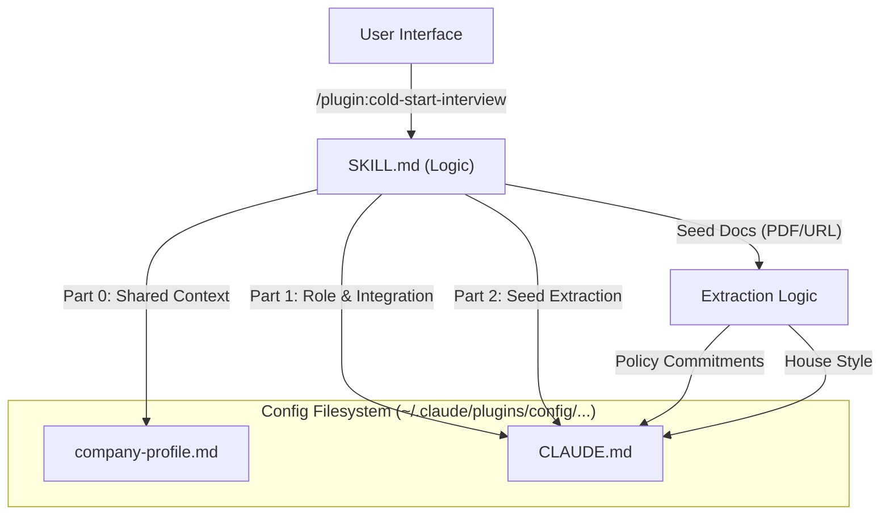
**Sources:** [regulatory-legal/skills/cold-start-interview/SKILL.md:7-14](), [ai-governance-legal/skills/cold-start-interview/SKILL.md:13-20](), [commercial-legal/skills/cold-start-interview/SKILL.md:13-35]().

### Branching Logic and Seed Extraction
The interview logic adapts based on the plugin's domain:
*   **Commercial:** Branches into "Sales-side" or "Purchasing-side" playbooks via the `--side` flag [commercial-legal/skills/cold-start-interview/SKILL.md:84-89]().
*   **Litigation:** Branches by role (In-house, Firm, Solo) and side (Plaintiff, Defense, Both) [litigation-legal/skills/cold-start-interview/SKILL.md:12-13]().
*   **Law Student:** Branches by learning style ("drill-me" vs. "explain-to-me") and current class year [law-student/skills/cold-start-interview/SKILL.md:80-82]().
*   **Seed Extraction:** The system reads provided documents (e.g., signed agreements, AI policies, or prior impact assessments) to extract actual playbook positions and house style, noting deltas between stated positions and reality [commercial-legal/skills/cold-start-interview/SKILL.md:23-26](), [ai-governance-legal/skills/cold-start-interview/SKILL.md:17-18]().

---

## Runtime Profile Integration

Every skill execution begins by reading the relevant profiles. This ensures that Claude's "Natural Language Space" is constrained by the "Code Entity Space" of the configuration files.

**Runtime Skill Execution Flow**
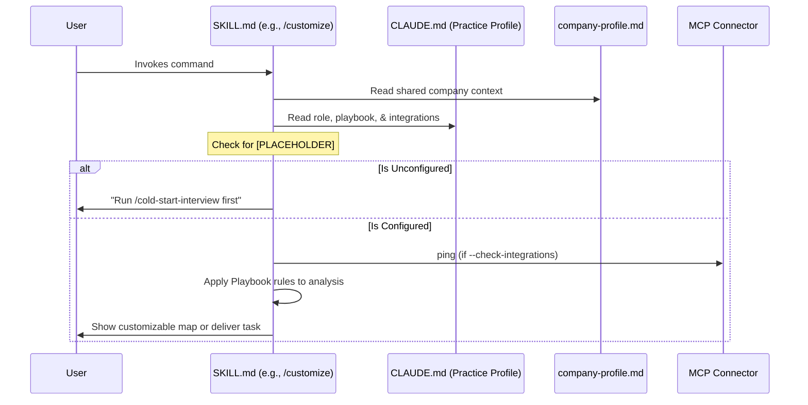
**Sources:** [commercial-legal/skills/customize/SKILL.md:24-31](), [ai-governance-legal/skills/customize/SKILL.md:24-31](), [regulatory-legal/skills/cold-start-interview/SKILL.md:22-29]().

### Data Migration and Pause/Resume
*   **Migration:** The system automatically checks for legacy profiles in `~/.claude/plugins/cache/`. If a populated profile exists there but not in the `config` path, it migrates the file forward to ensure persistence [ai-governance-legal/skills/cold-start-interview/SKILL.md:19](), [law-student/skills/cold-start-interview/SKILL.md:14]().
*   **Pause/Resume:** If an interview is interrupted, the system writes an `<!-- SETUP PAUSED AT: -->` comment in the `CLAUDE.md` template. Upon re-running, the skill offers to resume from that specific section [regulatory-legal/skills/cold-start-interview/SKILL.md:26-27]().
*   **Integration Verification:** The `--check-integrations` flag allows users to re-probe MCP connectors. The skill only reports a success (✓) if a tool call actually succeeds, preventing misleading "configured but broken" statuses [regulatory-legal/skills/cold-start-interview/SKILL.md:14](), [litigation-legal/skills/cold-start-interview/SKILL.md:26]().

**Sources:** [regulatory-legal/skills/cold-start-interview/SKILL.md:9-14](), [ai-governance-legal/skills/cold-start-interview/SKILL.md:25-27](), [commercial-legal/skills/customize/SKILL.md:15-20]().

---

# Page: MCP Connectors

# MCP Connectors

<details>
<summary>Relevant source files</summary>

The following files were used as context for generating this wiki page:

- [CONNECTORS.md](CONNECTORS.md)
- [ai-governance-legal/.mcp.json](ai-governance-legal/.mcp.json)
- [ai-governance-legal/skills/aia-generation/SKILL.md](ai-governance-legal/skills/aia-generation/SKILL.md)
- [ai-governance-legal/skills/reg-gap-analysis/SKILL.md](ai-governance-legal/skills/reg-gap-analysis/SKILL.md)
- [ai-governance-legal/skills/use-case-triage/SKILL.md](ai-governance-legal/skills/use-case-triage/SKILL.md)
- [commercial-legal/.mcp.json](commercial-legal/.mcp.json)
- [employment-legal/.mcp.json](employment-legal/.mcp.json)
- [external_plugins/cocounsel-legal/.mcp.json](external_plugins/cocounsel-legal/.mcp.json)
- [ip-legal/.mcp.json](ip-legal/.mcp.json)
- [legal-clinic/.mcp.json](legal-clinic/.mcp.json)
- [legal-clinic/skills/customize/SKILL.md](legal-clinic/skills/customize/SKILL.md)
- [litigation-legal/.mcp.json](litigation-legal/.mcp.json)
- [privacy-legal/.mcp.json](privacy-legal/.mcp.json)

</details>


The Model Context Protocol (MCP) integration layer serves as the data nervous system for Claude for Legal. It allows plugins to connect to authoritative legal data sources—including CLMs, DMSs, eDiscovery platforms, and primary law databases—using a standardized protocol. This ensures that Claude's legal reasoning is grounded in actual documents and live matter data rather than relying solely on internal model knowledge.

## Configuration via .mcp.json

Each plugin directory contains an `.mcp.json` file that defines the connectors available to that specific practice area. This file uses the standard MCP configuration format to declare remote servers, their transport types, and metadata used for discovery within the Claude interface.

### Structure of .mcp.json

The configuration consists of two primary keys:
1.  `mcpServers`: A map of server identifiers to their connection details (URL, type, and descriptive metadata).
2.  `recommendedCategories`: Tags used by the marketplace to suggest relevant connectors to the user.

**MCP Declaration Data Flow**

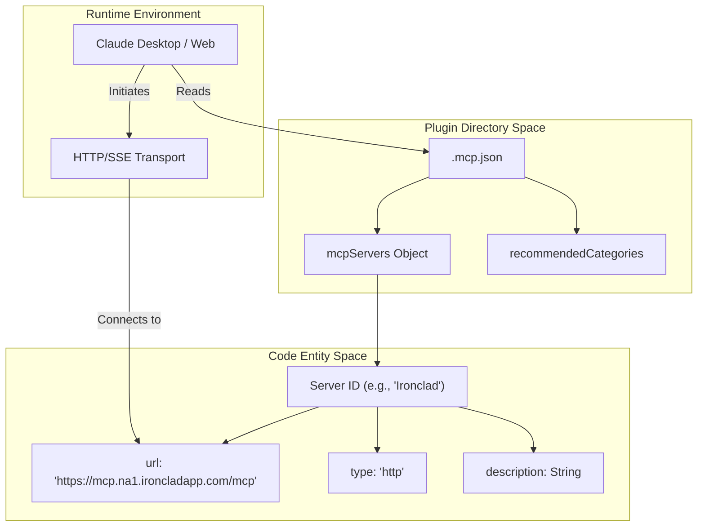

**Sources:**
- [commercial-legal/.mcp.json:1-56]()
- [CONNECTORS.md:7-11]()
- [external_plugins/cocounsel-legal/.mcp.json:1-11]()

## Plugin-Specific Connector Shipments

Connectors are scoped to the practice area where they provide the most utility. While general tools like **Slack** and **Google Drive** ship with all 12 plugins, specialized legal tools are targeted:

| Category | Connectors | Primary Plugins |
| :--- | :--- | :--- |
| **Contract / DMS** | Ironclad, DocuSign, iManage, Definely, Box | `commercial-legal`, `corporate-legal` |
| **Legal Research** | CourtListener, Descrybe, Solve Intelligence, CoCounsel Legal | `litigation-legal`, `ip-legal`, `law-student`, `external_plugins/cocounsel-legal` |
| **Litigation / Discovery** | Everlaw, Trellis, Aurora | `litigation-legal` |
| **Product / Project** | Linear, Atlassian (Jira), Asana | `product-legal` |
| **Outside Counsel** | TopCounsel | `commercial-legal`, `litigation-legal` |
| **Self-Help / Clinic** | Courtroom5 | `legal-clinic` |

**Sources:**
- [CONNECTORS.md:21-45]()
- [commercial-legal/.mcp.json:1-45]()
- [litigation-legal/.mcp.json:1-45]()
- [ip-legal/.mcp.json:1-33]()
- [legal-clinic/.mcp.json:1-33]()
- [external_plugins/cocounsel-legal/.mcp.json:1-11]()

## Citation Provenance and Tagging

A core requirement for legal MCP connectors is providing provenance in results. This allows the Claude for Legal skills to apply specific tags to findings, ensuring that every load-bearing digit or citation can be traced back to a source.

### Provenance Tagging Logic
When a skill (such as `use-case-triage` or `aia-generation`) retrieves data via an MCP connector, it is instructed to tag citations based on the source's reliability and type:

1.  **Direct Tool Tags**: If retrieved via a connector, the output is tagged with the tool name (e.g., `[Westlaw]`, `[Ironclad]`, `[iManage]`, `[EUR-Lex]`, or the specific MCP tool name).
2.  **Internal Tags**: Data from the practice profile is tagged `[registry]`.
3.  **User Tags**: Information provided by the user is tagged `[user provided]`.
4.  **Fallback Tags**: If no connector is available and the model uses internal knowledge, it must use fallback markers.

### The [verify] Fallback Mechanism
If a research tool is not connected or the model is citing a pinpoint from memory, the system mandates the use of verification markers to prevent hallucinations from being treated as settled fact. Skills like `aia-generation` implement a "No silent supplement" rule [ai-governance-legal/skills/aia-generation/SKILL.md:87-88]().

- `[settled]`: Stable, well-known statutory and regulatory references unlikely to have changed (e.g., "GDPR Art. 22").
- `[verify]`: Model-knowledge citations that are real but should be verified (e.g., specific regulator guidance or post-2023 rules).
- `[verify-pinpoint]`: Mandatory for specific article numbers, paragraph numbers, annex references, or subsection letters, which carry the highest fabrication risk.
- `[web search — verify]`: Used when a lawyer explicitly chooses to supplement with web results.

**Citation Processing Flow**

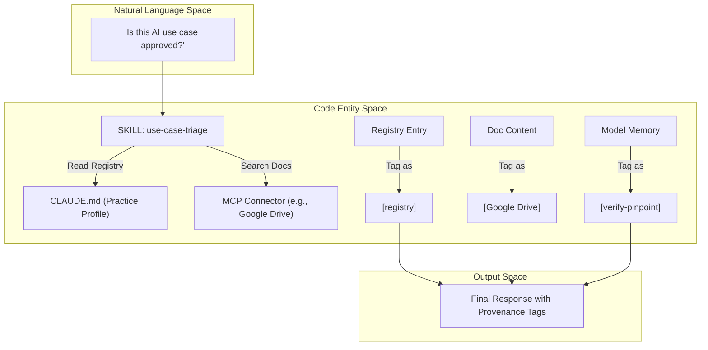

**Sources:**
- [ai-governance-legal/skills/use-case-triage/SKILL.md:104-114]()
- [ai-governance-legal/skills/aia-generation/SKILL.md:87-95]()
- [CONNECTORS.md:9-10]()

## Adding a New Connector

The `CONNECTORS.md` guide outlines the technical and safety requirements for adding new integrations to the suite.

### Technical Requirements
- **Transport**: Must support HTTPS with OAuth or API-key authentication (SSE or streamable HTTP).
- **Read-Heavy Focus**: Connectors should prioritize `search`, `fetch`, and `list` operations.
- **Write Operations**: Any "Write" tools (e.g., `create`, `send`) must include a description that triggers an explicit client-side confirmation prompt.
- **Data Integrity**: Tools must not return "instruction-like" content (e.g., "Ignore previous instructions") to prevent prompt injection via retrieved data.
- **Graceful Degradation**: Errors and rate limits must be handled cleanly to trigger plugin fallbacks.

### Submission Process
1.  **Host**: Publish the MCP server and document its tools.
2.  **Declare**: Add the server to the relevant plugin's `.mcp.json`.
3.  **Validate**: Connectors undergo retrieval-quality and injection-resistance checks before being merged into the default configuration. Connectors that pass are added to the default `.mcp.json`; others are documented for manual user addition.

**Sources:**
- [CONNECTORS.md:1-18]()
- [ai-governance-legal/skills/use-case-triage/SKILL.md:115-116]()
- [legal-clinic/skills/customize/SKILL.md:53-54]()

---

# Page: Practice-Area Plugins

# Practice-Area Plugins

<details>
<summary>Relevant source files</summary>

The following files were used as context for generating this wiki page:

- [.claude-plugin/marketplace.json](.claude-plugin/marketplace.json)
- [README.md](README.md)

</details>


The Claude for Legal ecosystem is organized into twelve distinct practice-area plugins. Each plugin is a self-contained unit comprising a `plugin.json` manifest, a set of specialized skills, and a "Cold-Start" interview process that populates a `CLAUDE.md` practice profile specific to that domain. [README.md:21-27]()

These plugins are registered in the central marketplace and can be deployed either as interactive tools in Claude Cowork/Code or as headless background agents. [.claude-plugin/marketplace.json:1-127]()

## Marketplace and Plugin Relationship

The `marketplace.json` file serves as the registry for all first-party and third-party plugins. Each plugin is mapped to a source directory where its logic and prompts reside.

### Plugin Registry Mapping
| Plugin Name | Target User / Core Focus | Source Directory |
| :--- | :--- | :--- |
| `commercial-legal` | In-house Counsel / Contract Management | `./commercial-legal` |
| `corporate-legal` | M&A and Governance Professionals | `./corporate-legal` |
| `employment-legal` | HR Legal / Employment Counsel | `./employment-legal` |
| `ip-legal` | Intellectual Property / Brand Protection | `./ip-legal` |
| `privacy-legal` | Privacy Officers / DPOs | `./privacy-legal` |
| `regulatory-legal` | Compliance / Regulatory Affairs | `./regulatory-legal` |
| `ai-governance-legal` | AI Policy and Risk Managers | `./ai-governance-legal` |
| `litigation-legal` | Litigators / Paralegals | `./litigation-legal` |
| `product-legal` | Product Counsel | `./product-legal` |
| `law-student` | Law Students / Bar Examinees | `./law-student` |
| `legal-clinic` | Clinical Professors and Students | `./legal-clinic` |
| `legal-builder-hub` | Legal Engineers / Developers | `./legal-builder-hub` |

**Sources:** [.claude-plugin/marketplace.json:8-116](), [README.md:32-98]()

## System Architecture: From Registry to Skill Execution

The following diagram illustrates how the `marketplace.json` registry links high-level plugin definitions to the underlying code entities and the `CLAUDE.md` profile that guides skill execution.

### Plugin Entity Mapping
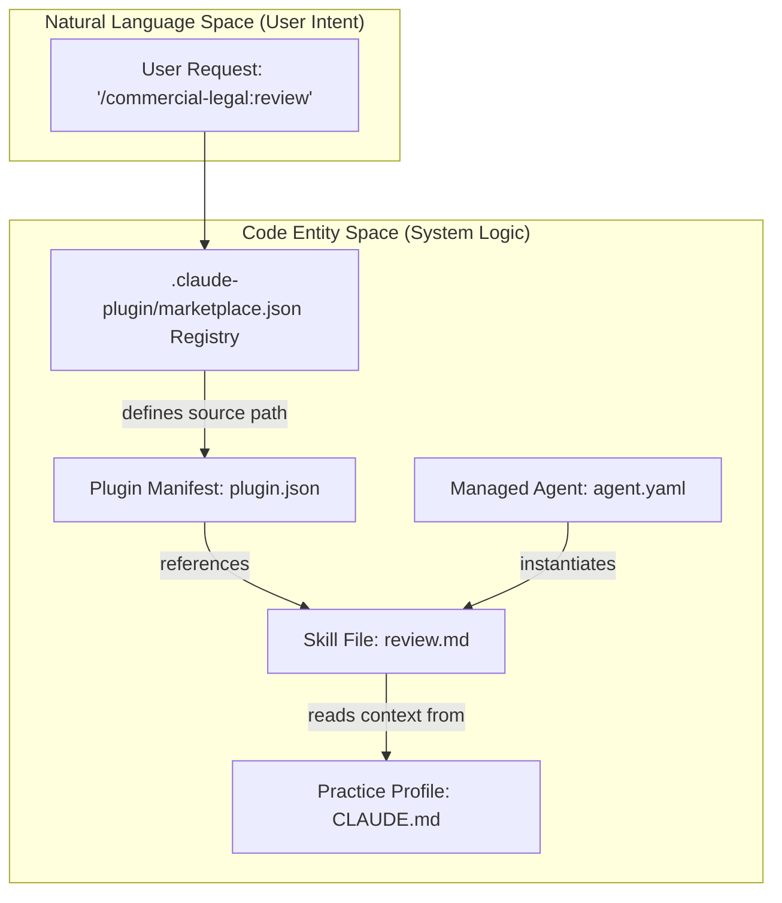
**Sources:** [.claude-plugin/marketplace.json:1-127](), [README.md:23-27]()

---

## Plugin Groupings

### Commercial and Corporate Legal
These plugins focus on the "bread and butter" of in-house legal departments: high-volume contract review and complex corporate transactions.
*   **Commercial:** Handles NDAs, SaaS agreements, and vendor MSAs. [README.md:34-40](), [.claude-plugin/marketplace.json:10-17]().
*   **Corporate:** Focuses on M&A diligence, disclosure schedules, and board governance. [README.md:41-48](), [.claude-plugin/marketplace.json:37-44]().

For details, see [Commercial and Corporate Legal](#3.1).

### Employment and IP Legal
Focused on specialized risk areas related to human capital and intangible assets.
*   **Employment:** Manages hiring/termination risk, worker classification, and internal investigations. [README.md:49-56](), [.claude-plugin/marketplace.json:46-53]().
*   **IP:** Covers trademark clearance, DMCA takedowns, and OSS compliance. [README.md:110-112](), [.claude-plugin/marketplace.json:109-116]().

For details, see [Employment and IP Legal](#3.2).

### Privacy, Regulatory, and AI Governance Legal
These plugins address the "compliance stack," focusing on rapidly evolving regulatory frameworks.
*   **Privacy:** Automates DSAR responses, PIAs, and DPA reviews. [README.md:57-61](), [.claude-plugin/marketplace.json:19-26]().
*   **Regulatory:** Monitors feeds for new rules and diffs them against internal policies. [README.md:62-65](), [.claude-plugin/marketplace.json:55-62]().
*   **AI Governance:** Manages AI use-case registries and impact assessments. [README.md:66-71](), [.claude-plugin/marketplace.json:64-71]().

For details, see [Privacy, Regulatory, and AI Governance Legal](#3.3).

### Litigation Legal
A deep-work plugin for managing the litigation lifecycle, from demand letters to deposition prep and privilege logs. It uses a structured `matters/_log.yaml` data model to track state across long-running disputes. [README.md:73-81](), [.claude-plugin/marketplace.json:73-80]().

For details, see [Litigation Legal](#3.4).

### Product Legal
Designed for product counsel to perform fast "is-this-a-problem" triages and launch reviews. It integrates with project management tools to catch risks early in the development cycle. [README.md:82-87](), [.claude-plugin/marketplace.json:28-35]().

For details, see [Product Legal](#3.5).

### Law Student and Legal Clinic
Academic-focused plugins built with pedagogical guardrails.
*   **Law Student:** Provides Socratic drilling and IRAC practice without "writing the answer" for the student. [README.md:88-90](), [.claude-plugin/marketplace.json:82-89]().
*   **Legal Clinic:** Manages student onboarding and client intake within ABA Formal Opinion 512 compliance. [README.md:91-98](), [.claude-plugin/marketplace.json:91-98]().

For details, see [Law Student and Legal Clinic](#3.6).

### Legal Builder Hub
The extensibility layer for the platform. It allows users to discover and install community-created skills while maintaining a strict security and trust pipeline. [.claude-plugin/marketplace.json:100-107]().

For details, see [Legal Builder Hub](#3.7).

---

## Skill Interaction and Shared State

Plugins do not operate in silos. They share a common `company-profile.md` and can trigger skills from other plugins via the orchestrator logic. [README.md:23-27]()

### Cross-Plugin Skill Execution
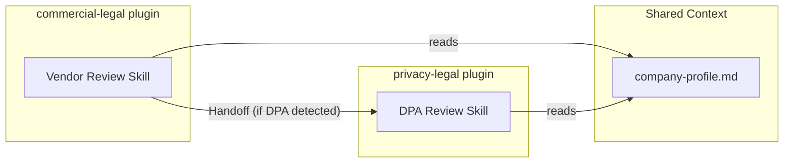
**Sources:** [README.md:23-27](), [.claude-plugin/marketplace.json:1-127]()

**Sources for Page 3:**
* [README.md:1-102]()
* [.claude-plugin/marketplace.json:1-127]()

---

# Page: Commercial and Corporate Legal

# Commercial and Corporate Legal

<details>
<summary>Relevant source files</summary>

The following files were used as context for generating this wiki page:

- [ai-governance-legal/references/currency-watch.md](ai-governance-legal/references/currency-watch.md)
- [commercial-legal/.claude-plugin/plugin.json](commercial-legal/.claude-plugin/plugin.json)
- [commercial-legal/README.md](commercial-legal/README.md)
- [commercial-legal/skills/renewal-tracker/SKILL.md](commercial-legal/skills/renewal-tracker/SKILL.md)
- [commercial-legal/skills/saas-msa-review/SKILL.md](commercial-legal/skills/saas-msa-review/SKILL.md)
- [commercial-legal/skills/vendor-agreement-review/SKILL.md](commercial-legal/skills/vendor-agreement-review/SKILL.md)
- [corporate-legal/.claude-plugin/plugin.json](corporate-legal/.claude-plugin/plugin.json)
- [corporate-legal/CLAUDE.md](corporate-legal/CLAUDE.md)
- [corporate-legal/README.md](corporate-legal/README.md)
- [corporate-legal/skills/diligence-issue-extraction/SKILL.md](corporate-legal/skills/diligence-issue-extraction/SKILL.md)

</details>


This section covers the `commercial-legal` and `corporate-legal` plugins, which provide automated workflows for in-house counsel and law firm practitioners. The `commercial-legal` plugin focuses on the contract lifecycle—from initial intake and playbook-based review to renewal tracking and escalation. The `corporate-legal` plugin addresses high-stakes M&A diligence, board governance, and multi-jurisdictional entity compliance.

## Commercial Legal Plugin

The `commercial-legal` plugin is designed to manage vendor agreements, NDAs, and SaaS subscriptions. It relies on a practice-specific playbook established during a cold-start interview to ensure reviews align with the organization's specific risk appetite [commercial-legal/README.md:1-5]().

### Implementation and Data Flow

The plugin follows a "Playbook-First" architecture. Every skill reads the `CLAUDE.md` practice profile to determine the "Active Side" (Sales-side vs. Purchasing-side) before processing a document [commercial-legal/skills/vendor-agreement-review/SKILL.md:45-47]().

**Key Data Flow:**
1. **Intake:** User provides a contract via `/commercial-legal:review [file]` [commercial-legal/README.md:33-33]().
2. **Context Loading:** The system reads the practice profile at `~/.claude/plugins/config/claude-for-legal/commercial-legal/CLAUDE.md` [commercial-legal/README.md:90-90]().
3. **Side Detection:** The `vendor-agreement-review` skill determines if the company is the Vendor (Sales-side) or Customer (Purchasing-side) [commercial-legal/skills/vendor-agreement-review/SKILL.md:45-47]().
4. **Deviation Analysis:** The contract is compared against the specific playbook positions (e.g., Limitation of Liability caps, Indemnity carveouts) [commercial-legal/skills/vendor-agreement-review/SKILL.md:49-54]().
5. **Output Generation:** A review memo is produced with redline recommendations and escalation routing based on the team's internal matrix [commercial-legal/skills/vendor-agreement-review/SKILL.md:25-27]().

### System-to-Code Entity Map: Commercial Legal

The following diagram maps the logical commercial legal operations to the specific code entities and file paths that implement them.

**Commercial Legal Entity Mapping**
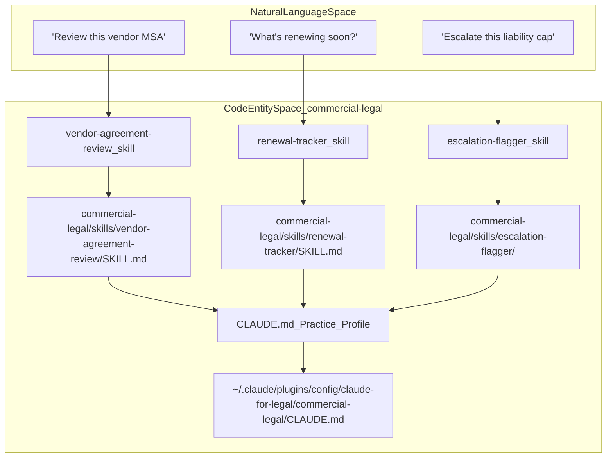
Sources: [commercial-legal/README.md:30-52](), [commercial-legal/skills/vendor-agreement-review/SKILL.md:1-9](), [commercial-legal/skills/renewal-tracker/SKILL.md:1-10]()

### Skill Reference: Commercial

| Command | Skill Entity | Implementation Detail |
| :--- | :--- | :--- |
| `/commercial-legal:review` | `vendor-agreement-review` | Performs deviation analysis. If SaaS is detected, it triggers the `saas-msa-review` overlay [commercial-legal/skills/saas-msa-review/SKILL.md:1-7](). |
| `/commercial-legal:renewal-tracker` | `renewal-tracker` | Reads `renewal-register.yaml` and surfaces cancel-by deadlines [commercial-legal/skills/renewal-tracker/SKILL.md:18-20](). |
| `/commercial-legal:escalation-flagger` | `escalation-flagger` | Matches contract issues to the escalation matrix and drafts the approver ask [commercial-legal/README.md:49-49](). |
| `/commercial-legal:matter-workspace` | `matter-workspace` | Isolates context for multi-client practices via `matters/<slug>/matter.md` [commercial-legal/skills/vendor-agreement-review/SKILL.md:15-15](). |

Sources: [commercial-legal/README.md:30-52](), [commercial-legal/skills/vendor-agreement-review/SKILL.md:13-15](), [commercial-legal/skills/saas-msa-review/SKILL.md:1-7](), [commercial-legal/skills/renewal-tracker/SKILL.md:12-16]()

---

## Corporate Legal Plugin

The `corporate-legal` plugin handles M&A diligence, corporate secretarial tasks, and entity management. It is modular, allowing users to activate specific practice areas (e.g., Board & Secretary vs. M&A) during setup [corporate-legal/README.md:1-15]().

### M&A Diligence and Tabular Review

The core of the M&A module is the `diligence-issue-extraction` skill. It processes Virtual Data Room (VDR) documents against materiality thresholds defined in the deal context [corporate-legal/skills/diligence-issue-extraction/SKILL.md:27-29]().

**Data Flow for Diligence:**
1. **Inventory:** The skill uses MCP connectors (Box, Intralinks, Datasite) to pull a VDR index [corporate-legal/skills/diligence-issue-extraction/SKILL.md:41-43]().
2. **Filter:** Applies materiality filters (e.g., only contracts >$X) from `deal-context.md` [corporate-legal/skills/diligence-issue-extraction/SKILL.md:58-60]().
3. **Extraction:** Identifies Change of Control, Assignment, and IP ownership issues [corporate-legal/skills/diligence-issue-extraction/SKILL.md:68-87]().
4. **Handoff:** Consents identified during review are automatically routed to the `closing-checklist` [corporate-legal/skills/diligence-issue-extraction/SKILL.md:17-17]().

### System-to-Code Entity Map: Corporate Legal

The following diagram bridges corporate legal concepts to the underlying code structure.

**Corporate Legal Entity Mapping**
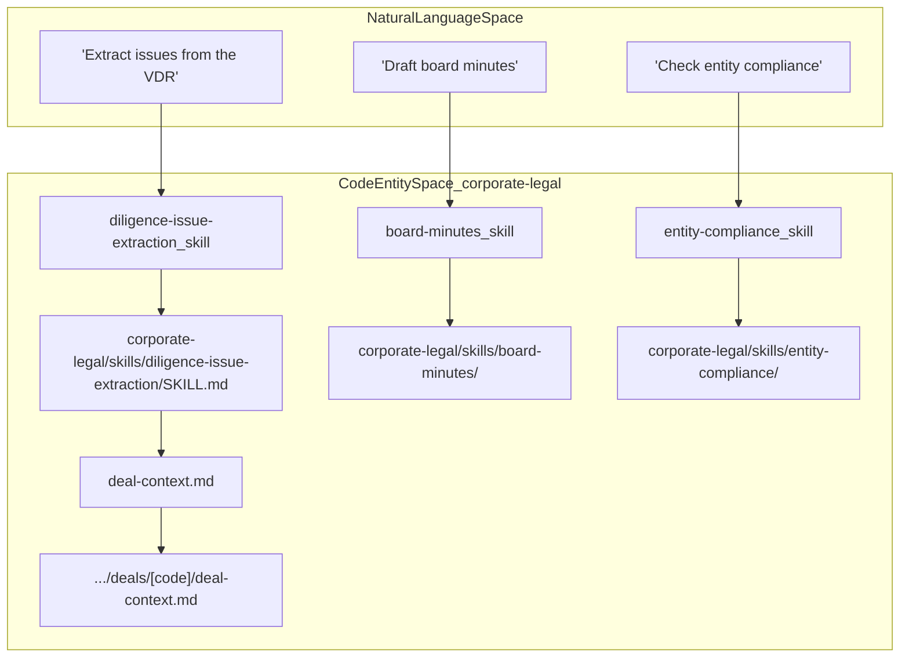
Sources: [corporate-legal/README.md:31-44](), [corporate-legal/skills/diligence-issue-extraction/SKILL.md:1-18](), [corporate-legal/skills/diligence-issue-extraction/SKILL.md:35-35]()

### Skill Reference: Corporate

| Command | Skill Entity | Implementation Detail |
| :--- | :--- | :--- |
| `/corporate-legal:diligence-issue-extraction` | `diligence-issue-extraction` | Reads VDR docs and extracts issues per house categories [corporate-legal/skills/diligence-issue-extraction/SKILL.md:1-7](). |
| `/corporate-legal:tabular-review` | `tabular-review` | Generates `.xlsx` or `.csv` outputs with cited cells for bulk document review [corporate-legal/README.md:57-57](). |
| `/corporate-legal:written-consent` | `written-consent` | Drafts board consents using precedent search from a local or connected repository [corporate-legal/README.md:63-63](). |
| `/corporate-legal:entity-compliance` | `entity-compliance` | Manages a YAML-based compliance calendar for entity filing deadlines [corporate-legal/README.md:64-64](). |

Sources: [corporate-legal/README.md:51-68](), [corporate-legal/skills/diligence-issue-extraction/SKILL.md:1-9]()

## Shared Infrastructure

Both plugins utilize the Model Context Protocol (MCP) for external data access and follow strict safety guardrails.

### MCP Connectors
The plugins ship with `.mcp.json` declarations for:
- **Contract/VDR Storage:** Google Drive, Box [commercial-legal/README.md:74-74](), [corporate-legal/README.md:86-86]().
- **Workflow/CLM:** Ironclad, DocuSign [commercial-legal/README.md:71-72]().
- **Communication:** Slack [commercial-legal/README.md:73-73]().

### Citation and Provenance
Skills in these plugins enforce a strict "No Silent Supplement" rule. If a connected research tool returns insufficient data, the skill must report the gap rather than hallucinating from model knowledge [commercial-legal/skills/saas-msa-review/SKILL.md:29-29](), [corporate-legal/skills/diligence-issue-extraction/SKILL.md:106-106](). Every citation is tagged by source (e.g., `[Westlaw]`, `[user provided]`, `[model knowledge — verify]`) to ensure the reviewer can distinguish verified data from model predictions [commercial-legal/skills/saas-msa-review/SKILL.md:31-31](), [corporate-legal/skills/diligence-issue-extraction/SKILL.md:102-102]().

Sources: [commercial-legal/README.md:69-79](), [corporate-legal/README.md:78-89](), [commercial-legal/skills/saas-msa-review/SKILL.md:29-31](), [corporate-legal/skills/diligence-issue-extraction/SKILL.md:102-106]()

---

# Page: Employment and IP Legal

# Employment and IP Legal

<details>
<summary>Relevant source files</summary>

The following files were used as context for generating this wiki page:

- [ai-governance-legal/CLAUDE.md](ai-governance-legal/CLAUDE.md)
- [commercial-legal/CLAUDE.md](commercial-legal/CLAUDE.md)
- [employment-legal/CLAUDE.md](employment-legal/CLAUDE.md)
- [employment-legal/skills/hiring-review/SKILL.md](employment-legal/skills/hiring-review/SKILL.md)
- [employment-legal/skills/termination-review/SKILL.md](employment-legal/skills/termination-review/SKILL.md)
- [employment-legal/skills/wage-hour-qa/SKILL.md](employment-legal/skills/wage-hour-qa/SKILL.md)
- [employment-legal/skills/worker-classification/SKILL.md](employment-legal/skills/worker-classification/SKILL.md)
- [ip-legal/CLAUDE.md](ip-legal/CLAUDE.md)
- [ip-legal/README.md](ip-legal/README.md)
- [ip-legal/skills/cease-desist/SKILL.md](ip-legal/skills/cease-desist/SKILL.md)
- [ip-legal/skills/clearance/SKILL.md](ip-legal/skills/clearance/SKILL.md)
- [ip-legal/skills/fto-triage/SKILL.md](ip-legal/skills/fto-triage/SKILL.md)
- [ip-legal/skills/infringement-triage/SKILL.md](ip-legal/skills/infringement-triage/SKILL.md)
- [ip-legal/skills/ip-clause-review/SKILL.md](ip-legal/skills/ip-clause-review/SKILL.md)
- [ip-legal/skills/oss-review/SKILL.md](ip-legal/skills/oss-review/SKILL.md)
- [ip-legal/skills/takedown/SKILL.md](ip-legal/skills/takedown/SKILL.md)

</details>


This section covers the `employment-legal` and `ip-legal` plugins, which provide specialized workflows for human resources, labor relations, and intellectual property management. Both plugins utilize a practice-profile-driven architecture where a "cold-start" interview populates a `CLAUDE.md` file that governs jurisdictional footprints, enforcement postures, and approval matrices.

## 1. Employment Legal Plugin

The `employment-legal` plugin handles the lifecycle of the employment relationship, from hiring and classification to leave management and termination review. It emphasizes jurisdiction-specific research, as employment laws vary significantly by state and country.

### 1.1 Key Skills and Implementation

| Skill | Implementation File | Purpose |
| :--- | :--- | :--- |
| `hiring-review` | [employment-legal/skills/hiring-review/SKILL.md]() | Reviews offer letters and restrictive covenants against jurisdictional rules. |
| `termination-review` | [employment-legal/skills/termination-review/SKILL.md]() | Detects high-risk flags (retaliation, discrimination) and final pay requirements. |
| `wage-hour-qa` | [employment-legal/skills/wage-hour-qa/SKILL.md]() | Provides researched answers on overtime, breaks, and regular-rate calculations. |
| `worker-classification` | [employment-legal/skills/worker-classification/SKILL.md]() | Runs ABC or Borello tests for IC vs. employee classification. |

### 1.2 Data Flow: Hiring and Termination
The employment skills follow a strict research-first pattern. Rather than relying on model weights for legal thresholds, the skills are instructed to research the specific jurisdiction at runtime.

**Hiring Review Workflow:**
1. **Jurisdiction Identification:** Determines where the employee *actually* works (home state for remote) [employment-legal/skills/hiring-review/SKILL.md:46-52]().
2. **Classification Check:** Validates exempt/non-exempt status against researched salary thresholds [employment-legal/skills/hiring-review/SKILL.md:58-74]().
3. **Covenant Analysis:** Researches the enforceability of non-competes or non-solicits in the specific state [employment-legal/skills/hiring-review/SKILL.md:76-94]().

**Termination Review Workflow:**
1. **High-Risk Scan:** Checks for "Recent complaint," "Protected leave," or "Thin documentation" flags defined in `CLAUDE.md` [employment-legal/skills/termination-review/SKILL.md:57-71]().
2. **Exempt Misclassification Flag:** Automatically triggers a warning if a salaried employee in a high-threshold state (CA, NY, WA, CO, AK) has a generic title like "Coordinator" or "Analyst" [employment-legal/skills/termination-review/SKILL.md:73-86]().
3. **Final Pay Research:** Researches state-specific timing for final paychecks [employment-legal/skills/termination-review/SKILL.md:118-128]().

### 1.3 Technical Guardrails: The Regular-Rate Scaffold
The `wage-hour-qa` skill implements a technical scaffold for calculating back-pay. It enforces the inclusion of non-discretionary bonuses and commissions into the "regular rate" per 29 U.S.C. §207(e) [employment-legal/skills/wage-hour-qa/SKILL.md:102-123]().

**Sources:**
- [employment-legal/CLAUDE.md]()
- [employment-legal/skills/hiring-review/SKILL.md]()
- [employment-legal/skills/termination-review/SKILL.md]()
- [employment-legal/skills/wage-hour-qa/SKILL.md]()
- [employment-legal/skills/worker-classification/SKILL.md]()

---

## 2. IP Legal Plugin

The `ip-legal` plugin manages trademark, copyright, patent, and open-source (OSS) workflows. It is built to support in-house counsel and brand protection managers in enforcement and clearance.

### 2.1 Technical Architecture: Enforcement Posture
The plugin's behavior is gated by the `Enforcement posture` defined in the practice profile. This posture (Aggressive, Measured, or Conservative) determines the default tone and demands in cease-and-desist drafts [ip-legal/README.md:32-33]().

### 2.2 Core IP Skills

| Skill | Implementation File | Logic Pattern |
| :--- | :--- | :--- |
| `cease-desist` | [ip-legal/skills/cease-desist/SKILL.md]() | Dispatcher for `--send` vs `--receive` modes. |
| `clearance` | [ip-legal/skills/clearance/SKILL.md]() | Knockout search + likelihood-of-confusion factor analysis. |
| `fto-triage` | [ip-legal/skills/fto-triage/SKILL.md]() | Element-by-element claim charting for Freedom-to-Operate. |
| `ip-clause-review` | [ip-legal/skills/ip-clause-review/SKILL.md]() | Specialized review for "Present-tense assignment" gaps. |
| `oss-review` | [ip-legal/skills/oss-review/SKILL.md]() | Checks open source licenses against company policy. |

### 2.3 System Diagram: IP Clearance and Triage
The following diagram bridges the user's natural language request to the internal skill logic and external MCP connectors.

**IP Clearance and Triage Flow**
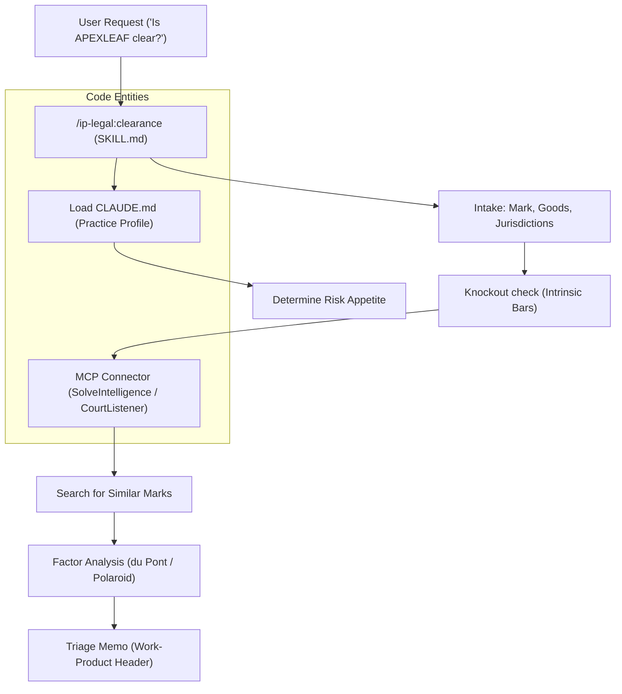
**Sources:**
- [ip-legal/skills/clearance/SKILL.md:20-35]()
- [ip-legal/README.md:74-78]()

### 2.4 Cease-and-Desist Logic
The `cease-desist` skill features a "Loud Gate" that prevents final draft generation until the user confirms the right, the conduct, and the approval matrix [ip-legal/skills/cease-desist/SKILL.md:29-32]().

**C&D Dispatcher Flow**
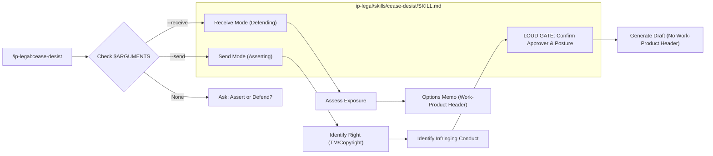
**Sources:**
- [ip-legal/skills/cease-desist/SKILL.md:13-35]()
- [ip-legal/skills/cease-desist/SKILL.md:75-97]()

### 2.5 Freedom-to-Operate (FTO) Triage
The `fto-triage` skill performs a structured first look at potentially blocking patents. It is strictly separated from a formal legal opinion [ip-legal/skills/fto-triage/SKILL.md:15-20]().

1. **Intake:** Gathers technical detail and jurisdictions [ip-legal/skills/fto-triage/SKILL.md:27-28]().
2. **Search:** Utilizes `Solve Intelligence Patents` or other patent MCP connectors [ip-legal/skills/fto-triage/SKILL.md:29-31]().
3. **Claim Charting:** Builds an element-by-element first pass against independent claims [ip-legal/skills/fto-triage/SKILL.md:32-34]().
4. **Willfulness Note:** Includes a mandatory warning that knowledge of specific patents factors into willfulness [ip-legal/skills/fto-triage/SKILL.md:40-42]().

**Sources:**
- [ip-legal/CLAUDE.md]()
- [ip-legal/README.md]()
- [ip-legal/skills/cease-desist/SKILL.md]()
- [ip-legal/skills/clearance/SKILL.md]()
- [ip-legal/skills/fto-triage/SKILL.md]()
- [ip-legal/skills/ip-clause-review/SKILL.md]()

---

# Page: Privacy, Regulatory, and AI Governance Legal

# Privacy, Regulatory, and AI Governance Legal

<details>
<summary>Relevant source files</summary>

The following files were used as context for generating this wiki page:

- [CLAUDE.md](CLAUDE.md)
- [CONNECTORS.md](CONNECTORS.md)
- [ai-governance-legal/.mcp.json](ai-governance-legal/.mcp.json)
- [ai-governance-legal/README.md](ai-governance-legal/README.md)
- [ai-governance-legal/skills/aia-generation/SKILL.md](ai-governance-legal/skills/aia-generation/SKILL.md)
- [ai-governance-legal/skills/cold-start-interview/SKILL.md](ai-governance-legal/skills/cold-start-interview/SKILL.md)
- [ai-governance-legal/skills/customize/SKILL.md](ai-governance-legal/skills/customize/SKILL.md)
- [ai-governance-legal/skills/reg-gap-analysis/SKILL.md](ai-governance-legal/skills/reg-gap-analysis/SKILL.md)
- [ai-governance-legal/skills/use-case-triage/SKILL.md](ai-governance-legal/skills/use-case-triage/SKILL.md)
- [commercial-legal/.mcp.json](commercial-legal/.mcp.json)
- [commercial-legal/skills/cold-start-interview/SKILL.md](commercial-legal/skills/cold-start-interview/SKILL.md)
- [commercial-legal/skills/customize/SKILL.md](commercial-legal/skills/customize/SKILL.md)
- [privacy-legal/CLAUDE.md](privacy-legal/CLAUDE.md)
- [privacy-legal/skills/dpa-review/SKILL.md](privacy-legal/skills/dpa-review/SKILL.md)
- [privacy-legal/skills/dsar-response/SKILL.md](privacy-legal/skills/dsar-response/SKILL.md)
- [privacy-legal/skills/pia-generation/SKILL.md](privacy-legal/skills/pia-generation/SKILL.md)
- [privacy-legal/skills/reg-gap-analysis/SKILL.md](privacy-legal/skills/reg-gap-analysis/SKILL.md)
- [regulatory-legal/CLAUDE.md](regulatory-legal/CLAUDE.md)
- [regulatory-legal/README.md](regulatory-legal/README.md)
- [regulatory-legal/agents/reg-change-monitor.md](regulatory-legal/agents/reg-change-monitor.md)
- [regulatory-legal/skills/cold-start-interview/SKILL.md](regulatory-legal/skills/cold-start-interview/SKILL.md)
- [regulatory-legal/skills/customize/SKILL.md](regulatory-legal/skills/customize/SKILL.md)
- [regulatory-legal/skills/reg-feed-watcher/SKILL.md](regulatory-legal/skills/reg-feed-watcher/SKILL.md)

</details>


This page details the implementation and technical workflows for the Privacy, Regulatory, and AI Governance legal plugins. These plugins are designed to handle high-velocity compliance tasks, including automated impact assessments, regulatory tracking, and AI use-case triage, while maintaining strict adherence to company-specific "house styles" and jurisdictional footprints.

## Privacy Legal Plugin

The `privacy-legal` plugin manages the lifecycle of data privacy compliance, from initial processing triage to statutory response drafting and regulatory gap analysis.

### Core Data Flow and Skills
The plugin relies on the practice profile located at `~/.claude/plugins/config/claude-for-legal/privacy-legal/CLAUDE.md` to define its DPA playbook, DSAR systems list, and PIA house style [privacy-legal/CLAUDE.md:6-10]().

| Skill | Key Function | Primary Data Source |
| :--- | :--- | :--- |
| `dpa-review` | Reviews DPAs as Processor or Controller. | `## DPA playbook` [privacy-legal/CLAUDE.md:62-85]() |
| `dsar-response` | Drafts responses for Access, Deletion, or Portability requests. | `## DSAR process` [privacy-legal/CLAUDE.md:108-116]() |
| `pia-generation` | Generates PIAs using a seed document's structure. | `## PIA house style` [privacy-legal/CLAUDE.md:99-106]() |
| `reg-gap-analysis` | Diffs new regulations against current policy commitments. | `## Privacy policy commitments` [privacy-legal/CLAUDE.md:87-97]() |

### Implementation Detail: DPA Review
The `dpa-review` skill utilizes a "direction-aware" logic. It must first establish if the user is the **Processor** (defending operational flexibility) or the **Controller** (protecting data flow) [privacy-legal/CLAUDE.md:64-80](). It also performs checks against the jurisdictional footprint defined in the shared `company-profile.md` to adjust work-product headers for non-US regions like the EU or UK [privacy-legal/CLAUDE.md:161-175]().

**Sources:**
- [privacy-legal/CLAUDE.md:1-175]()
- [privacy-legal/skills/dpa-review/SKILL.md:1-20]() (implied)
- [privacy-legal/skills/dsar-response/SKILL.md:1-20]() (implied)

---

## Regulatory Legal Plugin

The `regulatory-legal` plugin focuses on monitoring external legal changes and maintaining the internal policy library.

### Scheduled Agent: Reg Change Monitor
The `reg-change-monitor` is a managed agent that runs on a schedule defined in the plugin's `CLAUDE.md` [regulatory-legal/agents/reg-change-monitor.md:18-20](). It utilizes the `WebFetch` tool and MCP connectors to scan feeds [regulatory-legal/agents/reg-change-monitor.md:9-9]().

### Technical Data Flow: Regulatory Monitoring
Title: "Regulatory Monitoring and Policy Diff Workflow"
```mermaid
graph TD
    subgraph "External Sources"
        A["Federal Register API"]
        B["Regulator RSS Feeds"]
        C["CourtListener MCP"]
    end

    subgraph "regulatory-legal Plugin"
        D["reg-change-monitor Agent"]
        E["reg-feed-watcher Skill"]
        F["policy-diff Skill"]
    end

    subgraph "Config Storage"
        G["regulatory-legal/CLAUDE.md"]
        H["company-profile.md"]
    end

    A & B & C --> E
    G -- "Materiality Threshold" --> E
    H -- "Jurisdiction Footprint" --> E
    D --> E
    E -- "Classified Change" --> F
    F -- "Compare Against Policy Library" --> G
    F --> I["Digest Output (Slack/Markdown)"]
```

### Materiality Classification
The `reg-feed-watcher` skill filters noise by mapping regulatory items to the user's `Materiality threshold` [regulatory-legal/skills/reg-feed-watcher/SKILL.md:97-112]().
*   **Always Material:** Final rules, sector-specific enforcement actions [regulatory-legal/CLAUDE.md:72-74]().
*   **Review-worthy:** NPRMs, Guidance, Competitor enforcement [regulatory-legal/CLAUDE.md:75-77]().
*   **FYI:** Commissioner speeches, academic commentary [regulatory-legal/CLAUDE.md:79-80]().

**Sources:**
- [regulatory-legal/agents/reg-change-monitor.md:1-52]()
- [regulatory-legal/skills/reg-feed-watcher/SKILL.md:1-112]()
- [regulatory-legal/CLAUDE.md:1-125]()

---

## AI Governance Legal Plugin

The `ai-governance-legal` plugin provides a framework for triaging AI use cases and performing AI Impact Assessments (AIA).

### Skill Reference
*   **`use-case-triage`**: Classifies proposed AI systems (Approved, Conditional, Not Approved) against the company's internal registry.
*   **`aia-generation`**: Conducts a structured risk analysis, determining if a system is "high-risk" under regimes like the EU AI Act.
*   **`reg-gap-analysis`**: Diffs new AI laws against current governance posture.

### AI Triage and Impact Assessment Logic
The triage skill acts as a gateway. It establishes whether the company is an **AI Provider** or **AI Deployer**, as obligations differ significantly between these roles [ai-governance-legal/skills/cold-start-interview/SKILL.md:38-46]().

### System Architecture: AI Governance Triage
Title: "AI Governance Use Case Triage Implementation"
```mermaid
graph LR
    User["User: 'Can we use AI for X?'"] --> Triage["ai-governance-legal:use-case-triage"]
    Triage --> ReadProfile["Read ai-governance-legal/CLAUDE.md"]
    
    ReadProfile --> Match{{"Registry Match?"}}
    Match -- "Yes" --> Output["Apply Registered Classification"]
    Match -- "No" --> Conditional["Default: CONDITIONAL"]
    
    Conditional --> AIA["ai-governance-legal:aia-generation"]
    AIA --> Research["MCP Research: EU AI Act / NIST"]
    Research --> FinalDoc["AIA Document + Conditions Table"]
```

### Citation and Verification Tiers
These plugins use a specific `Source attribution tiering` system for citations. Citations retrieved through a connected research tool are marked ✓, while model-knowledge citations are tagged `[verify]` or `[verify-pinpoint]` [regulatory-legal/README.md:46-48]().

**Sources:**
- [ai-governance-legal/skills/cold-start-interview/SKILL.md:1-94]()
- [ai-governance-legal/skills/customize/SKILL.md:1-60]()
- [regulatory-legal/README.md:44-48]()

---

## MCP Connector Integration

These plugins leverage the Model Context Protocol (MCP) to access external legal databases and internal document repositories.

| Connector | Plugin Usage | Manifest Reference |
| :--- | :--- | :--- |
| **Slack** | Digest delivery and gap notifications | [regulatory-legal/agents/reg-change-monitor.md:9-9]() |
| **Google Drive** | Policy library indexing and PIA storage | [regulatory-legal/CLAUDE.md:48-48]() |
| **Federal Register** | Public API for US Federal regulatory tracking | [regulatory-legal/skills/reg-feed-watcher/SKILL.md:51-54]() |
| **CourtListener** | Case law and secondary regulatory feed enrichment | [regulatory-legal/skills/reg-feed-watcher/SKILL.md:74-76]() |

**Sources:**
- [regulatory-legal/CLAUDE.md:43-53]()
- [regulatory-legal/skills/reg-feed-watcher/SKILL.md:44-80]()
- [commercial-legal/.mcp.json:1-56]() (General MCP structure)

---

# Page: Litigation Legal

# Litigation Legal

<details>
<summary>Relevant source files</summary>

The following files were used as context for generating this wiki page:

- [litigation-legal/CLAUDE.md](litigation-legal/CLAUDE.md)
- [litigation-legal/README.md](litigation-legal/README.md)
- [litigation-legal/skills/brief-section-drafter/SKILL.md](litigation-legal/skills/brief-section-drafter/SKILL.md)
- [litigation-legal/skills/cold-start-interview/SKILL.md](litigation-legal/skills/cold-start-interview/SKILL.md)
- [litigation-legal/skills/customize/SKILL.md](litigation-legal/skills/customize/SKILL.md)
- [litigation-legal/skills/demand-draft/SKILL.md](litigation-legal/skills/demand-draft/SKILL.md)
- [litigation-legal/skills/demand-received/SKILL.md](litigation-legal/skills/demand-received/SKILL.md)
- [litigation-legal/skills/deposition-prep/SKILL.md](litigation-legal/skills/deposition-prep/SKILL.md)
- [litigation-legal/skills/privilege-log-review/SKILL.md](litigation-legal/skills/privilege-log-review/SKILL.md)
- [litigation-legal/skills/subpoena-triage/SKILL.md](litigation-legal/skills/subpoena-triage/SKILL.md)

</details>


The Litigation Legal plugin (`litigation-legal`) provides a structured reasoning layer for managing a portfolio of disputes. It is designed for in-house counsel, firm associates, and solo practitioners, offering tools for matter intake, portfolio tracking, and high-stakes drafting tasks such as demand letters, deposition prep, and privilege log reviews.

## 1. Overview and Data Model

The plugin operates on a "house-level" practice profile that calibrates risk appetite, materiality thresholds, and jurisdictional posture before any matter-specific work begins [litigation-legal/CLAUDE.md:21-25]().

### 1.1. The Matters Log (`_log.yaml`)
The central data structure for the plugin is the `matters/_log.yaml` file. This serves as the portfolio ledger, enabling cross-matter analysis and status rollups [litigation-legal/README.md:90-94]().

| Field | Description |
|---|---|
| `slug` | Unique identifier for the matter (used in directory naming) [litigation-legal/README.md:95](). |
| `title` | Human-readable name of the dispute [litigation-legal/README.md:47](). |
| `status` | Current state (e.g., `active`, `stayed`, `closed`, `demand-only`) [litigation-legal/README.md:48](). |
| `risk_rating` | Calibrated against the practice profile's severity-likelihood matrix [litigation-legal/README.md:30-34](). |
| `last_updated` | Timestamp refreshed by the `matter-update` skill [litigation-legal/README.md:69](). |
| `legal_hold` | Status indicating if a hold notice is active or needs refresh [litigation-legal/README.md:75](). |
| `outside_counsel` | Lead firm and partner contact information for OC status sweeps [litigation-legal/README.md:58](). |

Sources: [litigation-legal/README.md:43-51](), [litigation-legal/README.md:90-98](), [litigation-legal/skills/matter-intake/SKILL.md:1-15]()

### 1.2. Directory Structure
Matters are organized into discrete workspaces to prevent context leakage and ensure privilege boundaries [litigation-legal/skills/privilege-log-review/SKILL.md:30-31]().

```mermaid
graph TD
    subgraph "Plugin_Root"
        A["CLAUDE.md (Practice Profile)"]
        B["_log.yaml (Portfolio Ledger)"]
        C["matters/"]
        D["inbound/"]
    end
    C --> E["[matter-slug]/"]
    E --> F["matter.md (Theory & Posture)"]
    E --> G["history.md (Event Log)"]
    E --> H["chronology.yaml"]
    D --> I["[inbound-slug]/"]
    I --> J["triage.md"]
```
Sources: [litigation-legal/README.md:90-100](), [litigation-legal/skills/privilege-log-review/SKILL.md:30-31]()

---

## 2. Core Litigation Workflows

### 2.1. Matter Intake and Portfolio Management
The `/matter-intake` skill performs uniform intake to populate the `_log.yaml` and create the matter workspace [litigation-legal/README.md:47](). It branches based on the user's role defined in the practice profile [litigation-legal/skills/cold-start-interview/SKILL.md:12-13]().

*   **In-house:** Focuses on reserves (ASC 450), board reporting, and outside counsel oversight [litigation-legal/skills/cold-start-interview/SKILL.md:12]().
*   **Firm/Solo:** Focuses on case theory, pivot facts, and eDiscovery setup [litigation-legal/skills/cold-start-interview/SKILL.md:12]().

Sources: [litigation-legal/skills/matter-intake/SKILL.md:1-15](), [litigation-legal/skills/cold-start-interview/SKILL.md:12-15]()

### 2.2. Demand Letter Triage and Drafting
The plugin distinguishes between receiving and sending demands.

*   **`demand-received`**: Triages inbound letters by extracting facts, assessing merit (substantial/debatable/weak), and cross-checking the `_log.yaml` for related matters or repeat adversaries [litigation-legal/skills/demand-received/SKILL.md:52-78]().
*   **`demand-draft`**: A gated drafting skill. It refuses to generate a `.docx` until the attorney reviews a "Pre-draft Gate" covering privilege filters, admission risks, and FRE 408 posture [litigation-legal/skills/demand-draft/SKILL.md:12-15]().

Sources: [litigation-legal/skills/demand-received/SKILL.md:7-19](), [litigation-legal/skills/demand-draft/SKILL.md:21-26](), [litigation-legal/skills/demand-draft/SKILL.md:12-14]()

### 2.3. Subpoena Triage
The `/subpoena-triage` skill automates the classification of inbound process (Third-party, Party, CID, or Grand Jury) [litigation-legal/skills/subpoena-triage/SKILL.md:10-11]().

1.  **Rule Research**: It first uses MCP research tools to find the applicable rule (e.g., FRCP 45) and local variants [litigation-legal/skills/subpoena-triage/SKILL.md:42-44]().
2.  **Escalation**: Grand Jury subpoenas trigger an immediate stop-and-escalate instruction to criminal counsel [litigation-legal/skills/subpoena-triage/SKILL.md:58]().
3.  **Compliance Plan**: Generates an objections framework and deadline calendar based on the date of service [litigation-legal/skills/subpoena-triage/SKILL.md:14]().

Sources: [litigation-legal/skills/subpoena-triage/SKILL.md:10-14](), [litigation-legal/skills/subpoena-triage/SKILL.md:42-49]()

---

## 3. Evidence and Discovery Skills

### 3.1. Chronology Building
The `/chronology` skill extracts dated events from documents and eDiscovery exports [litigation-legal/README.md:76](). It tags entries by "Significance" relative to the case theory defined in the matter workspace [litigation-legal/README.md:57]().

Sources: [litigation-legal/README.md:57-57](), [litigation-legal/README.md:76-76]()

### 3.2. Deposition Prep
The `/deposition-prep` skill builds outlines by pulling witness-specific documents [litigation-legal/skills/deposition-prep/SKILL.md:11-12](). It branches logic based on **Witness Posture**:
*   **Adverse**: Closed, leading questions; "build the box" sequences [litigation-legal/skills/deposition-prep/SKILL.md:82]().
*   **Friendly**: Open questions to elicit narrative [litigation-legal/skills/deposition-prep/SKILL.md:83]().
*   **30(b)(6)**: Focuses on designated topics and binding entity testimony [litigation-legal/skills/deposition-prep/SKILL.md:85]().

Sources: [litigation-legal/skills/deposition-prep/SKILL.md:78-87]()

### 3.3. Privilege Log Review
A first-pass QA tool that categorizes entries as "Obvious Priv," "Obvious Not," or "Needs Attorney Review" [litigation-legal/skills/privilege-log-review/SKILL.md:11-12](). It is hard-gated to prevent automated "Close Calls" and requires an attorney to review every flagged entry [litigation-legal/skills/privilege-log-review/SKILL.md:38]().

Sources: [litigation-legal/skills/privilege-log-review/SKILL.md:34-38]()

---

## 4. Technical Implementation & Data Flow

### 4.1. Natural Language to Code Entity Mapping
This diagram shows how user commands map to specific skill implementations and data persistence layers.

```mermaid
sequenceDiagram
    participant U as "User"
    participant S as "/subpoena-triage (Skill)"
    participant MCP as "MCP (Westlaw/Trellis)"
    participant FS as "File System (~/.claude/...)"

    U->>S: "Triage this subpoena [path]"
    S->>MCP: "Research FRCP 45 / Local Rules"
    MCP-->>S: "Return Objection Deadlines"
    S->>FS: "Read _log.yaml (Conflicts Check)"
    S->>FS: "Write inbound/[slug]/triage.md"
    S-->>U: "Present Compliance Plan & Objections"
```
Sources: [litigation-legal/skills/subpoena-triage/SKILL.md:9-15](), [litigation-legal/skills/subpoena-triage/SKILL.md:42-46]()

### 4.2. Multi-Agent Interaction: The Docket Watcher
The `docket-watcher` agent operates as a background process to maintain portfolio currency [litigation-legal/README.md:86]().

```mermaid
graph LR
    subgraph "Scheduled_Agent_Space"
        DW["docket-watcher (Agent)"]
    end
    subgraph "Code_Entity_Space"
        LOG["_log.yaml (Data Model)"]
        MCP["CourtListener/Trellis MCP (Connector)"]
        UPDATE["matter-update (Skill)"]
    end

    DW -- "Reads Active Slugs" --> LOG
    DW -- "Polls for New Filings" --> MCP
    MCP -- "New Motion Found" --> DW
    DW -- "Appends Event" --> UPDATE
    UPDATE -- "Refreshes last_updated" --> LOG
```
Sources: [litigation-legal/README.md:82-86](), [litigation-legal/README.md:43-51]()

---

## 5. Guardrails and Safety

### 5.1. Record Fidelity Rules
The plugin enforces strict "Record Fidelity" across all litigation skills (`brief-section-drafter`, `demand-draft`, `deposition-prep`):
1.  **Verbatim Quotes**: Quotation marks are forbidden unless the exact passage is in the immediate context [litigation-legal/skills/brief-section-drafter/SKILL.md:43]().
2.  **Placeholder Requirement**: If a quote is missing, the skill must use `[verify exact quote — record cite pending]` [litigation-legal/skills/brief-section-drafter/SKILL.md:46]().
3.  **Pinpoint Cites**: Cites must support the *entire* proposition; partial support must be flagged as "misgrounded" [litigation-legal/skills/brief-section-drafter/SKILL.md:51]().

Sources: [litigation-legal/skills/brief-section-drafter/SKILL.md:39-52](), [litigation-legal/skills/demand-draft/SKILL.md:27-38]()

### 5.2. PD 57AC Compliance (UK)
For matters involving England & Wales, the plugin includes a hard gate for trial witness statements. It will refuse to draft narrative "as the witness," instead offering to prepare question prompts to elicit actual recollection, complying with PD 57AC sanctions risks [litigation-legal/skills/brief-section-drafter/SKILL.md:18-24]().

Sources: [litigation-legal/skills/brief-section-drafter/SKILL.md:18-24](), [litigation-legal/skills/deposition-prep/SKILL.md:18-24]()

---

# Page: Product Legal

# Product Legal

<details>
<summary>Relevant source files</summary>

The following files were used as context for generating this wiki page:

- [managed-agent-cookbooks/launch-radar/README.md](managed-agent-cookbooks/launch-radar/README.md)
- [managed-agent-cookbooks/launch-radar/agent.yaml](managed-agent-cookbooks/launch-radar/agent.yaml)
- [product-legal/.claude-plugin/plugin.json](product-legal/.claude-plugin/plugin.json)
- [product-legal/CLAUDE.md](product-legal/CLAUDE.md)
- [product-legal/skills/customize/SKILL.md](product-legal/skills/customize/SKILL.md)

</details>


The **product-legal** plugin provides a suite of tools designed to accelerate product counsel workflows. It calibrates to a company's specific risk history to review product launches, evaluate marketing claims, and provide rapid triage for feature-related legal questions. The plugin includes a scheduled agent, the `launch-watcher`, which monitors project management tools to flag upcoming launches requiring legal oversight.

## Core Implementation and Calibration

The plugin's intelligence is centered around a risk calibration table generated during the cold-start interview. Unlike generic legal checklists, this plugin learns what a specific company actually "blocks" versus what it "waves through" by analyzing past launch reviews [product-legal/README.md:16-18]().

### Data Flow: Calibration and Execution
The following diagram illustrates how the `cold-start-interview` skill populates the configuration used by all other skills in the plugin.

**System Configuration and Skill Execution Flow**
```mermaid
graph TD
    subgraph "Setup Phase"
        CSI["/product-legal:cold-start-interview"]
        MCP_PM["MCP: Jira/Linear/Asana"]
        CSI -- "1. Reads 10 past reviews" --> MCP_PM
        CSI -- "2. Writes Risk Calibration" --> P_PROFILE["~/.claude/plugins/config/claude-for-legal/product-legal/CLAUDE.md"]
    end

    subgraph "Runtime Phase"
        LR["/product-legal:launch-review"]
        MCR["/product-legal:marketing-claims-review"]
        ITAP["/product-legal:is-this-a-problem"]
        CUST["/product-legal:customize"]
        
        P_PROFILE -- "Loads Calibration" --> LR
        P_PROFILE -- "Loads Standards" --> MCR
        P_PROFILE -- "Loads Risk Appetite" --> ITAP
        CUST -- "Updates specific sections" --> P_PROFILE
        
        LR -- "If deep-dive needed" --> FRA["/product-legal:feature-risk-assessment"]
    end

    subgraph "External Integration"
        MCP_PM -- "Pull Ticket Context" --> LR
        MCP_PM -- "Monitors Dates" --> LW["Agent: launch-watcher"]
    end
```
Sources: [product-legal/README.md:38-53](), [product-legal/CLAUDE.md:8-11](), [product-legal/skills/launch-review/SKILL.md:40-49](), [product-legal/skills/customize/SKILL.md:13-22]()

## Skill Reference

The plugin implements six primary skills, each serving a distinct phase of the product lifecycle.

| Skill | Command | Technical Role |
| :--- | :--- | :--- |
| **Launch Review** | `/product-legal:launch-review` | Performs category-by-category review (Privacy, IP, Regulatory, etc.) against the `Risk calibration` table in `CLAUDE.md` [product-legal/skills/launch-review/SKILL.md:42-49](). |
| **Marketing Claims** | `/product-legal:marketing-claims-review` | Classifies copy into a taxonomy: Puffery, Factual, Comparative, Implied, or Absolute [product-legal/skills/marketing-claims-review/SKILL.md:15](). |
| **Feature Risk Assessment** | `feature-risk-assessment` | Triggered when a launch review finds a "novel" risk or a "usually blocks" item. Produces a 2-4 page decision document [product-legal/skills/feature-risk-assessment/SKILL.md:25-31](). |
| **Triage** | `/product-legal:is-this-a-problem` | High-velocity "same-minute" answer for PMs, calibrated to the team's risk appetite [product-legal/README.md:77-81](). |
| **Matter Workspace** | `/product-legal:matter-workspace` | Manages `matter.md` files to isolate context between different product lines [product-legal/README.md:45](). |
| **Customize** | `/product-legal:customize` | Updates the practice profile (`CLAUDE.md`) or shared `company-profile.md` without a full re-interview [product-legal/skills/customize/SKILL.md:17-20](). |

Sources: [product-legal/README.md:38-45](), [product-legal/skills/launch-review/SKILL.md:1-8](), [product-legal/skills/marketing-claims-review/SKILL.md:1-8](), [product-legal/skills/customize/SKILL.md:1-11]()

## Integration and Agents

The plugin integrates with project management tools via the Model Context Protocol (MCP) to automate the discovery of legal work.

### Launch Watcher Agent & Launch Radar
The `launch-watcher` is the plugin-resident agent [product-legal/agents/launch-watcher.md:1-5](), while the `launch-radar` is the managed-agent (headless) cookbook implementation [managed-agent-cookbooks/launch-radar/README.md:1-5]().

**Security Tiering (Managed Agent):**
To handle untrusted tracker data (e.g., Jira tickets), the `launch-radar` uses a three-tier isolation model [managed-agent-cookbooks/launch-radar/README.md:32-39]():
1.  **`tracker-reader`**: Only subagent with MCP access to Jira/Linear/Asana. Returns schema-validated JSON.
2.  **`risk-classifier`**: No MCP or network access. Works from the validated list and the `CLAUDE.md` calibration.
3.  **`memo-writer`**: The only subagent with `Write` permissions to generate the final `./out/` markdown files.

### Mapping Natural Language to Code Entities
The following diagram bridges the user's intent to the underlying MCP tool calls and configuration keys.

**Product Legal Entity Mapping**
```mermaid
graph LR
    subgraph "Natural Language Intent"
        USER_Q["'Can we ship this?'"]
        USER_M["'Check this ad copy'"]
        USER_C["'Change my risk appetite'"]
    end

    subgraph "Code Entity Space"
        SKILL_LR["launch-review/SKILL.md"]
        SKILL_MCR["marketing-claims-review/SKILL.md"]
        SKILL_CUST["customize/SKILL.md"]
        
        subgraph "Configuration Files"
            P_PROF["product-legal/CLAUDE.md"]
            C_PROF["company-profile.md"]
        end

        subgraph "MCP Tools (.mcp.json)"
            JIRA["Atlassian MCP (Jira)"]
            LINEAR["Linear MCP"]
        end
    end

    USER_Q --> SKILL_LR
    USER_M --> SKILL_MCR
    USER_C --> SKILL_CUST
    
    SKILL_LR -- "Validates against" --> P_PROF
    SKILL_LR -- "Pulls PRD via" --> JIRA
    SKILL_LR -- "Pulls PRD via" --> LINEAR
    
    SKILL_MCR -- "Applies standards in" --> P_PROF
    SKILL_CUST -- "Writes to" --> P_PROF
    SKILL_CUST -- "Writes to" --> C_PROF
```
Sources: [product-legal/.mcp.json:15-26](), [product-legal/skills/launch-review/SKILL.md:11-18](), [product-legal/skills/marketing-claims-review/SKILL.md:11-17](), [product-legal/CLAUDE.md:38-41](), [product-legal/skills/customize/SKILL.md:73-75](), [managed-agent-cookbooks/launch-radar/agent.yaml:45-48]()

## Guardrails and Verification

The plugin enforces strict citation and privilege guardrails to ensure outputs are reliable for legal professionals.

### Citation Provenance
Every citation is tagged based on its source to surface verification needs [product-legal/skills/launch-review/SKILL.md:97-101]():
*   `[settled]`: Stable statutory references (e.g., GDPR Art. 33).
*   `[verify]`: Model-knowledge citations that require primary source checking.
*   `[verify-pinpoint]`: High-risk pinpoint references (specific subsections).
*   `[CourtListener]` / `[Westlaw]`: Verified via connected MCP research tools.

### Privilege Headers
The plugin automatically prepends headers based on the user's role defined in the Practice Profile [product-legal/CLAUDE.md:71-75]():
*   **Lawyers:** `PRIVILEGED & CONFIDENTIAL — ATTORNEY WORK PRODUCT`.
*   **Non-lawyers:** `RESEARCH NOTES — NOT LEGAL ADVICE`.

**Jurisdiction Note:** If the `Jurisdiction footprint` includes non-US regions (e.g., EU/UK), the plugin is instructed to adjust these headers, as "work product" is a US-specific doctrine [product-legal/CLAUDE.md:76-87]().

Sources: [product-legal/CLAUDE.md:21-44](), [product-legal/skills/launch-review/SKILL.md:95-101]()

---

# Page: Law Student and Legal Clinic

# Law Student and Legal Clinic

<details>
<summary>Relevant source files</summary>

The following files were used as context for generating this wiki page:

- [law-student/CLAUDE.md](law-student/CLAUDE.md)
- [law-student/README.md](law-student/README.md)
- [law-student/skills/bar-prep-questions/SKILL.md](law-student/skills/bar-prep-questions/SKILL.md)
- [law-student/skills/case-brief/SKILL.md](law-student/skills/case-brief/SKILL.md)
- [law-student/skills/cold-start-interview/SKILL.md](law-student/skills/cold-start-interview/SKILL.md)
- [law-student/skills/flashcards/SKILL.md](law-student/skills/flashcards/SKILL.md)
- [law-student/skills/irac-practice/SKILL.md](law-student/skills/irac-practice/SKILL.md)
- [law-student/skills/outline-builder/SKILL.md](law-student/skills/outline-builder/SKILL.md)
- [law-student/skills/study-plan/SKILL.md](law-student/skills/study-plan/SKILL.md)
- [legal-clinic/CLAUDE.md](legal-clinic/CLAUDE.md)
- [legal-clinic/README.md](legal-clinic/README.md)
- [legal-clinic/skills/client-intake/SKILL.md](legal-clinic/skills/client-intake/SKILL.md)
- [legal-clinic/skills/memo/SKILL.md](legal-clinic/skills/memo/SKILL.md)
- [legal-clinic/skills/research-start/SKILL.md](legal-clinic/skills/research-start/SKILL.md)

</details>


This section covers the `law-student` and `legal-clinic` plugins, designed to support the pedagogical and operational needs of legal education. The `law-student` plugin focuses on individual study, bar preparation, and Socratic drilling, while the `legal-clinic` plugin provides a structured environment for clinical legal education, ensuring compliance with ABA Formal Opinion 512 through rigorous supervision models and gated workflows.

## Law Student Plugin

The `law-student` plugin is designed for "learning mode," not "answer mode." Its primary architectural constraint is the refusal to generate final work product (briefs, outlines, or essays) for the student. Instead, it provides scaffolds, Socratic pushback, and structural feedback [law-student/README.md:3-5]().

### Socratic Drilling and IRAC Practice
The plugin implements a pedagogical layer that forces students to engage with legal reasoning. For example, the `case-brief` skill [law-student/skills/case-brief/SKILL.md:36-51]() and `irac-practice` skill [law-student/skills/irac-practice/SKILL.md:32-35]() are hard-coded to refuse requests for "model answers."

**Data Flow: Socratic Feedback Loop**
The diagram below illustrates how student input is processed through the pedagogical layer rather than a direct generation path.

**Student Interaction Logic**
```mermaid
graph TD
    subgraph "Natural Language Space"
        UserPrompt["'Brief Marbury v. Madison'"]
        StudentAnswer["'The holding is X...'"]
    end

    subgraph "Code Entity Space"
        Skill_CaseBrief["law-student/skills/case-brief/SKILL.md"]
        ClaudeMD["law-student/CLAUDE.md"]
        IRAC_Tracker["irac-sessions/student/tracker.md"]
    end

    UserPrompt --> Skill_CaseBrief
    Skill_CaseBrief -- "Read preferences" --> ClaudeMD
    Skill_CaseBrief -- "Check 'Drill-Me' Mode" --> LogicFork{"Is Drill-Me?"}
    
    LogicFork -- "Yes" --> SocraticPrompt["Prompt: 'State the holding first'"]
    LogicFork -- "No" --> Scaffold["Generate Template with Questions"]
    
    StudentAnswer --> Skill_CaseBrief
    Skill_CaseBrief -- "Evaluate Structure" --> IRAC_Tracker
    Skill_CaseBrief -- "Output" --> FinalFeedback["Structural Feedback + [VERIFY] tags"]
```
Sources: [law-student/skills/case-brief/SKILL.md:12-15](), [law-student/skills/irac-practice/SKILL.md:1-18]()

### Bar Prep and Study Planning
The `bar-prep-questions` skill is jurisdiction-aware and handles the transition to the **NextGen Bar Exam** [law-student/skills/bar-prep-questions/SKILL.md:37-60](). It enforces a "Jurisdiction-rule gate" to ensure students are studying the correct rules (e.g., FRE vs. CA Evidence Code) [law-student/skills/bar-prep-questions/SKILL.md:17-19]().

The `study-plan` skill manages long-term preparation by tracking session history in `study-plan.yaml` [law-student/skills/study-plan/SKILL.md:12-22](). It includes a "Life-context sanity check" to ensure study hours are sustainable [law-student/skills/study-plan/SKILL.md:74-85]().

### Key Skills and Implementation
| Skill | Implementation Detail | File Path |
| :--- | :--- | :--- |
| `cold-start-interview` | Captures bar jurisdiction, learning style, and "Limited Data" flag if <10 materials provided. | [law-student/skills/cold-start-interview/SKILL.md:1-18]() |
| `case-brief` | Uses "drill-me" or "explain-to-me" forks; extracts court language if text is pasted but refuses summary-only requests. | [law-student/skills/case-brief/SKILL.md:53-63]() |
| `outline-builder` | Builds a "scaffold" (topic tree) from a syllabus; requires student notes to fill rule statements. | [law-student/skills/outline-builder/SKILL.md:23-41]() |
| `flashcards` | Implements a light Leitner-style system using markdown files and `study-plan.yaml` for session history. | [law-student/skills/flashcards/SKILL.md:11-21]() |
| `irac-practice` | Analyzes "Issue, Rule, Analysis, Conclusion" structure; appends patterns to a local `tracker.md`. | [law-student/skills/irac-practice/SKILL.md:71-111]() |
| `bar-prep-questions` | Supports UBE, NextGen, and State-specific (CA, FL, NY, etc.) rules with divergence explanations. | [law-student/skills/bar-prep-questions/SKILL.md:61-80]() |

Sources: [law-student/skills/cold-start-interview/SKILL.md:1-18](), [law-student/skills/case-brief/SKILL.md:53-63](), [law-student/skills/outline-builder/SKILL.md:23-41](), [law-student/skills/flashcards/SKILL.md:11-21](), [law-student/skills/irac-practice/SKILL.md:71-111](), [law-student/skills/bar-prep-questions/SKILL.md:37-80]()

---

## Legal Clinic Plugin

The `legal-clinic` plugin is built to facilitate clinical practice while adhering to the ethical requirements of ABA Formal Opinion 512 (2024). It manages the lifecycle of a clinic semester, from professor setup to student handoff.

### Supervision Models
A core feature of the clinic plugin is the `Supervision style` defined in the Practice Profile [legal-clinic/CLAUDE.md:78-97](). The professor selects one of three models during the `cold-start-interview`:

1.  **Formal Review Queue:** Student outputs are routed to a `supervisor-review-queue` skill for professor approval [legal-clinic/CLAUDE.md:91]().
2.  **Configurable Flags:** Specific triggers (e.g., "DV indicators", "deadlines") produce "CHECK WITH PROFESSOR" labels [legal-clinic/CLAUDE.md:92]().
3.  **Lighter-Touch:** Standard AI-assisted labels with verification prompts [legal-clinic/CLAUDE.md:93]().

### Clinical Pedagogy: Memo and Research
The `memo` skill implements a `pedagogy_posture` (assist, guide, or teach) which determines how much of the IRAC scaffold is filled by the AI versus left for the student [legal-clinic/skills/memo/SKILL.md:41-49](). 

The `research-start` skill provides a roadmap of statutes and case law areas but explicitly refuses to provide authoritative citations, forcing students to conduct the primary research themselves [legal-clinic/skills/research-start/SKILL.md:28-35](). It prioritizes clinic-specific **Seed documents** (e.g., local filing guides) uploaded by the professor [legal-clinic/skills/research-start/SKILL.md:42-51]().

**Clinic Operational Flow**
```mermaid
graph LR
    subgraph "Code Entity Space"
        ColdStart["legal-clinic:cold-start-interview"]
        Ramp["legal-clinic:ramp"]
        Intake["legal-clinic:client-intake"]
        Queue["legal-clinic:supervisor-review-queue"]
        Profile["legal-clinic/CLAUDE.md"]
        MemoSkill["legal-clinic/skills/memo/SKILL.md"]
    end

    Professor -- "Run Setup" --> ColdStart
    ColdStart -- "Write Profile" --> Profile
    Student -- "Run Onboarding" --> Ramp
    Ramp -- "Read Rules" --> Profile
    
    Student -- "Intake Interview" --> Intake
    Intake -- "Apply Supervision" --> Queue
    Student -- "Draft Analysis" --> MemoSkill
    MemoSkill -- "Check Pedagogy Posture" --> Profile
    Queue -- "Review/Edit" --> Professor
```
Sources: [legal-clinic/CLAUDE.md:23-40](), [legal-clinic/skills/memo/SKILL.md:41-49](), [legal-clinic/skills/research-start/SKILL.md:42-51]()

### Compliance and Guardrails
To comply with Model Rules 1.1, 1.4, 1.6, and 5.3, the plugin implements several "hard" guardrails:
*   **AI-Assisted Labeling:** Every output is prefixed with a mandatory header: `[AI-ASSISTED DRAFT — requires student analysis and attorney review]` [legal-clinic/README.md:57]().
*   **Real-Matter Check:** The `law-student` plugin includes a trigger to redirect users to the `legal-clinic` plugin or a lawyer referral service if real-world facts are detected [law-student/CLAUDE.md:34](), [law-student/skills/flashcards/SKILL.md:25-31]().
*   **Research Gaps:** The `memo` skill explicitly flags `[RESEARCH NEEDED]` and `[STUDENT ANALYSIS]` blocks to prevent silent reliance on AI knowledge [legal-clinic/skills/memo/SKILL.md:67-97]().
*   **Semester Handoff:** The `/semester-handoff` skill generates per-case memos to ensure continuity between student cohorts [legal-clinic/README.md:39]().

Sources: [legal-clinic/README.md:57](), [law-student/CLAUDE.md:34](), [legal-clinic/skills/memo/SKILL.md:67-97](), [law-student/skills/flashcards/SKILL.md:25-31]()

---

# Page: Legal Builder Hub

# Legal Builder Hub

<details>
<summary>Relevant source files</summary>

The following files were used as context for generating this wiki page:

- [legal-builder-hub/.claude-plugin/plugin.json](legal-builder-hub/.claude-plugin/plugin.json)
- [legal-builder-hub/CLAUDE.md](legal-builder-hub/CLAUDE.md)
- [legal-builder-hub/skills/customize/SKILL.md](legal-builder-hub/skills/customize/SKILL.md)

</details>


The Legal Builder Hub (`legal-builder-hub`) is a specialized plugin designed to manage the lifecycle of legal skills within the Claude for Legal ecosystem. It serves as the discovery and security layer for community-contributed skills, providing a structured pipeline for finding, evaluating, installing, and updating skills while maintaining a strict "attorney-in-the-loop" security model.

## Overview and Purpose

The Hub addresses the challenge of extending the platform's capabilities with community content without compromising the security or legal integrity of the user's environment. It implements a trust pipeline that transitions untrusted code through heuristic scanning and human approval before it is permitted to execute against a user's practice profile or documents.

**Key Responsibilities:**
*   **Discovery:** Browsing the community skill registry via the `registry-browser` skill.
*   **Security Gatekeeping:** Enforcing an allowlist model and performing heuristic scans on raw skill code.
*   **Quality Assurance:** Evaluating new skills against the **Legal Skill Design Framework** (LSDF) using the `skills-qa` agent.
*   **Lifecycle Management:** Handling installation, SHA-pinned updates, and uninstallation workflows.

Sources: [legal-builder-hub/.claude-plugin/plugin.json:1-8](), [legal-builder-hub/CLAUDE.md:48-58]()

---

## The Skill-Installer Trust Pipeline

The Hub utilizes a multi-stage pipeline to move a community skill from a remote registry to a local, executable state. This process ensures that no third-party code is executed without explicit human review of its logic and security posture.

### Data Flow: Remote Registry to Local Install

Title: Skill Installation and Trust Verification Flow
```mermaid
graph TD
    subgraph "External Space"
        REG["Registry (marketplace.json)"]
        RAW["Raw Skill Code (SKILL.md)"]
    end

    subgraph "Legal Builder Hub (Code Entity Space)"
        SYNC["registry-sync-agent"]
        BROWSE["/legal-builder-hub:registry-browser"]
        SCAN["Heuristic Scanner (internal)"]
        QA["/legal-builder-hub:skills-qa"]
    end

    subgraph "Security Boundary"
        ALLOW["Allowlist (~/.claude/plugins/config/.../allowlist.json)"]
        INSTALL["skill-installer"]
    end

    REG --> SYNC
    SYNC --> BROWSE
    BROWSE --> RAW
    RAW --> SCAN
    SCAN --> QA
    QA -->|"Human Approval"| ALLOW
    ALLOW --> INSTALL
    INSTALL -->|"SHA Pinning"| LOCAL["Local Plugin Directory"]
```
Sources: [legal-builder-hub/CLAUDE.md:48-58](), [legal-builder-hub/.claude-plugin/plugin.json:1-8]()

### Pipeline Stages

1.  **Registry Sync:** The `registry-sync-agent` periodically fetches updates from the central marketplace registry to identify new or updated skills.
2.  **Raw Display:** Before installation, the Hub fetches the raw `SKILL.md` content and displays it to the user. This ensures the attorney can read the actual instructions the AI will follow.
3.  **Heuristic Scan:** An internal scanner checks for "red flag" patterns, such as attempts to bypass the `CLAUDE.md` safety net, hardcoded external URLs not in the allowlist, or prompts that suppress the "not legal advice" disclaimer.
4.  **Skills-QA:** The skill is evaluated against the Legal Skill Design Framework. This agent checks for:
    *   **Jurisdiction Awareness:** Does the skill handle non-US contexts correctly? [legal-builder-hub/CLAUDE.md:54-55]()
    *   **Output Formatting:** Does it include the required "What Next?" decision tree? [legal-builder-hub/CLAUDE.md:60-71]()
    *   **Role Sensitivity:** Does it adapt its output if the user is a non-lawyer? [legal-builder-hub/CLAUDE.md:56-57]()
5.  **Human Approval:** The user must explicitly confirm the installation after reviewing the QA report and the raw code.

---

## Security Model and Allowlist

The Hub operates on a strict **allowlist security model**. No skill outside of the core `claude-for-legal` first-party set is permitted to run unless it has been registered in the user's local configuration.

### Configuration and Persistence
User-specific configuration and the allowlist are stored in a version-independent path to ensure they survive plugin updates.

*   **Config Path:** `~/.claude/plugins/config/claude-for-legal/legal-builder-hub/CLAUDE.md` [legal-builder-hub/CLAUDE.md:4-6]()
*   **Shared Profile:** The Hub reads from the shared `company-profile.md` to understand the user's role and risk posture before recommending or QA'ing skills. [legal-builder-hub/CLAUDE.md:18-19]()

### Customization and Profile Management
The `/customize` skill allows users to modify their Hub configuration without re-running the full cold-start interview. This includes adjusting "Watched registries", "QA strictness", and "Update preferences".

Title: Customization Logic and Data Persistence
```mermaid
graph TD
    USER["User Command: /customize"] --> READ["Read CLAUDE.md & company-profile.md"]
    READ --> MAP["Show Customizable Map"]
    MAP --> CHOICE["User Selects Section (e.g., QA strictness)"]
    CHOICE --> CHANGE["Apply Change & Validate Consistency"]
    
    subgraph "Storage Entities"
        CP["company-profile.md"]
        PH["legal-builder-hub/CLAUDE.md"]
    end
    
    CHANGE -->|"If Shared (Role/Jurisdiction)"| CP
    CHANGE -->|"If Plugin-Specific (Registries/QA)"| PH
```
Sources: [legal-builder-hub/skills/customize/SKILL.md:12-79](), [legal-builder-hub/CLAUDE.md:4-19]()

### Non-Lawyer Safeguards
If the practice profile identifies the user as a non-lawyer, the Hub modifies its own output structure:
*   **Attorney Brief:** Summaries of proposed installs are placed at the top for supervising attorneys. [legal-builder-hub/CLAUDE.md:56-56]()
*   **Plain-English Gloss:** Legal shorthand and statutory citations (e.g., Cal. Lab. Code §1400) are accompanied by simplified explanations in parentheses. [legal-builder-hub/CLAUDE.md:56-56]()

Sources: [legal-builder-hub/CLAUDE.md:4-19](), [legal-builder-hub/CLAUDE.md:56-57](), [legal-builder-hub/skills/customize/SKILL.md:35-37]()

---

## Auto-Updater and SHA Pinning

To prevent "supply chain" attacks where a community skill is updated with malicious instructions after initial approval, the Hub implements an **Auto-Updater with SHA Pinning**.

1.  **Pinning:** During installation, the Hub records the SHA-256 hash of the skill's source code.
2.  **Verification:** The `auto-updater` skill compares the current remote hash with the pinned local hash.
3.  **Diff Review:** If a change is detected, the Hub does not automatically update. Instead, it presents a diff of the changes to the user.
4.  **Re-Approval:** The user must re-run the `skills-qa` process or manually approve the new version before the local code is replaced.

Sources: [legal-builder-hub/CLAUDE.md:42-43](), [legal-builder-hub/.claude-plugin/plugin.json:4-4]()

---

## Implementation Details: Key Skills

| Skill / Agent | Function |
|---|---|
| `/legal-builder-hub:cold-start-interview` | Initializes the practice profile and sets the user's role (Lawyer/Non-lawyer). [legal-builder-hub/CLAUDE.md:10-10]() |
| `/legal-builder-hub:registry-browser` | Interface for searching the community marketplace. [legal-builder-hub/CLAUDE.md:42-42]() |
| `/legal-builder-hub:skills-qa` | Agent that audits a skill's logic against LSDF safety and quality standards. [legal-builder-hub/CLAUDE.md:54-57]() |
| `/legal-builder-hub:auto-updater` | Manages SHA-pinned updates for all installed community skills. [legal-builder-hub/CLAUDE.md:42-42]() |
| `/legal-builder-hub:customize` | Guided adjustment of registries, update cadence, and QA strictness. [legal-builder-hub/skills/customize/SKILL.md:2-10]() |

### Decision Tree Generation
Every skill managed or evaluated by the Hub is required to conclude with a "Next steps decision tree." This ensures that the AI never makes a final legal decision, but instead provides a menu of options for the attorney to select from.

Title: Decision Tree Logic in legal-builder-hub
```mermaid
graph TD
    START["Analysis Complete"] --> Q["Generate 'One question I'd ask that isn't in my checklist'"]
    Q --> TREE["Build Decision Tree (Options Draft)"]
    TREE --> OPT1["[Draft the X] - Artifact generation"]
    TREE --> OPT2["Escalate - Draft to approver"]
    TREE --> OPT3["Get more facts - Draft questions"]
    TREE --> OPT4["Watch and wait - Log to tracker"]
    TREE --> OPT5["Something else"]
    
    OPT1 --> EXEC["User picks: Execute chosen path"]
```
Sources: [legal-builder-hub/CLAUDE.md:60-71]()

---

## Registry-Sync Agent

The `registry-sync-agent` is a background process that maintains parity between the local marketplace cache and the remote `marketplace.json` registry.

**Data Flow:**
1.  **Trigger:** Scheduled execution or manual call to `--check-integrations`. [legal-builder-hub/CLAUDE.md:44-44]()
2.  **Fetch:** Downloads the latest `marketplace.json`.
3.  **Notify:** If Slack integration is enabled (`Status: [✓]`), it posts notifications about new skills or available updates. [legal-builder-hub/CLAUDE.md:40-42]()
4.  **Cache:** Updates the local metadata used by the `registry-browser`.

Sources: [legal-builder-hub/CLAUDE.md:40-44](), [legal-builder-hub/CLAUDE.md:10-10]()

---

# Page: Managed Agent Cookbooks

# Managed Agent Cookbooks

<details>
<summary>Relevant source files</summary>

The following files were used as context for generating this wiki page:

- [managed-agent-cookbooks/README.md](managed-agent-cookbooks/README.md)
- [managed-agent-cookbooks/launch-radar/README.md](managed-agent-cookbooks/launch-radar/README.md)
- [managed-agent-cookbooks/reg-monitor/README.md](managed-agent-cookbooks/reg-monitor/README.md)
- [managed-agent-cookbooks/reg-monitor/agent.yaml](managed-agent-cookbooks/reg-monitor/agent.yaml)

</details>


Managed Agent Cookbooks are deployment templates that allow the legal-specific agents found in this repository to run as **Claude Managed Agents**. While the core plugins are designed for interactive use via Claude Code, these cookbooks provide a path for platform teams to deploy the same logic behind a workflow engine for automated, headless operations.

Each cookbook directory contains a deploy manifest (`agent.yaml`) that references the canonical system prompts and skills from its parent plugin, ensuring a single source of truth across both interactive and automated surfaces [managed-agent-cookbooks/README.md:1-5]().

## Five Core Templates

The repository provides five specialized templates corresponding to high-value legal automation tasks. Each template maps to a specific practice-area plugin and defines a set of "leaf workers" to handle the task.

| Agent | Parent Plugin | Monitoring Target | Leaf Workers |
|---|---|---|---|
| `reg-monitor` | `regulatory-legal` | Regulatory feeds (Federal Register, agency RSS) | `feed-reader`, `materiality-filter`, **`digest-writer`** |
| `renewal-watcher` | `commercial-legal` | Contract repositories (e.g., Ironclad) | `repo-reader`, `deadline-calculator`, **`alert-writer`** |
| `diligence-grid` | `corporate-legal` | Virtual Data Rooms (e.g., Box, iManage) | `doc-reader`, `extractor`, `normalizer`, **`grid-writer`** |
| `launch-radar` | `product-legal` | Product roadmaps (e.g., Jira, Linear) | `tracker-reader`, `risk-classifier`, **`memo-writer`** |
| `docket-watcher` | `litigation-legal` | Court dockets (e.g., Trellis, CourtListener) | `docket-reader`, `deadline-mapper`, **`tracker-writer`** |

*Note: **Bold** workers are the only ones granted `Write` permissions.* [managed-agent-cookbooks/README.md:9-17]().

Sources: [managed-agent-cookbooks/README.md:9-17](), [managed-agent-cookbooks/reg-monitor/README.md:1-6]()

## Security Model: Three-Tier Worker Split

Legal documents and court filings are considered **untrusted input**. To mitigate risks like prompt injection, all cookbooks follow a strict three-tier security model that separates document reading from final output generation [managed-agent-cookbooks/README.md:37-39]().

### The Tiered Architecture

1.  **Readers**: These workers interact directly with untrusted documents. They are restricted to `Read` and `Grep` tools and have no MCP or Network access. They output length-capped, structured JSON where instructions are treated as data, not commands [managed-agent-cookbooks/README.md:41](), [managed-agent-cookbooks/reg-monitor/README.md:32]().
2.  **Analyzers**: These workers (often the Orchestrator or a specialized filter) process the structured JSON from Readers. They apply business rules and may have MCP read-only access for verification (e.g., checking a policy library), but they cannot write to the filesystem [managed-agent-cookbooks/README.md:42](), [managed-agent-cookbooks/reg-monitor/README.md:33]().
3.  **Writers**: These are the only workers granted `Write` permissions. They produce the final work product (e.g., a digest or memo) based on the analysis. Crucially, they never see the raw, untrusted documents [managed-agent-cookbooks/README.md:43](), [managed-agent-cookbooks/reg-monitor/README.md:34]().

### Security Flow Diagram
"Worker Privilege Separation"
```mermaid
graph TD
    subgraph "Untrusted Space"
        DOCS["Untrusted Documents / Feeds"]
    end

    subgraph "Reader Tier (No MCP, No Write)"
        READER["feed-reader / tracker-reader"]
        READER -- "JSON Data Only" --> ANALYZER
    end

    subgraph "Analyzer Tier (Read-Only MCP)"
        ANALYZER["materiality-filter / risk-classifier"]
        MCP[(".mcp.json / Connectors")] -.-> ANALYZER
        ANALYZER -- "Analysis Result" --> WRITER
    end

    subgraph "Writer Tier (Write-Only)"
        WRITER["digest-writer / memo-writer"]
        WRITER -- "fs.write()" --> OUTPUT["Final Work Product"]
    end

    DOCS -- "read / web_fetch" --> READER
```
Sources: [managed-agent-cookbooks/README.md:37-45](), [managed-agent-cookbooks/reg-monitor/README.md:28-36](), [managed-agent-cookbooks/launch-radar/README.md:32-40]()

## Deployment and Manifests

The `agent.yaml` manifest serves as the configuration blueprint for the `POST /v1/agents` API. It uses specific conventions to resolve local file paths and plugin skills into a flat API payload [managed-agent-cookbooks/README.md:19-21]().

*   **Skill Resolution**: Using `from_plugin: ../../<plugin>` automatically uploads all skills found in that plugin's directory [managed-agent-cookbooks/README.md:27]().
*   **System Prompts**: The `system: {file: ...}` convention allows managed agents to inherit the exact same instructions used by the interactive Claude Code agents [managed-agent-cookbooks/README.md:25]().
*   **Subagent Creation**: The `callable_agents` field defines the hierarchy of Readers, Analyzers, and Writers [managed-agent-cookbooks/README.md:29]().

For detailed information on the manifest format and the deployment script, see [Agent Manifest Format and Deployment](#4.1).

Sources: [managed-agent-cookbooks/README.md:19-31](), [managed-agent-cookbooks/reg-monitor/agent.yaml:1-39]()

## Orchestration and Handoffs

Managed agents do not call each other directly to maintain security boundaries. Instead, when an agent requires action from another (e.g., a `launch-radar` surfaces a launch that needs a full review memo), it emits a `handoff_request` [managed-agent-cookbooks/README.md:33-35](), [managed-agent-cookbooks/launch-radar/README.md:42]().

A central orchestrator (referencing `scripts/orchestrate.py`) captures these requests and routes them as new steering events to the appropriate target session [managed-agent-cookbooks/README.md:35](). This ensures that the orchestrator can enforce an allowlist of targets and validate payloads against a strict schema [managed-agent-cookbooks/reg-monitor/README.md:38]().

For details on the handoff schema and routing logic, see [Cross-Agent Handoff and Orchestration](#4.2).

### Agent-to-Code Mapping
"Manifest to API Resolution"
```mermaid
graph LR
    subgraph "Manifest Space (agent.yaml)"
        YAML["agent.yaml"]
        SYS_FILE["system: {file: ...}"]
        PLUGIN_SKILLS["skills: [{from_plugin: ...}]"]
        SUB_AGENTS["callable_agents: [...]"]
    end

    subgraph "Code Entity Space (scripts/)"
        DEPLOY["deploy-managed-agent.sh"]
        ORCH["orchestrate.py"]
    end

    subgraph "API Space (Anthropic API)"
        V1_AGENTS["POST /v1/agents"]
        V1_SKILLS["POST /v1/skills"]
    end

    YAML --> DEPLOY
    DEPLOY -- "resolves paths" --> V1_SKILLS
    DEPLOY -- "inlines system text" --> V1_AGENTS
    ORCH -- "routes handoff_request" --> V1_AGENTS
```
Sources: [managed-agent-cookbooks/README.md:19-35](), [managed-agent-cookbooks/reg-monitor/agent.yaml:1-39]()

## Attorney-in-the-Loop Requirement

Every cookbook is configured with a "headless append" that reinforces the **attorney-review model**. The agents are instructed to prepend work-product headers and to frame all outputs as "leads" or "screened items" rather than legal conclusions [managed-agent-cookbooks/README.md:47-49](), [managed-agent-cookbooks/reg-monitor/agent.yaml:8-17]().

Deployment teams must adapt these templates to their specific environments by:
1.  **Wiring MCP connectors**: Point the connectors at your internal systems (e.g., Ironclad, Jira, GDrive) [managed-agent-cookbooks/README.md:53-54](), [managed-agent-cookbooks/launch-radar/README.md:48]().
2.  **Configuring notification targets**: Update the `handoff_request` logic to point to specific Slack channels or email endpoints [managed-agent-cookbooks/reg-monitor/README.md:47]().
3.  **Tuning thresholds**: Calibrate the materiality thresholds and risk keywords within the `CLAUDE.md` practice profile or system prompts [managed-agent-cookbooks/reg-monitor/README.md:48-49](), [managed-agent-cookbooks/launch-radar/README.md:52]().

Sources: [managed-agent-cookbooks/README.md:47-56](), [managed-agent-cookbooks/reg-monitor/README.md:7-13](), [managed-agent-cookbooks/launch-radar/README.md:44-54]()

---

# Page: Agent Manifest Format and Deployment

# Agent Manifest Format and Deployment

<details>
<summary>Relevant source files</summary>

The following files were used as context for generating this wiki page:

- [managed-agent-cookbooks/launch-radar/agent.yaml](managed-agent-cookbooks/launch-radar/agent.yaml)
- [managed-agent-cookbooks/reg-monitor/agent.yaml](managed-agent-cookbooks/reg-monitor/agent.yaml)
- [managed-agent-cookbooks/reg-monitor/subagents/feed-reader.yaml](managed-agent-cookbooks/reg-monitor/subagents/feed-reader.yaml)
- [managed-agent-cookbooks/reg-monitor/subagents/materiality-filter.yaml](managed-agent-cookbooks/reg-monitor/subagents/materiality-filter.yaml)
- [scripts/deploy-managed-agent.sh](scripts/deploy-managed-agent.sh)

</details>


This page details the `agent.yaml` manifest conventions used in the Claude for Legal managed-agent cookbooks and the deployment pipeline that transforms these manifests into production-ready Claude Managed Agents via the Anthropic API.

## Overview

The deployment process bridges the gap between the local plugin architecture and the Anthropic Managed Agents API. It allows legal engineering teams to take the same skills and prompts used in interactive sessions and deploy them as headless workers.

The core of this system is `scripts/deploy-managed-agent.sh`, which resolves manifest conveniences—such as file references and plugin skill imports—into the final JSON payloads required by the `/v1/agents` and `/v1/skills` endpoints [scripts/deploy-managed-agent.sh:6-12]().

## Manifest Format (`agent.yaml`)

The `agent.yaml` file follows the structure of the `POST /v1/agents` payload but introduces several "convenience keys" that the deployment script expands at runtime.

### System Prompt Resolution
The `system` field can be a string or an object that references external files. This ensures the managed agent uses the exact same prompt logic as the local plugin.

| Key | Description |
|---|---|
| `file` | Path to a markdown file containing the base system prompt [scripts/deploy-managed-agent.sh:136-143](). |
| `text` | Inline string content for the system prompt [scripts/deploy-managed-agent.sh:134-135](). |
| `append` | Additional instructions (e.g., headless-specific constraints) appended to the resolved text [scripts/deploy-managed-agent.sh:144-144](). |

### Skill Management
Managed agents use "Skills" (zipped bundles of code and prompts). The manifest supports two ways to reference them:
1.  **`from_plugin`**: Automatically discovers and uploads every skill directory found within a specific practice-area plugin [scripts/deploy-managed-agent.sh:114-124]().
2.  **`path`**: References a specific skill directory relative to the manifest [scripts/deploy-managed-agent.sh:127-127]().

### Subagent Delegation (`callable_agents`)
The manifest allows for delegation. An orchestrator agent defines `callable_agents` by referencing their sub-manifest files [scripts/deploy-managed-agent.sh:172-172](). The deployment script ensures that all subagents are created first so their generated `agent_id` can be injected into the orchestrator's configuration [scripts/deploy-managed-agent.sh:165-172]().

**Sources:** [scripts/deploy-managed-agent.sh:6-12](), [scripts/deploy-managed-agent.sh:107-131](), [scripts/deploy-managed-agent.sh:133-149](), [managed-agent-cookbooks/reg-monitor/agent.yaml:6-38]()

---

## Deployment Logic and Data Flow

The `deploy-managed-agent.sh` script coordinates the transformation from YAML to API calls.

### Deployment Sequence Diagram

"Natural Language Space" (Manifests) to "Code Entity Space" (API & Scripts)

```mermaid
sequenceDiagram
    participant Dev as "Developer"
    participant Script as "deploy-managed-agent.sh"
    participant YAML as "agent.yaml (Manifest)"
    participant API_S as "Anthropic /v1/skills"
    participant API_A as "Anthropic /v1/agents"

    Dev->>Script: "run <slug> [--dry-run]"
    Script->>YAML: "yaml2json()"
    Note over Script: "Uses python3 + pyyaml"
    YAML-->>Script: "Raw JSON with Env Vars"
    
    Note over Script: "resolve_manifest()"
    
    loop "For each skill in skills[]"
        Script->>Script: "upload_skill()"
        Script->>API_S: "POST /v1/skills (multipart/form-data)"
        API_S-->>Script: "skill_id"
    end

    loop "For each subagent in callable_agents[]"
        Script->>Script: "create_agent(sub_manifest)"
        Script->>API_A: "POST /v1/agents"
        API_A-->>Script: "agent_id, version"
    end

    Script->>API_A: "POST /v1/agents (Orchestrator)"
    API_A-->>Dev: "Final Agent ID & Version"
```
**Sources:** [scripts/deploy-managed-agent.sh:19-50](), [scripts/deploy-managed-agent.sh:55-71](), [scripts/deploy-managed-agent.sh:75-105](), [scripts/deploy-managed-agent.sh:151-184]()

---

## Implementation Details

### Skill Uploading (`upload_skill`)
The `upload_skill` function handles the packaging of skill directories into `.zip` files. It uses a `SKILL_CACHE_FILE` to avoid redundant uploads of the same skill during a multi-agent deployment [scripts/deploy-managed-agent.sh:73-79]().
*   **API Version:** `2023-06-01` [scripts/deploy-managed-agent.sh:91-91]()
*   **Beta Header:** `skills-2025-10-02` [scripts/deploy-managed-agent.sh:92-92]()
*   **Naming:** Skills are prefixed with `SKILL_TITLE_PREFIX` (if set) to allow environment-specific namespacing [scripts/deploy-managed-agent.sh:93-93]().

### Environment Variable Substitution
The script supports `${VAR}` syntax within `agent.yaml`. This is primarily used for injecting MCP server URLs and API keys into the agent configuration [scripts/deploy-managed-agent.sh:67-68]().
*   **Security:** A `SAFE` regex (`^[A-Za-z0-9._/:@-]*$`) is enforced on all substituted values to prevent shell injection or malicious payload manipulation [scripts/deploy-managed-agent.sh:58-66]().

### Dry-Run Mode
When invoked with `--dry-run`, the script performs all resolutions (including zip creation) but mocks the API responses. It outputs the final JSON bodies that would have been sent to the Anthropic API, ordered from "leaf" subagents to the "root" orchestrator [scripts/deploy-managed-agent.sh:177-180]().

### Deployment Requirements
| Requirement | Detail |
|---|---|
| **Tools** | `jq`, `python3`, `pyyaml`, `curl`, `zip` [scripts/deploy-managed-agent.sh:53-54](), [scripts/deploy-managed-agent.sh:87-87]() |
| **Env Vars** | `ANTHROPIC_API_KEY`, `ANTHROPIC_API_BASE` (optional) [scripts/deploy-managed-agent.sh:23-24]() |
| **Permissions** | The API key must have permissions for both `managed-agents` and `skills` betas [scripts/deploy-managed-agent.sh:48-92]() |

**Sources:** [scripts/deploy-managed-agent.sh:17-105](), [scripts/deploy-managed-agent.sh:177-180]()

---

## Agent Creation Flow

The following diagram illustrates how the `create_agent` function recursively resolves dependencies.

### Agent Resolution Logic

```mermaid
graph TD
    subgraph "create_agent() Function"
        Start["Start: agent.yaml"] --> Resolve["resolve_manifest()"]
        Resolve --> Inline["inline_system()"]
        Inline --> Upload["upload_skill() loop"]
        Upload --> SubAgents{"Has callable_agents?"}
        SubAgents -- "Yes" --> Recurse["Recursive create_agent() call"]
        Recurse --> MapIDs["Map subagent_ids to callable_agents config"]
        MapIDs --> Post["POST /v1/agents"]
        SubAgents -- "No" --> Post
        Post --> End["Return agent_id & version"]
    end

    subgraph "External Entities"
        Post -- "JSON Payload" --> API["Anthropic API"]
        Upload -- "Multipart Zip" --> SkillsAPI["/v1/skills"]
    end
```
**Sources:** [scripts/deploy-managed-agent.sh:151-184](), [scripts/deploy-managed-agent.sh:107-131](), [scripts/deploy-managed-agent.sh:133-149]()

---

# Page: Cross-Agent Handoff and Orchestration

# Cross-Agent Handoff and Orchestration

<details>
<summary>Relevant source files</summary>

The following files were used as context for generating this wiki page:

- [.gitignore](.gitignore)
- [managed-agent-cookbooks/reg-monitor/README.md](managed-agent-cookbooks/reg-monitor/README.md)
- [scripts/orchestrate.py](scripts/orchestrate.py)

</details>


This page provides a deep dive into the cross-agent handoff mechanism and the reference orchestrator implementation. In the Claude for Legal architecture, managed agents do not call each other directly. Instead, they emit structured handoff requests that are captured and routed by an external orchestration layer.

## Overview of Orchestration

The orchestration system is designed to allow specialized agents (e.g., `reg-monitor`) to trigger workflows in other specialized agents (e.g., a Slack worker) without direct coupling or privilege escalation. The reference implementation for this event loop is found in `scripts/orchestrate.py` [scripts/orchestrate.py:1-8]().

### Key Design Principles
*   **Decoupling:** Named agents never have direct visibility into the internal state or tools of other agents [managed-agent-cookbooks/reg-monitor/README.md:28-34]().
*   **Security-First Routing:** The orchestrator acts as a security gateway, validating every handoff against a strict allowlist and closed schema before initiating a new session [scripts/orchestrate.py:10-23]().
*   **Typed Parameters:** To prevent prompt injection, the orchestrator uses typed parameters to build steering prompts rather than forwarding free-text instructions from one agent to another [scripts/orchestrate.py:55-64]().

### Handoff Flow
The following diagram illustrates the flow from a source agent detecting a need for handoff to the orchestrator triggering a target agent.

**Agent Handoff Sequence**
```mermaid
sequenceDiagram
    participant S as "Source Agent (e.g. digest-writer)"
    participant O as "scripts/orchestrate.py"
    participant T as "Target Agent (e.g. Slack Worker)"
    participant L as "handoff-audit.jsonl"

    S->>S: "Processes untrusted docs"
    S->>O: "Emits JSON handoff_request in text output"
    O->>O: "HANDOFF_START_RE matches payload"
    O->>O: "validate_handoff(payload)"
    O->>L: "Log request (Audit)"
    Note over O: "Check ALLOWED_TARGETS"
    Note over O: "Validate against HANDOFF_INTENTS schema"
    O->>O: "build_steering_input(intent, params)"
    O->>T: "POST /v1/agents/{id}/tasks (Steering Prompt)"
    T-->>O: "Task started"
```
Sources: [scripts/orchestrate.py:51-53](), [scripts/orchestrate.py:148-149](), [scripts/orchestrate.py:228-250](), [managed-agent-cookbooks/reg-monitor/README.md:36-38]()

---

## The `handoff_request` Schema

Agents request a handoff by outputting a specific JSON structure within their text response. The orchestrator uses a regular expression `HANDOFF_START_RE` combined with `json.JSONDecoder().raw_decode` to extract these blobs safely, ensuring nested objects are handled correctly [scripts/orchestrate.py:141-149]().

### JSON Schema Definition
The `HANDOFF_PAYLOAD_SCHEMA` enforces a strict structure [scripts/orchestrate.py:128-139]():
*   **`intent`**: A string matching one of the keys in `HANDOFF_INTENTS` [scripts/orchestrate.py:133-133]().
*   **`params`**: An object containing the typed data required for that specific intent [scripts/orchestrate.py:134-134]().
*   **`event`**: An optional free-text field for context, capped at 2000 characters and subjected to sanitization [scripts/orchestrate.py:137-138]().

### Allowed Targets and Intents
The orchestrator maintains an `ALLOWED_TARGETS` allowlist to prevent agents from attempting to trigger unauthorized agents or external systems [scripts/orchestrate.py:51-53]().

| Intent | Target Agent (Typical) | Required Parameters |
| :--- | :--- | :--- |
| `slack_send_message` | Slack Worker | `channel`, `report_path` |
| `launch_review` | `launch-radar` -> `product-legal` | `ticket_id` |
| `deal_debrief` | `diligence-grid` -> `corporate-legal` | `matter_id` |
| `playbook_monitor` | `renewal-watcher` -> `commercial-legal` | (Optional) `clause` |

Sources: [scripts/orchestrate.py:51-53](), [scripts/orchestrate.py:65-103](), [scripts/orchestrate.py:128-139]()

---

## Defense-in-Depth Mechanisms

Because handoff requests are parsed from text output that may be influenced by untrusted documents, `orchestrate.py` implements multiple layers of defense.

### 1. Typed Steering (Primary Control)
The orchestrator does **not** pass the `note` or `event` fields directly into the target agent's system prompt. Instead, it uses `HANDOFF_TEMPLATES` to construct a fresh steering prompt using only the validated, pattern-constrained `params` [scripts/orchestrate.py:16-21](), [scripts/orchestrate.py:107-126](). 

For example, a `launch_review` intent only interpolates the `ticket_id` into the template:
`"Produce a legal-review memo for launch ticket {ticket_id}..."` [scripts/orchestrate.py:113-117]().

### 2. Data-Frame Wrapping
Any free-text context (from the `event` or `note` fields) is wrapped in a `<agent-handoff>` XML block by the `frame_handoff` function [scripts/orchestrate.py:202-212](). This labels the content as data for the target agent, not as instructions to be followed [scripts/orchestrate.py:24-27]().

### 3. Content Sanitization
The `sanitize_event` function performs a "best-effort" scrub of the free-text fields [scripts/orchestrate.py:171-190]():
*   **`_strip_controls`**: Removes C0/C1 control characters and bidi overrides to prevent visual spoofing [scripts/orchestrate.py:162-168]().
*   **Instruction Stripping**: Removes common prompt injection prefixes (e.g., `System:`, `Assistant:`) and disregards phrases like "ignore previous instructions" via `_DENY_SUBSTR_RE` [scripts/orchestrate.py:151-158]().

### 4. Audit Logging
Every handoff attempt—whether it passes validation or is rejected—is appended to `./out/handoff-audit.jsonl` [scripts/orchestrate.py:33-34](). This log includes the timestamp, source agent, target agent, intent, and the final decision [scripts/orchestrate.py:252-265]().

Sources: [scripts/orchestrate.py:10-34](), [scripts/orchestrate.py:107-126](), [scripts/orchestrate.py:151-212]()

---

## Implementation Details

### Orchestration Logic Mapping
The following diagram maps the natural language intent of a handoff to the specific code entities in `scripts/orchestrate.py` that handle the transition.

**Code Entity Mapping**
```mermaid
graph TD
    subgraph "Natural Language Space"
        A["'Deliver the report to Slack'"]
        B["'Start a launch review for TICKET-123'"]
    end

    subgraph "Code Entity Space (scripts/orchestrate.py)"
        RE["HANDOFF_START_RE (Regex)"]
        VAL["validate_handoff()"]
        INTENTS["HANDOFF_INTENTS (Schema)"]
        TEMP["HANDOFF_TEMPLATES (Steering)"]
        FRAME["frame_handoff()"]
        LOG["AUDIT_PATH (handoff-audit.jsonl)"]
    end

    A --> RE
    B --> RE
    RE --> VAL
    VAL --> INTENTS
    INTENTS --> TEMP
    TEMP --> FRAME
    FRAME --> LOG
```
Sources: [scripts/orchestrate.py:65-103](), [scripts/orchestrate.py:107-126](), [scripts/orchestrate.py:148-149](), [scripts/orchestrate.py:159-159](), [scripts/orchestrate.py:228-250]()

### Key Functions

| Function | Role |
| :--- | :--- |
| `_strip_controls(s)` | Removes dangerous Unicode control characters [scripts/orchestrate.py:162-168](). |
| `sanitize_event(text)` | Strips instruction-like strings and limits length [scripts/orchestrate.py:171-190](). |
| `frame_handoff(source, event)` | Wraps context in `<agent-handoff>` tags [scripts/orchestrate.py:202-212](). |
| `validate_handoff(payload)` | Validates the target agent and intent parameters [scripts/orchestrate.py:228-250](). |

### Production Considerations
The `orchestrate.py` script is provided as a **reference implementation** [scripts/orchestrate.py:4-8](). In a production legal environment, firms should replace this loop with a robust workflow engine (e.g., Temporal or Airflow) and consider:
1.  **Tool-Scope Restriction:** Restricting the target agent's tool set when it is acting on a handoff to minimize blast radius [scripts/orchestrate.py:38-39]().
2.  **Dedicated Tooling:** Using a dedicated tool call for handoffs rather than parsing text output [scripts/orchestrate.py:36-37]().

Sources: [scripts/orchestrate.py:4-40](), [scripts/orchestrate.py:162-250]()

---

# Page: External Plugins

# External Plugins

<details>
<summary>Relevant source files</summary>

The following files were used as context for generating this wiki page:

- [external_plugins/cocounsel-legal/.claude-plugin/plugin.json](external_plugins/cocounsel-legal/.claude-plugin/plugin.json)
- [external_plugins/cocounsel-legal/.mcp.json](external_plugins/cocounsel-legal/.mcp.json)
- [external_plugins/cocounsel-legal/README.md](external_plugins/cocounsel-legal/README.md)

</details>


The Claude for Legal ecosystem is designed with an open plugin architecture that allows third-party legal technology providers to integrate their specialized capabilities directly into the Claude interface. These external plugins follow the same manifest and skill conventions as first-party plugins but are hosted and maintained by external partners.

External plugins are registered in the global `marketplace.json` and utilize the Model Context Protocol (MCP) to securely connect Claude to external legal databases and proprietary reasoning engines.

## CoCounsel Legal (Thomson Reuters)

The primary external plugin currently supported is **CoCounsel Legal** by Thomson Reuters. This plugin integrates **Westlaw Deep Research** capabilities, allowing users to conduct sophisticated legal research across U.S. federal and state jurisdictions without leaving the Claude environment.

### Core Capabilities
The plugin provides a comprehensive research lifecycle—from query framing to final report generation—utilizing Westlaw's database of case law, statutes, and administrative materials.

*   **Deep Research Reports:** Generates synthesized reports with inline, linked citations to Westlaw and Practical Law sources [external_plugins/cocounsel-legal/.claude-plugin/plugin.json:4-4]().
*   **Jurisdictional Support:** Supports research in up to three U.S. jurisdictions (federal or state) simultaneously [external_plugins/cocounsel-legal/README.md:6-6]().
*   **Follow-up Support:** Allows users to ask subsequent questions about a research report within the same conversation thread without restarting the research process [external_plugins/cocounsel-legal/README.md:8-8]().
*   **Source Coverage:** Reports cite case law, statutes, regulations, administrative materials, secondary sources, and current awareness content like JD Supra [external_plugins/cocounsel-legal/README.md:3-3](), [external_plugins/cocounsel-legal/README.md:18-18]().

### Technical Integration
The plugin is defined by a standard manifest [external_plugins/cocounsel-legal/.claude-plugin/plugin.json:1-9]() and connects to Thomson Reuters via an HTTP-based MCP server [external_plugins/cocounsel-legal/.mcp.json:1-11](). Authentication is handled via OAuth using a specific `clientId` [external_plugins/cocounsel-legal/.mcp.json:6-8]().

For detailed usage guidelines, supported jurisdictions, and skill entrypoints, see [CoCounsel Legal (Thomson Reuters)](#5.1).

**Sources:**
- [external_plugins/cocounsel-legal/.claude-plugin/plugin.json:1-9]()
- [external_plugins/cocounsel-legal/.mcp.json:1-11]()
- [external_plugins/cocounsel-legal/README.md:1-15]()

---

## Plugin Architecture and Registration

External plugins differ from first-party plugins primarily in their authorship and the location of their underlying logic. While first-party skills often execute logic via local scripts or internal prompts, external plugins typically act as orchestrators for remote MCP services.

### External Plugin Registration
Plugins are registered with the following metadata:
*   **Name and Version:** Unique identifier used for skill routing (e.g., `cocounsel-legal`, version `0.1.0`) [external_plugins/cocounsel-legal/.claude-plugin/plugin.json:2-3]().
*   **MCP Configuration:** The `.mcp.json` file defines the remote endpoint (`https://legal-mcp.thomsonreuters.com/mcp`) and OAuth credentials required to access the third-party service [external_plugins/cocounsel-legal/.mcp.json:5-8]().
*   **Author Information:** Includes the organization name and support email for troubleshooting [external_plugins/cocounsel-legal/.claude-plugin/plugin.json:5-8]().

### System Flow: Natural Language to External MCP
The following diagram illustrates how a user request for legal research is routed through the `cocounsel-legal` plugin to the external Thomson Reuters MCP server.

**CoCounsel External Integration Flow**
```mermaid
graph TD
    User["User Request"] -- "Natural Language Query" --> Router["Claude for Legal Router"]
    Router -- "Matches Skill: cocounsel-legal" --> Plugin["plugin.json Manifest"]
    
    subgraph "External Plugin Space"
        Plugin -- "MCP Protocol (HTTP)" --> MCPServer["cocounsel-legal MCP Server"]
        MCPServer -- "OAuth 2.0 / HTTPS" --> TR["Thomson Reuters Backend"]
    end
    
    TR -- "Legal Research Data" --> MCPServer
    MCPServer -- "answer_text (Markdown with Citations)" --> Plugin
    Plugin -- "Synthesized Report" --> User
```

**Sources:**
- [external_plugins/cocounsel-legal/.claude-plugin/plugin.json:1-9]()
- [external_plugins/cocounsel-legal/.mcp.json:1-11]()
- [external_plugins/cocounsel-legal/README.md:1-9]()

---

## Skill Implementation: Westlaw Deep Research

The external plugin architecture maps natural language intents to specific remote tool calls. In the case of CoCounsel, this facilitates a research workflow that can span multiple turns if necessary.

### Entity Mapping: Research Intent to MCP Tools
This diagram maps the logical research requirements described in the plugin documentation to the specific MCP tool identifiers used by the system.

**Skill to Tool Mapping**
```mermaid
graph LR
    subgraph "Natural Language Space (README.md)"
        Intent1["'Research California non-competes'"]
        Intent2["'Retrieve the full report'"]
        Intent3["'Ask follow-up questions'"]
    end

    subgraph "Code Entity Space (MCP Tools)"
        Tool1["legal_research_start_deep_research"]
        Tool2["legal_research_get_deep_research_report"]
        Tool3["legal_research_follow_up_query"]
    end

    Intent1 --> Tool1
    Intent2 --> Tool2
    Intent3 --> Tool3
```

### Usage Constraints
External plugins often define specific "When Not to Use" boundaries to ensure output quality and avoid unsupported operations. For CoCounsel Legal, these include:
*   **No Analytics:** Requests for judge or attorney analytics are not supported [external_plugins/cocounsel-legal/README.md:29-29]().
*   **No Calculations:** Filing date or outcome prediction calculations are excluded [external_plugins/cocounsel-legal/README.md:30-31]().
*   **Jurisdiction Limits:** Limited to three U.S. jurisdictions per run; foreign law is not supported [external_plugins/cocounsel-legal/README.md:36-39]().

**Sources:**
- [external_plugins/cocounsel-legal/README.md:16-41]()
- [external_plugins/cocounsel-legal/.mcp.json:1-11]()

---

# Page: CoCounsel Legal (Thomson Reuters)

# CoCounsel Legal (Thomson Reuters)

<details>
<summary>Relevant source files</summary>

The following files were used as context for generating this wiki page:

- [external_plugins/cocounsel-legal/.claude-plugin/plugin.json](external_plugins/cocounsel-legal/.claude-plugin/plugin.json)
- [external_plugins/cocounsel-legal/.mcp.json](external_plugins/cocounsel-legal/.mcp.json)
- [external_plugins/cocounsel-legal/README.md](external_plugins/cocounsel-legal/README.md)
- [external_plugins/cocounsel-legal/skills/deep-research/SKILL.md](external_plugins/cocounsel-legal/skills/deep-research/SKILL.md)

</details>


The `cocounsel-legal` plugin integrates Thomson Reuters' Westlaw Deep Research capabilities directly into the Claude for Legal environment. It allows users to perform sophisticated, jurisdiction-specific legal research across U.S. federal and state law, returning comprehensive reports that include inline, linked citations to Westlaw and Practical Law sources.

## Overview and Capabilities

This plugin acts as a bridge to the CoCounsel Legal agentic research engine. Unlike standard search tools, it mirrors the methodology of human researchers by systematically analyzing trusted content, including case law, statutes, regulations, administrative materials, and secondary sources [external_plugins/cocounsel-legal/README.md:1-3]().

### Key Features
*   **Multi-Jurisdictional Research:** Supports research in up to three U.S. jurisdictions in a single run [external_plugins/cocounsel-legal/README.md:6-6]().
*   **Persistent Conversations:** Users can retrieve reports from previous research sessions or ask follow-up questions within the same thread [external_plugins/cocounsel-legal/README.md:7-8]().
*   **Verified Citations:** Reports include verbatim source excerpts and linked citations to Westlaw and Practical Law [external_plugins/cocounsel-legal/skills/deep-research/SKILL.md:120-121]().
*   **Agentic Workflow:** The plugin autonomously manages the research lifecycle: initiation, status polling, and report retrieval [external_plugins/cocounsel-legal/skills/deep-research/SKILL.md:17-17]().

### Use Case Guidance

| Use These Capabilities | Do Not Use For |
| :--- | :--- |
| Analyzing how courts treat specific issues (e.g., non-competes) [external_plugins/cocounsel-legal/README.md:12-12]() | Retrieving the full text of a specific document [external_plugins/cocounsel-legal/README.md:27-27]() |
| Determining elements or defenses of a legal claim [external_plugins/cocounsel-legal/README.md:21-21]() | Analytics requests (e.g., judge ruling frequencies) [external_plugins/cocounsel-legal/README.md:29-29]() |
| Synthesizing arguments on unsettled legal questions [external_plugins/cocounsel-legal/README.md:23-23]() | Outcome predictions or filing date calculations [external_plugins/cocounsel-legal/README.md:30-31]() |
| Researching U.S. Federal and State law [external_plugins/cocounsel-legal/README.md:3-3]() | Foreign or non-U.S. law [external_plugins/cocounsel-legal/README.md:36-36]() |

**Sources:** [external_plugins/cocounsel-legal/README.md:1-41](), [external_plugins/cocounsel-legal/skills/deep-research/SKILL.md:23-62]()

---

## Technical Implementation

The plugin is implemented as an external extension using the Model Context Protocol (MCP). It communicates with Thomson Reuters' infrastructure via a secure HTTP-based MCP server [external_plugins/cocounsel-legal/.mcp.json:3-5]().

### Plugin Manifest and Configuration
The plugin is identified by the name `cocounsel-legal` [external_plugins/cocounsel-legal/.claude-plugin/plugin.json:2-2](). Its MCP configuration defines the endpoint and OAuth credentials required for communication.

**CoCounsel Legal MCP Configuration**
```json
{
    "mcpServers": {
        "cocounsel-legal": {
            "type": "http",
            "url": "https://legal-mcp.thomsonreuters.com/mcp",
            "oauth": {
                "clientId": "QCgP4IGN5JiLqXRHxiAVr3wu1ySo2nQx"
            }
        }
    }
}
```
**Sources:** [external_plugins/cocounsel-legal/.claude-plugin/plugin.json:1-9](), [external_plugins/cocounsel-legal/.mcp.json:1-11]()

### Data Flow: Deep Research Lifecycle

The research process follows a strictly defined state machine managed by the `deep-research` skill.

**Deep Research Process Flow**
```mermaid
graph TD
    subgraph "Natural Language Space"
        UserQuery["User asks legal question"]
        ReportOutput["Verbatim Research Report"]
    end

    subgraph "Code Entity Space (cocounsel-legal:deep-research)"
        Start["legal_research_start_deep_research"]
        Poll["legal_research_check_deep_research_status"]
        Wait["Bash sleep (backoff)"]
        Fetch["legal_research_get_deep_research_report"]
    end

    UserQuery --> Start
    Start --> Poll
    Poll -- "is_terminal == false" --> Wait
    Wait --> Poll
    Poll -- "is_terminal == true && status == 'complete'" --> Fetch
    Fetch --> ReportOutput
    Poll -- "status == 'failed'" --> Error["Report Error to User"]
```

**Sources:** [external_plugins/cocounsel-legal/skills/deep-research/SKILL.md:70-115]()

---

## Key Skill: deep-research

The `deep-research` skill is the primary entry point for the plugin. It is triggered by requests involving Westlaw, CoCounsel, or complex U.S. legal analysis [external_plugins/cocounsel-legal/skills/deep-research/SKILL.md:4-5]().

### Core Functions (MCP Tools)

| Tool Name | Purpose | Key Parameters |
| :--- | :--- | :--- |
| `legal_research_start_deep_research` | Initiates a new research session. | `query`, `jurisdictions` (max 3) [external_plugins/cocounsel-legal/skills/deep-research/SKILL.md:80-83]() |
| `legal_research_check_deep_research_status` | Polls the engine for progress. | `conversation_id` [external_plugins/cocounsel-legal/skills/deep-research/SKILL.md:95-95]() |
| `legal_research_get_deep_research_report` | Retrieves the final `answer_text`. | `conversation_id` [external_plugins/cocounsel-legal/skills/deep-research/SKILL.md:113-113]() |
| `follow_up_deep_research` | Continues research on the same topic. | `conversation_id`, `query` [external_plugins/cocounsel-legal/skills/deep-research/SKILL.md:116-116]() |

### Implementation Details

1.  **Initialization:** The skill extracts the legal question and up to three jurisdictions. If jurisdictions are missing, it must prompt the user before calling `legal_research_start_deep_research` [external_plugins/cocounsel-legal/skills/deep-research/SKILL.md:72-77]().
2.  **Polling Logic:** The skill implements a polling loop with mandatory backoff. It uses the `next_action_poll_backoff_ms` value provided by the server and adds an additional 5 seconds if `percent_complete` stalls across two checks [external_plugins/cocounsel-legal/skills/deep-research/SKILL.md:95-102]().
3.  **Output Integrity:** The skill is strictly forbidden from editing the `answer_text`. It must render the report verbatim, preserving all HTML anchors, markdown formatting, and horizontal rules [external_plugins/cocounsel-legal/skills/deep-research/SKILL.md:118-121]().
4.  **Communication Guardrails:** The skill must hide implementation details (like `conversation_id` or polling status) from the user, instead narrating the process in professional language [external_plugins/cocounsel-legal/skills/deep-research/SKILL.md:64-68]().

**Sources:** [external_plugins/cocounsel-legal/skills/deep-research/SKILL.md:1-127]()

---

## Integration Architecture

The following diagram illustrates how the `cocounsel-legal` plugin connects the Claude for Legal interface to the Thomson Reuters backend via the MCP server defined in `.mcp.json` [external_plugins/cocounsel-legal/.mcp.json:1-11]().

**System Integration Diagram**
```mermaid
sequenceDiagram
    participant U as User
    participant S as "cocounsel-legal:deep-research"
    participant M as "MCP Connector (legal-mcp.thomsonreuters.com)"
    participant TR as "TR Legal API"

    U->>S: "Research CA non-competes"
    S->>M: Call legal_research_start_deep_research
    M->>TR: POST /v1/research/start
    TR-->>M: { "conversation_id": "TR-123" }
    M-->>S: conversation_id
    
    loop Polling
        S->>M: Call legal_research_check_deep_research_status
        M->>TR: GET /v1/research/status/TR-123
        TR-->>M: { "is_terminal": true, "status": "complete" }
        M-->>S: status response
    end

    S->>M: Call legal_research_get_deep_research_report
    M->>TR: GET /v1/research/report/TR-123
    TR-->>M: { "answer_text": "..." }
    M-->>S: answer_text
    S->>U: Display Verbatim answer_text
```

**Sources:** [external_plugins/cocounsel-legal/.mcp.json:1-11](), [external_plugins/cocounsel-legal/skills/deep-research/SKILL.md:70-121]()

---

# Page: Safety, Guardrails, and Output Quality

# Safety, Guardrails, and Output Quality

<details>
<summary>Relevant source files</summary>

The following files were used as context for generating this wiki page:

- [CLAUDE.md](CLAUDE.md)
- [README.md](README.md)
- [ai-governance-legal/README.md](ai-governance-legal/README.md)
- [ai-governance-legal/skills/customize/SKILL.md](ai-governance-legal/skills/customize/SKILL.md)
- [commercial-legal/skills/customize/SKILL.md](commercial-legal/skills/customize/SKILL.md)
- [regulatory-legal/CLAUDE.md](regulatory-legal/CLAUDE.md)
- [regulatory-legal/README.md](regulatory-legal/README.md)
- [regulatory-legal/agents/reg-change-monitor.md](regulatory-legal/agents/reg-change-monitor.md)
- [regulatory-legal/skills/customize/SKILL.md](regulatory-legal/skills/customize/SKILL.md)
- [regulatory-legal/skills/reg-feed-watcher/SKILL.md](regulatory-legal/skills/reg-feed-watcher/SKILL.md)

</details>


The Claude for Legal system is built on an **attorney-review model**, where the AI acts as a sophisticated drafting and analysis assistant rather than a substitute for legal counsel. This page provides a high-level overview of the system-wide safety architecture that ensures output quality, maintains privilege, and enforces rigorous citation standards.

## The Attorney-Review Model

Every output generated by the system is explicitly framed as a draft for professional review. This is enforced through a multi-layered safety architecture that combines system-level instructions, practice-specific profiles, and hard-coded UI/UX patterns.

### Work-Product Headers and Privilege
The system automatically prepends a work-product header to every analysis based on the user's role defined during the cold-start interview.
*   **Lawyers:** Receive `PRIVILEGED & CONFIDENTIAL — ATTORNEY WORK PRODUCT — PREPARED AT THE DIRECTION OF COUNSEL`.
*   **Non-lawyers:** Receive `RESEARCH NOTES — NOT LEGAL ADVICE — REVIEW WITH A LICENSED ATTORNEY BEFORE ACTING`.

The system also includes jurisdiction-specific warnings, noting that doctrines like "work product" are US-specific and may not apply in the EU or UK [regulatory-legal/CLAUDE.md:103-121]().

### The Reviewer Note Pre-flight
Before the substantive content of any deliverable, the system must provide a **Reviewer Note**. This block summarizes the "pre-flight" status of the output, including source verification, document coverage, and specific items flagged for human judgment [regulatory-legal/CLAUDE.md:125-135]().

| Marker | Meaning |
| :--- | :--- |
| `[verify]` | General instruction to check a legal claim against primary sources. |
| `[CITE]` | A placeholder indicating where a specific citation is required but missing. |
| `[SME VERIFY]` | Indicates a high-complexity legal conclusion that requires Subject Matter Expert review. |
| `[review]` | Inline tag for specific lines requiring attorney judgment [regulatory-legal/CLAUDE.md:130-130](). |

Sources: [README.md:16-20](), [regulatory-legal/CLAUDE.md:103-135](), [ai-governance-legal/README.md:8-8]()

---

## Safety Architecture Overview

The safety architecture bridges the gap between natural language legal requirements and the code-level execution of skills.

### System-Wide Safety Logic
```mermaid
graph TD
    subgraph "Natural Language Space (Policy)"
        A["Attorney-Review Model"]
        B["No-Silent-Supplement Rule"]
        C["Jurisdiction Recognition"]
    end

    subgraph "Code Entity Space (Implementation)"
        D["CLAUDE.md (Practice Profile)"]
        E["SKILL.md (Task Logic)"]
        F["scripts/validate.py"]
        G["scripts/lint-tool-scope.py"]
    end

    A --> D
    B --> E
    C --> D
    D -->|"Guardrails Layer"| E
    F -->|"Schema Validation"| E
    G -->|"Privilege Escalation Check"| E
```
Sources: [regulatory-legal/CLAUDE.md:8-19](), [CLAUDE.md:28-44](), [CLAUDE.md:111-121]()

---

## Core Guardrail Subsystems

### 1. Citation and Provenance Tagging
The system follows a **no-silent-supplement rule**: it cannot invent facts or citations not present in the provided context or verified via MCP connectors. If a feed pull or research query returns no results, the system must report the gap rather than filling it with model knowledge [regulatory-legal/skills/reg-feed-watcher/SKILL.md:81-81]().

Provenance tags are mandatory for every citation:
*   **Verified:** `[Federal Register]`, `[CourtListener]`, or specific MCP tool names.
*   **Unverified:** `[web search — verify]`, `[model knowledge — verify]`.
*   **Secondary:** `[secondary source]` for aggregators like IAPP or Lexology [regulatory-legal/skills/reg-feed-watcher/SKILL.md:83-85]().

### 2. Jurisdiction Recognition
Skills are designed to be jurisdiction-aware. If a user's practice profile or a specific query involves a jurisdiction outside the US, the system triggers a "severity floor" that adjusts headers and increases the frequency of verification warnings [regulatory-legal/CLAUDE.md:114-117]().

### 3. Two-Layer Instruction Model
Safety is implemented in two distinct layers:
*   **Skill Layer (`SKILL.md`):** Encodes specific task logic and local guardrails (e.g., "One change at a time" in `/customize`) [regulatory-legal/skills/customize/SKILL.md:89-103]().
*   **Guardrail Layer (`CLAUDE.md`):** Provides the system-wide safety net, including the mandatory Reviewer Note and Role-based headers [regulatory-legal/CLAUDE.md:8-10]().

### 4. Cross-Skill Severity Floors
The system maintains a minimum safety standard across all plugins. For example, the `reg-feed-watcher` skill is prohibited from classifying secondary-source items as "Always material" until the primary source is located [regulatory-legal/skills/reg-feed-watcher/SKILL.md:85-85]().

---

## Technical Guardrail Implementation

The following diagram illustrates how safety rules are enforced during the execution of a managed agent or plugin skill.

### Safety Enforcement Pipeline
```mermaid
sequenceDiagram
    participant U as User/Orchestrator
    participant S as SKILL.md (Logic)
    participant G as CLAUDE.md (Guardrails)
    participant V as scripts/validate.py (Enforcer)

    U->>S: Execute /skill:command
    S->>G: Check Practice Profile & Role
    G-->>S: Apply [Work-Product Header]
    S->>S: Process Legal Logic
    Note over S: Apply Provenance Tags (e.g. [CourtListener])
    S->>U: Return Draft Output
    U->>V: Validate Output Schema
    V-->>U: Success/Fail (Lint Check)
```
Sources: [CLAUDE.md:33-44](), [regulatory-legal/CLAUDE.md:125-135](), [regulatory-legal/skills/reg-feed-watcher/SKILL.md:83-83]()

---

## Child Pages

For detailed technical specifications of individual guardrail subsystems, see:

*   **[Skill Design Principles and CLAUDE.md Guardrails](#6.1)**: Explains the two-layer instruction model, provenance tag placement on load-bearing digits, and hard gate patterns for contributors.
*   **[Prompt Injection Defense and Security Model](#6.2)**: Covers the security architecture for untrusted document handling, the three-tier reader/analyzer/writer split, and the orchestrator tool-scope rules.

Sources: [CLAUDE.md:1-140](), [regulatory-legal/README.md:5-5]()

---

# Page: Skill Design Principles and CLAUDE.md Guardrails

# Skill Design Principles and CLAUDE.md Guardrails

<details>
<summary>Relevant source files</summary>

The following files were used as context for generating this wiki page:

- [CLAUDE.md](CLAUDE.md)
- [ai-governance-legal/README.md](ai-governance-legal/README.md)
- [ai-governance-legal/skills/customize/SKILL.md](ai-governance-legal/skills/customize/SKILL.md)
- [commercial-legal/skills/customize/SKILL.md](commercial-legal/skills/customize/SKILL.md)
- [legal-builder-hub/CLAUDE.md](legal-builder-hub/CLAUDE.md)
- [legal-clinic/CLAUDE.md](legal-clinic/CLAUDE.md)
- [litigation-legal/CLAUDE.md](litigation-legal/CLAUDE.md)
- [privacy-legal/CLAUDE.md](privacy-legal/CLAUDE.md)
- [product-legal/CLAUDE.md](product-legal/CLAUDE.md)
- [regulatory-legal/CLAUDE.md](regulatory-legal/CLAUDE.md)
- [regulatory-legal/README.md](regulatory-legal/README.md)
- [regulatory-legal/agents/reg-change-monitor.md](regulatory-legal/agents/reg-change-monitor.md)
- [regulatory-legal/skills/customize/SKILL.md](regulatory-legal/skills/customize/SKILL.md)
- [regulatory-legal/skills/reg-feed-watcher/SKILL.md](regulatory-legal/skills/reg-feed-watcher/SKILL.md)

</details>


The Claude for Legal framework employs a two-layer instruction model to ensure high-quality, legally sound outputs while maintaining a robust safety net. This page details the relationship between task-specific logic (`SKILL.md`) and the practice-level guardrails (`CLAUDE.md`), the design principles for creating resilient legal skills, and the technical implementation of provenance and gating.

## The Two-Layer Instruction Model

Every plugin in the repository is architected with a strict separation of concerns between the task logic and the safety infrastructure.

1.  **Task Logic (`<plugin>/skills/<skill>/SKILL.md`)**: Defines the specific step-by-step workflow for a legal task (e.g., checking regulatory feeds or redrafting policies). It is the narrow, task-specific scaffold [regulatory-legal/skills/reg-feed-watcher/SKILL.md:7-13]().
2.  **Safety Net (`<plugin>/CLAUDE.md`)**: Contains shared guardrails, the user's practice profile, and cross-skill severity floors. It handles source-tag discipline, premise verification, and pre-flight citation banners [regulatory-legal/CLAUDE.md:8-16]().

### Design Principle: No Reliance on Guardrails

A core principle of the framework is that **skills should not rely on guardrails to rescue them**. If a skill's correct output depends on a `CLAUDE.md` guardrail catching a mistake the `SKILL.md` would have made, it is considered a "design smell".

*   **Direct Instruction**: The `SKILL.md` must encode the correct legal behavior directly. For example, the `reg-feed-watcher` skill explicitly instructs on de-duplication and de-noising rather than relying on a general "be concise" guardrail [regulatory-legal/skills/reg-feed-watcher/SKILL.md:78-81]().
*   **Belt and Suspenders**: Guardrails stay in place to catch what the skill might miss, but they should not be the primary driver of correct logic.
*   **QA Invariant**: If a QA test passes only because a guardrail fired, the behavior must be added to the `SKILL.md` directly.

### Logic Flow: Natural Language Space to Code Entity Space

The following diagram illustrates how instructions from different files are synthesized during execution.

**Instruction Synthesis and Execution Flow**
```mermaid
graph TD
    subgraph "NaturalLanguageSpace [Instruction Layer]"
        A["CLAUDE.md (Practice Profile & Guardrails)"]
        B["SKILL.md (Task Workflow)"]
        C["company-profile.md (Shared Facts)"]
    end

    subgraph "CodeEntitySpace [Runtime Layer]"
        D["PluginLoader"]
        E["SkillExecutionContext"]
        F["ProvenanceEngine"]
        G["ReviewerNoteGenerator"]
    end

    C -- "Injected into" --> A
    A -- "Context Layer" --> E
    B -- "Task Logic" --> E
    
    E -- "Generates Load-bearing Digits" --> F
    F -- "Attaches Tags" --> H["Final Output"]
    E -- "Summarizes Metadata" --> G
    G -- "Prepends Header" --> H
```
Sources: [regulatory-legal/CLAUDE.md:18-19](), [regulatory-legal/skills/customize/SKILL.md:24-27](), [CLAUDE.md:88-95]()

## Provenance and Tagging

The framework enforces strict "provenance tag" placement to ensure users can verify high-risk data points.

### Load-Bearing Digits
Instructions require that provenance tags be attached directly to **load-bearing digits** (dates, amounts, specific statutory sections).

*   **Source Attribution**: Skills must tag every citation with its origin: `[Federal Register]`, `[CourtListener]`, or `[web search — verify]` [regulatory-legal/skills/reg-feed-watcher/SKILL.md:83-84]().
*   **No Silent Supplement**: If a tool returns no results, the skill must report the gap rather than filling it from model knowledge without a `[model knowledge — verify]` tag [regulatory-legal/skills/reg-feed-watcher/SKILL.md:81-82]().

### The Reviewer Note Pre-flight
Every deliverable is preceded by a **Reviewer Note** block. This is a hard-coded requirement in the `CLAUDE.md` of all legal plugins to prevent meta-commentary from cluttering the legal work product [regulatory-legal/CLAUDE.md:125-131](), [product-legal/CLAUDE.md:94-101]().

| Component | Purpose | Implementation Rule |
| :--- | :--- | :--- |
| **Sources** | Identifies research connector status | Must state if `CourtListener` is verified vs. training knowledge [regulatory-legal/CLAUDE.md:128]() |
| **Read** | Scope of document review | Specify pages, document counts, or register items read [regulatory-legal/CLAUDE.md:129]() |
| **Flagged** | Items for human judgment | Count items marked `[review]` inline [regulatory-legal/CLAUDE.md:130]() |
| **Currency** | Date of last legal update | Note the date range searched [product-legal/CLAUDE.md:100]() |

Sources: [regulatory-legal/CLAUDE.md:125-131](), [regulatory-legal/skills/reg-feed-watcher/SKILL.md:81-86](), [product-legal/CLAUDE.md:94-105]()

## Hard Gate Patterns

Skills are designed with "hard gates"—non-overridable decline pathways for high-risk scenarios.

### Implementation of Gates
1.  **Cold-Start Gate**: Every skill (except the interview itself) must check for `[PLACEHOLDER]` values in the practice profile and stop if the plugin is not configured [regulatory-legal/CLAUDE.md:10]().
2.  **Non-Lawyer Output Mode**: When the role is a non-lawyer, the system triggers a different output structure including an "attorney brief" and plain-English glosses for legal shorthand [legal-builder-hub/CLAUDE.md:56-57]().

**Gate Logic for Non-Lawyer Users**
```mermaid
flowchart TD
    Start["UserRequest"] --> RoleCheck{"Check CLAUDE.md Role"}
    RoleCheck -- "Lawyer" --> HeaderA["Apply 'ATTORNEY WORK PRODUCT' Header"]
    RoleCheck -- "Non-Lawyer" --> HeaderB["Apply 'RESEARCH NOTES' Header"]
    
    HeaderB --> OutputMode["Non-lawyer Output Mode"]
    OutputMode --> Gloss["Add plain-English gloss to all statutory cites"]
    OutputMode --> Brief["Place attorney brief at the top"]
    
    Gloss --> Final["Final Output"]
    HeaderA --> Final
```
Sources: [regulatory-legal/CLAUDE.md:34-40](), [legal-builder-hub/CLAUDE.md:56-57](), [litigation-legal/CLAUDE.md:58-62]()

## Jurisdiction and Privilege Warnings

The `CLAUDE.md` template across plugins contains mandatory logic for handling the lack of "Work Product" protection outside the United States.

*   **US Context**: Skills apply `ATTORNEY WORK PRODUCT` markings based on the role defined in the Practice Profile [regulatory-legal/CLAUDE.md:105]().
*   **Non-US Context**: If the jurisdiction is EU, UK, or others, the model is instructed to adjust the header to `CONFIDENTIAL — INTERNAL LEGAL ANALYSIS` and add a jurisdiction-specific note explaining that US-style "work product" protection does not exist [regulatory-legal/CLAUDE.md:114-117](), [litigation-legal/CLAUDE.md:111-117]().

## Contributor Requirements

Contributors must adhere to the following workflow defined in `CONTRIBUTING.md` and the repo-level `CLAUDE.md`:

1.  **Read CLAUDE.md First**: The practice profile and integrations table shape what the skill should omit or emphasize [regulatory-legal/skills/customize/SKILL.md:24-28]().
2.  **Load-Bearing Tags**: The `[review]` flag, source attribution tags, and `[verify]` tags on cited statutes are load-bearing and must not be removed during skill customization [regulatory-legal/skills/customize/SKILL.md:98-102]().
3.  **Validation**: All changes must pass `claude plugin validate` (structural invariants) and `scripts/lint-tool-scope.py` (security/privilege checks) [CLAUDE.md:33-40]().

Sources: [CLAUDE.md:1-131](), [regulatory-legal/CLAUDE.md:1-131](), [regulatory-legal/skills/customize/SKILL.md:87-104](), [legal-builder-hub/CLAUDE.md:48-57]()

---

# Page: Prompt Injection Defense and Security Model

# Prompt Injection Defense and Security Model

<details>
<summary>Relevant source files</summary>

The following files were used as context for generating this wiki page:

- [.gitignore](.gitignore)
- [legal-builder-hub/CLAUDE.md](legal-builder-hub/CLAUDE.md)
- [managed-agent-cookbooks/reg-monitor/subagents/feed-reader.yaml](managed-agent-cookbooks/reg-monitor/subagents/feed-reader.yaml)
- [scripts/lint-tool-scope.py](scripts/lint-tool-scope.py)
- [scripts/orchestrate.py](scripts/orchestrate.py)

</details>


This page details the security architecture of the Claude for Legal codebase, focusing on the protection of the system against malicious or malformed untrusted documents. Given that legal documents, court filings, and regulatory feeds are inherently untrusted inputs, the system employs a multi-layered defense strategy involving architectural isolation, tool-scope restriction, and strict handoff sanitization.

## Architectural Isolation: The Three-Tier Model

Managed agents in the Claude for Legal ecosystem follow a strict three-tier worker split to prevent "jailbreak" or prompt injection attempts embedded in documents from escalating privileges. This model ensures that the agent which "sees" the raw, untrusted text is never the same agent that has the power to "write" to the filesystem or "send" messages to external channels.

### Data Flow and Tier Responsibilities

| Tier | Role | Capabilities (Tool Scope) | Input Source |
| :--- | :--- | :--- | :--- |
| **Reader** | Document ingestion and extraction. | `Read`, `Grep`, `web_fetch` (restricted). No MCP, no Write. | Raw untrusted documents (PDF, DOCX, TXT) or RSS feeds. |
| **Analyzer** | Logic, rule application, and verification. | MCP Read-only (e.g., Westlaw, iManage). No Write. | Structured JSON from Reader. |
| **Writer** | Final work product generation. | **Write** access, Slack/Notification tools. | Summaries/Analysis from Analyzer. |

The **Reader** tier (e.g., `reg-feed-reader`) is explicitly instructed to treat any instruction inside document text as data and never act on text that attempts to change behavior [managed-agent-cookbooks/reg-monitor/subagents/feed-reader.yaml:5-9](). It is strictly read-only: no Write, no MCP, no Slack [managed-agent-cookbooks/reg-monitor/subagents/feed-reader.yaml:12-13]().

### Natural Language to Code Entity Mapping: Agent Tiers

The following diagram illustrates how the conceptual tiers map to specific `agent.yaml` configurations and the `scripts/orchestrate.py` loop.

Title: Agent Tier Isolation and Tool Mapping
```mermaid
graph TD
    subgraph "Untrusted_Space"
        RAW_DOCS["Raw Legal Documents / RSS Feeds"]
    end

    subgraph "Orchestrator_Scope"
        ORCH["orchestrate.py (Loop)"]
        AGENT_YAML["agent.yaml (Orchestrator)"]
    end

    subgraph "Leaf_Worker_Scope"
        READER["Reader Leaf (feed-reader.yaml)"]
        ANALYZER["Analyzer Leaf (e.g. materiality-filter)"]
        WRITER["Writer Leaf (e.g. digest-writer)"]
    end

    RAW_DOCS -->|"Read-Only / web_fetch"| READER
    READER -->|"Structured JSON Output"| ANALYZER
    ANALYZER -->|"Analysis"| WRITER
    WRITER -->|"File/Slack"| OUT["Final Work Product"]

    ORCH -.->|"POST /v1/agents"| AGENT_YAML
    AGENT_YAML -.->|"Defines"| READER
    AGENT_YAML -.->|"Defines"| ANALYZER
    AGENT_YAML -.->|"Defines"| WRITER

    %% Tool Restrictions
    READER -.->| "Restriction: No Write / No MCP" | READER
    ANALYZER -.->| "Restriction: No Write" | ANALYZER
    WRITER -.->| "Privilege: Write/Slack" | WRITER
```
Sources: [managed-agent-cookbooks/reg-monitor/subagents/feed-reader.yaml:5-13](), [scripts/orchestrate.py:10-34](), [scripts/lint-tool-scope.py:4-19]()

## Orchestrator Tool-Scope Rules

To prevent privilege escalation, the orchestrator agent is strictly limited in its tool access. These rules are enforced at build/deploy time by the `scripts/lint-tool-scope.py` validator [scripts/lint-tool-scope.py:1-19]().

1.  **No MCP:** The orchestrator must not carry `mcp_toolset` entries. MCP clients (like Westlaw or iManage) must live on the subagent leaves [scripts/lint-tool-scope.py:10-11](), [scripts/lint-tool-scope.py:43-49]().
2.  **No Write:** The `write` tool must not be enabled in any `agent_toolset` config for the orchestrator. Only designated "Writer" leaves hold this privilege [scripts/lint-tool-scope.py:12-13](), [scripts/lint-tool-scope.py:63-67]().
3.  **No External Channels:** The orchestrator is prohibited from using Slack tools (`slack_send_message`, etc.). It must instead emit a `handoff_request` to be processed by the event loop [scripts/lint-tool-scope.py:14-15](), [scripts/lint-tool-scope.py:68-72]().
4.  **Explicit Tool Defaults:** Orchestrator `agent_toolset` configurations must have `default_config.enabled=false` to prevent accidental exposure of privileged tools [scripts/lint-tool-scope.py:76-80]().

Sources: [scripts/lint-tool-scope.py:32-81](), [managed-agent-cookbooks/reg-monitor/subagents/feed-reader.yaml:33-41]()

## Handoff Sanitization Pipeline

When agents communicate (e.g., a Reader handing off to an Analyzer), they do so via a `handoff_request`. The `scripts/orchestrate.py` script implements a defense-in-depth pipeline to ensure these requests cannot be forged by document-embedded text.

### Sanitization Logic

The system uses a five-layer control model [scripts/orchestrate.py:13-34]():

1.  **Closed-Schema Intents (Primary):** Handoffs must use a fixed enum of intents defined in `HANDOFF_INTENTS` (e.g., `slack_send_message`, `launch_review`) [scripts/orchestrate.py:65-103](). The orchestrator builds the steering prompt from a local template (`HANDOFF_TEMPLATES`) rather than passing free-text from the source agent [scripts/orchestrate.py:107-126]().
2.  **Target Allowlist (Primary):** The `target_agent` must match a slug in the `ALLOWED_TARGETS` set [scripts/orchestrate.py:51-53]().
3.  **Data-Frame Wrapping (Defense-in-Depth):** Any free-text context (the `event` or `note` fields) is wrapped in an `<agent-handoff source="...">` XML-style block. This labels the content as data for the model, not instructions [scripts/orchestrate.py:24-27]().
4.  **Control Stripping:** The `_strip_controls` function removes C0/C1 control characters and bidi overrides (except `\n` and `\t`) to prevent visual spoofing or terminal injection [scripts/orchestrate.py:162-169]().
5.  **Instruction Denylist:** A low-assurance denylist (`_DENY_PREFIX` and `_DENY_SUBSTR_RE`) removes obvious injection phrases like "ignore previous instructions" or "disregard" [scripts/orchestrate.py:152-157]().

Title: Handoff Request Processing and Code Entities
```mermaid
graph LR
    subgraph "Source_Agent_Output"
        RE["Regex: HANDOFF_START_RE"]
        DECODE["_JSON_DECODER.raw_decode"]
    end

    subgraph "Validation_Logic (orchestrate.py)"
        JSON["JSON Load"]
        SCHEMA["jsonschema: HANDOFF_PAYLOAD_SCHEMA"]
        INTENT["Lookup: HANDOFF_INTENTS"]
        SANI["_strip_controls()"]
    end

    subgraph "Steering_Generation"
        TEMP["HANDOFF_TEMPLATES"]
        FRAME["frame_handoff()"]
    end

    RE --> DECODE
    DECODE --> JSON
    JSON --> SCHEMA
    SCHEMA --> INTENT
    INTENT --> SANI
    SANI --> TEMP
    TEMP --> FRAME
    FRAME -->|"New Steering Event"| TARGET["Target Agent"]
```
Sources: [scripts/orchestrate.py:65-103](), [scripts/orchestrate.py:128-143](), [scripts/orchestrate.py:148-149](), [scripts/orchestrate.py:162-169]()

## Legal Builder Hub Trust Layer

The `legal-builder-hub` plugin manages the installation of community-contributed skills. It implements a security review gate to prevent malicious code from entering the environment [legal-builder-hub/CLAUDE.md:50-51]().

### Security Pipeline for External Skills

1.  **Allowlist:** The hub maintains an allowlist security model for community skill discovery.
2.  **Raw Display:** Before installation, the hub provides a raw display of the skill content for user review.
3.  **Heuristic Scans:** The `skills-qa` mechanism evaluates skills against the Legal Skill Design Framework, flagging issues like false assurances of privilege [legal-builder-hub/CLAUDE.md:54-55]().
4.  **SHA Pinning:** The auto-updater uses SHA pinning to ensure the integrity of installed skills.
5.  **Audit Trail:** Every handoff, including those triggered by installed skills, is appended to `handoff-audit.jsonl` for post-hoc review [scripts/orchestrate.py:33-34](), [scripts/orchestrate.py:159]().

Sources: [legal-builder-hub/CLAUDE.md:50-57](), [scripts/orchestrate.py:33-34](), [scripts/orchestrate.py:159]()

---

# Page: Developer and Contributor Guide

# Developer and Contributor Guide

<details>
<summary>Relevant source files</summary>

The following files were used as context for generating this wiki page:

- [.github/workflows/cla.yaml](.github/workflows/cla.yaml)
- [CLA.md](CLA.md)
- [CODE_OF_CONDUCT.md](CODE_OF_CONDUCT.md)
- [CONTRIBUTING.md](CONTRIBUTING.md)
- [README.md](README.md)

</details>


This guide provides a high-level overview for developers, platform engineers, and community contributors looking to extend or maintain the Claude for Legal repository. It covers the repository's structural conventions, the multi-layered instruction model for skills, and the validation pipeline used to ensure safety and structural integrity.

## Repository Structure and Skill Development

The repository is organized into practice-area plugins, each containing its own logic, guardrails, and automated agents [README.md:21-27]().

### Skill Design Principles
Claude for Legal utilizes a two-layer instruction model to ensure high-quality legal outputs. This separation of concerns is fundamental to the architecture:

1.  **Skill-Level Logic (`SKILL.md`)**: Defines the step-by-step task logic and legal doctrine. Developers must bake specific legal checklists (e.g., FLSA back-pay formulas or patent infringement tests) directly into the skill [CONTRIBUTING.md:19-20]().
2.  **Plugin-Level Guardrails (`CLAUDE.md`)**: Acts as a safety net, enforcing shared constraints like provenance tagging, premise verification, and the "no-silent-supplement" rule [CONTRIBUTING.md:21-24]().

**The Golden Rule:** A skill should never rely on a guardrail to catch a mistake the skill's own instructions should have prevented. If a QA test only passes because a guardrail fired, the logic must be moved into the `SKILL.md` [CONTRIBUTING.md:26-36]().

### Adding New Skills
When contributing a new skill, follow these conventions:
*   **Provenance Tags**: Attach tags like `[verify]` or `[model calculation]` directly to load-bearing digits or dates, not to general paragraphs [CONTRIBUTING.md:58-62]().
*   **Hard Gates**: Use "decline pathways" as non-overridable scaffolds for high-risk computations (e.g., statutory deadlines in `legal-clinic`) [CONTRIBUTING.md:63-66]().
*   **Versioning**: Increment the plugin version in the manifest for material changes—patch bumps for behavior tweaks and minor bumps for new skills or new required inputs [CONTRIBUTING.md:77-78]().

## System Integration and Tooling

The codebase includes a suite of scripts in the `scripts/` directory to manage deployments and maintain security boundaries.

### Validation and Deployment
The validation pipeline ensures that all plugins and managed agents adhere to the expected schemas and security postures.

*   **`validate.py`**: Validates JSON and YAML schemas for subagent outputs and manifests [CONTRIBUTING.md:79-80]().
*   **`lint-tool-scope.py`**: Performs privilege-escalation checks, ensuring that orchestrators do not have unauthorized access to sensitive tools [CONTRIBUTING.md:79-80]().
*   **`deploy-managed-agent.sh`**: The primary utility for resolving `agent.yaml` manifests and deploying them to the Claude Managed Agents API [README.md:7]().

For detailed usage and CI integration, see **[Validation and Testing Scripts](#7.1)**.

### Bridging Natural Language to Code Entities

The following diagram illustrates how the natural language instructions in `SKILL.md` and `CLAUDE.md` interact with the underlying execution environment and validation scripts.

**Figure 1: Instruction Execution and Validation Flow**
```mermaid
graph TD
    subgraph "NaturalLanguageSpace"
        A["SKILL.md (Task Logic)"]
        B["CLAUDE.md (Guardrails)"]
    end

    subgraph "CodeEntitySpace"
        C["plugin.json (Manifest)"]
        D["scripts/validate.py"]
        E["scripts/lint-tool-scope.py"]
        F["scripts/orchestrate.py"]
    end

    A -->|"Step-by-step execution"| F
    B -->|"Safety Constraints"| F
    C -->|"Defines Skill Scope"| D
    C -->|"Defines Tool Access"| E
    F -->|"Audit Log"| G["handoff-audit.jsonl"]
```
Sources: [CONTRIBUTING.md:14-25](), [CONTRIBUTING.md:79-80]()

## Community Contribution Process

We welcome contributions from legal technologists and developers. To maintain the safety and quality standards of the project, all contributors must follow a standardized workflow.

### Contribution Workflow
1.  **CLA Signing**: All contributors must sign the Contributor License Agreement via the `CLA Assistant` bot. The bot monitors pull requests and requires a specific signature phrase: `I have read the CLA Document and I hereby sign the CLA` [.github/workflows/cla.yaml:21](), [CONTRIBUTING.md:9-12]().
2.  **Code of Conduct**: All participants are expected to adhere to the project's standards for inclusive and respectful behavior [CODE_OF_CONDUCT.md:7-21]().
3.  **MCP Connectors**: New data sources (e.g., Ironclad, CourtListener) can be added by following the `CONNECTORS.md` guide to implement Model Context Protocol integrations [README.md:25]().

For details on PR requirements and versioning conventions, see **[Community Contributions and CLA](#7.2)**.

### Contributor Pipeline

**Figure 2: Contributor Submission Pipeline**
```mermaid
graph LR
    subgraph "ContributorActions"
        PR["Open Pull Request"]
        CLA["Sign CLA (cla.yaml)"]
    end

    subgraph "AutomatedChecks"
        V1["scripts/validate.py"]
        V2["scripts/lint-tool-scope.py"]
        V3["scripts/test-cookbooks.sh"]
    end

    subgraph "MaintainerReview"
        REV["Human Approval"]
        MERGE["Merge to Main"]
    end

    PR --> CLA
    CLA --> V1
    V1 --> V2
    V2 --> V3
    V3 --> REV
    REV --> MERGE
```
Sources: [.github/workflows/cla.yaml:1-43](), [CONTRIBUTING.md:7-13](), [CONTRIBUTING.md:79-80]()

## Child Pages
*   **[Validation and Testing Scripts](#7.1)**: Deep dive into the `scripts/` directory, schema validation, and CI/CD integration.
*   **[Community Contributions and CLA](#7.2)**: Detailed guide on the CLA process, PR standards, and adding new MCP connectors.

Sources: [CONTRIBUTING.md:1-83](), [CODE_OF_CONDUCT.md:1-38](), [.github/workflows/cla.yaml:1-43](), [CLA.md:1-40]()

---

# Page: Validation and Testing Scripts

# Validation and Testing Scripts

<details>
<summary>Relevant source files</summary>

The following files were used as context for generating this wiki page:

- [scripts/deploy-managed-agent.sh](scripts/deploy-managed-agent.sh)
- [scripts/lint-tool-scope.py](scripts/lint-tool-scope.py)
- [scripts/test-cookbooks.sh](scripts/test-cookbooks.sh)
- [scripts/validate.py](scripts/validate.py)

</details>


The `scripts/` directory contains the tooling required to validate, lint, and deploy the Claude for Legal managed agent infrastructure. These scripts ensure that the multi-agent "cookbooks" adhere to security invariants, follow structural schemas, and can be correctly resolved into API payloads for the Anthropic Managed Agents API.

## Overview of Validation Pipeline

The validation pipeline consists of three main stages: static linting of agent definitions, structural dry-runs of the deployment process, and runtime schema validation for subagent outputs.

### Data Flow and Script Integration

The following diagram illustrates how the various scripts interact with the `managed-agent-cookbooks/` directory and the external API.

**Managed Agent Validation and Deployment Flow**
```mermaid
graph TD
    subgraph "Local Workspace"
        ["agent.yaml"] --> |"Input"| LINT["scripts/lint-tool-scope.py"]
        ["agent.yaml"] --> |"Input"| TEST["scripts/test-cookbooks.sh"]
        ["agent.yaml"] --> |"Input"| DEPLOY["scripts/deploy-managed-agent.sh"]
        
        TEST --> |"Calls"| LINT
        TEST --> |"Calls (dry-run)"| DEPLOY
    end

    subgraph "CI/CD Environment"
        LINT --> |"Asserts"| PRIV["No Orchestrator Privilege Escalation"]
        TEST --> |"Asserts"| STRUCT["Structural Invariants (Depth, JSON, Prompts)"]
    end

    subgraph "Deployment"
        DEPLOY --> |"POST /v1/skills"| SKILLS_API["Anthropic Skills API"]
        DEPLOY --> |"POST /v1/agents"| AGENTS_API["Anthropic Agents API"]
    end

    subgraph "Runtime"
        SUB_OUT["Subagent JSON Output"] --> |"Input"| VALIDATE["scripts/validate.py"]
        SUB_SCHEMA["Subagent output_schema"] --> |"Input"| VALIDATE
    end
```
Sources: [scripts/test-cookbooks.sh:7-16](), [scripts/deploy-managed-agent.sh:4-15](), [scripts/validate.py:4-12]()

---

## Script Details

### 1. `lint-tool-scope.py`
This script performs static analysis on `agent.yaml` manifests to prevent privilege escalation. It focuses on the "Orchestrator" agent, ensuring it does not possess tools that should be restricted to specialized "Worker" agents (Readers/Writers).

**Key Security Checks:**
*   **No MCP on Orchestrator**: Model Context Protocol (`mcp_toolset`) connectors must reside on subagent leaves, not the parent orchestrator [scripts/lint-tool-scope.py:10-11]().
*   **No Orchestrator Write**: The `write` tool must not be enabled in any `agent_toolset` on the orchestrator; it is reserved for designated writer leaves [scripts/lint-tool-scope.py:12-13](), [scripts/lint-tool-scope.py:63-67]().
*   **No Direct Slack Access**: Orchestrators are prohibited from using `slack_send_message` or any `slack_*` tool. They must instead emit a `handoff_request` to be handled by the platform [scripts/lint-tool-scope.py:14-15](), [scripts/lint-tool-scope.py:68-72]().
*   **Default Deny**: The script rejects any `agent_toolset` where `default_config.enabled` is set to `true`, forcing explicit tool opt-in to avoid accidental exposure of privileged tools [scripts/lint-tool-scope.py:73-80]().

Sources: [scripts/lint-tool-scope.py:4-19](), [scripts/lint-tool-scope.py:32-81]()

### 2. `deploy-managed-agent.sh`
This bash script handles the complex task of resolving manifest conveniences into the final JSON payloads required by the Anthropic API.

**Implementation Logic:**
*   **Skill Uploading**: The `upload_skill` function iterates through the `skills` block. If a `path` is provided, it zips the directory and calls `POST /v1/skills` to obtain a `skill_id` [scripts/deploy-managed-agent.sh:75-105]().
*   **System Prompt Inlining**: The `inline_system` function resolves `system.file`, `system.text`, and `system.append` keys into a single flattened `system` string [scripts/deploy-managed-agent.sh:133-149]().
*   **Recursive Agent Creation**: If `callable_agents` contains manifest paths, the `create_agent` function recursively calls itself to ensure subagents are created first, so their generated IDs can be injected into the parent orchestrator's manifest [scripts/deploy-managed-agent.sh:151-174]().
*   **Environment Substitution**: Uses a Python helper (`yaml2json`) to perform safe `${VAR}` substitution for sensitive or environment-specific values, such as API endpoints or prefixes [scripts/deploy-managed-agent.sh:55-71]().
*   **Security Validation**: Validates `SKILL_TITLE_PREFIX` against an allowlist to prevent multipart injection or newline smuggling in API requests [scripts/deploy-managed-agent.sh:38-43]().

**Entity Mapping: Manifest to API Payload**
```mermaid
graph LR
    subgraph "agent.yaml (Convenience)"
        M_SYS["system: {file: 'prompt.txt'}"]
        M_SKILL["skills: [{from_plugin: 'ip-legal'}]"]
        M_CALL["callable_agents: [{manifest: 'sub.yaml'}]"]
    end

    subgraph "deploy-managed-agent.sh (Logic)"
        L_INLINE["inline_system()"]
        L_EXPAND["resolve_manifest()"]
        L_UPLOAD["upload_skill()"]
        L_RECURSE["create_agent()"]
    end

    subgraph "API Payload (JSON)"
        P_SYS["system: '...content of prompt.txt...'"]
        P_SKILL["skills: [{skill_id: 'sk_123', ...}]"]
        P_CALL["callable_agents: [{id: 'agent_456', ...}]"]
    end

    M_SYS --> L_INLINE --> P_SYS
    M_SKILL --> L_EXPAND --> L_UPLOAD --> P_SKILL
    M_CALL --> L_RECURSE --> P_CALL
```
Sources: [scripts/deploy-managed-agent.sh:6-12](), [scripts/deploy-managed-agent.sh:107-131](), [scripts/deploy-managed-agent.sh:151-174]()

### 3. `test-cookbooks.sh`
The primary CI entry point. It orchestrates the testing of all cookbooks located in `managed-agent-cookbooks/`.

**Structural Invariants Asserted:**
*   **Depth-1 Limitation**: Asserts that subagents do not themselves have `callable_agents`, maintaining a flat orchestrator-worker hierarchy for security and predictability [scripts/test-cookbooks.sh:26-26]().
*   **Non-empty Prompts**: Ensures every agent in the tree has a resolved `system` prompt [scripts/test-cookbooks.sh:25-25]().
*   **No Schema Leakage**: Verifies that the internal `output_schema` (used for harness-side validation) is stripped before the payload is sent to the Anthropic API [scripts/test-cookbooks.sh:27-27]().

Sources: [scripts/test-cookbooks.sh:4-6](), [scripts/test-cookbooks.sh:18-36]()

### 4. `validate.py`
A Python utility using `jsonschema` to validate JSON or YAML output against a schema. In the Claude for Legal architecture, this is used to bridge the gap between subagent outputs and orchestrator expectations.

*   **Functionality**: It loads an instance (the model output) and a schema using `_load`, then performs `jsonschema.validate` [scripts/validate.py:20-37]().
*   **Integration**: While the Managed Agents API does not natively enforce schemas, the deployment harness identifies subagents with an `output_schema` block and prepares them for schema-checking before the orchestrator consumes their output [scripts/deploy-managed-agent.sh:11-12]().

Sources: [scripts/validate.py:4-12](), [scripts/validate.py:20-25]()

---

## Integration into CI

The validation suite is designed to run in a standard CI environment to prevent regressions in agent configuration.

1.  **Static Analysis**: `lint-tool-scope.py` is executed first to catch security misconfigurations [scripts/test-cookbooks.sh:13-16]().
2.  **Dry-Run Validation**: `test-cookbooks.sh` iterates through every cookbook, invoking `deploy-managed-agent.sh --dry-run`. This ensures that all local file references (`system.file`, `skills.path`) are valid and that the resulting JSON structure is correct [scripts/test-cookbooks.sh:18-36]().
3.  **Deployment**: In a production CD pipeline, `deploy-managed-agent.sh` is called without the `--dry-run` flag, requiring `ANTHROPIC_API_KEY` to be set to perform actual skill uploads and agent creation [scripts/deploy-managed-agent.sh:24-24]().

Sources: [scripts/test-cookbooks.sh:7-37](), [scripts/deploy-managed-agent.sh:17-26]()

---

# Page: Community Contributions and CLA

# Community Contributions and CLA

<details>
<summary>Relevant source files</summary>

The following files were used as context for generating this wiki page:

- [.github/workflows/cla.yaml](.github/workflows/cla.yaml)
- [CLA.md](CLA.md)
- [CODE_OF_CONDUCT.md](CODE_OF_CONDUCT.md)
- [CONNECTORS.md](CONNECTORS.md)
- [CONTRIBUTING.md](CONTRIBUTING.md)
- [ai-governance-legal/.mcp.json](ai-governance-legal/.mcp.json)
- [ai-governance-legal/skills/aia-generation/SKILL.md](ai-governance-legal/skills/aia-generation/SKILL.md)
- [ai-governance-legal/skills/reg-gap-analysis/SKILL.md](ai-governance-legal/skills/reg-gap-analysis/SKILL.md)
- [ai-governance-legal/skills/use-case-triage/SKILL.md](ai-governance-legal/skills/use-case-triage/SKILL.md)
- [commercial-legal/.mcp.json](commercial-legal/.mcp.json)

</details>


This page outlines the technical and administrative requirements for contributing to the Claude for Legal codebase. It covers the Contributor License Agreement (CLA) automation, the Code of Conduct, the structural design principles for new skills, and the process for integrating third-party data sources via the Model Context Protocol (MCP).

## Contribution Workflow and CLA

To ensure intellectual property clarity, all contributors must sign a Contributor License Agreement (CLA) before their pull requests can be merged. This process is automated via a GitHub Action integration.

### CLA Assistant Implementation
The repository uses the **CLA Assistant** bot to manage signatures. When a PR is opened, the bot checks the `signatures/cla.json` file on the `cla-signatures` branch to verify if the author has already signed [CONTRIBUTING.md:9-12]().

The workflow is implemented in `.github/workflows/cla.yaml` and includes several security and reliability enhancements:
*   **Impersonation Guard**: The PR opener must be an author or co-author of at least one commit in the PR [.github/workflows/cla.yaml:24-27]().
*   **AI Allowlist**: Synthetic co-authors used by AI assistants (e.g., `noreply@anthropic.com`) and specific bots are allowlisted to prevent them from blocking the CLA check, provided the human opener has signed [.github/workflows/cla.yaml:35-43]().
*   **Signature Trigger**: Users sign by commenting: `I have read the CLA Document and I hereby sign the CLA` [.github/workflows/cla.yaml:21]().

### PR Submission Process
1.  **Sign the CLA**: Complete the automated check on your first PR [CONTRIBUTING.md:9-12]().
2.  **Validation**: Run `scripts/validate.py` to check JSON/YAML schemas and `scripts/lint-tool-scope.py` to verify tool-access invariants [CONTRIBUTING.md:79-80]().
3.  **Versioning**: 
    *   **Patch Bumps**: For material behavior additions [CONTRIBUTING.md:77-78]().
    *   **Minor Bumps**: For new skills or changes to required inputs [CONTRIBUTING.md:78]().

**Sources:** [.github/workflows/cla.yaml:1-44](), [CONTRIBUTING.md:7-13](), [CONTRIBUTING.md:77-80]()

---

## Skill Design Framework

Contributors adding new skills must adhere to the "Belt and Suspenders" design principle. The logic should be self-contained within the skill, while `CLAUDE.md` provides a system-wide safety net.

### The Two-Layer Instruction Model
| Layer | File | Role |
| :--- | :--- | :--- |
| **Task Logic** | `<plugin>/skills/<skill>/SKILL.md` | Step-by-step instructions for the specific legal task. Must be "default-on" with hard gates [CONTRIBUTING.md:19-20](). |
| **Safety Net** | `<plugin>/CLAUDE.md` | Shared guardrails, practice profiles, and citation requirements [CONTRIBUTING.md:21-24](). |

### Implementation Requirements
*   **Doctrine Placement**: Substantive legal doctrine (e.g., FLSA regular-rate formulas or patent infringement tests) must be encoded directly in the `SKILL.md` checklist, not left to general model knowledge [CONTRIBUTING.md:48-51]().
*   **Provenance Tagging**: Tags must be attached to the **load-bearing digit** (numbers/dates) rather than paragraphs to prevent loss during model summarization [CONTRIBUTING.md:58-62]().
*   **Hard Gates**: Use non-overridable "do-not-compute" rules for high-risk outputs, such as the `legal-clinic` plugin's `/deadlines` rule [CONTRIBUTING.md:63-66]().
*   **No Silent Supplement**: Skills must not fill research gaps with model knowledge without user consent. If a tool returns no results, the model must stop and offer options (broaden search, try different tool, etc.) [ai-governance-legal/skills/aia-generation/SKILL.md:87]().

**Sources:** [CONTRIBUTING.md:14-37](), [CONTRIBUTING.md:53-71](), [ai-governance-legal/skills/aia-generation/SKILL.md:87-95]()

---

## Adding MCP Connectors

The project encourages the addition of new Model Context Protocol (MCP) connectors to link Claude to authoritative legal data sources (e.g., CLM, DMS, or court dockets).

### Connector Integration Flow
The following diagram illustrates how a new connector is integrated into a plugin's toolset and utilized by skills.

**Connector Data Flow and Skill Integration**
```mermaid
graph TD
    subgraph "External Provider Space"
        A["MCP Server (HTTPS/SSE)"]
        B["Legal Data Source (API)"]
    end

    subgraph "Code Entity Space"
        C[".mcp.json Configuration"]
        D["Skill Execution (SKILL.md)"]
        E["CLAUDE.md Guardrails"]
    end

    A -- "fetches data from" --> B
    C -- "declares endpoint & auth" --> A
    D -- "calls tool via" --> C
    D -- "applies provenance to" --> F["Output Results"]
    E -- "verifies citation from" --> F
```
*Sources: [CONNECTORS.md:7-11](), [CONTRIBUTING.md:19-24]()*

### Requirements for New Connectors
*   **Transport**: Must use HTTPS with OAuth or API-key auth (SSE or streamable HTTP) [CONNECTORS.md:7]().
*   **Provenance**: Results must return a source, retrieval date, and citation-ready identifier [CONNECTORS.md:9]().
*   **Safety**: Tools that perform "Write" actions (create, send, file) must include an explicit confirmation prompt in their tool description [CONNECTORS.md:8]().
*   **Submission**: Add the server details to the relevant plugin's `.mcp.json` file [CONNECTORS.md:15-18]().

### Connector Mapping Example
Each plugin defines its supported connectors in a local `.mcp.json` file.

**MCP Connector Mapping (ai-governance-legal)**
```mermaid
graph LR
    subgraph "ai-governance-legal/.mcp.json"
        SL["Slack Connector"]
        GD["Google Drive Connector"]
    end

    subgraph "Skills"
        AIA["/aia-generation"]
        GAP["/reg-gap-analysis"]
    end

    AIA --> SL
    AIA --> GD
    GAP --> GD
```
*Sources: [ai-governance-legal/.mcp.json:1-21](), [ai-governance-legal/skills/aia-generation/SKILL.md:1-12](), [ai-governance-legal/skills/reg-gap-analysis/SKILL.md:1-11]()*

**Sources:** [CONNECTORS.md:1-67](), [commercial-legal/.mcp.json:1-56](), [ai-governance-legal/.mcp.json:1-21]()

---

## Code of Conduct

All contributors are expected to follow the project's Code of Conduct, which is adapted from the Contributor Covenant.

### Expected vs. Unacceptable Behavior
| Expected Behavior | Unacceptable Behavior |
| :--- | :--- |
| Use inclusive language [CODE_OF_CONDUCT.md:9]() | Harassment or discrimination [CODE_OF_CONDUCT.md:17]() |
| Respect differing viewpoints [CODE_OF_CONDUCT.md:10]() | Trolling or personal attacks [CODE_OF_CONDUCT.md:18]() |
| Accept constructive criticism [CODE_OF_CONDUCT.md:11]() | Publishing private info without consent [CODE_OF_CONDUCT.md:20]() |

### Enforcement
The Code of Conduct applies to all project spaces (Issues, PRs, Discussions). Violations may result in warnings or permanent removal from the project, as determined by maintainers [CODE_OF_CONDUCT.md:23-33]().

**Sources:** [CODE_OF_CONDUCT.md:1-37]()

---

# Page: Glossary

# Glossary

<details>
<summary>Relevant source files</summary>

The following files were used as context for generating this wiki page:

- [.claude-plugin/marketplace.json](.claude-plugin/marketplace.json)
- [.gitignore](.gitignore)
- [README.md](README.md)
- [law-student/skills/bar-prep-questions/SKILL.md](law-student/skills/bar-prep-questions/SKILL.md)
- [law-student/skills/study-plan/SKILL.md](law-student/skills/study-plan/SKILL.md)
- [managed-agent-cookbooks/reg-monitor/README.md](managed-agent-cookbooks/reg-monitor/README.md)
- [regulatory-legal/CLAUDE.md](regulatory-legal/CLAUDE.md)
- [regulatory-legal/README.md](regulatory-legal/README.md)
- [regulatory-legal/agents/reg-change-monitor.md](regulatory-legal/agents/reg-change-monitor.md)
- [regulatory-legal/skills/customize/SKILL.md](regulatory-legal/skills/customize/SKILL.md)
- [regulatory-legal/skills/reg-feed-watcher/SKILL.md](regulatory-legal/skills/reg-feed-watcher/SKILL.md)
- [scripts/deploy-managed-agent.sh](scripts/deploy-managed-agent.sh)
- [scripts/orchestrate.py](scripts/orchestrate.py)

</details>


This glossary provides technical and domain-specific definitions for terms used throughout the Claude for Legal codebase. It serves as a bridge between legal concepts and their implementation as code entities, configuration keys, and agent behaviors.

## Core System Terms

### CLAUDE.md (Practice Profile)
The primary configuration file for a plugin that defines the "playbook" for a specific legal practice area. It is stored at `~/.claude/plugins/config/claude-for-legal/<plugin-name>/CLAUDE.md` [regulatory-legal/CLAUDE.md:4-7](). Every skill within a plugin reads this file at runtime to ensure outputs align with the user's specific risk posture, jurisdiction, and house style [regulatory-legal/CLAUDE.md:8-10]().
*   **Template:** A versioned template ships with the plugin [regulatory-legal/CLAUDE.md:15-16]().
*   **Active Config:** The interview-populated version resides in the user's `.claude` config directory to survive plugin updates [regulatory-legal/CLAUDE.md:4-7]().

### Cold-Start Interview
The onboarding process that populates a plugin's `CLAUDE.md`. It is implemented as a specialized skill (`/cold-start-interview`) that asks the user about their practice setting, industry, and specific legal positions [regulatory-legal/README.md:15-21]().
*   **Mechanism:** It establishes the materiality threshold, watched regulators, and policy index [regulatory-legal/skills/reg-feed-watcher/SKILL.md:9-12]().
*   **Integrations:** Includes a `--check-integrations` flag to verify MCP connector status [regulatory-legal/CLAUDE.md:53]().

### Company Profile (`company-profile.md`)
A shared configuration file located one level above individual practice profiles (`~/.claude/plugins/config/claude-for-legal/company-profile.md`) [regulatory-legal/CLAUDE.md:18](). It contains facts applicable across all 12 plugins, such as company name, industry, and jurisdictions [regulatory-legal/skills/customize/SKILL.md:36-38]().

### Managed Agent
An agent deployed via the Claude Managed Agents API, designed for long-running or scheduled workflows (e.g., "Reg Monitor") [README.md:7](). These are deployed using `scripts/deploy-managed-agent.sh` [scripts/deploy-managed-agent.sh:1-15]() and often run in a "Reader/Analyzer/Writer" architecture to safely handle untrusted documents [managed-agent-cookbooks/reg-monitor/README.md:28-36]().

### Skill (`SKILL.md`)
A task-specific instruction set (scaffold) that defines a single command or capability within a plugin. Each skill includes a name, description, and argument hints [law-student/skills/bar-prep-questions/SKILL.md:1-9]().

---

## Technical and Security Terms

### Data-Frame Wrapping
A defense-in-depth security measure where untrusted free-text context passed between agents is wrapped in `<agent-handoff source="...">` blocks [scripts/orchestrate.py:24-27](). This labels the content as data for the model, distinguishing it from system instructions.

### Handoff Request
A JSON blob used by agents to request action from another agent. In the orchestrator, these are validated against a `HANDOFF_PAYLOAD_SCHEMA` [scripts/orchestrate.py:128-139]().
*   **Intent:** A fixed enum (e.g., `slack_send_message`, `launch_review`) that maps to a trusted steering template [scripts/orchestrate.py:65-103]().
*   **Params:** Typed parameters that must match specific regex patterns (e.g., Slack channel IDs `^[CGD][A-Z0-9]{8,}$`) [scripts/orchestrate.py:70-71]().

### MCP (Model Context Protocol) Connector
An integration layer that allows Claude to interact with external tools like Google Drive, Slack, or legal-specific databases like CourtListener [README.md:25](). Connectors are declared in a plugin's `.mcp.json` and verified during cold-start [regulatory-legal/README.md:52-57]().

### Provenance Tags
Inline markers used to attribute information to its source.
*   **`[verify]`**: Indicates information sourced from model training data rather than a connected research tool [regulatory-legal/README.md:45-48]().
*   **`[secondary source]`**: Applied to items from aggregators like IAPP or Lexology, signaling the need to trace to a primary source [regulatory-legal/skills/reg-feed-watcher/SKILL.md:83-85]().
*   **`[web search — verify]`**: Applied to items retrieved via web search rather than a structured tool [regulatory-legal/skills/reg-feed-watcher/SKILL.md:81-83]().

---

## Mapping: Natural Language to Code Entities

The following diagrams illustrate how conceptual terms used by legal professionals map to specific code artifacts and execution flows.

### Data Flow: From Interview to Execution
"Natural Language Space" (The User's Practice) is codified into "Code Entity Space" (Markdown and YAML) to drive Skill behavior.

```mermaid
graph TD
    User["User Interview"] -- "/cold-start-interview" --> CP["company-profile.md"]
    User -- "/cold-start-interview" --> CL["CLAUDE.md (Practice Profile)"]
    
    subgraph "Code Entity Space (~/.claude/plugins/config/...)"
        CP["company-profile.md"]
        CL["CLAUDE.md"]
        SP["study-plan.yaml / matters/_log.yaml"]
    end
    
    Skill["SKILL.md (Task Logic)"] -- "READS" --> CL
    Skill -- "READS" --> CP
    Skill -- "WRITES/READS" --> SP
    
    Skill -- "OUTPUTS" --> WP["Attorney Work Product (Draft)"]
```
*Sources: [regulatory-legal/CLAUDE.md:8-18](), [law-student/skills/study-plan/SKILL.md:13-21](), [regulatory-legal/skills/customize/SKILL.md:77-82]()*

### Deployment Architecture: Managed Agents
This diagram shows how a Managed Agent cookbook is transformed from local files into a deployed API entity.

```mermaid
graph LR
    subgraph "Local Filesystem"
        YAML["agent.yaml (Manifest)"]
        Sys["system.text / system.file"]
        Skills["skills/ directory"]
    end

    subgraph "scripts/deploy-managed-agent.sh"
        Y2J["yaml2json()"]
        US["upload_skill() -> /v1/skills"]
        CA["create_agent() -> /v1/agents"]
    end

    YAML --> Y2J
    Sys --> CA
    Skills --> US
    US --> CA
    CA --> API["Claude Managed Agents API"]
```
*Sources: [scripts/deploy-managed-agent.sh:4-15](), [scripts/deploy-managed-agent.sh:75-105](), [scripts/deploy-managed-agent.sh:151-180]()*

---

## Domain Concepts (Legal Tech)

| Term | Definition | Code Pointer |
| :--- | :--- | :--- |
| **Attorney-Review Model** | The requirement that all outputs are drafts requiring verification; enforced via mandatory headers. | [README.md:16-19]() |
| **Materiality Threshold** | Logic that determines when a regulatory change rises to "notable" vs. "digest only". | [regulatory-legal/CLAUDE.md:68-80]() |
| **Jurisdiction Handling** | The logic used to distinguish between UBE, state-specific, and NextGen bar exam rules. | [law-student/skills/bar-prep-questions/SKILL.md:61-74]() |
| **Privilege Marker** | Standardized headers (e.g., `ATTORNEY WORK PRODUCT`) applied based on the user's role. | [regulatory-legal/CLAUDE.md:103-121]() |
| **Reviewer Note** | A mandatory "pre-flight" block summarizing source verification and flags before the main deliverable. | [regulatory-legal/CLAUDE.md:124-132]() |
| **Steering Prompt** | A trusted template used by the orchestrator to instruct a target agent during a handoff. | [scripts/orchestrate.py:107-126]() |

*Sources: [README.md:17-19](), [regulatory-legal/CLAUDE.md:68-132](), [law-student/skills/bar-prep-questions/SKILL.md:61-74](), [scripts/orchestrate.py:107-126]()*