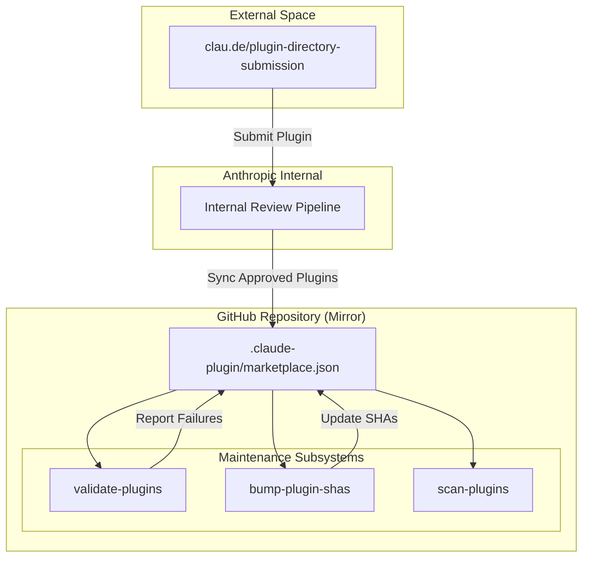
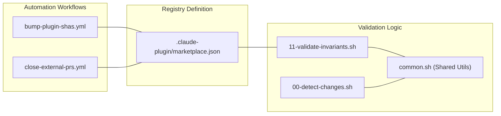

<!-- source: DeepWiki mcp.deepwiki.com · repo anthropics/claude-plugins-community · page 1.1 Repository Purpose and Architecture · fetched 2026-10-26 -->

# Repository Purpose and Architecture

Relevant source files

The following files were used as context for generating this wiki page:

- [.claude-plugin/marketplace.json](.claude-plugin/marketplace.json)
- [.github/workflows/close-external-prs.yml](.github/workflows/close-external-prs.yml)
- [README.md](README.md)

The `claude-plugins-community` repository serves as the official distribution hub for community-contributed plugins for **Claude Cowork** and **Claude Code** [README.md:1-3](). It functions as a centralized registry where users can discover and install tools, skills, and agents that extend Claude's capabilities.

Architecturally, this repository is a **read-only mirror** [README.md:7](). It is not the primary source of truth for plugin submissions; instead, it reflects the state of Anthropic's internal review pipeline. This design ensures that all publicly listed plugins have undergone automated security scanning and manual approval before being surfaced to users [README.md:9]().

## Plugin Submission and Synchronization Flow

Changes to the marketplace do not originate from Pull Requests on this repository. Instead, they follow a structured submission and review lifecycle:

1.  **Submission**: Developers submit their plugins via the [Plugin Directory Submission form](https://clau.de/plugin-directory-submission) [README.md:26]().
2.  **Review**: Submissions enter an internal Anthropic pipeline for security and policy evaluation.
3.  **Synchronization**: Approved plugins are synced to this repository's `.claude-plugin/marketplace.json` file [README.md:7]().
4.  **Maintenance**: Automated GitHub Actions continuously validate the registry, update version hashes (SHAs), and perform periodic security re-scans.

### The `close-external-prs` Guard

To maintain the integrity of the read-only mirror, the repository employs a strict gatekeeper via the `Close External PRs` workflow [.github/workflows/close-external-prs.yml:1]().

This workflow uses the `pull_request_target` trigger to ensure it has the necessary permissions to close PRs opened from forks [.github/workflows/close-external-prs.yml:4-9](). It identifies the author and automatically closes any PR that does not originate from a repository collaborator or the internal automation bot [.github/workflows/close-external-prs.yml:18-63]().

#### Logic for PR Acceptance
| Entity | Status | Rationale |
| :--- | :--- | :--- |
| `github-actions[bot]` | **Allowed** | Used by the `bump-plugin-shas` action to keep the registry fresh [.github/workflows/close-external-prs.yml:29-32](). |
| Admin/Write Users | **Allowed** | Allows maintainers to perform manual emergency fixes [.github/workflows/close-external-prs.yml:40-43](). |
| External Contributors | **Closed** | Prevents bypassing the submission/review pipeline [.github/workflows/close-external-prs.yml:45-63](). |

**Sources:**
- [README.md:1-32]()
- [.github/workflows/close-external-prs.yml:1-64]()

## System Architecture

The repository's functionality is defined by the interaction between the marketplace manifest and three primary maintenance subsystems implemented as GitHub Actions.

### Data Flow Diagram: Registry Maintenance

The following diagram illustrates how the internal review pipeline and the automated actions interact with the `marketplace.json` registry.

**Sources:**
- [README.md:7-9]()
- [README.md:26]()
- [.github/workflows/close-external-prs.yml:20-22]()

## Core Subsystems

The repository's health and security are maintained by three specialized composite actions. These actions form a complete lifecycle management system for the plugin registry.

### 1. `validate-plugins`
This is the primary CI gate. It ensures that any change to the marketplace follows strict schema and security invariants.
*   **Key Function**: Enforces rules such as HTTPS-only URLs, alphabetical sorting, and SHA-integrity pinning.
*   **Implementation**: Utilizes a multi-stage pipeline of shell scripts (e.g., `11-validate-invariants.sh`) and the `claude` CLI's `cli_validate` command.

### 2. `bump-plugin-shas`
Because plugins are hosted externally (often on GitHub), this action ensures the marketplace stays up-to-date with the latest versions of the source code.
*   **Key Function**: Discovers new commits on external plugin repositories and updates the `sha` field in `marketplace.json` [.claude-plugin/marketplace.json:13]().
*   **Implementation**: Uses the GitHub GraphQL API to create signed commits, satisfying branch protection rules without requiring personal access tokens.

### 3. `scan-plugins`
This provides ongoing security assurance by evaluating the actual source code of the plugins listed in the registry.
*   **Key Function**: Uses Claude (via the `claude -p headless` mode) to scan for credential exfiltration, unsafe code patterns, and policy violations.
*   **Implementation**: Employs "Workload Identity Federation" for secure authentication and executes a specialized security rubric against the plugin source files.

### Architectural Mapping: Code Entities

This diagram maps the high-level maintenance concepts to specific files and entry points within the repository.

**Sources:**
- [.claude-plugin/marketplace.json:1-86]()
- [.github/workflows/close-external-prs.yml:1-5]()
- [README.md:7-22]()

---

