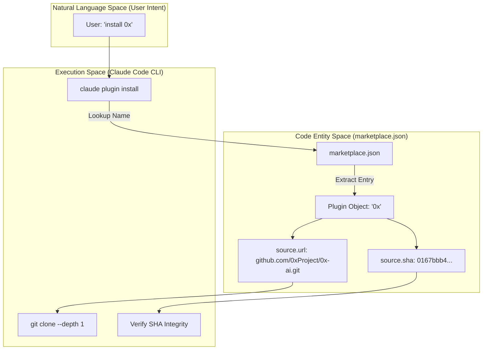

<!-- source: DeepWiki mcp.deepwiki.com · repo anthropics/claude-plugins-community · page 2 Plugin Marketplace Registry · fetched 2026-10-26 -->

# Plugin Marketplace Registry

<details>
<summary>Relevant source files</summary>

The following files were used as context for generating this wiki page:

- [.claude-plugin/marketplace.json](.claude-plugin/marketplace.json)
- [README.md](README.md)

</details>


The Plugin Marketplace Registry is the central catalog of community-contributed extensions for the Claude ecosystem. It is primarily defined by a single manifest file, `.claude-plugin/marketplace.json`, which serves as the source of truth for available plugins, their metadata, and their installation sources [[README.md:7-7]]().

This repository acts as a **read-only mirror** of Anthropic's internal review pipeline [[README.md:7-7]](). Every entry in the registry has undergone automated security scanning and manual approval before being synced to this public manifest [[README.md:9-9]]().

## Marketplace Structure

The registry is designed to be machine-readable by the Claude Code CLI and the Claude Cowork web interface. It organizes plugins into a flat list of entities, each containing the necessary pointers to fetch the plugin's code or configuration.

### Data Model Overview

The `marketplace.json` file follows a structured schema that includes repository-level metadata and an array of plugin objects.

| Field | Type | Description |
| :--- | :--- | :--- |
| `name` | String | The unique identifier for the marketplace (e.g., `claude-community`) [[.claude-plugin/marketplace.json:2-2]](). |
| `owner.name` | String | The entity responsible for the registry [[.claude-plugin/marketplace.json:4-4]](). |
| `plugins` | Array | A collection of `Plugin` objects [[.claude-plugin/marketplace.json:6-6]](). |

### Plugin Entity Schema

Each plugin entry contains metadata for discovery and a `source` block for installation.

```json
{
  "name": "plugin-name",
  "description": "Human-readable purpose of the plugin",
  "source": {
    "source": "url | git-subdir",
    "url": "repository-url",
    "sha": "40-character-git-sha",
    "path": "optional-subdirectory-path",
    "ref": "optional-git-branch-or-tag"
  },
  "homepage": "url-to-docs-or-repo"
}
```

For a deep dive into the specific fields, the distinction between `url` and `git-subdir` distribution models, and how SHA pinning ensures security, see **[marketplace.json Schema and Plugin Types](#2.1)**.

Sources: [[.claude-plugin/marketplace.json:1-86]](), [[README.md:7-10]]().

---

## Plugin Categories and Functionality

The registry contains a diverse set of plugins ranging from simple prompt-based "Skills" to complex "Agents" with autonomous capabilities. These are categorized based on their technical implementation and the value they provide to the user.

### Functional Categories

*   **MCP Server Wrappers**: Plugins that bridge Claude to Model Context Protocol (MCP) servers for external data access.
*   **Skills**: Domain-specific system prompts that give Claude new specialized capabilities (e.g., `10x-team` role-playing [[.claude-plugin/marketplace.json:28-29]]()).
*   **Agents**: Multi-step workflows that can use tools to perform autonomous tasks (e.g., `10x-shopping` for cart management [[.claude-plugin/marketplace.json:18-19]]()).
*   **Security & Guardrails**: Tools that audit code or enforce compliance (e.g., `42crunch-api-security-testing` [[.claude-plugin/marketplace.json:48-49]]()).

For a complete list of categories and examples from the registry, see **[Plugin Functional Categories](#2.2)**.

### Architecture Patterns

Plugins often utilize recurring design patterns to interact with the Claude environment:
*   **Artifact-Driven Development**: Using `.claude/` directories or `CLAUDE.md` files to maintain state across sessions [[.claude-plugin/marketplace.json:29-29]]().
*   **Slash Commands**: Registering specific triggers like `/mind` or `/cto` [[.claude-plugin/marketplace.json:29-29]](), [[.claude-plugin/marketplace.json:39-39]]().

For detailed documentation on these patterns, see **[Plugin Architecture Patterns](#2.3)**.

Sources: [[.claude-plugin/marketplace.json:18-68]]().

---

## Registry Lifecycle and Integration

The marketplace is not a static file; it is the core of an automated ecosystem that connects developers to users.

### Integration Flow: From Registry to Code

The following diagram illustrates how the `marketplace.json` entity maps to the local environment during installation via the Claude Code CLI.

"Registry to Local Entity Mapping"


### Maintenance and Validation

The registry is maintained by a set of automated GitHub Actions that ensure every entry remains valid and secure:
1.  **Validation**: Enforces 11 core invariants (e.g., alphabetical sorting, HTTPS-only, SHA pinning).
2.  **Bumping**: Automatically updates the `sha` field in `marketplace.json` when the upstream plugin repository changes.
3.  **Scanning**: Uses Claude-based policy scans to detect malicious code or credential exfiltration.

For details on the automation pipeline, see **[CI/CD Pipeline: Validation, Bumping, and Scanning](#3)**.

Sources: [[.claude-plugin/marketplace.json:7-16]](), [[README.md:17-22]]().

---

