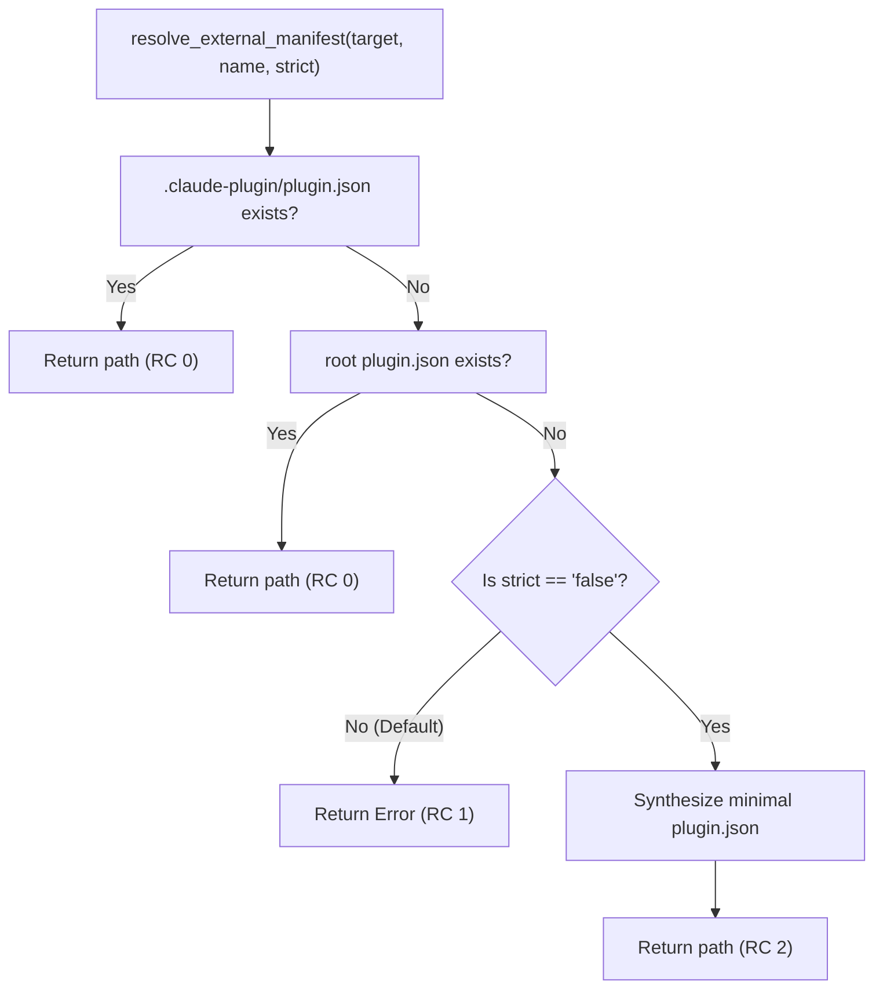
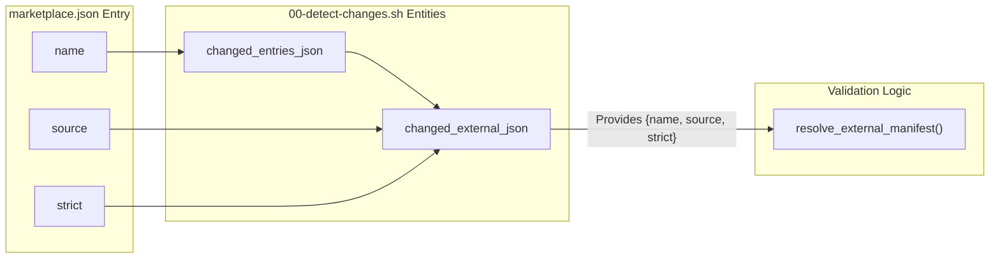

<!-- source: DeepWiki mcp.deepwiki.com · repo anthropics/claude-plugins-community · page 2.1 marketplace.json Schema and Plugin Types · fetched 2026-10-26 -->

# marketplace.json Schema and Plugin Types

<details>
<summary>Relevant source files</summary>

The following files were used as context for generating this wiki page:

- [.claude-plugin/marketplace.json](.claude-plugin/marketplace.json)
- [.github/actions/validate-plugins/scripts/00-detect-changes.sh](.github/actions/validate-plugins/scripts/00-detect-changes.sh)
- [.github/actions/validate-plugins/test-external-manifest.sh](.github/actions/validate-plugins/test-external-manifest.sh)
- [README.md](README.md)

</details>


The `marketplace.json` file serves as the central registry for the Claude community plugin ecosystem. It defines the metadata, distribution sources, and integrity constraints for every plugin available to **Claude Cowork** and **Claude Code**. This manifest is a read-only mirror synced from Anthropic's internal review pipeline [README.md:5-9]().

## Data Model: The Plugin Schema

The marketplace is an object containing a `plugins` array. Each entry in this array must conform to a strict schema to ensure compatibility with the Claude CLI and web interfaces.

### Core Fields

| Field | Type | Description |
| :--- | :--- | :--- |
| `name` | `string` | Unique identifier for the plugin. Must follow the name schema (I11) [manifest:8](). |
| `description` | `string` | A detailed explanation of the plugin's capabilities. Used by Claude to understand when to invoke the plugin [.claude-plugin/marketplace.json:9](). |
| `source` | `object` | Defines how the plugin code is retrieved. Supports `url` and `git-subdir` models [.claude-plugin/marketplace.json:10-14](). |
| `homepage` | `string` | A link to the plugin's documentation or repository home [.claude-plugin/marketplace.json:15](). |
| `strict` | `boolean` | (Optional) Controls manifest resolution behavior. Defaults to `true` [.github/actions/validate-plugins/scripts/00-detect-changes.sh:102](). |

### Source Distribution Models

The `source` field determines how the maintenance pipeline (e.g., `bump-plugin-shas`) and the Claude CLI interact with the external code.

#### 1. Direct URL (`url`)
Used for standalone repositories where the plugin manifest (`plugin.json`) is located at the repository root.
- **`source`**: Must be "url".
- **`url`**: The `.git` clone URL.
- **`sha`**: The specific git commit hash for integrity pinning.

Example:
```json
"source": {
  "source": "url",
  "url": "https://github.com/0xProject/0x-ai.git",
  "sha": "0167bbb411cc972b966127d23c23de801061fa99"
}
```
Sources: [.claude-plugin/marketplace.json:10-14]()

#### 2. Git Sub-directory (`git-subdir`)
Designed for monorepos or repositories hosting multiple plugins.
- **`source`**: Must be "git-subdir".
- **`url`**: The GitHub repository (format: `org/repo`).
- **`path`**: The relative path within the repo to the plugin directory.
- **`ref`**: The branch or tag to track.
- **`sha`**: The pinned commit hash.

Example:
```json
"source": {
  "source": "git-subdir",
  "url": "42Crunch-AI/claude-plugins",
  "path": "plugins/api-security-testing",
  "ref": "v1.0.1",
  "sha": "bc781f96be8ce17a2972e8a9a3ef38b1ca7e8cc4"
}
```
Sources: [.claude-plugin/marketplace.json:50-56]()

---

## Strict vs. Non-Strict Manifests

The `strict` field (defaulting to `true`) dictates how the validation logic in `resolve_external_manifest()` handles missing `plugin.json` files in the source repository.

### Strict Mode (`strict: true`)
The source repository **must** contain a `.claude-plugin/plugin.json` or a root `plugin.json`. If neither is found, validation fails [test-external-manifest.sh:73-75]().

### Skills-Only / Non-Strict Mode (`strict: false`)
This mode supports "skills-only" entries—plugins that consist purely of prompts or markdown without a formal manifest in their source repo.
- If no manifest exists, the system **synthesizes** a minimal one in memory carrying the `name` from `marketplace.json` [test-external-manifest.sh:64-71]().
- If a real manifest is later added to the repo, it takes precedence over synthesis [test-external-manifest.sh:53-58]().

### Manifest Resolution Logic
The following diagram illustrates the precedence used by the `resolve_external_manifest` function in `lib/common.sh`.

**Manifest Resolution Precedence**

Sources: [.github/actions/validate-plugins/test-external-manifest.sh:37-80]()

---

## SHA Pinning and Integrity

Every external plugin must be pinned to a specific git `sha`. This is a core security invariant (I5) enforced during validation.

1.  **Immutable References**: Even if a `git-subdir` entry specifies a `ref` (like `main`), the `sha` field ensures that the actual code executed by a user is the exact version reviewed and scanned by the pipeline [.claude-plugin/marketplace.json:54-55]().
2.  **Automated Maintenance**: The `bump-plugin-shas` action is responsible for updating these hashes. It clones the external source, verifies the latest commit against the `ref`, and updates `marketplace.json` via signed commits.
3.  **Change Detection**: The `00-detect-changes.sh` script identifies which entries have had their SHAs modified by diffing `BASE_REF` against `HEAD` [.github/actions/validate-plugins/scripts/00-detect-changes.sh:82-88]().

### Data Flow: From Registry to Validation

This diagram maps the JSON fields to the internal variables used during the `00-detect-changes.sh` execution.

**Metadata to Change Detection Mapping**

Sources: [.github/actions/validate-plugins/scripts/00-detect-changes.sh:96-104](), [.github/actions/validate-plugins/test-external-manifest.sh:18-24]()

---

