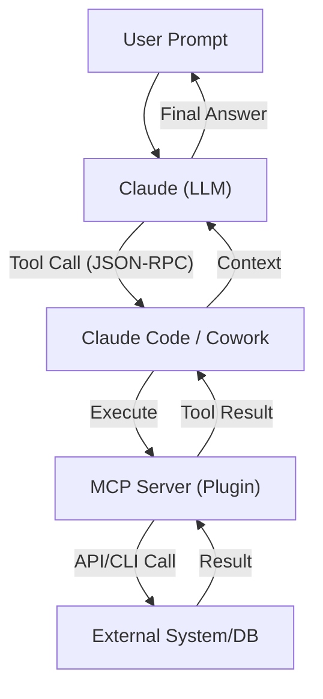
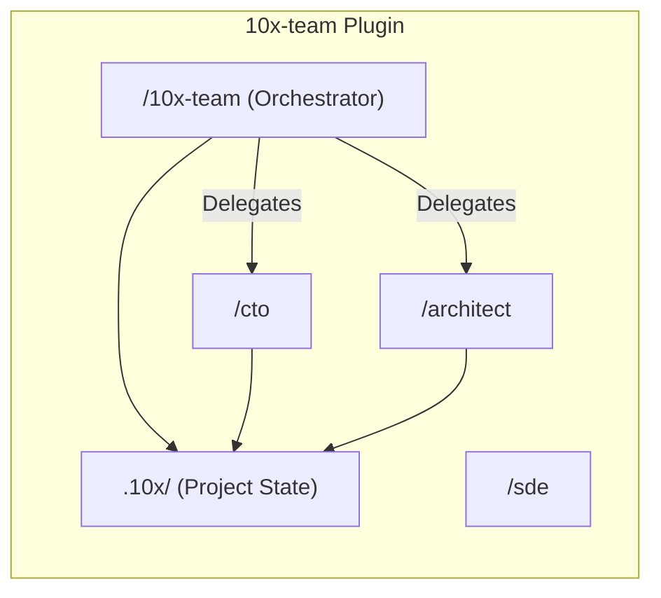

<!-- source: DeepWiki mcp.deepwiki.com · repo anthropics/claude-plugins-community · page 2.2 Plugin Functional Categories · fetched 2026-10-26 -->

# Plugin Functional Categories

Relevant source files

The following files were used as context for generating this wiki page:

- [.claude-plugin/marketplace.json](.claude-plugin/marketplace.json)
- [README.md](README.md)

The Claude Plugins Community marketplace contains a diverse ecosystem of extensions designed to augment Claude's capabilities. These plugins are categorized by their technical implementation and functional role, ranging from lightweight prompt-based "Skills" to complex autonomous "Agents" and "MCP Server Wrappers."

This page details the major functional categories found in the registry and how they interact with the Claude environment.

## 1. MCP Server Wrappers

Model Context Protocol (MCP) server wrappers are the most technically robust plugins. They provide Claude with executable tools by bridging the LLM to external APIs, databases, or local system resources.

### Implementation and Data Flow
MCP plugins define a set of `tools` that Claude can call. When a user invokes a tool, the request flows through the Claude CLI or Cowork interface to the plugin's MCP server, which executes the logic and returns a structured response.

**Diagram: MCP Tool Execution Flow**

**Examples in Registry:**
*   `0x`: Guides developers through ERC-20 token swaps via the 0x API [[.claude-plugin/marketplace.json:8-16]]().
*   `10x-shopping`: Connects Claude to Shopify's global product catalog for cart management and purchases [[.claude-plugin/marketplace.json:18-26]]().

**Sources:** [[.claude-plugin/marketplace.json:8-26]]()

---

## 2. Skills (Domain-Specific Prompts)

Skills are "pure markdown" or prompt-based plugins. They do not require a runtime server; instead, they inject specialized instructions, few-shot examples, and structured workflows into Claude's system prompt.

### Key Characteristics
*   **Zero-Dependency:** Often contain no code, only `.md` or `.txt` files.
*   **Slash Commands:** Usually mapped to specific commands (e.g., `/cto`, `/debug`).
*   **Structured Output:** Use rubrics or templates to ensure consistent formatting.

**Examples in Registry:**
*   `8-habit-ai-dev`: A structured 7-step workflow based on Stephen Covey's habits. It uses 17 hand-crafted skills with no runtime dependencies [[.claude-plugin/marketplace.json:60-68]]().
*   `16minds`: Summons agents modeled on 16 personality types to debate or review topics [[.claude-plugin/marketplace.json:38-46]]().

**Sources:** [[.claude-plugin/marketplace.json:38-68]]()

---

## 3. Agents (Multi-Step Autonomous Workflows)

Agents are plugins that orchestrate complex, multi-step tasks. Unlike simple tools, Agents often maintain their own state and can make autonomous decisions about which sub-tasks to execute next.

### Implementation Pattern: The Orchestrator
Agents often use a "Director" or "Orchestrator" pattern where one primary skill manages several subordinate roles.

**Diagram: Agent Orchestration (e.g., 10x-team)**

**Examples in Registry:**
*   `10x-team`: Provides 12 specialized engineering roles (CTO, SRE, etc.) and an orchestrator that runs them end-to-end with hard gates [[.claude-plugin/marketplace.json:28-36]]().

**Sources:** [[.claude-plugin/marketplace.json:28-36]]()

---

## 4. Guardrails and Security Hooks

These plugins act as a middleware layer, enforcing safety, compliance, or quality standards on Claude's inputs and outputs.

### Functionality
*   **Static Analysis:** Auditing code or configuration files before they are deployed.
*   **Policy Enforcement:** Ensuring that Claude's suggestions adhere to corporate or security policies.

**Examples in Registry:**
*   `42crunch-api-security-testing`: Enables developers to audit OpenAPI specifications and detect OWASP vulnerabilities directly in the workflow [[.claude-plugin/marketplace.json:48-58]]().
*   `a11y-fixer`: Scans HTML/JSX for accessibility issues [[.claude-plugin/marketplace.json:70-80]]().

**Sources:** [[.claude-plugin/marketplace.json:48-80]]()

---

## 5. Persistent Memory and Context Systems

While Claude has a large context window, these plugins provide long-term storage or structured state management that persists across different sessions.

### Mechanisms
*   **File-based State:** Using hidden directories (like `.10x/` or `.claude/`) to store decision logs and progress [[.claude-plugin/marketplace.json:29-29]]().
*   **External DBs:** Using MCP to query vector databases or key-value stores.

---

## 6. IaC and Cloud Integrations

Infrastructure-as-Code (IaC) plugins allow Claude to provision, manage, and analyze cloud resources. These often combine MCP tools (to call cloud CLI/SDKs) with Skills (to generate valid Terraform/CloudFormation).

**Examples in Registry:**
*   `ab-testing`: Generates A/B testing infrastructure and analysis [[.claude-plugin/marketplace.json:82-86]]().

**Sources:** [[.claude-plugin/marketplace.json:82-86]]()

---

## Summary of Categories

| Category | Primary Mechanism | Example Plugin |
| :--- | :--- | :--- |
| **MCP Wrapper** | JSON-RPC Tooling | `0x` |
| **Skills** | Prompt Engineering | `8-habit-ai-dev` |
| **Agents** | Multi-role Orchestration | `10x-team` |
| **Guardrails** | Static/Dynamic Analysis | `42crunch` |
| **Memory** | Local/Remote State | `10x-team` (`.10x/`) |
| **Cloud/IaC** | Provider SDK Wrappers | `ab-testing` |

**Sources:** [[.claude-plugin/marketplace.json:1-86]]()

---

