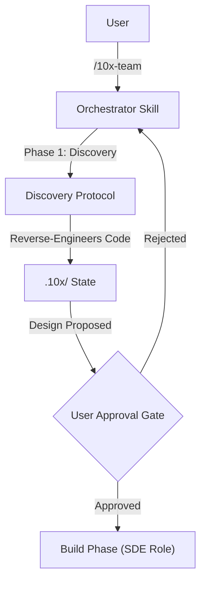
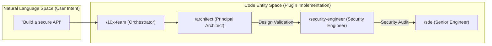

<!-- source: DeepWiki mcp.deepwiki.com · repo anthropics/claude-plugins-community · page 2.3 Plugin Architecture Patterns · fetched 2026-10-26 -->

# Plugin Architecture Patterns

Relevant source files

The following files were used as context for generating this wiki page:

- [.claude-plugin/marketplace.json](.claude-plugin/marketplace.json)
- [README.md](README.md)

This page documents the recurring design patterns and architectural conventions found in the Claude community plugin ecosystem. These patterns allow plugins to maintain state, enforce safety, and provide structured workflows within the stateless execution environment of a chat session.

## Artifact-Driven Development

Artifact-driven development is a pattern where plugins maintain persistent state and project-specific memory by writing to specific files in the user's filesystem. This bypasses the context window limits of a single session by providing a "source of truth" that Claude can read at the start of any new interaction.

### The .claude/ Convention
Many plugins use a hidden `.claude/` or plugin-specific hidden directory (e.g., `.10x/`) to store configuration, session logs, and state machines.

*   **CLAUDE.md**: Often used as a project-level "brain" containing build commands, style guides, and active task lists.
*   **Worklogs**: A pattern where the plugin maintains a `.worklogs/` directory to track atomic changes, enabling "undo" functionality or multi-session resumes.

| Plugin Example | Directory/File | Purpose |
| :--- | :--- | :--- |
| `10x-team` | `.10x/` | Stores role-based decisions and progress across conversations [.claude-plugin/marketplace.json:29-29]() |
| `8-habit-ai-dev` | DAG-validated handoffs | Uses a structured graph to track progress through 7 development steps [.claude-plugin/marketplace.json:61-61]() |

**Sources:** [.claude-plugin/marketplace.json:29-29](), [.claude-plugin/marketplace.json:61-61]()

---

## Human-in-the-Loop Gates

To ensure safety and correctness in autonomous workflows, plugins implement "Hard Gates." This pattern prevents the AI from proceeding to high-risk actions (like code execution or deployment) without explicit user confirmation or architectural validation.

### Implementation Pattern: The Orchestrator Gate
Plugins like `10x-team` utilize an orchestrator skill that manages multiple sub-agents. The orchestrator enforces a "Brainstorm-first" approach, where design must be validated before the "Build" phase can begin.

**Data Flow: Orchestrated Gate**

**Sources:** [.claude-plugin/marketplace.json:29-29]()

---

## Context Management and Compaction

As conversations grow, the context window can become saturated. Advanced plugins implement "Compaction" or "Synthesis" patterns to summarize previous findings into a dense format.

### The Synthesis Rubric
The `16minds` plugin demonstrates a "fan-out and synthesize" pattern. It invokes 16 distinct personality types to debate a topic, then applies a fixed 4-section rubric to condense the output.

*   **Score Distribution**: Quantitative summary of opinions.
*   **Axes of Disagreement**: Identifying the core conflicts.
*   **Landing-Zone Candidates**: Actionable paths forward.

This pattern ensures that "16-voice output" remains "structured rather than scattershot" [.claude-plugin/marketplace.json:39-39]().

**Sources:** [.claude-plugin/marketplace.json:39-39]()

---

## Slash Commands and Tool Lifecycle Hooks

Plugins define their interface through "Skills" which manifest as slash commands in the Claude CLI or Cowork interface.

### Lifecycle Hooks
While the marketplace manifest defines the plugin source, the internal implementation often uses hooks to manage setup and teardown:
*   **PreToolUse**: Checking for API keys or environment variables before executing a tool.
*   **PostToolUse**: Cleaning up temporary files or updating a `.worklog`.

### Command Mapping Example
| Command | Plugin | Logic Entity |
| :--- | :--- | :--- |
| `/mind <type>` | `16minds` | Invokes specific agent persona [.claude-plugin/marketplace.json:39-39]() |
| `/calibrate` | `8-habit-ai-dev` | Adjusts maturity-adaptive verbosity [.claude-plugin/marketplace.json:61-61]() |
| `/reflect` | `8-habit-ai-dev` | Consolidates lessons learned into state [.claude-plugin/marketplace.json:61-61]() |

**Sources:** [.claude-plugin/marketplace.json:39-39](), [.claude-plugin/marketplace.json:61-61]()

---

## Multi-Agent Orchestration

This pattern involves decomposing a complex task into specialized roles. Instead of one general-purpose assistant, the plugin provides a suite of experts.

### Role-Based Specialization
The `10x-team` plugin implements 12 specialized roles, each with its own "structured decision process" [.claude-plugin/marketplace.json:29-29]().

**Entity Mapping: Natural Language to Code Roles**

**Sources:** [.claude-plugin/marketplace.json:29-29]()

---

## Pure Markdown vs. Runtime Plugins

The marketplace supports two primary execution models:

1.  **Pure Markdown Plugins**: These contain no code and rely entirely on high-quality system prompts (Skills). They are portable and have no runtime dependencies (e.g., `8-habit-ai-dev`).
2.  **MCP/Runtime Plugins**: These connect to Model Context Protocol (MCP) servers or external APIs (e.g., `0x` for EVM chain swaps, `10x-shopping` for Shopify catalog access).

| Feature | Pure Markdown | Runtime/MCP |
| :--- | :--- | :--- |
| **Dependencies** | None [.claude-plugin/marketplace.json:61-61]() | Node/Python/Docker |
| **Connectivity** | Local Filesystem | External APIs/Webhooks [.claude-plugin/marketplace.json:9-9]() |
| **Security** | Prompt-based | API Keys/OAuth [.claude-plugin/marketplace.json:19-19]() |

**Sources:** [.claude-plugin/marketplace.json:9-9](), [.claude-plugin/marketplace.json:19-19](), [.claude-plugin/marketplace.json:61-61]()

---

