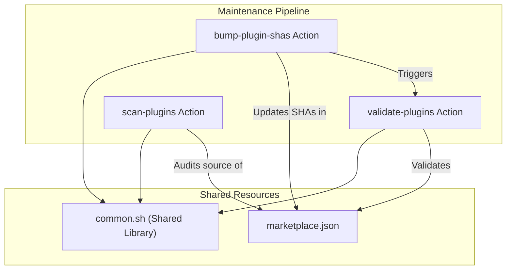
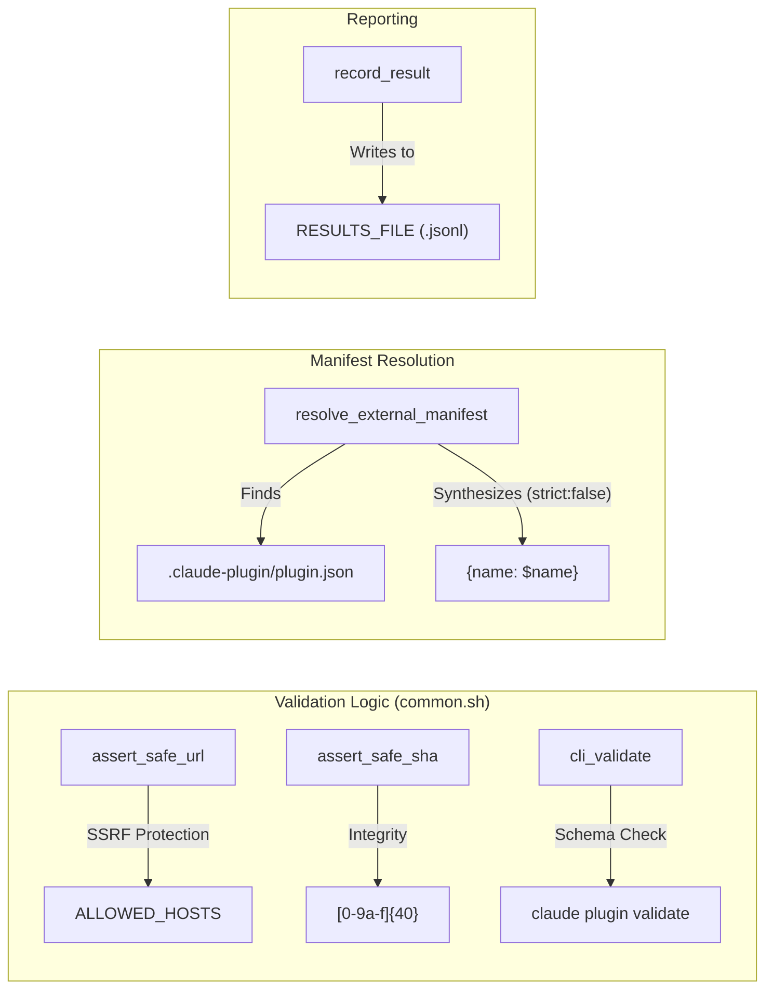

<!-- source: DeepWiki mcp.deepwiki.com · repo anthropics/claude-plugins-community · page 3 CI/CD Pipeline: Validation, Bumping, and Scanning · fetched 2026-10-26 -->

# CI/CD Pipeline: Validation, Bumping, and Scanning

Relevant source files

The following files were used as context for generating this wiki page:

- [.github/actions/validate-plugins/lib/common.sh](.github/actions/validate-plugins/lib/common.sh)
- [.github/workflows/validate-plugins.yml](.github/workflows/validate-plugins.yml)

The `claude-plugins-community` repository employs a multi-stage automated maintenance pipeline to ensure the integrity, security, and freshness of the plugin marketplace. This pipeline is composed of three primary GitHub Actions that interlock to validate submissions, update external references, and perform safety scans using Claude.

The system is designed with a **bot-free philosophy**, utilizing `GITHUB_TOKEN` and the GraphQL `createCommitOnBranch` mutation to generate GitHub-signed commits that satisfy security requirements without requiring personal access tokens or external bots.

### Pipeline Architecture Overview

The three actions share a common utility library and follow a standardized reporting structure.

**Sources:** [.github/actions/validate-plugins/lib/common.sh:1-168](), [.github/workflows/validate-plugins.yml:13-19]()

---

### validate-plugins Action
The `validate-plugins` action is the primary gatekeeper for the repository. It performs comprehensive static and dynamic checks on the `marketplace.json` manifest. It is designed for "zero-schema-maintenance," meaning it leverages the Claude CLI's internal validation logic rather than duplicating schema rules in Bash.

The action follows a six-stage pipeline:
1.  **00-detect-changes**: Identifies which plugins were modified in a PR to scope validation.
2.  **11-invariants**: Enforces repository-specific rules (e.g., alphabetical sorting, HTTPS-only URLs).
3.  **20-cli-marketplace**: Validates the entire manifest against the Claude CLI schema.
4.  **30-cli-external**: Clones external git repositories to verify that the pinned SHA and subdirectories exist.
5.  **40-cli-local**: Validates plugins vendored directly within the repository.
6.  **90-report**: Aggregates results into a `GITHUB_STEP_SUMMARY`.

For details, see [validate-plugins Action](#3.1).

**Sources:** [.github/workflows/validate-plugins.yml:31-50](), [.github/actions/validate-plugins/lib/common.sh:97-122]()

---

### bump-plugin-shas Action
The `bump-plugin-shas` action automates the process of keeping the marketplace up to date with the latest upstream changes. It periodically checks the remote repositories of all plugins and updates their `sha` fields if new commits are found.

Key features include:
*   **Signed Commits**: Uses the GraphQL API to create "Verified" commits.
*   **Freeze List**: Respects a `freeze-shas.txt` file to prevent updates to specific plugins.
*   **Recursive Validation**: Automatically triggers the `validate-plugins` workflow on newly created bump branches to ensure that an update doesn't break the manifest.

For details, see [bump-plugin-shas Action](#3.2).

**Sources:** [.github/workflows/validate-plugins.yml:13-19](), [.github/actions/validate-plugins/test-bump.sh:1-30]()

---

### scan-plugins Action
The `scan-plugins` action provides an AI-augmented security layer. It uses Claude (via the `claude -p headless` command) to perform deep analysis of plugin source code.

The scanner:
*   **Tool-Use Driven**: Claude is provided with read-only tools (`Read`, `Glob`, `Grep`) to explore the codebase.
*   **Policy Enforcement**: Evaluates code against a specific security rubric (e.g., detecting credential exfiltration or SSRF vulnerabilities).
*   **WIF Integration**: Uses Workload Identity Federation for secure, keyless authentication to Anthropic services.

For details, see [scan-plugins Action](#3.3).

---

### Shared Library: common.sh
All scripts in the pipeline source `lib/common.sh`, which provides a standardized environment for logging, result tracking, and security assertions.

| Function | Purpose |
| :--- | :--- |
| `record_result` | Appends a JSONL entry to `$RESULTS_FILE` for final reporting. |
| `assert_safe_url` | Enforces HTTPS and checks host against `ALLOWED_HOSTS` to prevent SSRF. |
| `assert_safe_sha` | Ensures a string is a valid 40-character hex SHA. |
| `cli_validate` | Wrapper for `claude plugin validate` that handles error classification. |
| `resolve_external_manifest` | Locates or synthesizes a `plugin.json` for external repositories. |

**Sources:** [.github/actions/validate-plugins/lib/common.sh:23-33](), [.github/actions/validate-plugins/lib/common.sh:56-78](), [.github/actions/validate-plugins/lib/common.sh:100-122](), [.github/actions/validate-plugins/lib/common.sh:152-166]()

### Code Entity Mapping: Validation Logic
The following diagram maps the high-level validation concepts to the specific shell functions and files that implement them.

**Sources:** [.github/actions/validate-plugins/lib/common.sh:56-86](), [.github/actions/validate-plugins/lib/common.sh:103-104](), [.github/actions/validate-plugins/lib/common.sh:152-164](), [.github/actions/validate-plugins/lib/common.sh:21-33]()

---

