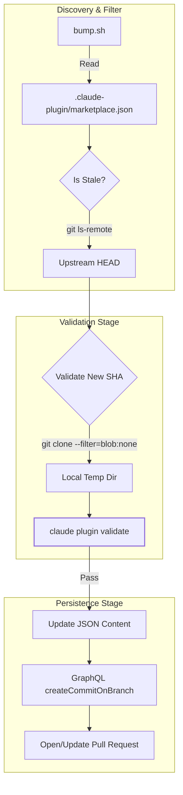
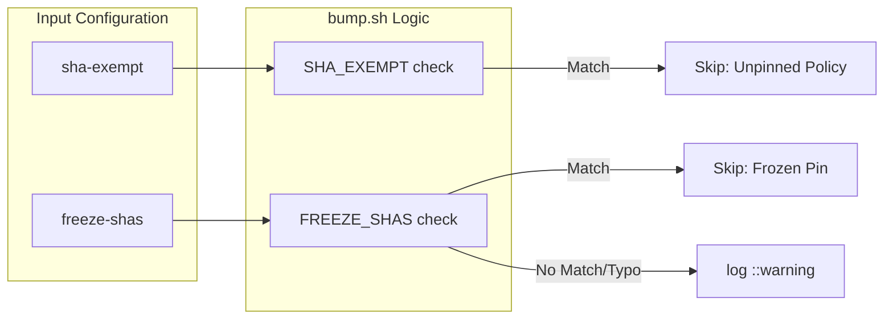

<!-- source: DeepWiki mcp.deepwiki.com · repo anthropics/claude-plugins-community · page 3.2 bump-plugin-shas Action · fetched 2026-10-26 -->

# bump-plugin-shas Action

Relevant source files

The following files were used as context for generating this wiki page:

- [.github/actions/bump-plugin-shas/README.md](.github/actions/bump-plugin-shas/README.md)
- [.github/actions/bump-plugin-shas/action.yml](.github/actions/bump-plugin-shas/action.yml)
- [.github/actions/bump-plugin-shas/scripts/bump.sh](.github/actions/bump-plugin-shas/scripts/bump.sh)

The `bump-plugin-shas` action is a composite GitHub Action designed to automate the maintenance of the `marketplace.json` registry. It identifies external plugin entries whose upstream source code has moved past the currently pinned SHA, validates the new version, and proposes updates via Pull Requests.

The action follows a "bot-free" design philosophy, using the standard `GITHUB_TOKEN` to perform all operations. To satisfy security requirements and status checks without triggering recursive workflow runs, it performs all CI validation inline before creating signed commits via the GitHub GraphQL API.

### Core Pipeline Architecture

The action executes a four-stage pipeline to ensure that only valid, safe updates are committed to the repository.

1.  **Discovery**: Iterates through `marketplace.json` entries. For each external source, it uses `git ls-remote` to find the current `HEAD` SHA of the upstream repository.
2.  **Validation**: For every stale entry, it performs a blobless clone of the upstream repository at the **new** SHA and executes `claude plugin validate`. This ensures the new version still adheres to the registry's technical requirements.
3.  **Staging**: Updates the `sha` field in the local `marketplace.json` for all passing plugins.
4.  **Persistence**: Commits the changes and opens/updates Pull Requests. It uses the GraphQL `createCommitOnBranch` mutation, which generates a "Verified" signed commit by the `github-actions[bot]` without requiring external GPG keys.

### Pipeline Logic Flow

The following diagram illustrates the relationship between the discovery logic in `bump.sh` and the external `claude` CLI tool used for validation.

**Bump Action Logic Flow**

Sources: [.github/actions/bump-plugin-shas/scripts/bump.sh:1-17](), [.github/actions/bump-plugin-shas/action.yml:3-11](), [.github/actions/bump-plugin-shas/README.md:8-16]()

---

### PR Operating Modes

The action supports two distinct modes for handling updates, configured via the `pr-mode` input.

| Mode | Description | Use Case |
| :--- | :--- | :--- |
| **Batch** (Default) | Consolidates all passing bumps into a single PR on a fixed branch (e.g., `bump/plugin-shas`). | Standard nightly maintenance for community registries. |
| **Per-Entry** | Opens one PR per plugin using a sanitized branch name (e.g., `bump/plugin-name`). | High-security environments requiring isolated status checks and individual triage for every update. |

Sources: [.github/actions/bump-plugin-shas/scripts/bump.sh:3-13](), [.github/actions/bump-plugin-shas/action.yml:51-58]()

---

### SHA Exemptions vs. Freezing

The action provides two mechanisms to prevent automatic updates, serving different lifecycle purposes.

*   **`sha-exempt`**: Used for plugins that are intentionally unpinned (e.g., local skills or plugins that should always track a moving target). Without this, the nightly run would attempt to pin them to the current HEAD.
*   **`freeze-shas`**: Used for plugins that **are** pinned but must not advance (e.g., during a security incident or pending a manual review of an upstream change). The action surfaces a `::warning` if a frozen plugin name is typo'd or missing from the registry.

**Code Entity Mapping: Policy Guards**

Sources: [.github/actions/bump-plugin-shas/scripts/bump.sh:31-37](), [.github/actions/bump-plugin-shas/scripts/bump.sh:140-155](), [.github/actions/bump-plugin-shas/action.yml:23-38]()

---

### Optimizations and Reporting

*   **Blobless Clones**: To minimize bandwidth and time during validation, the action uses `git clone --filter=blob:none`, which avoids downloading the full history and file contents of the upstream repository until needed.
*   **Self-Healing CLI Install**: The action includes a resilient installation routine for the `@anthropic-ai/claude-code` CLI, featuring a 3-attempt retry loop and a `heal_postinstall` fallback to ensure the platform-native binary is available on GitHub runners.
*   **GITHUB_STEP_SUMMARY**: The action generates a detailed Markdown report at the end of every run, listing all successfully bumped plugins and providing reasons for any skipped entries (e.g., validation failure, network timeout, or existing open PR).

Sources: [.github/actions/bump-plugin-shas/action.yml:122-158](), [.github/actions/bump-plugin-shas/README.md:10-14]()

---

### Detailed Components

For more detailed information on specific parts of the bumping infrastructure, see the following child pages:

*   **[Bump Workflow and Freeze List](#3.2.1)**: Detailed documentation on the `bump-plugin-shas.yml` workflow, the `freeze-shas.txt` format, and the fan-out dispatch pattern for per-entry PRs.

---

