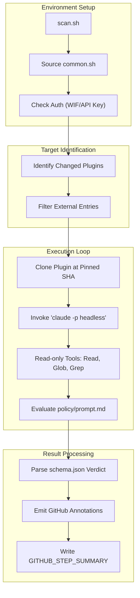
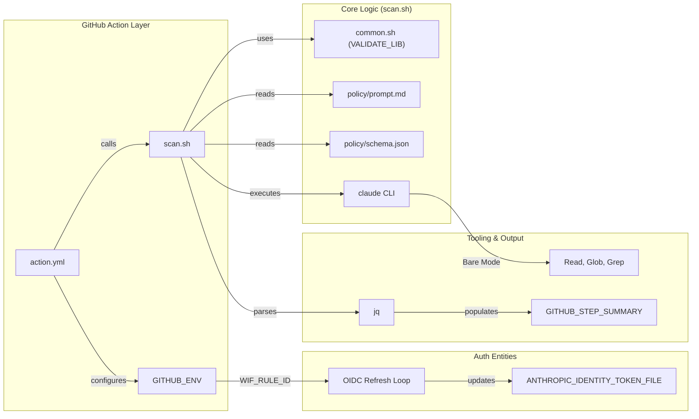

<!-- source: DeepWiki mcp.deepwiki.com · repo anthropics/claude-plugins-community · page 3.3 scan-plugins Action · fetched 2026-10-26 -->

# scan-plugins Action

Relevant source files

The following files were used as context for generating this wiki page:

- [.github/actions/README.md](.github/actions/README.md)
- [.github/actions/scan-plugins/README.md](.github/actions/scan-plugins/README.md)
- [.github/actions/scan-plugins/action.yml](.github/actions/scan-plugins/action.yml)
- [.github/actions/scan-plugins/policy/prompt.md](.github/actions/scan-plugins/policy/prompt.md)
- [.github/actions/scan-plugins/policy/schema.json](.github/actions/scan-plugins/policy/schema.json)
- [.github/actions/scan-plugins/scripts/scan.sh](.github/actions/scan-plugins/scripts/scan.sh)

The `scan-plugins` action is a composite GitHub Action that performs an automated policy and safety review of external plugin source code using Claude. It functions as a non-blocking safety layer (by default) within the CI pipeline, evaluating whether a plugin's implementation complies with Anthropic's Software Directory and Acceptable Use policies [.github/actions/scan-plugins/action.yml:2-9]().

## System Architecture and Data Flow

The action operates by identifying changed external plugins in `marketplace.json`, cloning them into an isolated environment, and invoking the Claude CLI in a headless mode. Claude is provided with a specific policy prompt and a set of read-only file tools to inspect the codebase before returning a structured JSON verdict [.github/actions/scan-plugins/README.md:41-52]().

### Scan Pipeline Overview

The following diagram illustrates the flow from a change in the marketplace to the generation of a safety verdict.

**Plugin Scan Logic Flow**

**Sources:** [.github/actions/scan-plugins/scripts/scan.sh:1-166](), [.github/actions/scan-plugins/action.yml:73-160]()

## Implementation Details

### Target Determination
The script `scan.sh` determines which plugins to scan by comparing the current `marketplace.json` against a `BASE_REF` (typically the PR base or previous commit) [.github/actions/scan-plugins/scripts/scan.sh:32-47]().
- **Standard Mode:** Scans only plugins where the `source` object has changed or is new [.github/actions/scan-plugins/scripts/scan.sh:40-46]().
- **Full Sweep:** If `SCAN_ALL_EXTERNAL` is true, every entry with an external source is queued [.github/actions/scan-plugins/scripts/scan.sh:32-33]().

### Isolated Execution
For each target, the action:
1. Validates the URL against an `ALLOWED_HOSTS` list to prevent SSRF [.github/actions/scan-plugins/scripts/scan.sh:93-98]().
2. Clones the repository to a temporary directory using `git clone --depth 1` [.github/actions/scan-plugins/scripts/scan.sh:110]().
3. Checks out the specific pinned `sha` to ensure integrity [.github/actions/scan-plugins/scripts/scan.sh:112]().
4. Executes `claude` with the `--bare` and `--allowed-tools "Read,Glob,Grep"` flags, restricting the model to read-only filesystem access [.github/actions/scan-plugins/scripts/scan.sh:127-133]().

**Sources:** [.github/actions/scan-plugins/scripts/scan.sh:82-133](), [.github/actions/scan-plugins/README.md:114-122]()

## Policy and Verdict Structure

The scan is governed by two primary files:
1. **`policy/prompt.md`**: The natural language instructions for Claude. It specifically directs the model to look for credential exfiltration, such as "cross-service hops" where a secret for Service A is sent to Service B [.github/actions/scan-plugins/policy/prompt.md:22-41]().
2. **`policy/schema.json`**: Defines the required JSON structure for Claude's response, ensuring the CI can parse the results [.github/actions/scan-plugins/policy/schema.json:1-13]().

### Verdict Schema
| Field | Type | Description |
| :--- | :--- | :--- |
| `passes` | boolean | `true` if the plugin complies with policies [.github/actions/scan-plugins/policy/schema.json:6]() |
| `summary` | string | Brief description of plugin functionality [.github/actions/scan-plugins/policy/schema.json:7]() |
| `violations` | string | Details on specific files or issues found [.github/actions/scan-plugins/policy/schema.json:8]() |
| `may_make_external_network_calls` | boolean | Detection of network activity [.github/actions/scan-plugins/policy/schema.json:9]() |
| `may_download_additional_software` | boolean | Detection of package managers or downloads [.github/actions/scan-plugins/policy/schema.json:10]() |

**Sources:** [.github/actions/scan-plugins/policy/prompt.md:52-58](), [.github/actions/scan-plugins/policy/schema.json:1-13]()

## Authentication and Security

The action supports two authentication methods for communicating with the Anthropic API.

### Workload Identity Federation (WIF)
WIF allows the action to exchange a GitHub OIDC token for a short-lived Anthropic access token, removing the need for static secrets [.github/actions/scan-plugins/action.yml:17-24]().
- **OIDC Token Refresh Loop**: Because GitHub OIDC tokens have a short TTL (~5 minutes), `action.yml` implements a background loop that fetches a new JWT every 240 seconds and updates the `ANTHROPIC_IDENTITY_TOKEN_FILE` [.github/actions/scan-plugins/action.yml:125-133](). This ensures long-running scans of large plugin sets do not fail due to expired credentials.

### Static API Key
Alternatively, an `ANTHROPIC_API_KEY` can be provided as a secret [.github/actions/scan-plugins/action.yml:12-16]().

### Security Isolation
The `claude` process is restricted to a subset of tools (`Read`, `Glob`, `Grep`) and its scope is limited to the temporary directory containing the plugin source [.github/actions/scan-plugins/scripts/scan.sh:130](). Users can further isolate the scan by running it in a dedicated job with `permissions: {}` [.github/actions/scan-plugins/README.md:120-122]().

**Sources:** [.github/actions/scan-plugins/action.yml:101-140](), [.github/actions/scan-plugins/scripts/scan.sh:11-13](), [.github/actions/scan-plugins/README.md:11-16]()

## Configuration Options

| Input | Description | Default |
| :--- | :--- | :--- |
| `fail-on-findings` | If `true`, a `passes: false` verdict will fail the GitHub Action job [.github/actions/scan-plugins/action.yml:37-39](). | `false` |
| `policy-prompt` | Path to an override prompt. Organizations can use a private file for custom heuristics [.github/actions/scan-plugins/action.yml:43-45](). | Bundled `prompt.md` |
| `allowed-hosts` | Space-separated list of git hosts allowed for cloning (SSRF guard) [.github/actions/scan-plugins/action.yml:46-48](). | `github.com gitlab.com bitbucket.org` |

**Sources:** [.github/actions/scan-plugins/action.yml:11-57](), [.github/actions/scan-plugins/README.md:18-35]()

## Code Entity Mapping

The following diagram bridges the high-level scan concepts to the specific scripts and variables used in the implementation.

**Action Implementation Mapping**

**Sources:** [.github/actions/scan-plugins/action.yml:73-160](), [.github/actions/scan-plugins/scripts/scan.sh:1-23](), [.github/actions/scan-plugins/README.md:41-52]()

---

