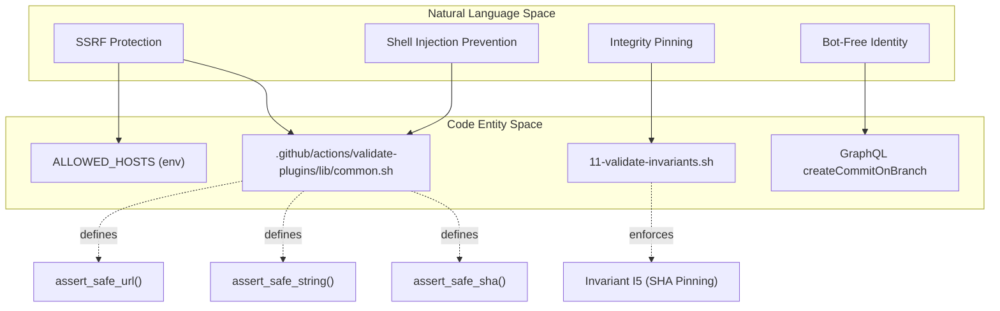
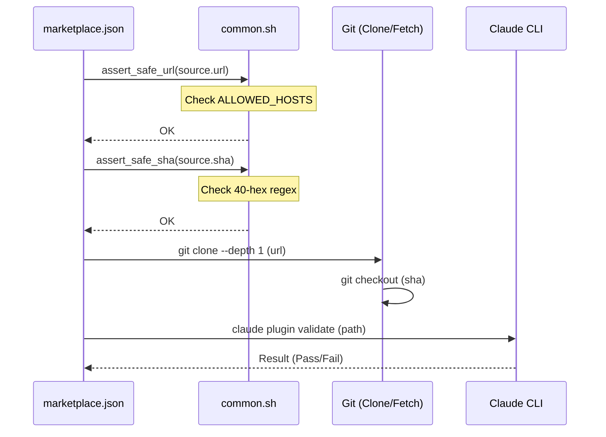

<!-- source: DeepWiki mcp.deepwiki.com · repo anthropics/claude-plugins-community · page 4 Security Model · fetched 2026-10-26 -->

# Security Model

Relevant source files

The following files were used as context for generating this wiki page:

- [.github/actions/README.md](.github/actions/README.md)
- [.github/actions/scan-plugins/scripts/scan.sh](.github/actions/scan-plugins/scripts/scan.sh)
- [.github/actions/validate-plugins/lib/common.sh](.github/actions/validate-plugins/lib/common.sh)

The `claude-plugins-community` repository employs a defense-in-depth security architecture designed to maintain a high-trust marketplace while allowing for automated community contributions. The system is built on a "bot-free" philosophy, leveraging native GitHub features and strict input validation to prevent common attack vectors like Server-Side Request Forgery (SSRF), shell injection, and supply chain compromise.

## Architecture Overview

The security model spans three primary composite actions that share a common library of safety predicates. The architecture ensures that no untrusted code is executed on the runner and that all external data is validated against strict allowlists and integrity checks.

### Code-to-System Mapping
The following diagram illustrates how natural language security concepts map to specific code entities within the repository.

**Security Concept to Code Entity Mapping**

Sources: [.github/actions/README.md:3-5](), [.github/actions/validate-plugins/lib/common.sh:35-95]()

## Core Security Subsystems

### Input Validation and SSRF Protection
All three actions (`validate-plugins`, `bump-plugin-shas`, and `scan-plugins`) utilize a shared library of safety predicates to sanitize untrusted plugin metadata. 

*   **Host Allowlist:** The `ALLOWED_HOSTS` variable restricts where the system can clone code from, preventing SSRF attacks against internal metadata endpoints or private network ranges [.github/actions/validate-plugins/lib/common.sh:56-78]().
*   **Shell Safety:** The `assert_safe_string` function blocks shell metacharacters and whitespace to prevent command injection when values are passed to CLI tools [.github/actions/validate-plugins/lib/common.sh:46-51]().
*   **Path Traversal:** The `assert_safe_path` function ensures that plugin subdirectories are relative and do not contain `..` sequences [.github/actions/validate-plugins/lib/common.sh:89-95]().

For details, see [Input Validation and SSRF Protection](#4.1).

### Signed Commits and Bot-Free Design
The system avoids using GitHub Apps or external bots. Instead, it uses the standard `GITHUB_TOKEN` to interact with the GitHub API. 

*   **Verified Commits:** Automated updates (like SHA bumping) are performed via the GitHub GraphQL `createCommitOnBranch` mutation. This ensures that commits are "Verified" and signed by GitHub, satisfying repository rulesets that require signed commits [.github/actions/README.md:3-5]().
*   **Access Control:** The `close-external-prs` workflow prevents external contributors from running potentially sensitive workflows by immediately closing PRs from forks and directing users to the official submission portal.

For details, see [Signed Commits and Bot-Free Design](#4.2).

### Policy Scan Security
The `scan-plugins` action provides a safety layer by using Claude to review the source code of external plugins.

*   **No-Code-Execution:** The scanner uses Claude in a headless mode with a restricted set of read-only tools (`Read`, `Glob`, `Grep`) [.github/actions/scan-plugins/scripts/scan.sh:130-130](). It evaluates the logic of the plugin without ever executing its code.
*   **Exfiltration Detection:** The policy prompt specifically instructs the model to look for cross-service credential exfiltration, such as a plugin attempting to send AWS credentials to an unrelated third-party domain.
*   **Isolation:** Scans are performed in temporary directories that are wiped after each individual plugin check [.github/actions/scan-plugins/scripts/scan.sh:108-115]().

For details, see [Policy Scan Security: Credential Exfiltration Detection](#4.3).

## Integrity and Pinning

The marketplace enforces strict integrity through SHA-40 pinning. Every external plugin must specify a full 40-character hex SHA.

| Mechanism | Implementation | File Reference |
| :--- | :--- | :--- |
| **SHA Validation** | `assert_safe_sha` regex check | [.github/actions/validate-plugins/lib/common.sh:81-86]() |
| **Invariant I5** | Enforces SHA presence for all external sources | `11-validate-invariants.sh` |
| **Consumer Pinning** | Users must use commit SHAs for `uses:` keys | [.github/actions/README.md:13-14]() |

### Security Flow for External Plugins
This diagram shows the validation sequence for an external plugin entry.

**External Plugin Validation Flow**

Sources: [.github/actions/validate-plugins/lib/common.sh:56-86](), [.github/actions/scan-plugins/scripts/scan.sh:108-133]()

## Related Child Pages
*   [Input Validation and SSRF Protection](#4.1)
*   [Signed Commits and Bot-Free Design](#4.2)
*   [Policy Scan Security: Credential Exfiltration Detection](#4.3)

---

