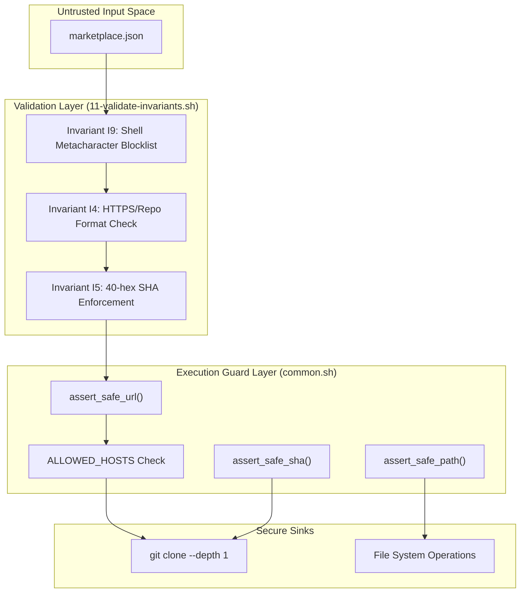
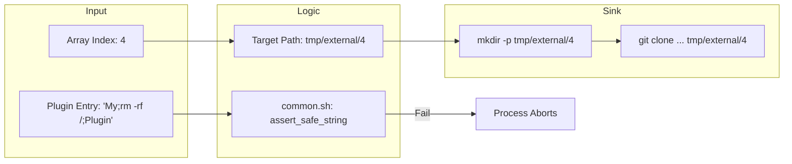

<!-- source: DeepWiki mcp.deepwiki.com · repo anthropics/claude-plugins-community · page 4.1 Input Validation and SSRF Protection · fetched 2026-10-26 -->

# Input Validation and SSRF Protection

Relevant source files

The following files were used as context for generating this wiki page:

- [.github/actions/validate-plugins/lib/common.sh](.github/actions/validate-plugins/lib/common.sh)
- [.github/actions/validate-plugins/scripts/11-validate-invariants.sh](.github/actions/validate-plugins/scripts/11-validate-invariants.sh)

This page details the defense-in-depth approach used by the `claude-plugins-community` repository to handle untrusted plugin metadata. Because the marketplace registry contains URLs, SHAs, and paths provided by contributors, the system enforces strict validation to prevent Server-Side Request Forgery (SSRF), shell injection, and directory traversal attacks during the validation and bumping processes.

## Defense-in-Depth Architecture

The security model relies on a tiered validation strategy. Validation occurs first at the schema level, followed by custom invariant checks, and finally through low-level safety predicates before any external network or file system operations are performed.

### System Safety Flow
The following diagram illustrates how untrusted input from `marketplace.json` is filtered through security gates before reaching sensitive sinks like `git clone` or `rm -rf`.

**Diagram: Input Validation Pipeline**

**Sources:** [.github/actions/validate-plugins/scripts/11-validate-invariants.sh:1-21](), [.github/actions/validate-plugins/lib/common.sh:35-95]()

---

## Safety Predicates and SSRF Protection

All three primary actions (`validate-plugins`, `bump-plugin-shas`, and `scan-plugins`) source the shared library `common.sh`. This library provides the core security predicates that protect the GitHub Actions runner environment.

### SSRF Protection via `assert_safe_url`
The `assert_safe_url` function is the primary defense against SSRF. It prevents the runner from making requests to internal metadata endpoints (e.g., `169.254.169.254`) or unauthorized hosts.

1.  **Metacharacter Blocklist**: Calls `assert_safe_string` to reject whitespace and shell characters [`.github/actions/validate-plugins/lib/common.sh:58-58`]().
2.  **Protocol Enforcement**: Strictly matches `^https://[A-Za-z0-9./_-]+$` [`.github/actions/validate-plugins/lib/common.sh:59-61`]().
3.  **Bare IP Rejection**: Rejects any host that is a raw IP address or contains a port colon [`.github/actions/validate-plugins/lib/common.sh:64-66`]().
4.  **Host Allowlist**: Checks the extracted host against the `ALLOWED_HOSTS` environment variable. It supports exact matches and suffix matches (e.g., `github.com` allows `raw.githubusercontent.com`) [`.github/actions/validate-plugins/lib/common.sh:67-78`]().

### Integrity and Path Protection
| Function | Enforcement Logic | Purpose |
| :--- | :--- | :--- |
| `assert_safe_sha` | Regex `^[0-9a-f]{40}$` | Prevents injection in git checkout commands [`.github/actions/validate-plugins/lib/common.sh:81-86`](). |
| `assert_safe_path` | Rejects leading `/` and any `..` | Prevents directory traversal during subdir extraction [`.github/actions/validate-plugins/lib/common.sh:89-95`](). |
| `has_unsafe_chars` | Blocklist: `$`, `` ` ``, `;`, `&`, `|`, `(`, `)`, `<`, `>`, `\`, quotes, and whitespace | Prevents shell injection in scripts using variables [`.github/actions/validate-plugins/lib/common.sh:38-44`](). |

**Sources:** [.github/actions/validate-plugins/lib/common.sh:35-95]()

---

## Custom Invariants (I1–I11)

The script `11-validate-invariants.sh` enforces security and policy rules that exceed standard JSON Schema capabilities.

### Shell Injection Prevention (I9)
Invariant **I9** ensures that every string-valued field under the `source` object is free of shell metacharacters. This is critical because these values are often interpolated into shell commands during the cloning and bumping processes [`.github/actions/validate-plugins/scripts/11-validate-invariants.sh:17-17`]().

### Name and Description Hardening (I10, I11)
To prevent UI spoofing and malicious naming:
*   **I11**: Plugin names must match `^[a-z0-9][a-z0-9-]{1,63}$` [`.github/actions/validate-plugins/scripts/11-validate-invariants.sh:107-109`]().
*   **I10**: Names and descriptions are scanned for hidden Unicode characters (Zero-Width Spaces, Bidi controls like `U+202E`) which could be used to obfuscate malicious content or mislead users [`.github/actions/validate-plugins/scripts/11-validate-invariants.sh:99-112`]().

**Sources:** [.github/actions/validate-plugins/scripts/11-validate-invariants.sh:99-150]()

---

## Secure Clone Path Derivation

A common vulnerability in CI pipelines is using contributor-supplied names to create directory paths. The system mitigates this by deriving target paths from the plugin's index in the array rather than its `.name` field when performing batch operations.

**Diagram: Safe Path Derivation Logic**

In the `bump-plugin-shas` and `validate-plugins` actions, external repositories are cloned into directories named by their numeric index in the marketplace array. This ensures that even if a plugin name bypasses `I11` (e.g., in a "warn-only" mode), it cannot cause path traversal or command injection during the `mkdir` or `rm` phases of the CI runner.

**Sources:** [.github/actions/validate-plugins/lib/common.sh:89-95](), [.github/actions/validate-plugins/scripts/11-validate-invariants.sh:107-109]()

---

