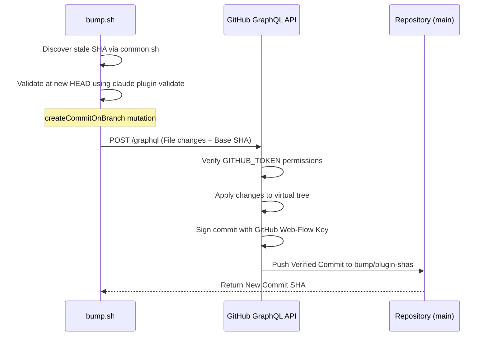
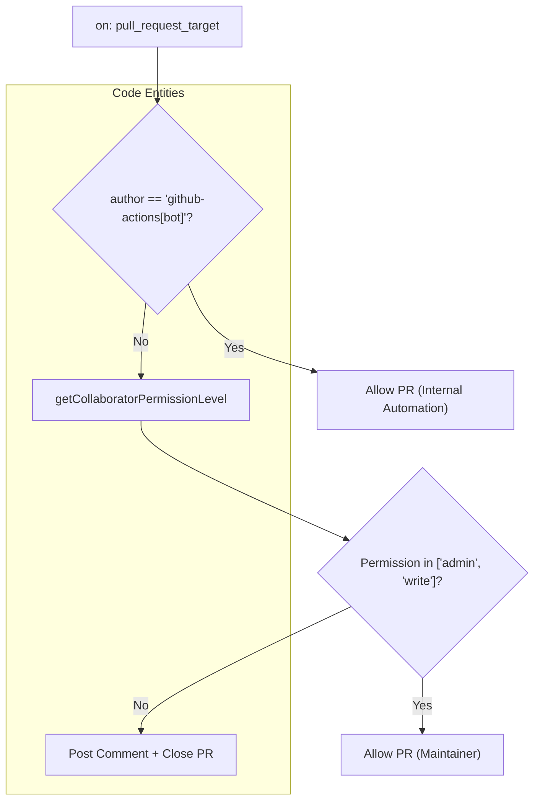

<!-- source: DeepWiki mcp.deepwiki.com · repo anthropics/claude-plugins-community · page 4.2 Signed Commits and Bot-Free Design · fetched 2026-10-26 -->

# Signed Commits and Bot-Free Design

Relevant source files

The following files were used as context for generating this wiki page:

- [.github/actions/bump-plugin-shas/action.yml](.github/actions/bump-plugin-shas/action.yml)
- [.github/actions/bump-plugin-shas/scripts/bump.sh](.github/actions/bump-plugin-shas/scripts/bump.sh)
- [.github/workflows/close-external-prs.yml](.github/workflows/close-external-prs.yml)

This page details the security and automation architecture used to maintain the plugin marketplace. The system is designed to be "bot-free," meaning it avoids the complexity of GitHub Apps and external signing keys while still producing "Verified" commits that satisfy enterprise-grade branch protection rules.

## Bot-Free Architecture: GITHUB_TOKEN vs. GitHub Apps

The repository intentionally avoids using a custom GitHub App or a shared "Machine User" account for automated maintenance. Instead, it relies on the standard `GITHUB_TOKEN` provided by GitHub Actions.

### Rationale
1.  **Reduced Secret Surface Area**: By using the ephemeral `GITHUB_TOKEN`, there are no long-lived private keys or App secrets to rotate or secure in repository secrets.
2.  **Native Identity**: Actions performed by the token are natively attributed to `github-actions[bot]`, making them easy to identify in audit logs and workflows.
3.  **Scoped Permissions**: The `bump-plugin-shas` action requests only the minimum necessary scopes: `contents:write` and `pull-requests:write` [.github/actions/bump-plugin-shas/action.yml:5-11]().

### The Recursion Guard and workflow_dispatch
A security feature of the default `GITHUB_TOKEN` is that it cannot trigger other workflows (to prevent infinite loops). This creates a challenge for the `bump-plugin-shas` workflow: a PR opened by the token will not trigger the `validate-plugins` CI check.

To solve this, the system uses a **Workflow Dispatch Workaround**:
*   The `bump-plugin-shas` action performs validation **inline** before committing [.github/actions/bump-plugin-shas/action.yml:9-11]().
*   The resulting PR body includes a link back to the successful "Bump" run as the CI evidence.
*   For repositories requiring status checks, the system supports a `per-entry` mode that allows a downstream orchestrator to trigger checks via `workflow_dispatch` [.github/actions/bump-plugin-shas/scripts/bump.sh:9-13]().

Sources: [.github/actions/bump-plugin-shas/action.yml:1-11](), [.github/actions/bump-plugin-shas/scripts/bump.sh:1-15]()

## Server-Side Signed Commits

To satisfy `required_signatures` rulesets (which block unverified commits from being merged), the system does not use a local `git commit` command. Local commits would require a GPG or SSH signing key to be stored in the repository.

Instead, the `bump-plugin-shas` action uses the GitHub GraphQL `createCommitOnBranch` mutation.

### Implementation Detail
When a plugin SHA is updated, the script prepares the new file content and sends it to the GitHub GraphQL API. Because the commit is created via the GitHub API using the `GITHUB_TOKEN`, GitHub signs the commit using its own internal web-flow key. This results in a **Verified** badge on the commit without the maintainers ever touching a private key.

### Data Flow: GraphQL Commit Mutation
The following diagram illustrates how the `bump.sh` script transforms a detected SHA change into a signed GitHub commit.

**Commit Signature Data Flow**

Sources: [.github/actions/bump-plugin-shas/action.yml:5-11](), [.github/actions/bump-plugin-shas/scripts/bump.sh:63-67]()

## Close-External-PRs Guard

The repository is a read-only mirror of an internal Anthropic pipeline. To prevent community confusion and maintain the integrity of the mirror, direct external Pull Requests are automatically closed.

### Implementation: pull_request_target
The `close-external-prs.yml` workflow uses the `pull_request_target` trigger. Unlike the standard `pull_request` trigger, this runs in the context of the base repository (main) and has access to a write-capable `GITHUB_TOKEN`, even for forks.

### Logic Flow
The workflow distinguishes between authorized automation and unauthorized external contributors using the `user.login` and collaborator permission levels.

1.  **Bot Exemption**: It explicitly allows `github-actions[bot]` so that the `bump-plugin-shas` automation can continue to open PRs [.github/workflows/close-external-prs.yml:29-32]().
2.  **Collaborator Check**: It checks if the author has `admin` or `write` access to the repository [.github/workflows/close-external-prs.yml:40-43]().
3.  **Auto-Closure**: If neither condition is met, it posts a friendly message directing the user to the official submission portal and closes the PR [.github/workflows/close-external-prs.yml:47-63]().

**PR Authorization Logic**

Sources: [.github/workflows/close-external-prs.yml:1-64]()

## System Integration: The Bump Cycle

The `bump-plugin-shas` action integrates these components into a cohesive maintenance cycle.

| Component | Role | Code Entity |
| :--- | :--- | :--- |
| **Discovery** | Identifies plugins where upstream `HEAD` != `source.sha` | `bump.sh` loop over `MARKETPLACE_PATH` |
| **Validation** | Runs `claude plugin validate` against the new SHA | `install_attempt` and `claude --version` |
| **Staging** | Prepares the updated `marketplace.json` | `base_marketplace_content` variable |
| **Persistence** | Creates the signed commit and PR | `createCommitOnBranch` (via GraphQL) |

### Branch Management
The system supports two `PR_MODE` settings in `bump.sh`:
*   **batch**: A single PR on `bump/plugin-shas` containing all updates [.github/actions/bump-plugin-shas/scripts/bump.sh:5-7]().
*   **per-entry**: One PR per plugin (e.g., `bump/my-plugin`) to allow granular triage and per-PR status checks [.github/actions/bump-plugin-shas/scripts/bump.sh:9-13]().

The `branch_for()` function in `bump.sh` ensures that plugin names (which may contain dots, slashes, or uppercase characters) are safely sanitized into git-compatible branch names [.github/actions/bump-plugin-shas/scripts/bump.sh:85-91]().

Sources: [.github/actions/bump-plugin-shas/scripts/bump.sh:1-91](), [.github/actions/bump-plugin-shas/action.yml:51-63]()

---

