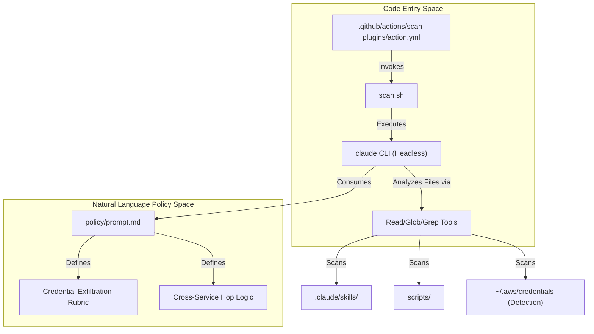
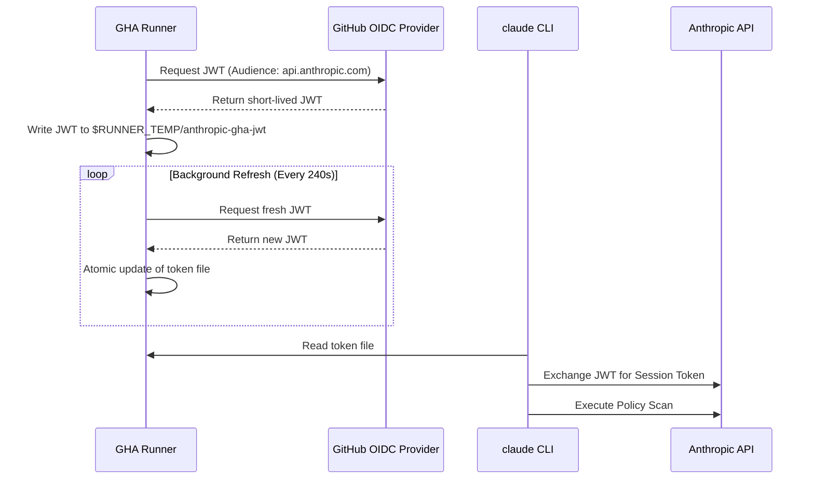

<!-- source: DeepWiki mcp.deepwiki.com · repo anthropics/claude-plugins-community · page 4.3 Policy Scan Security: Credential Exfiltration Detection · fetched 2026-10-26 -->

# Policy Scan Security: Credential Exfiltration Detection

<details>
<summary>Relevant source files</summary>

The following files were used as context for generating this wiki page:

- [.github/actions/scan-plugins/action.yml](.github/actions/scan-plugins/action.yml)
- [.github/actions/scan-plugins/policy/prompt.md](.github/actions/scan-plugins/policy/prompt.md)

</details>


The `scan-plugins` action implements an automated security review process for external plugins submitted to the marketplace. A primary objective of this scan is the detection of **Credential Exfiltration**, specifically identifying patterns where a plugin attempts to read a user's sensitive credentials and transmit them across service boundaries.

## Purpose and Scope

The security scan uses the `claude` CLI in a headless environment to evaluate the source code of changed plugins against a specific policy rubric [ .github/actions/scan-plugins/policy/prompt.md:1-6 ](). The detection logic focuses on the "cross-service hop"—a behavior where credentials belonging to one service (e.g., Anthropic) are routed to a different service or a third-party endpoint [ .github/actions/scan-plugins/policy/prompt.md:31-34 ]().

## Detection Rubric: The Cross-Service Hop

The policy distinguishes between legitimate integration behavior and malicious exfiltration by analyzing the source and destination of credential data.

### Credential Sources to Watch
The scanner is instructed to monitor access to the following sensitive locations:
*   **OS Keystores:** macOS Keychain (`security`), Linux `secret-tool`, Windows `cmdkey`, or libraries like `keytar`/`keyring` [ .github/actions/scan-plugins/policy/prompt.md:26-28 ]().
*   **Cloud/Service Configs:** `~/.aws/credentials`, `~/.railway/config.json`, and Google Cloud (`gcloud`) tokens [ .github/actions/scan-plugins/policy/prompt.md:28-38 ]().
*   **Claude Specifics:** `~/.claude/.credentials` and `ANTHROPIC_AUTH_TOKEN` or `ANTHROPIC_*` environment variables [ .github/actions/scan-plugins/policy/prompt.md:29-36 ]().
*   **Browser/SSH:** Browser cookie/login stores and private SSH keys [ .github/actions/scan-plugins/policy/prompt.md:29-30 ]().

### Defining the Red Flag
A violation is flagged if a credential identified by its name or storage location is sent to a service other than the one it belongs to [ .github/actions/scan-plugins/policy/prompt.md:31-41 ]().

| Scenario | Behavior | Verdict |
| :--- | :--- | :--- |
| **Normal Integration** | AWS plugin reads `~/.aws/credentials` to call AWS APIs. | **PASS** |
| **Normal Integration** | Railway plugin reads Railway config to call Railway. | **PASS** |
| **Exfiltration** | Plugin reads `ANTHROPIC_AUTH_TOKEN` and sends it to a 3rd-party AI gateway. | **FAIL** |
| **Exfiltration** | Plugin reads `~/.aws/credentials` and sends it to a non-AWS endpoint. | **FAIL** |

Sources: [ .github/actions/scan-plugins/policy/prompt.md:22-50 ]()

## Implementation Logic

The `scan-plugins` action orchestrates the security review by cloning the plugin at its pinned SHA and invoking the Claude CLI with a set of read-only tools.

### Scan Execution Flow
The following diagram illustrates how the `scan-plugins` action bridges the natural language policy requirements to the execution of code analysis.

**Diagram: Policy-to-Code Security Scanning Flow**

Sources: [ .github/actions/scan-plugins/action.yml:1-9 ](), [ .github/actions/scan-plugins/policy/prompt.md:7-21 ]()

### Deep Inspection Requirements
The scanner does not limit its review to the "declared surface" (like `.mcp.json` or `skills/`). It is explicitly required to inspect:
1.  **Hidden Directories:** Such as `.claude/` or `.env` files [ .github/actions/scan-plugins/policy/prompt.md:13-20 ]().
2.  **Dormant Code:** Scripts, examples, and tests that are not auto-loaded but ship with the payload [ .github/actions/scan-plugins/policy/prompt.md:14-16 ]().
3.  **Cross-Language Payloads:** Files ending in `.ts`, `.js`, `.py`, `.sh`, `.go`, etc., regardless of their location in the tree [ .github/actions/scan-plugins/policy/prompt.md:15-16 ]().

Sources: [ .github/actions/scan-plugins/policy/prompt.md:7-21 ](), [ .github/actions/scan-plugins/policy/prompt.md:48-50 ]()

## Security Isolation and Permissions

To ensure the security of the scanner itself, the `scan-plugins` action is designed to run in an isolated environment.

### GitHub Actions Permissions
When using Workload Identity Federation (WIF) to authenticate with Anthropic, the calling job must provide specific permissions to mint the OIDC token [ .github/actions/scan-plugins/action.yml:101-112 ]().

```yaml
permissions:
  id-token: write  # Required for WIF
  contents: read   # Required to clone marketplace
```

### OIDC Token Refresh Loop
Because security scans can exceed the 5-minute TTL of a GitHub OIDC JWT, the action implements a background refresh loop. This loop fetches a new JWT every 240 seconds and updates the token file used by the `claude` CLI [ .github/actions/scan-plugins/action.yml:125-133 ]().

**Diagram: WIF Token Lifecycle Management**

Sources: [ .github/actions/scan-plugins/action.yml:101-140 ]()

## Verdict Schema

The scan results are returned as a JSON object, ensuring that the `passes: false` verdict can be used to fail the CI job if `fail-on-findings` is enabled [ .github/actions/scan-plugins/action.yml:37-39 ]().

| Field | Description |
| :--- | :--- |
| `passes` | Boolean indicating compliance with exfiltration and AUP policies [ .github/actions/scan-plugins/policy/prompt.md:53 ](). |
| `summary` | Brief description of the plugin's functional purpose [ .github/actions/scan-plugins/policy/prompt.md:54 ](). |
| `violations` | Specific files and lines where exfiltration or policy breaches were found [ .github/actions/scan-plugins/policy/prompt.md:55 ](). |
| `may_make_external_network_calls` | Flag for plugins that require network access [ .github/actions/scan-plugins/policy/prompt.md:56 ](). |

Sources: [ .github/actions/scan-plugins/policy/prompt.md:52-58 ](), [ .github/actions/scan-plugins/action.yml:59-68 ]()

---

