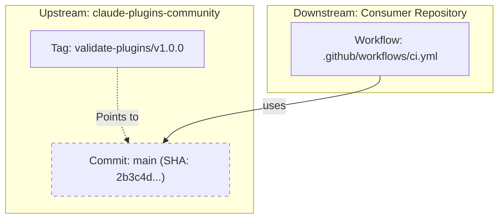
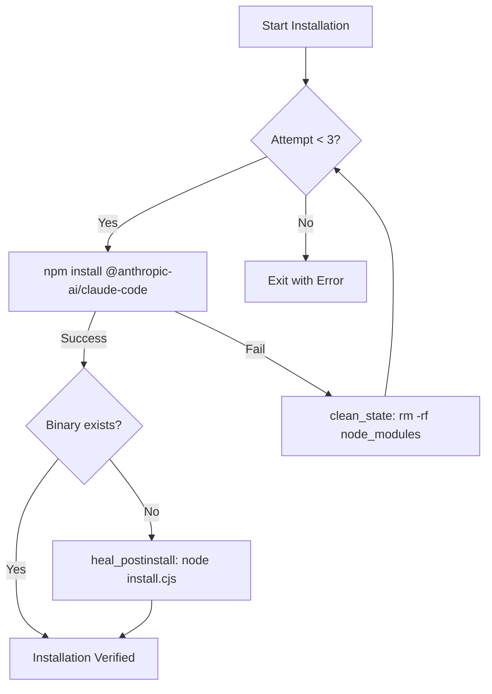

<!-- source: DeepWiki mcp.deepwiki.com · repo anthropics/claude-plugins-community · page 5 Releasing and Consumer Guidance · fetched 2026-10-26 -->

# Releasing and Consumer Guidance

Relevant source files

The following files were used as context for generating this wiki page:

- [.github/actions/bump-plugin-shas/README.md](.github/actions/bump-plugin-shas/README.md)
- [.github/actions/validate-plugins/README.md](.github/actions/validate-plugins/README.md)
- [.github/actions/validate-plugins/RELEASING.md](.github/actions/validate-plugins/RELEASING.md)
- [.github/actions/validate-plugins/scripts/41-validate-aux-files.sh](.github/actions/validate-plugins/scripts/41-validate-aux-files.sh)

This page provides the operational framework for maintainers releasing updates to the `claude-plugins-community` actions and for external consumers integrating these actions into their own plugin marketplace repositories.

The primary goal of this guidance is to ensure a secure, immutable supply chain for CI validation and automated maintenance.

## Release Process and Immutability

The actions in this repository—`validate-plugins`, `bump-plugin-shas`, and `scan-plugins`—must be consumed using **immutable commit SHAs**. This security requirement prevents unauthorized code execution in consumer CI environments that would otherwise be possible if mutable references (like `@main` or `@v1`) were used.

### Release Workflow
Maintainers follow a specific sequence to cut a release:
1. Merge vetted changes to the `main` branch.
2. Capture the merge commit SHA using `git rev-parse HEAD`.
3. Create an annotated tag (e.g., `validate-plugins/v1.2.3`) for human-readable versioning and history.
4. Update the usage documentation in the action's README to reflect the new canonical SHA.
5. Open PRs in downstream consumer repositories to update their workflow files.

For details on the step-by-step procedure and the security rationale, see **[Action Release Process](#5.1)**.

Sources: [.github/actions/validate-plugins/RELEASING.md:1-27](), [.github/actions/validate-plugins/README.md:39-40]()

---

## Consumer Integration Patterns

Integrating these actions involves configuring the `marketplace-path` and managing SHA pinning. The system is designed to support both monolithic `marketplace.json` files and per-file plugin directories.

### Common Configuration
| Requirement | Implementation |
|:---|:---|
| **Pinning** | Always use `@<FULL-COMMIT-SHA>` in the `uses:` block. |
| **CLI Versioning** | Consumers should pin `claude-cli-version` to a specific version rather than `latest`. |
| **SSRF Safety** | Define `allowed-hosts` to restrict which domains the actions can clone from. |

### Integration Diagram: Action to Consumer
The following diagram illustrates how the release entities (Tags/SHAs) map to the consumer's workflow configuration.

**Release Mapping**

Sources: [.github/actions/validate-plugins/README.md:107-125](), [.github/actions/validate-plugins/RELEASING.md:18-24]()

---

## Claude CLI Installation and Self-Healing

The actions depend on `@anthropic-ai/claude-code` to perform canonical validation. Because these actions often run on various GitHub-hosted runner images where optional native dependencies might fail to compile or install, a "self-healing" installation pattern is utilized.

### Resilient Installation Logic
The installation process includes:
*   **Retry Loop:** A three-attempt loop to handle transient network or registry issues.
*   **State Cleansing:** Automated removal of `node_modules` and clearing of the `npm` cache between failed attempts.
*   **Post-install Healing:** A fallback mechanism that manually executes `node install.cjs` if the platform-native binary is missing after the standard `npm install`.
*   **Timeout Protection:** A 300-second wrapper to prevent hung installation processes from consuming runner minutes indefinitely.

For technical details on the installation scripts and failure recovery, see **[Claude CLI Installation and Self-Healing](#5.2)**.

### Installation Flow Diagram
This diagram bridges the high-level installation logic to the specific shell commands and files involved in the self-healing routine.

**Self-Healing Logic Flow**

Sources: [.github/actions/validate-plugins/README.md:7-12](), [.github/actions/validate-plugins/scripts/41-validate-aux-files.sh:1-47]() (shared logic context).

---

## Child Pages
*   **[Action Release Process](#5.1)**: Detailed instructions for maintainers on tagging, SHA pinning, and the security implications of mutable references.
*   **[Claude CLI Installation and Self-Healing](#5.2)**: Technical breakdown of the `npm` installation wrapper, the retry logic, and the post-install binary recovery used across all actions.

---

