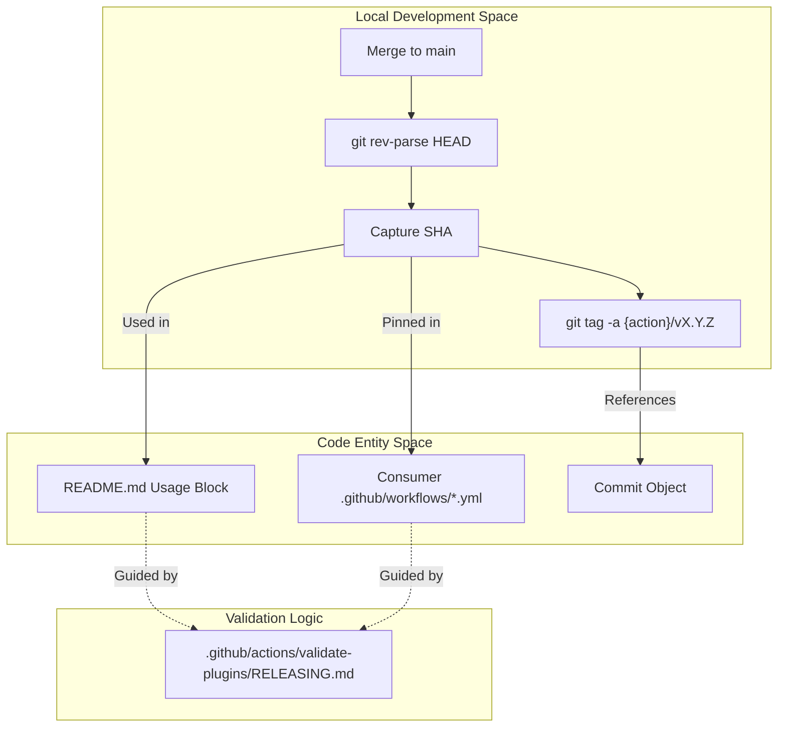
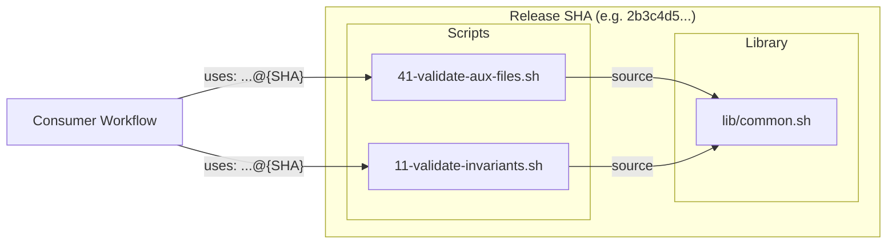

<!-- source: DeepWiki mcp.deepwiki.com · repo anthropics/claude-plugins-community · page 5.1 Action Release Process · fetched 2026-10-26 -->

# Action Release Process

Relevant source files

The following files were used as context for generating this wiki page:

- [.github/actions/validate-plugins/RELEASING.md](.github/actions/validate-plugins/RELEASING.md)
- [.github/actions/validate-plugins/scripts/41-validate-aux-files.sh](.github/actions/validate-plugins/scripts/41-validate-aux-files.sh)

The `claude-plugins-community` repository enforces a strict, security-first release process for its composite GitHub Actions. Unlike typical GitHub Actions that might encourage using mutable tags (e.g., `@v1`) or branch names (e.g., `@main`), this project mandates **immutable commit SHA pinning** for all consumers. This ensures that the maintenance pipeline remains resistant to supply-chain attacks and provides a deterministic execution environment across different repositories.

## Security Rationale: Immutable Refs

The primary driver for the release process is the prevention of arbitrary code execution in consumer CI pipelines.

*   **Mutable Ref Risk:** If a consumer uses `@main` or a tag like `@v1.2.3`, anyone with push access to the `claude-plugins-community` repository could potentially modify the action's logic (e.g., the `common.sh` library or validation scripts) to exfiltrate secrets or run malicious payloads in the consumer's environment [RELEASING.md:3-5]().
*   **SHA Pinning:** By pinning to a full 40-character commit SHA, consumers are guaranteed that the code they audited is exactly the code that runs. The release process treats tags as human-readable pointers only; they are never used in the `uses:` block of a workflow [RELEASING.md:18-26]().

## Step-by-Step Release Workflow

The release process follows a linear path from code stabilization to consumer deployment.

### 1. Merging and Identification
Changes are first integrated into the primary branch. Once the CI passes on the PR, the maintainer merges it to `main` [RELEASING.md:9](). The specific merge commit SHA is then captured using `git rev-parse HEAD` [RELEASING.md:10]().

### 2. Annotated Tagging
While consumers pin to SHAs, tags are used for versioning and changelog tracking. Tags follow the pattern `{action-name}/vX.Y.Z` (e.g., `validate-plugins/v1.0.4`) [RELEASING.md:11]().
*   **Command:** `git tag -a validate-plugins/vX.Y.Z -m "Release description" <SHA>`
*   **Push:** `git push origin --tags`

### 3. Documentation Update
The `README.md` for the specific action is updated to reflect the "current SHA." This serves as the source of truth for new consumers or those looking to upgrade [RELEASING.md:12]().

### 4. Downstream Deployment
Finally, the maintainer opens Pull Requests against consuming repositories (such as internal Anthropic repositories or partner integrations) to bump their pinned SHA to the newly released version [RELEASING.md:13]().

### Release Data Flow and Command Mapping

The following diagram maps the natural language steps of the release process to the specific Git commands and file entities involved.

**Title: Release Command and Entity Mapping**

Sources: [.github/actions/validate-plugins/RELEASING.md:1-27]()

## Implementation Detail: Action Pinning Examples

The release process explicitly forbids the "Wrong" patterns often found in GitHub Actions documentation to maintain the security posture of the marketplace.

| Usage Type | Syntax Example | Status | Rationale |
| :--- | :--- | :--- | :--- |
| **Correct** | `uses: .../validate-plugins@2b3c4d5...` | **Approved** | Immutable; immune to tag floating or branch force-pushes [RELEASING.md:19](). |
| **Wrong** | `uses: .../validate-plugins@main` | **Forbidden** | Mutable; tracks the latest (potentially unvetted) code [RELEASING.md:22](). |
| **Wrong** | `uses: .../validate-plugins@v1` | **Forbidden** | Mutable; tags can be moved to different commits [RELEASING.md:23](). |

## Validation Consistency

The release process ensures that the scripts within the action, such as the auxiliary file validator, are deployed as a cohesive unit. For instance, when `41-validate-aux-files.sh` is updated to check for new runtime config files like `.mcp.json` or `.lsp.json`, the release process ensures that the `common.sh` library it sources is the exact version expected by that script [41-validate-aux-files.sh:7-11]().

### Release Pipeline Interaction

This diagram illustrates how a release (a specific SHA) encapsulates the entire validation logic, ensuring that the script execution and the shared library remain in sync.

**Title: Action Release Encapsulation**

Sources: [.github/actions/validate-plugins/scripts/41-validate-aux-files.sh:7](), [.github/actions/validate-plugins/RELEASING.md:3-5]()

---

