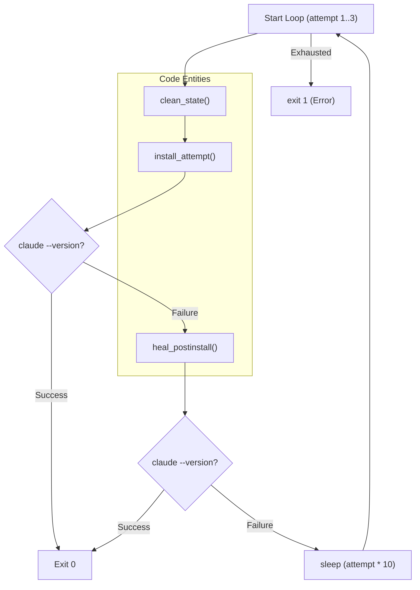
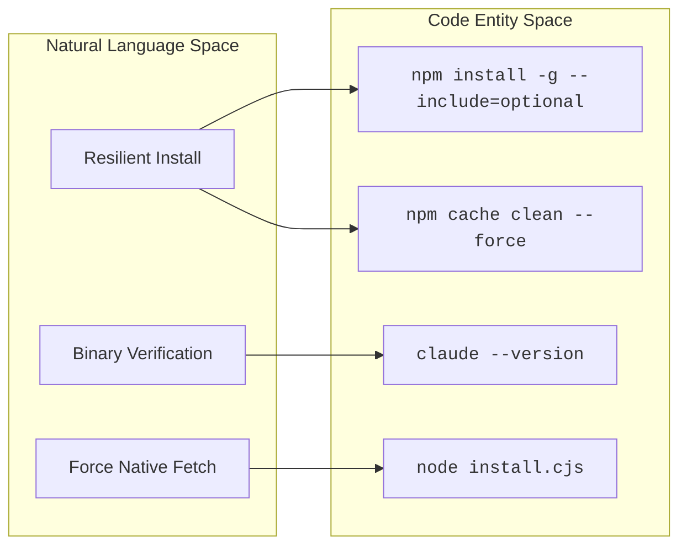

<!-- source: DeepWiki mcp.deepwiki.com · repo anthropics/claude-plugins-community · page 5.2 Claude CLI Installation and Self-Healing · fetched 2026-10-26 -->

# Claude CLI Installation and Self-Healing

Relevant source files

The following files were used as context for generating this wiki page:

- [.github/actions/bump-plugin-shas/action.yml](.github/actions/bump-plugin-shas/action.yml)
- [.github/actions/scan-plugins/action.yml](.github/actions/scan-plugins/action.yml)
- [.github/actions/validate-plugins/action.yml](.github/actions/validate-plugins/action.yml)

This section documents the resilient `npm` installation routine shared by all three primary GitHub Actions in the repository: `validate-plugins`, `bump-plugin-shas`, and `scan-plugins`. The routine is designed to mitigate non-deterministic failures of platform-native binary fetches on hosted CI runners.

## Overview and Rationale

The `@anthropic-ai/claude-code` package distributes its core runtime as a platform-native **optional dependency** [ .github/actions/validate-plugins/action.yml:139-140 ](). In standard environments, this binary is fetched via an `npm` `postinstall` script. However, on hosted GitHub Actions runners, this network fetch intermittently stalls or is skipped due to specific runner configurations (e.g., `npm --omit=optional` or `pnpm` overrides) [ .github/actions/validate-plugins/action.yml:140-142 ]().

Without the self-healing routine, a standard `npm install -g` might report success ("added 1 package") while leaving the environment without a usable `claude` binary, causing subsequent CI steps to fail with "native binary not installed" [ .github/actions/validate-plugins/action.yml:142-145 ]().

### Key Features
*   **Three-Attempt Retry Loop**: Orchestrates the entire recovery process [ .github/actions/bump-plugin-shas/action.yml:144 ]().
*   **State Sanitization**: Clears existing partial installs and the `npm` cache before retrying [ .github/actions/bump-plugin-shas/action.yml:130-134 ]().
*   **Heal Fallback**: Manually invokes the `install.cjs` script if the binary is missing after a successful `npm` command [ .github/actions/bump-plugin-shas/action.yml:136-142 ]().
*   **Strict Timeouts**: Wraps every network-bound operation in a 300-second `timeout` to prevent CI hangs [ .github/actions/bump-plugin-shas/action.yml:135 ]().

---

## Installation Implementation Details

The installation logic is implemented as a Bash script block within the `Install claude CLI` step of each action [ .github/actions/validate-plugins/action.yml:133-180 ](), [ .github/actions/bump-plugin-shas/action.yml:116-160 ](), [ .github/actions/scan-plugins/action.yml:154-166 ]().

### Key Functions and Logic

| Function | Role | Code Reference |
| :--- | :--- | :--- |
| `pkg_root` | Resolves the global `node_modules` path for the CLI package. | [ .github/actions/bump-plugin-shas/action.yml:129 ]() |
| `clean_state` | Deletes the package directory and runs `npm cache clean --force`. | [ .github/actions/bump-plugin-shas/action.yml:130-134 ]() |
| `install_attempt` | Executes `npm install -g --include=optional` under a 300s timeout. | [ .github/actions/bump-plugin-shas/action.yml:135 ]() |
| `heal_postinstall` | Manually runs `node install.cjs` from the package root. | [ .github/actions/bump-plugin-shas/action.yml:136-142 ]() |

### Execution Flow

The routine follows a specific escalation path to ensure the binary is available:

1.  **Attempt 1**: Runs `install_attempt`.
2.  **Verification**: Checks `claude --version`. If it succeeds, the loop breaks [ .github/actions/bump-plugin-shas/action.yml:148 ]().
3.  **Healing**: If verification fails, it calls `heal_postinstall` to manually trigger the native binary download [ .github/actions/bump-plugin-shas/action.yml:149 ]().
4.  **Re-Verification**: Checks `claude --version` again [ .github/actions/bump-plugin-shas/action.yml:150 ]().
5.  **Retry**: If still failing, it waits (10s/20s), calls `clean_state`, and repeats the cycle up to 3 times [ .github/actions/bump-plugin-shas/action.yml:146-153 ]().

**Sources:** [ .github/actions/bump-plugin-shas/action.yml:128-158 ](), [ .github/actions/validate-plugins/action.yml:150-178 ]()

---

## Logic and Entity Mapping

The following diagrams illustrate how the Natural Language concepts of "Self-Healing" and "Retries" map to the specific Bash entities in the Action YAML files.

### Installation State Machine
This diagram shows the transition between the recovery functions defined in the scripts.

**Sources:** [ .github/actions/bump-plugin-shas/action.yml:130-153 ](), [ .github/actions/validate-plugins/action.yml:153-171 ]()

### Code Entity Association
Mapping the high-level installation goals to the specific CLI and NPM commands used in the shell script.

**Sources:** [ .github/actions/bump-plugin-shas/action.yml:133-140 ](), [ .github/actions/validate-plugins/action.yml:158-165 ]()

---

## Failure Handling and Diagnostics

If the CLI remains unusable after three attempts, the action terminates with a diagnostic block to assist maintainers in debugging runner environment issues.

### Diagnostic Output
The script prints the following system state information before exiting:
*   `node --version` [ .github/actions/bump-plugin-shas/action.yml:156 ]()
*   `npm --version` [ .github/actions/bump-plugin-shas/action.yml:156 ]()
*   `npm config get omit` (to check if optional dependencies are being suppressed) [ .github/actions/bump-plugin-shas/action.yml:156 ]()

### Error Message
> `::error::claude CLI did not become usable after 3 attempts (native-binary fetch failing — see logs above).` [ .github/actions/bump-plugin-shas/action.yml:155 ]()

**Sources:** [ .github/actions/bump-plugin-shas/action.yml:154-158 ](), [ .github/actions/validate-plugins/action.yml:174-178 ]()

---

