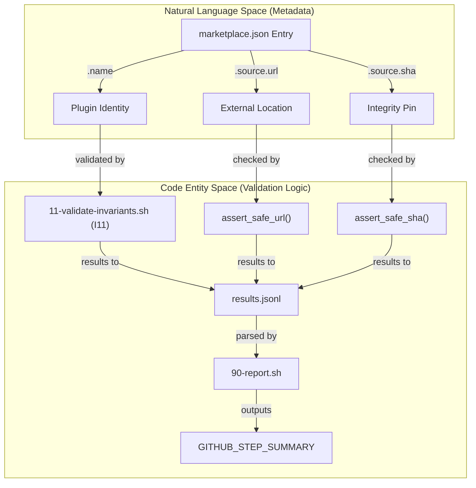
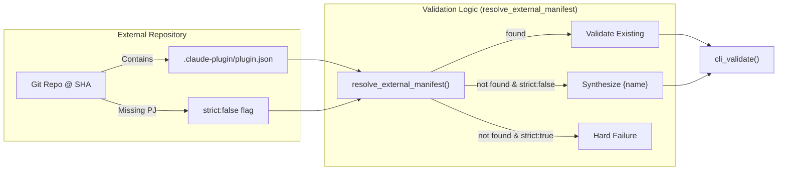

<!-- source: DeepWiki mcp.deepwiki.com · repo anthropics/claude-plugins-community · page 6 Glossary · fetched 2026-10-26 -->

# Glossary

Relevant source files

The following files were used as context for generating this wiki page:

- [.claude-plugin/marketplace.json](.claude-plugin/marketplace.json)
- [.github/actions/README.md](.github/actions/README.md)
- [.github/actions/bump-plugin-shas/scripts/bump.sh](.github/actions/bump-plugin-shas/scripts/bump.sh)
- [.github/actions/scan-plugins/scripts/scan.sh](.github/actions/scan-plugins/scripts/scan.sh)
- [.github/actions/validate-plugins/README.md](.github/actions/validate-plugins/README.md)
- [.github/actions/validate-plugins/lib/common.sh](.github/actions/validate-plugins/lib/common.sh)
- [.github/actions/validate-plugins/scripts/11-validate-invariants.sh](.github/actions/validate-plugins/scripts/11-validate-invariants.sh)
- [LICENSE](LICENSE)
- [README.md](README.md)

This page provides a comprehensive reference for terms, abbreviations, and domain concepts used throughout the `claude-plugins-community` repository and its associated CI/CD infrastructure.

## Core Concepts

### Marketplace Manifest
The central registry file, typically located at `.claude-plugin/marketplace.json`, which defines the catalog of available plugins [README.md:7-7](). It contains an array of plugin objects, each specifying metadata such as name, description, and source [ .claude-plugin/marketplace.json:1-16]().

### Plugin Invariants
A set of eleven custom hardening rules (I1–I11) enforced by the `validate-plugins` action [ .github/actions/validate-plugins/scripts/11-validate-invariants.sh:8-19](). These rules go beyond standard JSON Schema validation to ensure repository consistency, security, and policy compliance.

| ID | Name | Description |
|---|---|---|
| **I1** | Alphabetical Sort | Plugins must be sorted by name (case-insensitive) [ .github/actions/validate-plugins/scripts/11-validate-invariants.sh:91-93](). |
| **I2** | No Duplicates | Plugin names must be unique within the manifest [ .github/actions/validate-plugins/scripts/11-validate-invariants.sh:95-97](). |
| **I4** | HTTPS Only | All external source URLs must use the `https://` protocol [ .github/actions/validate-plugins/scripts/11-validate-invariants.sh:131-134](). |
| **I5** | SHA Pinning | External sources must have a 40-character hex SHA, unless exempt [ .github/actions/validate-plugins/scripts/11-validate-invariants.sh:136-148](). |
| **I9** | Shell Safety | Source fields must not contain shell metacharacters [ .github/actions/validate-plugins/scripts/11-validate-invariants.sh:15-15](). |
| **I11** | Name Schema | Names must match `^[a-z0-9][a-z0-9-]{1,63}$` [ .github/actions/validate-plugins/scripts/11-validate-invariants.sh:107-109](). |

### SHA Bumping
The process of updating the pinned `source.sha` of an external plugin to its latest upstream `HEAD`. This is automated by the `bump-plugin-shas` action [ .github/actions/bump-plugin-shas/scripts/bump.sh:1-13]().

### Drift Detection
A mode of the `validate-plugins` action (triggered by `validate-all-external: "true"`) that scans all external entries to detect repositories that have been deleted or force-pushed past their pinned SHA [ .github/actions/validate-plugins/README.md:70-73]().

---

## Technical Terms & Components

### ALLOWED_HOSTS
An SSRF (Server-Side Request Forgery) guard list of permitted domains for plugin cloning. Defaults to `github.com`, `gitlab.com`, and `bitbucket.org` [ .github/actions/validate-plugins/README.md:123-123](). Enforced via `assert_safe_url` in the shared library [ .github/actions/validate-plugins/lib/common.sh:56-78]().

### Results JSONL
A machine-readable log file (`results.jsonl`) generated during validation. Each entry contains the `step`, `status` (pass/warn/fail), `subject`, and `detail` [ .github/actions/validate-plugins/lib/common.sh:21-33](). This file is used by `90-report.sh` to generate the final GitHub Actions summary [ .github/actions/validate-plugins/lib/common.sh:19-19]().

### strict:false (Skills-Only)
A plugin configuration that indicates the plugin does not ship a physical `plugin.json` manifest. In these cases, the marketplace and CI pipeline synthesize a minimal manifest for validation [ .github/actions/validate-plugins/lib/common.sh:129-137]().

### SHA_EXEMPT
A list of plugin names that are permitted by policy to omit a `source.sha`. This is used for plugins that should always track the latest version without pinning [ .github/actions/bump-plugin-shas/scripts/bump.sh:28-31]().

### FREEZE_SHAS
A list of plugin names whose SHAs should not be advanced by the automated bumping logic, even if they are stale. This is typically used during security incidents or pending upstream fixes [ .github/actions/bump-plugin-shas/scripts/bump.sh:33-37]().

---

## Data Flow Diagrams

### Plugin Validation Pipeline
This diagram illustrates the flow from natural language plugin metadata in `marketplace.json` to the code-level validation entities.

**Sources:** [ .github/actions/validate-plugins/lib/common.sh:21-33](), [ .github/actions/validate-plugins/scripts/11-validate-invariants.sh:103-109](), [ .github/actions/validate-plugins/lib/common.sh:56-86]()

### External Manifest Resolution Flow
How the system handles the transition from a remote repository (Natural Language Space) to a validated manifest (Code Space).

**Sources:** [ .github/actions/validate-plugins/lib/common.sh:125-164](), [ .github/actions/validate-plugins/lib/common.sh:100-122]()

---

## Function & Utility Reference

| Function | File | Purpose |
|---|---|---|
| `record_result` | [lib/common.sh:23-33]() | Appends a structured JSON object to the results tracking file. |
| `assert_safe_url` | [lib/common.sh:56-78]() | Enforces HTTPS, non-IP hosts, and the `ALLOWED_HOSTS` allowlist. |
| `assert_safe_sha` | [lib/common.sh:81-86]() | Validates that a string is exactly a 40-character lowercase hex SHA. |
| `cli_validate` | [lib/common.sh:100-122]() | Wrapper for `claude plugin validate` that handles error classification and reporting. |
| `resolve_external_manifest` | [lib/common.sh:152-166]() | Logic for locating or synthesizing a manifest for an external plugin. |
| `flag` | [11-validate-invariants.sh:58-87]() | Logs an invariant violation, handling `SCOPE_ERRORS_TO_CHANGED` logic. |
| `branch_for` | [scripts/bump.sh:85-91]() | Sanitizes a plugin name into a git-safe branch name for PR creation. |

**Sources:** [ .github/actions/validate-plugins/lib/common.sh:1-166](), [ .github/actions/validate-plugins/scripts/11-validate-invariants.sh:58-87](), [ .github/actions/bump-plugin-shas/scripts/bump.sh:85-91]()