# Page: Overview

# Overview

<details>
<summary>Relevant source files</summary>

The following files were used as context for generating this wiki page:

- [.claude-plugin/marketplace.json](.claude-plugin/marketplace.json)
- [.github/actions/README.md](.github/actions/README.md)
- [.github/actions/scan-plugins/scripts/scan.sh](.github/actions/scan-plugins/scripts/scan.sh)
- [README.md](README.md)

</details>


The `claude-plugins-community` repository serves as the official, read-only mirror of the community plugin marketplace for the Claude ecosystem. It provides a centralized registry that powers plugin discovery and installation for both **Claude Cowork** and the **Claude Code CLI** [README.md:1-22]().

## System Architecture

The repository is not a primary source for submissions; rather, it is a downstream mirror synchronized from Anthropic's internal review pipeline [README.md:5-9](). The system consists of three primary layers: the **Marketplace Registry**, the **CI Validation Pipeline**, and the **Automated Maintenance Loop**.

### High-Level Component Interaction

The following diagram illustrates how the GitHub Actions subsystems interact with the `marketplace.json` manifest and external plugin sources.

**Marketplace Maintenance Flow**
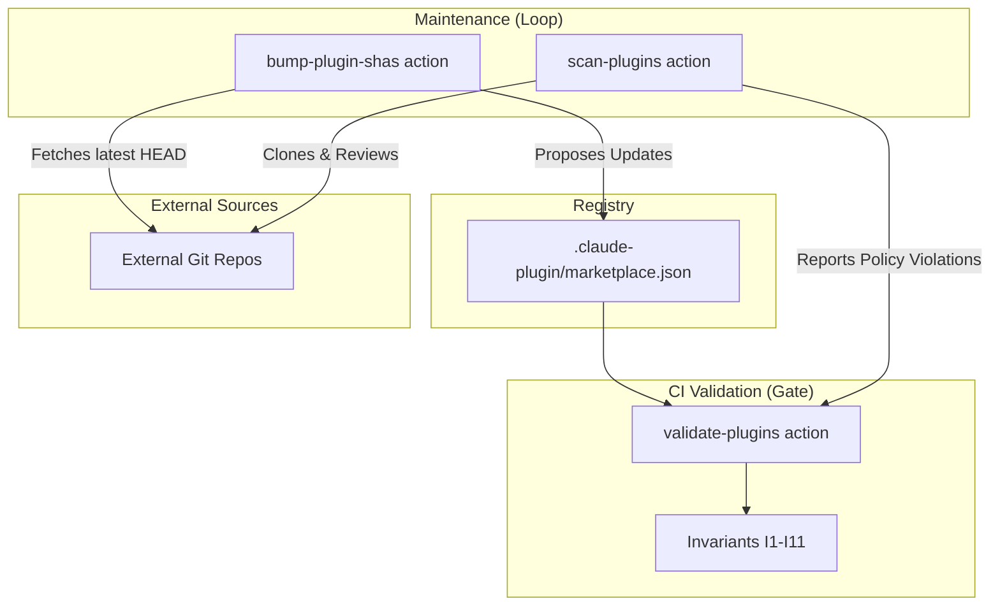
Sources: [.github/actions/README.md:1-15](), [.claude-plugin/marketplace.json:1-6]()

## Core Subsystems

### 1. Marketplace Registry
The heart of the repository is the manifest file located at [.claude-plugin/marketplace.json](). This JSON file defines the metadata, source locations (Git URLs), and integrity SHAs for every community-approved plugin [.claude-plugin/marketplace.json:7-16]().
*   **For details, see [Repository Purpose and Architecture](#1.1)**

### 2. CI Validation (validate-plugins)
Every change to the marketplace is gated by a comprehensive validation suite. This system enforces eleven specific "Invariants" (I1–I11) ranging from alphabetical sorting and HTTPS-only requirements to strict SHA-40 hex validation and shell metacharacter safety [.github/actions/README.md:9](). It utilizes a shared library of security predicates to prevent SSRF and injection attacks [.github/actions/validate-plugins/lib/common.sh]().
*   **For details, see [CI/CD Pipeline: Validation, Bumping, and Scanning](#3)**

### 3. Automated Maintenance (bump-plugin-shas & scan-plugins)
To ensure plugins remain functional and secure, the repository employs two automated maintenance actions:
*   **`bump-plugin-shas`**: Periodically checks external repositories for new commits and proposes manifest updates via signed commits [.github/actions/README.md:10]().
*   **`scan-plugins`**: Uses Claude-based headless analysis (via `claude -p`) to review plugin source code against safety policies, checking for credential exfiltration or malicious patterns [.github/actions/scan-plugins/scripts/scan.sh:127-133]().
*   **For details, see [CI/CD Pipeline: Validation, Bumping, and Scanning](#3)**

## Code Entity Mapping

The following diagram maps the logical subsystems to the specific scripts and files that implement them within the codebase.

**Subsystem to Code Entity Map**
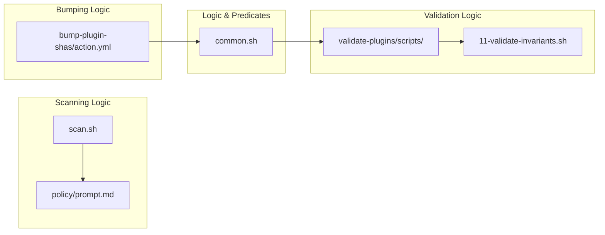
Sources: [.github/actions/README.md:3-5](), [.github/actions/scan-plugins/scripts/scan.sh:1-23]()

## Integration with Claude Ecosystem

| Consumer | Installation Method | Source Reference |
| :--- | :--- | :--- |
| **Claude Cowork** | Web UI at [claude.com/plugins](https://claude.com/plugins/) | Internal Anthropic Sync |
| **Claude Code CLI** | `claude plugin marketplace add anthropics/claude-plugins-community` | GitHub Repository Mirror |

Sources: [README.md:13-22]()

*   **For practical usage instructions, see [Getting Started: Installing and Using Plugins](#1.2)**

---

# Page: Repository Purpose and Architecture

# Repository Purpose and Architecture

<details>
<summary>Relevant source files</summary>

The following files were used as context for generating this wiki page:

- [.claude-plugin/marketplace.json](.claude-plugin/marketplace.json)
- [.github/workflows/close-external-prs.yml](.github/workflows/close-external-prs.yml)
- [README.md](README.md)

</details>


The `claude-plugins-community` repository serves as the official distribution hub for community-contributed plugins for **Claude Cowork** and **Claude Code** [README.md:1-3](). It functions as a centralized registry where users can discover and install tools, skills, and agents that extend Claude's capabilities.

Architecturally, this repository is a **read-only mirror** [README.md:7](). It is not the primary source of truth for plugin submissions; instead, it reflects the state of Anthropic's internal review pipeline. This design ensures that all publicly listed plugins have undergone automated security scanning and manual approval before being surfaced to users [README.md:9]().

## Plugin Submission and Synchronization Flow

Changes to the marketplace do not originate from Pull Requests on this repository. Instead, they follow a structured submission and review lifecycle:

1.  **Submission**: Developers submit their plugins via the [Plugin Directory Submission form](https://clau.de/plugin-directory-submission) [README.md:26]().
2.  **Review**: Submissions enter an internal Anthropic pipeline for security and policy evaluation.
3.  **Synchronization**: Approved plugins are synced to this repository's `.claude-plugin/marketplace.json` file [README.md:7]().
4.  **Maintenance**: Automated GitHub Actions continuously validate the registry, update version hashes (SHAs), and perform periodic security re-scans.

### The `close-external-prs` Guard

To maintain the integrity of the read-only mirror, the repository employs a strict gatekeeper via the `Close External PRs` workflow [.github/workflows/close-external-prs.yml:1]().

This workflow uses the `pull_request_target` trigger to ensure it has the necessary permissions to close PRs opened from forks [.github/workflows/close-external-prs.yml:4-9](). It identifies the author and automatically closes any PR that does not originate from a repository collaborator or the internal automation bot [.github/workflows/close-external-prs.yml:18-63]().

#### Logic for PR Acceptance
| Entity | Status | Rationale |
| :--- | :--- | :--- |
| `github-actions[bot]` | **Allowed** | Used by the `bump-plugin-shas` action to keep the registry fresh [.github/workflows/close-external-prs.yml:29-32](). |
| Admin/Write Users | **Allowed** | Allows maintainers to perform manual emergency fixes [.github/workflows/close-external-prs.yml:40-43](). |
| External Contributors | **Closed** | Prevents bypassing the submission/review pipeline [.github/workflows/close-external-prs.yml:45-63](). |

**Sources:**
- [README.md:1-32]()
- [.github/workflows/close-external-prs.yml:1-64]()

## System Architecture

The repository's functionality is defined by the interaction between the marketplace manifest and three primary maintenance subsystems implemented as GitHub Actions.

### Data Flow Diagram: Registry Maintenance

The following diagram illustrates how the internal review pipeline and the automated actions interact with the `marketplace.json` registry.

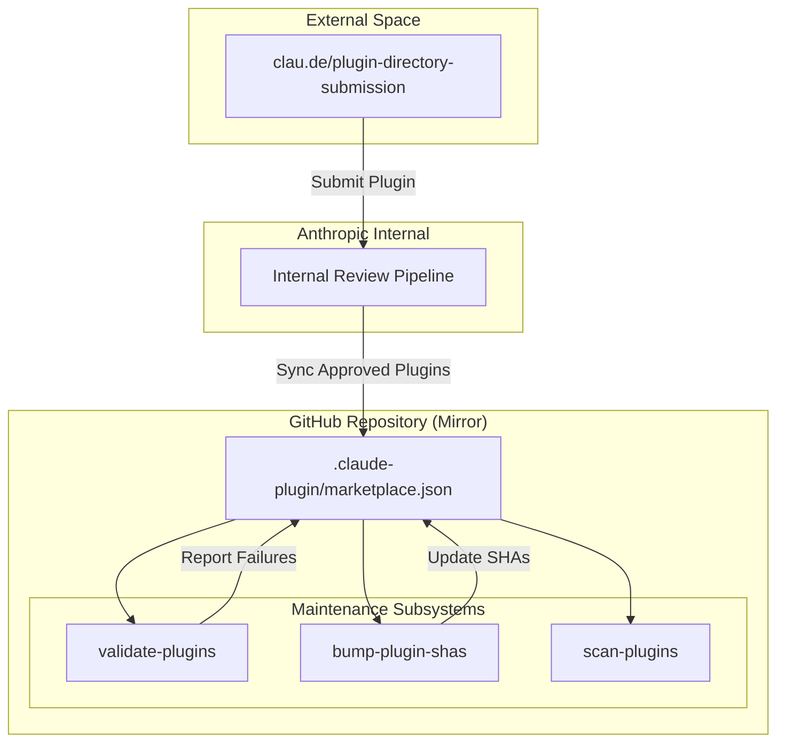

**Sources:**
- [README.md:7-9]()
- [README.md:26]()
- [.github/workflows/close-external-prs.yml:20-22]()

## Core Subsystems

The repository's health and security are maintained by three specialized composite actions. These actions form a complete lifecycle management system for the plugin registry.

### 1. `validate-plugins`
This is the primary CI gate. It ensures that any change to the marketplace follows strict schema and security invariants.
*   **Key Function**: Enforces rules such as HTTPS-only URLs, alphabetical sorting, and SHA-integrity pinning.
*   **Implementation**: Utilizes a multi-stage pipeline of shell scripts (e.g., `11-validate-invariants.sh`) and the `claude` CLI's `cli_validate` command.

### 2. `bump-plugin-shas`
Because plugins are hosted externally (often on GitHub), this action ensures the marketplace stays up-to-date with the latest versions of the source code.
*   **Key Function**: Discovers new commits on external plugin repositories and updates the `sha` field in `marketplace.json` [.claude-plugin/marketplace.json:13]().
*   **Implementation**: Uses the GitHub GraphQL API to create signed commits, satisfying branch protection rules without requiring personal access tokens.

### 3. `scan-plugins`
This provides ongoing security assurance by evaluating the actual source code of the plugins listed in the registry.
*   **Key Function**: Uses Claude (via the `claude -p headless` mode) to scan for credential exfiltration, unsafe code patterns, and policy violations.
*   **Implementation**: Employs "Workload Identity Federation" for secure authentication and executes a specialized security rubric against the plugin source files.

### Architectural Mapping: Code Entities

This diagram maps the high-level maintenance concepts to specific files and entry points within the repository.

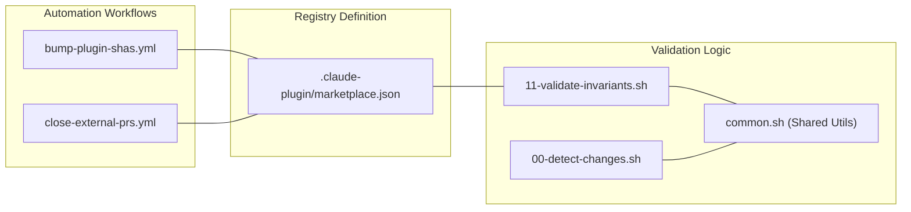

**Sources:**
- [.claude-plugin/marketplace.json:1-86]()
- [.github/workflows/close-external-prs.yml:1-5]()
- [README.md:7-22]()

---

# Page: Getting Started: Installing and Using Plugins

# Getting Started: Installing and Using Plugins

<details>
<summary>Relevant source files</summary>

The following files were used as context for generating this wiki page:

- [.claude-plugin/marketplace.json](.claude-plugin/marketplace.json)
- [README.md](README.md)

</details>


This page provides a practical guide for end users on how to interact with the community plugin marketplace. It covers the registration of the marketplace as a source in the Claude Code CLI, the installation process, and the data structure that defines a plugin's identity and integrity.

## Adding the Marketplace to Claude Code

To use community plugins in the Claude Code CLI, you must first register this repository as a known marketplace source. Claude Code uses a namespaced system to manage plugins from different providers.

### CLI Commands

The following commands are used to manage the marketplace and install plugins:

| Action | Command |
| :--- | :--- |
| **Add Marketplace** | `claude plugin marketplace add anthropics/claude-plugins-community` |
| **Install Plugin** | `claude plugin install <plugin-name>@claude-community` |
| **List Installed** | `claude plugin list` |

Sources: `[README.md:19-22]()`

### Data Flow: Marketplace Registration to Installation

The diagram below illustrates how the Claude Code CLI interacts with the `marketplace.json` manifest to resolve and install a plugin.

**Plugin Resolution and Installation Flow**
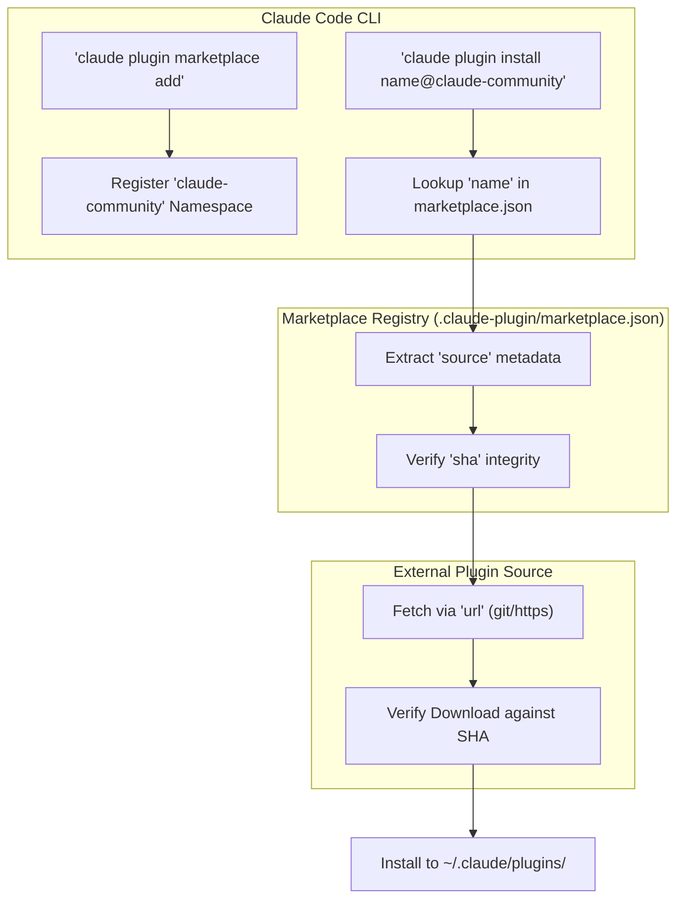
Sources: `[.claude-plugin/marketplace.json:1-16]()`, `[README.md:19-22]()`

## Plugin Schema Fields

Every entry in the marketplace is defined by a specific set of fields in the `.claude-plugin/marketplace.json` manifest. These fields ensure that the CLI can find, describe, and securely download the plugin.

| Field | Type | Description |
| :--- | :--- | :--- |
| `name` | `string` | The unique identifier used for installation (e.g., `0x`, `10x-shopping`). |
| `description` | `string` | A detailed explanation of the plugin's capabilities, commands, and use cases. |
| `source` | `object` | Contains the distribution details, including the `url` and the `sha`. |
| `sha` | `string` | A 40-character hex string (SHA-1/SHA-256) used to pin the plugin to a specific version for security. |
| `homepage` | `string` | The URL for documentation or the plugin's primary website. |

### Source Distribution Models

The `source` field supports two primary distribution models:

1.  **Direct URL (`url`)**: The plugin is hosted in its own repository.
    *   Example: `0x` plugin `[.claude-plugin/marketplace.json:10-14]()`
2.  **Git Subdirectory (`git-subdir`)**: The plugin is part of a monorepo.
    *   Example: `42crunch-api-security-testing` plugin `[.claude-plugin/marketplace.json:50-56]()`

**Plugin Entity Mapping**
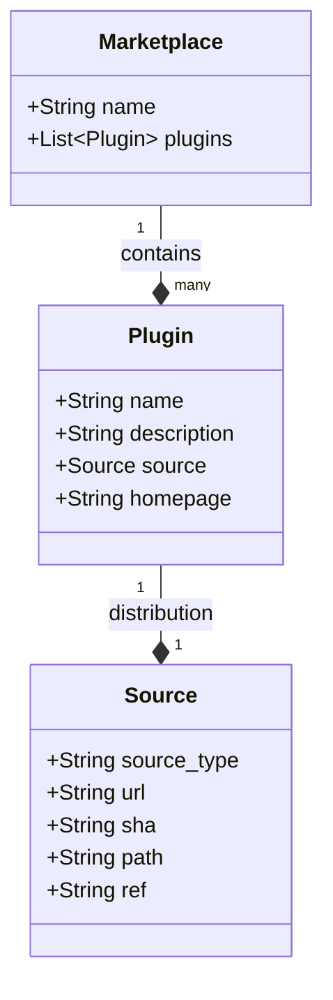
Sources: `[.claude-plugin/marketplace.json:1-16]()`, `[.claude-plugin/marketplace.json:50-56]()`

## Browsing Plugins via Claude Cowork

For users who prefer a graphical interface or are using the web-based Claude Cowork environment, plugins can be browsed and managed directly through the Anthropic web interface.

*   **Discovery**: Browse the directory at [claude.com/plugins](https://claude.com/plugins/).
*   **Submission**: New plugins are submitted via a web form at [clau.de/plugin-directory-submission](https://clau.de/plugin-directory-submission).

Note that this repository is a **read-only mirror** of the internal Anthropic review pipeline. Manual pull requests to add plugins directly to this repository are automatically closed. All community contributions must flow through the official submission portal to undergo security scanning and approval.

Sources: `[README.md:5-9]()`, `[README.md:13-15]()`, `[README.md:24-27]()`

---

# Page: Plugin Marketplace Registry

# Plugin Marketplace Registry

<details>
<summary>Relevant source files</summary>

The following files were used as context for generating this wiki page:

- [.claude-plugin/marketplace.json](.claude-plugin/marketplace.json)
- [README.md](README.md)

</details>


The Plugin Marketplace Registry is the central catalog of community-contributed extensions for the Claude ecosystem. It is primarily defined by a single manifest file, `.claude-plugin/marketplace.json`, which serves as the source of truth for available plugins, their metadata, and their installation sources [[README.md:7-7]]().

This repository acts as a **read-only mirror** of Anthropic's internal review pipeline [[README.md:7-7]](). Every entry in the registry has undergone automated security scanning and manual approval before being synced to this public manifest [[README.md:9-9]]().

## Marketplace Structure

The registry is designed to be machine-readable by the Claude Code CLI and the Claude Cowork web interface. It organizes plugins into a flat list of entities, each containing the necessary pointers to fetch the plugin's code or configuration.

### Data Model Overview

The `marketplace.json` file follows a structured schema that includes repository-level metadata and an array of plugin objects.

| Field | Type | Description |
| :--- | :--- | :--- |
| `name` | String | The unique identifier for the marketplace (e.g., `claude-community`) [[.claude-plugin/marketplace.json:2-2]](). |
| `owner.name` | String | The entity responsible for the registry [[.claude-plugin/marketplace.json:4-4]](). |
| `plugins` | Array | A collection of `Plugin` objects [[.claude-plugin/marketplace.json:6-6]](). |

### Plugin Entity Schema

Each plugin entry contains metadata for discovery and a `source` block for installation.

```json
{
  "name": "plugin-name",
  "description": "Human-readable purpose of the plugin",
  "source": {
    "source": "url | git-subdir",
    "url": "repository-url",
    "sha": "40-character-git-sha",
    "path": "optional-subdirectory-path",
    "ref": "optional-git-branch-or-tag"
  },
  "homepage": "url-to-docs-or-repo"
}
```

For a deep dive into the specific fields, the distinction between `url` and `git-subdir` distribution models, and how SHA pinning ensures security, see **[marketplace.json Schema and Plugin Types](#2.1)**.

Sources: [[.claude-plugin/marketplace.json:1-86]](), [[README.md:7-10]]().

---

## Plugin Categories and Functionality

The registry contains a diverse set of plugins ranging from simple prompt-based "Skills" to complex "Agents" with autonomous capabilities. These are categorized based on their technical implementation and the value they provide to the user.

### Functional Categories

*   **MCP Server Wrappers**: Plugins that bridge Claude to Model Context Protocol (MCP) servers for external data access.
*   **Skills**: Domain-specific system prompts that give Claude new specialized capabilities (e.g., `10x-team` role-playing [[.claude-plugin/marketplace.json:28-29]]()).
*   **Agents**: Multi-step workflows that can use tools to perform autonomous tasks (e.g., `10x-shopping` for cart management [[.claude-plugin/marketplace.json:18-19]]()).
*   **Security & Guardrails**: Tools that audit code or enforce compliance (e.g., `42crunch-api-security-testing` [[.claude-plugin/marketplace.json:48-49]]()).

For a complete list of categories and examples from the registry, see **[Plugin Functional Categories](#2.2)**.

### Architecture Patterns

Plugins often utilize recurring design patterns to interact with the Claude environment:
*   **Artifact-Driven Development**: Using `.claude/` directories or `CLAUDE.md` files to maintain state across sessions [[.claude-plugin/marketplace.json:29-29]]().
*   **Slash Commands**: Registering specific triggers like `/mind` or `/cto` [[.claude-plugin/marketplace.json:29-29]](), [[.claude-plugin/marketplace.json:39-39]]().

For detailed documentation on these patterns, see **[Plugin Architecture Patterns](#2.3)**.

Sources: [[.claude-plugin/marketplace.json:18-68]]().

---

## Registry Lifecycle and Integration

The marketplace is not a static file; it is the core of an automated ecosystem that connects developers to users.

### Integration Flow: From Registry to Code

The following diagram illustrates how the `marketplace.json` entity maps to the local environment during installation via the Claude Code CLI.

"Registry to Local Entity Mapping"
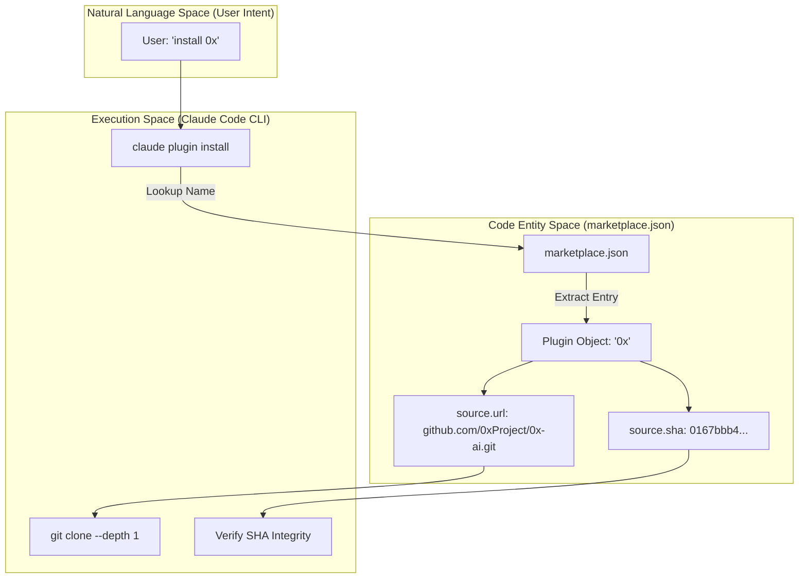

### Maintenance and Validation

The registry is maintained by a set of automated GitHub Actions that ensure every entry remains valid and secure:
1.  **Validation**: Enforces 11 core invariants (e.g., alphabetical sorting, HTTPS-only, SHA pinning).
2.  **Bumping**: Automatically updates the `sha` field in `marketplace.json` when the upstream plugin repository changes.
3.  **Scanning**: Uses Claude-based policy scans to detect malicious code or credential exfiltration.

For details on the automation pipeline, see **[CI/CD Pipeline: Validation, Bumping, and Scanning](#3)**.

Sources: [[.claude-plugin/marketplace.json:7-16]](), [[README.md:17-22]]().

---

# Page: marketplace.json Schema and Plugin Types

# marketplace.json Schema and Plugin Types

<details>
<summary>Relevant source files</summary>

The following files were used as context for generating this wiki page:

- [.claude-plugin/marketplace.json](.claude-plugin/marketplace.json)
- [.github/actions/validate-plugins/scripts/00-detect-changes.sh](.github/actions/validate-plugins/scripts/00-detect-changes.sh)
- [.github/actions/validate-plugins/test-external-manifest.sh](.github/actions/validate-plugins/test-external-manifest.sh)
- [README.md](README.md)

</details>


The `marketplace.json` file serves as the central registry for the Claude community plugin ecosystem. It defines the metadata, distribution sources, and integrity constraints for every plugin available to **Claude Cowork** and **Claude Code**. This manifest is a read-only mirror synced from Anthropic's internal review pipeline [README.md:5-9]().

## Data Model: The Plugin Schema

The marketplace is an object containing a `plugins` array. Each entry in this array must conform to a strict schema to ensure compatibility with the Claude CLI and web interfaces.

### Core Fields

| Field | Type | Description |
| :--- | :--- | :--- |
| `name` | `string` | Unique identifier for the plugin. Must follow the name schema (I11) [manifest:8](). |
| `description` | `string` | A detailed explanation of the plugin's capabilities. Used by Claude to understand when to invoke the plugin [.claude-plugin/marketplace.json:9](). |
| `source` | `object` | Defines how the plugin code is retrieved. Supports `url` and `git-subdir` models [.claude-plugin/marketplace.json:10-14](). |
| `homepage` | `string` | A link to the plugin's documentation or repository home [.claude-plugin/marketplace.json:15](). |
| `strict` | `boolean` | (Optional) Controls manifest resolution behavior. Defaults to `true` [.github/actions/validate-plugins/scripts/00-detect-changes.sh:102](). |

### Source Distribution Models

The `source` field determines how the maintenance pipeline (e.g., `bump-plugin-shas`) and the Claude CLI interact with the external code.

#### 1. Direct URL (`url`)
Used for standalone repositories where the plugin manifest (`plugin.json`) is located at the repository root.
- **`source`**: Must be "url".
- **`url`**: The `.git` clone URL.
- **`sha`**: The specific git commit hash for integrity pinning.

Example:
```json
"source": {
  "source": "url",
  "url": "https://github.com/0xProject/0x-ai.git",
  "sha": "0167bbb411cc972b966127d23c23de801061fa99"
}
```
Sources: [.claude-plugin/marketplace.json:10-14]()

#### 2. Git Sub-directory (`git-subdir`)
Designed for monorepos or repositories hosting multiple plugins.
- **`source`**: Must be "git-subdir".
- **`url`**: The GitHub repository (format: `org/repo`).
- **`path`**: The relative path within the repo to the plugin directory.
- **`ref`**: The branch or tag to track.
- **`sha`**: The pinned commit hash.

Example:
```json
"source": {
  "source": "git-subdir",
  "url": "42Crunch-AI/claude-plugins",
  "path": "plugins/api-security-testing",
  "ref": "v1.0.1",
  "sha": "bc781f96be8ce17a2972e8a9a3ef38b1ca7e8cc4"
}
```
Sources: [.claude-plugin/marketplace.json:50-56]()

---

## Strict vs. Non-Strict Manifests

The `strict` field (defaulting to `true`) dictates how the validation logic in `resolve_external_manifest()` handles missing `plugin.json` files in the source repository.

### Strict Mode (`strict: true`)
The source repository **must** contain a `.claude-plugin/plugin.json` or a root `plugin.json`. If neither is found, validation fails [test-external-manifest.sh:73-75]().

### Skills-Only / Non-Strict Mode (`strict: false`)
This mode supports "skills-only" entries—plugins that consist purely of prompts or markdown without a formal manifest in their source repo.
- If no manifest exists, the system **synthesizes** a minimal one in memory carrying the `name` from `marketplace.json` [test-external-manifest.sh:64-71]().
- If a real manifest is later added to the repo, it takes precedence over synthesis [test-external-manifest.sh:53-58]().

### Manifest Resolution Logic
The following diagram illustrates the precedence used by the `resolve_external_manifest` function in `lib/common.sh`.

**Manifest Resolution Precedence**
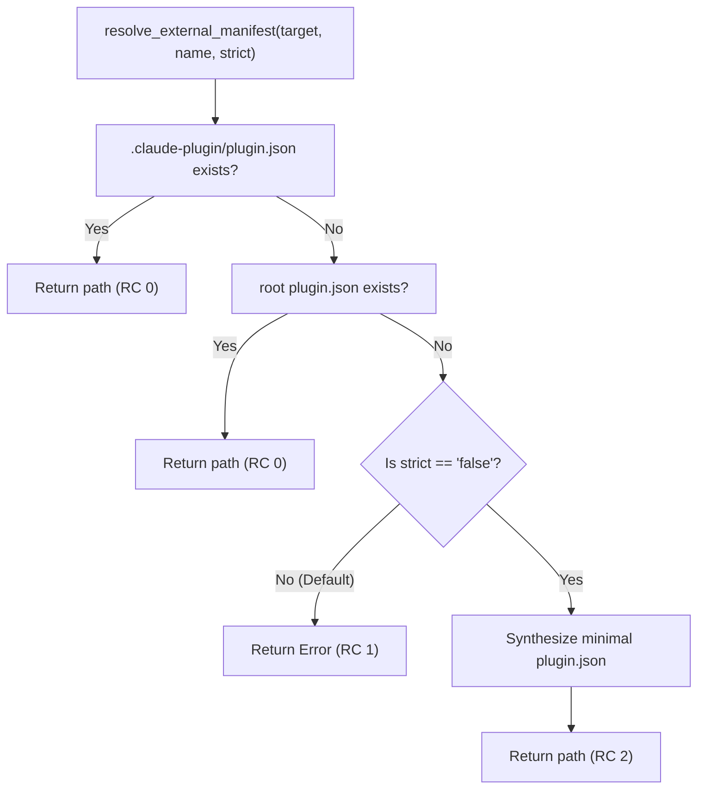
Sources: [.github/actions/validate-plugins/test-external-manifest.sh:37-80]()

---

## SHA Pinning and Integrity

Every external plugin must be pinned to a specific git `sha`. This is a core security invariant (I5) enforced during validation.

1.  **Immutable References**: Even if a `git-subdir` entry specifies a `ref` (like `main`), the `sha` field ensures that the actual code executed by a user is the exact version reviewed and scanned by the pipeline [.claude-plugin/marketplace.json:54-55]().
2.  **Automated Maintenance**: The `bump-plugin-shas` action is responsible for updating these hashes. It clones the external source, verifies the latest commit against the `ref`, and updates `marketplace.json` via signed commits.
3.  **Change Detection**: The `00-detect-changes.sh` script identifies which entries have had their SHAs modified by diffing `BASE_REF` against `HEAD` [.github/actions/validate-plugins/scripts/00-detect-changes.sh:82-88]().

### Data Flow: From Registry to Validation

This diagram maps the JSON fields to the internal variables used during the `00-detect-changes.sh` execution.

**Metadata to Change Detection Mapping**
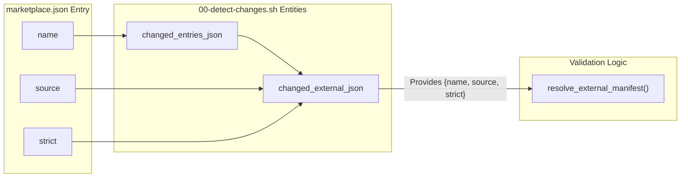
Sources: [.github/actions/validate-plugins/scripts/00-detect-changes.sh:96-104](), [.github/actions/validate-plugins/test-external-manifest.sh:18-24]()

---

# Page: Plugin Functional Categories

# Plugin Functional Categories

<details>
<summary>Relevant source files</summary>

The following files were used as context for generating this wiki page:

- [.claude-plugin/marketplace.json](.claude-plugin/marketplace.json)
- [README.md](README.md)

</details>


The Claude Plugins Community marketplace contains a diverse ecosystem of extensions designed to augment Claude's capabilities. These plugins are categorized by their technical implementation and functional role, ranging from lightweight prompt-based "Skills" to complex autonomous "Agents" and "MCP Server Wrappers."

This page details the major functional categories found in the registry and how they interact with the Claude environment.

## 1. MCP Server Wrappers

Model Context Protocol (MCP) server wrappers are the most technically robust plugins. They provide Claude with executable tools by bridging the LLM to external APIs, databases, or local system resources.

### Implementation and Data Flow
MCP plugins define a set of `tools` that Claude can call. When a user invokes a tool, the request flows through the Claude CLI or Cowork interface to the plugin's MCP server, which executes the logic and returns a structured response.

**Diagram: MCP Tool Execution Flow**
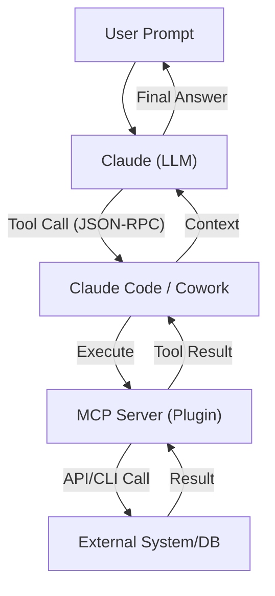

**Examples in Registry:**
*   `0x`: Guides developers through ERC-20 token swaps via the 0x API [[.claude-plugin/marketplace.json:8-16]]().
*   `10x-shopping`: Connects Claude to Shopify's global product catalog for cart management and purchases [[.claude-plugin/marketplace.json:18-26]]().

**Sources:** [[.claude-plugin/marketplace.json:8-26]]()

---

## 2. Skills (Domain-Specific Prompts)

Skills are "pure markdown" or prompt-based plugins. They do not require a runtime server; instead, they inject specialized instructions, few-shot examples, and structured workflows into Claude's system prompt.

### Key Characteristics
*   **Zero-Dependency:** Often contain no code, only `.md` or `.txt` files.
*   **Slash Commands:** Usually mapped to specific commands (e.g., `/cto`, `/debug`).
*   **Structured Output:** Use rubrics or templates to ensure consistent formatting.

**Examples in Registry:**
*   `8-habit-ai-dev`: A structured 7-step workflow based on Stephen Covey's habits. It uses 17 hand-crafted skills with no runtime dependencies [[.claude-plugin/marketplace.json:60-68]]().
*   `16minds`: Summons agents modeled on 16 personality types to debate or review topics [[.claude-plugin/marketplace.json:38-46]]().

**Sources:** [[.claude-plugin/marketplace.json:38-68]]()

---

## 3. Agents (Multi-Step Autonomous Workflows)

Agents are plugins that orchestrate complex, multi-step tasks. Unlike simple tools, Agents often maintain their own state and can make autonomous decisions about which sub-tasks to execute next.

### Implementation Pattern: The Orchestrator
Agents often use a "Director" or "Orchestrator" pattern where one primary skill manages several subordinate roles.

**Diagram: Agent Orchestration (e.g., 10x-team)**
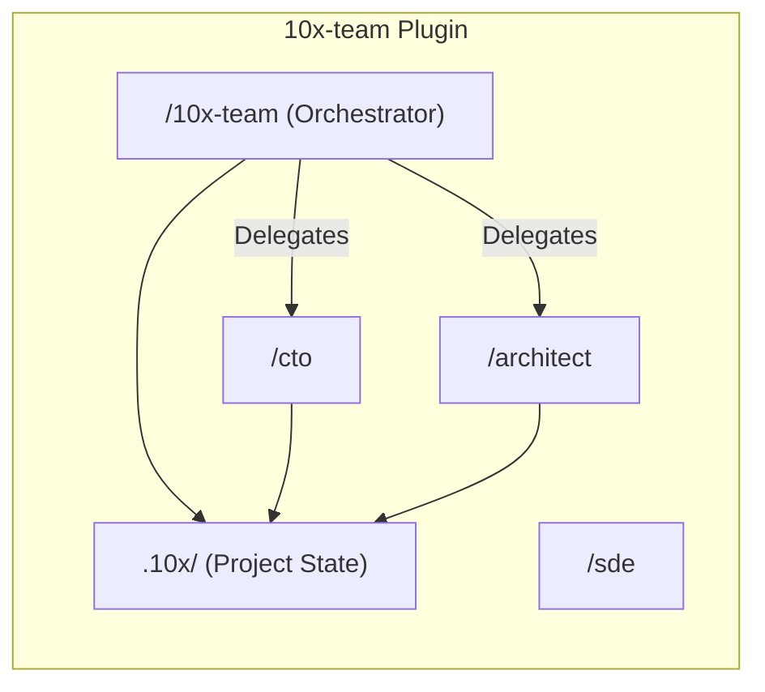

**Examples in Registry:**
*   `10x-team`: Provides 12 specialized engineering roles (CTO, SRE, etc.) and an orchestrator that runs them end-to-end with hard gates [[.claude-plugin/marketplace.json:28-36]]().

**Sources:** [[.claude-plugin/marketplace.json:28-36]]()

---

## 4. Guardrails and Security Hooks

These plugins act as a middleware layer, enforcing safety, compliance, or quality standards on Claude's inputs and outputs.

### Functionality
*   **Static Analysis:** Auditing code or configuration files before they are deployed.
*   **Policy Enforcement:** Ensuring that Claude's suggestions adhere to corporate or security policies.

**Examples in Registry:**
*   `42crunch-api-security-testing`: Enables developers to audit OpenAPI specifications and detect OWASP vulnerabilities directly in the workflow [[.claude-plugin/marketplace.json:48-58]]().
*   `a11y-fixer`: Scans HTML/JSX for accessibility issues [[.claude-plugin/marketplace.json:70-80]]().

**Sources:** [[.claude-plugin/marketplace.json:48-80]]()

---

## 5. Persistent Memory and Context Systems

While Claude has a large context window, these plugins provide long-term storage or structured state management that persists across different sessions.

### Mechanisms
*   **File-based State:** Using hidden directories (like `.10x/` or `.claude/`) to store decision logs and progress [[.claude-plugin/marketplace.json:29-29]]().
*   **External DBs:** Using MCP to query vector databases or key-value stores.

---

## 6. IaC and Cloud Integrations

Infrastructure-as-Code (IaC) plugins allow Claude to provision, manage, and analyze cloud resources. These often combine MCP tools (to call cloud CLI/SDKs) with Skills (to generate valid Terraform/CloudFormation).

**Examples in Registry:**
*   `ab-testing`: Generates A/B testing infrastructure and analysis [[.claude-plugin/marketplace.json:82-86]]().

**Sources:** [[.claude-plugin/marketplace.json:82-86]]()

---

## Summary of Categories

| Category | Primary Mechanism | Example Plugin |
| :--- | :--- | :--- |
| **MCP Wrapper** | JSON-RPC Tooling | `0x` |
| **Skills** | Prompt Engineering | `8-habit-ai-dev` |
| **Agents** | Multi-role Orchestration | `10x-team` |
| **Guardrails** | Static/Dynamic Analysis | `42crunch` |
| **Memory** | Local/Remote State | `10x-team` (`.10x/`) |
| **Cloud/IaC** | Provider SDK Wrappers | `ab-testing` |

**Sources:** [[.claude-plugin/marketplace.json:1-86]]()

---

# Page: Plugin Architecture Patterns

# Plugin Architecture Patterns

<details>
<summary>Relevant source files</summary>

The following files were used as context for generating this wiki page:

- [.claude-plugin/marketplace.json](.claude-plugin/marketplace.json)
- [README.md](README.md)

</details>


This page documents the recurring design patterns and architectural conventions found in the Claude community plugin ecosystem. These patterns allow plugins to maintain state, enforce safety, and provide structured workflows within the stateless execution environment of a chat session.

## Artifact-Driven Development

Artifact-driven development is a pattern where plugins maintain persistent state and project-specific memory by writing to specific files in the user's filesystem. This bypasses the context window limits of a single session by providing a "source of truth" that Claude can read at the start of any new interaction.

### The .claude/ Convention
Many plugins use a hidden `.claude/` or plugin-specific hidden directory (e.g., `.10x/`) to store configuration, session logs, and state machines.

*   **CLAUDE.md**: Often used as a project-level "brain" containing build commands, style guides, and active task lists.
*   **Worklogs**: A pattern where the plugin maintains a `.worklogs/` directory to track atomic changes, enabling "undo" functionality or multi-session resumes.

| Plugin Example | Directory/File | Purpose |
| :--- | :--- | :--- |
| `10x-team` | `.10x/` | Stores role-based decisions and progress across conversations [.claude-plugin/marketplace.json:29-29]() |
| `8-habit-ai-dev` | DAG-validated handoffs | Uses a structured graph to track progress through 7 development steps [.claude-plugin/marketplace.json:61-61]() |

**Sources:** [.claude-plugin/marketplace.json:29-29](), [.claude-plugin/marketplace.json:61-61]()

---

## Human-in-the-Loop Gates

To ensure safety and correctness in autonomous workflows, plugins implement "Hard Gates." This pattern prevents the AI from proceeding to high-risk actions (like code execution or deployment) without explicit user confirmation or architectural validation.

### Implementation Pattern: The Orchestrator Gate
Plugins like `10x-team` utilize an orchestrator skill that manages multiple sub-agents. The orchestrator enforces a "Brainstorm-first" approach, where design must be validated before the "Build" phase can begin.

**Data Flow: Orchestrated Gate**
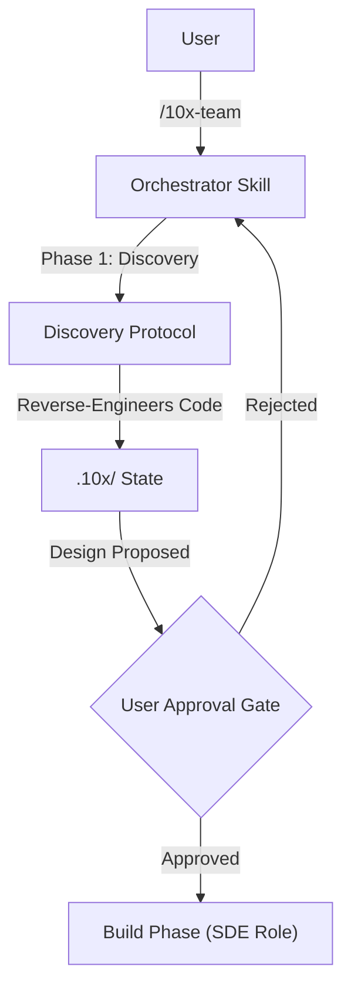
**Sources:** [.claude-plugin/marketplace.json:29-29]()

---

## Context Management and Compaction

As conversations grow, the context window can become saturated. Advanced plugins implement "Compaction" or "Synthesis" patterns to summarize previous findings into a dense format.

### The Synthesis Rubric
The `16minds` plugin demonstrates a "fan-out and synthesize" pattern. It invokes 16 distinct personality types to debate a topic, then applies a fixed 4-section rubric to condense the output.

*   **Score Distribution**: Quantitative summary of opinions.
*   **Axes of Disagreement**: Identifying the core conflicts.
*   **Landing-Zone Candidates**: Actionable paths forward.

This pattern ensures that "16-voice output" remains "structured rather than scattershot" [.claude-plugin/marketplace.json:39-39]().

**Sources:** [.claude-plugin/marketplace.json:39-39]()

---

## Slash Commands and Tool Lifecycle Hooks

Plugins define their interface through "Skills" which manifest as slash commands in the Claude CLI or Cowork interface.

### Lifecycle Hooks
While the marketplace manifest defines the plugin source, the internal implementation often uses hooks to manage setup and teardown:
*   **PreToolUse**: Checking for API keys or environment variables before executing a tool.
*   **PostToolUse**: Cleaning up temporary files or updating a `.worklog`.

### Command Mapping Example
| Command | Plugin | Logic Entity |
| :--- | :--- | :--- |
| `/mind <type>` | `16minds` | Invokes specific agent persona [.claude-plugin/marketplace.json:39-39]() |
| `/calibrate` | `8-habit-ai-dev` | Adjusts maturity-adaptive verbosity [.claude-plugin/marketplace.json:61-61]() |
| `/reflect` | `8-habit-ai-dev` | Consolidates lessons learned into state [.claude-plugin/marketplace.json:61-61]() |

**Sources:** [.claude-plugin/marketplace.json:39-39](), [.claude-plugin/marketplace.json:61-61]()

---

## Multi-Agent Orchestration

This pattern involves decomposing a complex task into specialized roles. Instead of one general-purpose assistant, the plugin provides a suite of experts.

### Role-Based Specialization
The `10x-team` plugin implements 12 specialized roles, each with its own "structured decision process" [.claude-plugin/marketplace.json:29-29]().

**Entity Mapping: Natural Language to Code Roles**
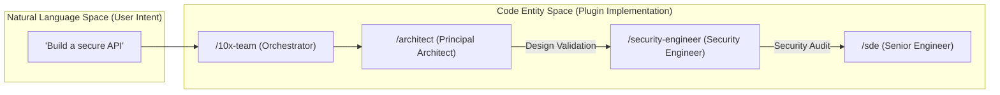

**Sources:** [.claude-plugin/marketplace.json:29-29]()

---

## Pure Markdown vs. Runtime Plugins

The marketplace supports two primary execution models:

1.  **Pure Markdown Plugins**: These contain no code and rely entirely on high-quality system prompts (Skills). They are portable and have no runtime dependencies (e.g., `8-habit-ai-dev`).
2.  **MCP/Runtime Plugins**: These connect to Model Context Protocol (MCP) servers or external APIs (e.g., `0x` for EVM chain swaps, `10x-shopping` for Shopify catalog access).

| Feature | Pure Markdown | Runtime/MCP |
| :--- | :--- | :--- |
| **Dependencies** | None [.claude-plugin/marketplace.json:61-61]() | Node/Python/Docker |
| **Connectivity** | Local Filesystem | External APIs/Webhooks [.claude-plugin/marketplace.json:9-9]() |
| **Security** | Prompt-based | API Keys/OAuth [.claude-plugin/marketplace.json:19-19]() |

**Sources:** [.claude-plugin/marketplace.json:9-9](), [.claude-plugin/marketplace.json:19-19](), [.claude-plugin/marketplace.json:61-61]()

---

# Page: CI/CD Pipeline: Validation, Bumping, and Scanning

# CI/CD Pipeline: Validation, Bumping, and Scanning

<details>
<summary>Relevant source files</summary>

The following files were used as context for generating this wiki page:

- [.github/actions/validate-plugins/lib/common.sh](.github/actions/validate-plugins/lib/common.sh)
- [.github/workflows/validate-plugins.yml](.github/workflows/validate-plugins.yml)

</details>


The `claude-plugins-community` repository employs a multi-stage automated maintenance pipeline to ensure the integrity, security, and freshness of the plugin marketplace. This pipeline is composed of three primary GitHub Actions that interlock to validate submissions, update external references, and perform safety scans using Claude.

The system is designed with a **bot-free philosophy**, utilizing `GITHUB_TOKEN` and the GraphQL `createCommitOnBranch` mutation to generate GitHub-signed commits that satisfy security requirements without requiring personal access tokens or external bots.

### Pipeline Architecture Overview

The three actions share a common utility library and follow a standardized reporting structure.

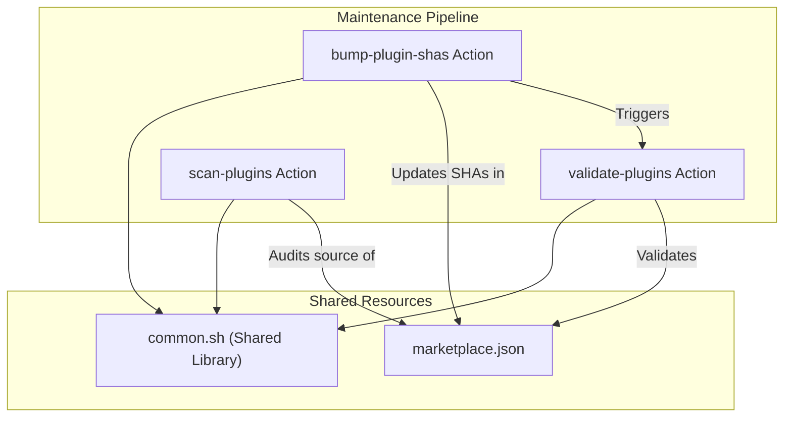

**Sources:** [.github/actions/validate-plugins/lib/common.sh:1-168](), [.github/workflows/validate-plugins.yml:13-19]()

---

### validate-plugins Action
The `validate-plugins` action is the primary gatekeeper for the repository. It performs comprehensive static and dynamic checks on the `marketplace.json` manifest. It is designed for "zero-schema-maintenance," meaning it leverages the Claude CLI's internal validation logic rather than duplicating schema rules in Bash.

The action follows a six-stage pipeline:
1.  **00-detect-changes**: Identifies which plugins were modified in a PR to scope validation.
2.  **11-invariants**: Enforces repository-specific rules (e.g., alphabetical sorting, HTTPS-only URLs).
3.  **20-cli-marketplace**: Validates the entire manifest against the Claude CLI schema.
4.  **30-cli-external**: Clones external git repositories to verify that the pinned SHA and subdirectories exist.
5.  **40-cli-local**: Validates plugins vendored directly within the repository.
6.  **90-report**: Aggregates results into a `GITHUB_STEP_SUMMARY`.

For details, see [validate-plugins Action](#3.1).

**Sources:** [.github/workflows/validate-plugins.yml:31-50](), [.github/actions/validate-plugins/lib/common.sh:97-122]()

---

### bump-plugin-shas Action
The `bump-plugin-shas` action automates the process of keeping the marketplace up to date with the latest upstream changes. It periodically checks the remote repositories of all plugins and updates their `sha` fields if new commits are found.

Key features include:
*   **Signed Commits**: Uses the GraphQL API to create "Verified" commits.
*   **Freeze List**: Respects a `freeze-shas.txt` file to prevent updates to specific plugins.
*   **Recursive Validation**: Automatically triggers the `validate-plugins` workflow on newly created bump branches to ensure that an update doesn't break the manifest.

For details, see [bump-plugin-shas Action](#3.2).

**Sources:** [.github/workflows/validate-plugins.yml:13-19](), [.github/actions/validate-plugins/test-bump.sh:1-30]()

---

### scan-plugins Action
The `scan-plugins` action provides an AI-augmented security layer. It uses Claude (via the `claude -p headless` command) to perform deep analysis of plugin source code.

The scanner:
*   **Tool-Use Driven**: Claude is provided with read-only tools (`Read`, `Glob`, `Grep`) to explore the codebase.
*   **Policy Enforcement**: Evaluates code against a specific security rubric (e.g., detecting credential exfiltration or SSRF vulnerabilities).
*   **WIF Integration**: Uses Workload Identity Federation for secure, keyless authentication to Anthropic services.

For details, see [scan-plugins Action](#3.3).

---

### Shared Library: common.sh
All scripts in the pipeline source `lib/common.sh`, which provides a standardized environment for logging, result tracking, and security assertions.

| Function | Purpose |
| :--- | :--- |
| `record_result` | Appends a JSONL entry to `$RESULTS_FILE` for final reporting. |
| `assert_safe_url` | Enforces HTTPS and checks host against `ALLOWED_HOSTS` to prevent SSRF. |
| `assert_safe_sha` | Ensures a string is a valid 40-character hex SHA. |
| `cli_validate` | Wrapper for `claude plugin validate` that handles error classification. |
| `resolve_external_manifest` | Locates or synthesizes a `plugin.json` for external repositories. |

**Sources:** [.github/actions/validate-plugins/lib/common.sh:23-33](), [.github/actions/validate-plugins/lib/common.sh:56-78](), [.github/actions/validate-plugins/lib/common.sh:100-122](), [.github/actions/validate-plugins/lib/common.sh:152-166]()

### Code Entity Mapping: Validation Logic
The following diagram maps the high-level validation concepts to the specific shell functions and files that implement them.

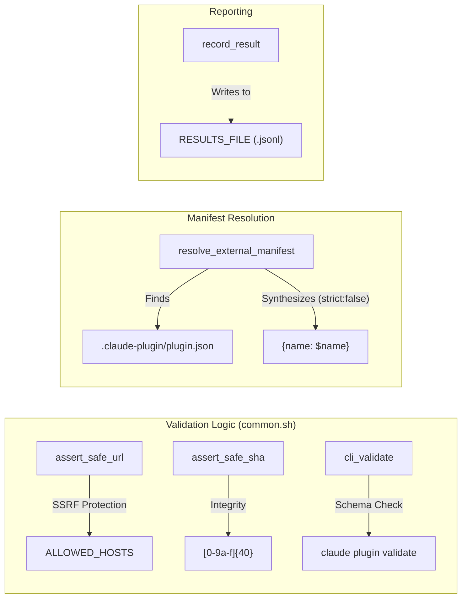

**Sources:** [.github/actions/validate-plugins/lib/common.sh:56-86](), [.github/actions/validate-plugins/lib/common.sh:103-104](), [.github/actions/validate-plugins/lib/common.sh:152-164](), [.github/actions/validate-plugins/lib/common.sh:21-33]()

---

# Page: validate-plugins Action

# validate-plugins Action

<details>
<summary>Relevant source files</summary>

The following files were used as context for generating this wiki page:

- [.github/actions/validate-plugins/README.md](.github/actions/validate-plugins/README.md)
- [.github/actions/validate-plugins/action.yml](.github/actions/validate-plugins/action.yml)
- [.github/workflows/validate-plugins.yml](.github/workflows/validate-plugins.yml)

</details>


The `validate-plugins` composite action provides canonical CI validation for Claude plugin marketplace repositories. It is designed as a "drop-in" solution that enforces both the technical schema requirements of the Claude CLI and a set of strict security and policy invariants.

The action follows a **zero-schema-maintenance** philosophy: it does not vendor a JSON schema. Instead, it dynamically installs the `@anthropic-ai/claude-code` package to use the CLI's own Zod definitions as the source of truth for validation.

### Architecture Overview

The action executes a six-stage pipeline that transitions from change detection to deep validation of external and local plugin source code.

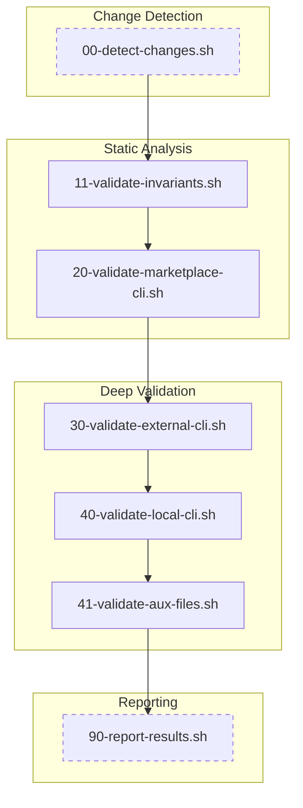

**Sources:**
- [.github/actions/validate-plugins/README.md:7-23]()
- [.github/actions/validate-plugins/action.yml:105-245]()

---

### Pipeline Stages

#### 00-detect-changes
This stage identifies which plugins have been modified by comparing the current `HEAD` against a `base-ref`. It supports both monolithic `marketplace.json` files and per-file entry directories.
For details, see [Change Detection and External Manifest Resolution](#3.1.2).

#### 11-invariants
Applies 11 hardening rules (I1–I11) that enforce repository policy, such as alphabetical sorting, SHA pinning, and shell metacharacter prevention. This stage supports "grandfathering" via the `scope-errors-to-changed` policy, which prevents preexisting errors in unrelated plugins from blocking a PR.
For details, see [Invariants I1–I11: Security and Policy Rules](#3.1.1).

#### 20-cli-marketplace
Executes `claude plugin validate <marketplace-path>`. This is the canonical schema check. It ensures the `marketplace.json` structure matches what the Claude CLI expects at runtime.
**Sources:** [.github/actions/validate-plugins/README.md:29-29]()

#### 30-cli-external
For every changed external plugin, the action:
1. Clones the repository into an isolated temporary directory.
2. Checks out the specific pinned `source.sha`.
3. Runs `claude plugin validate`.
4. Handles `strict:false` (skills-only) entries by synthesizing a manifest if one is missing.

This stage also powers the **Nightly Drift Detection** mode when `validate-all-external` is set to `true`, catching deleted upstream repos or force-pushed SHAs.
**Sources:** [.github/actions/validate-plugins/README.md:70-95](), [.github/actions/validate-plugins/action.yml:58-64]()

#### 40-cli-local & 41-aux-files
Validates plugins hosted directly within the marketplace repository. Step 41 specifically parses auxiliary runtime files like `.mcp.json` or `hooks.json` to ensure they are valid JSON, preventing runtime crashes.
**Sources:** [.github/actions/validate-plugins/README.md:31-32]()

#### 90-report
Consolidates results from the `RESULTS_FILE` JSONL log and generates a GitHub Step Summary and a markdown report.
**Sources:** [.github/actions/validate-plugins/action.yml:236-245]()

---

### Inputs and Outputs

The action is highly configurable to support different repository layouts and policy strictness.

| Input | Default | Purpose |
| :--- | :--- | :--- |
| `marketplace-path` | `.claude-plugin/marketplace.json` | Path to the main registry file. |
| `entries-dir` | `""` | Directory for per-file plugin definitions (enables I6/I7). |
| `scope-errors-to-changed` | `false` | If `true`, preexisting invariant errors in unchanged plugins become warnings. |
| `warn-invariants` | `I1 I3 I5 I8` | Invariants that should not fail the build. |
| `allowed-hosts` | `github.com gitlab.com ...` | SSRF protection allowlist for external clones. |

**Sources:** [.github/actions/validate-plugins/action.yml:8-83]()

---

### Implementation Mapping

The following diagram maps the logical validation stages to the specific script entities and shared utilities defined in the codebase.

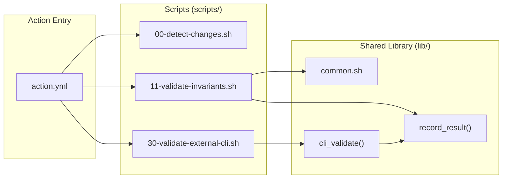

**Sources:**
- [.github/actions/validate-plugins/action.yml:105-245]()
- [.github/actions/validate-plugins/scripts/11-validate-invariants.sh]()
- [.github/actions/validate-plugins/lib/common.sh]()

---

### Security and Grandfathering

The action implements a **Grandfathering Policy** via the `scope-errors-to-changed` input. This allows a repository to adopt new invariants without immediately breaking all existing entries.

- **Global Invariants (Always Error):** Rules that affect the whole file (e.g., `I1` Alphabetical Sort, `I2` Duplicate Names) always trigger a failure.
- **Per-Entry Invariants (Scoped):** Rules like `I3` (Description length) or `I5` (SHA pinning) are downgraded from `ERROR` to `WARNING` if the specific plugin entry was not modified in the current PR.

**Sources:**
- [.github/actions/validate-plugins/action.yml:35-46]()
- [.github/actions/validate-plugins/README.md:116-116]()

For details on the shared security predicates and logging system, see [Shared Library: common.sh Utilities](#3.1.3).

---

# Page: Invariants I1–I11: Security and Policy Rules

# Invariants I1–I11: Security and Policy Rules

<details>
<summary>Relevant source files</summary>

The following files were used as context for generating this wiki page:

- [.github/actions/validate-plugins/scripts/11-validate-invariants.sh](.github/actions/validate-plugins/scripts/11-validate-invariants.sh)
- [.github/actions/validate-plugins/test-invariants.sh](.github/actions/validate-plugins/test-invariants.sh)

</details>


The `11-validate-invariants.sh` script enforces a set of eleven custom hardening rules that extend beyond standard JSON Schema validation. These invariants ensure the structural integrity, security, and stylistic consistency of the plugin marketplace registry.

## Overview and Purpose

While the primary JSON Schema handles basic data types, the invariants script performs deep inspection of the `marketplace.json` manifest. It is designed with a "grandfathering" policy called **diff-scoping**, which allows existing defects in the marketplace to remain as warnings while requiring new or modified entries to meet the full security and policy bar [.github/actions/validate-plugins/scripts/11-validate-invariants.sh:2-6]().

### Key Design Patterns
*   **Fail-Safe Scoping**: If change detection fails or is absent, the script defaults to strict enforcement for all entries [.github/actions/validate-plugins/scripts/11-validate-invariants.sh:36-39]().
*   **Non-Downgradable Rules**: Whole-marketplace invariants (like alphabetical sorting or duplicate detection) always result in hard failures regardless of which entry was changed [.github/actions/validate-plugins/scripts/11-validate-invariants.sh:75-76]().
*   **Shell Safety**: A dedicated invariant (I9) prevents shell metacharacter injection in URLs, paths, and SHAs, serving as a defense-in-depth layer for the maintenance actions [.github/actions/validate-plugins/scripts/11-validate-invariants.sh:17-17]().

---

## Data Flow and Implementation

The following diagram illustrates how the `11-validate-invariants.sh` script processes the marketplace manifest and applies the diff-scoping logic via the `flag()` function.

### Invariant Validation Logic
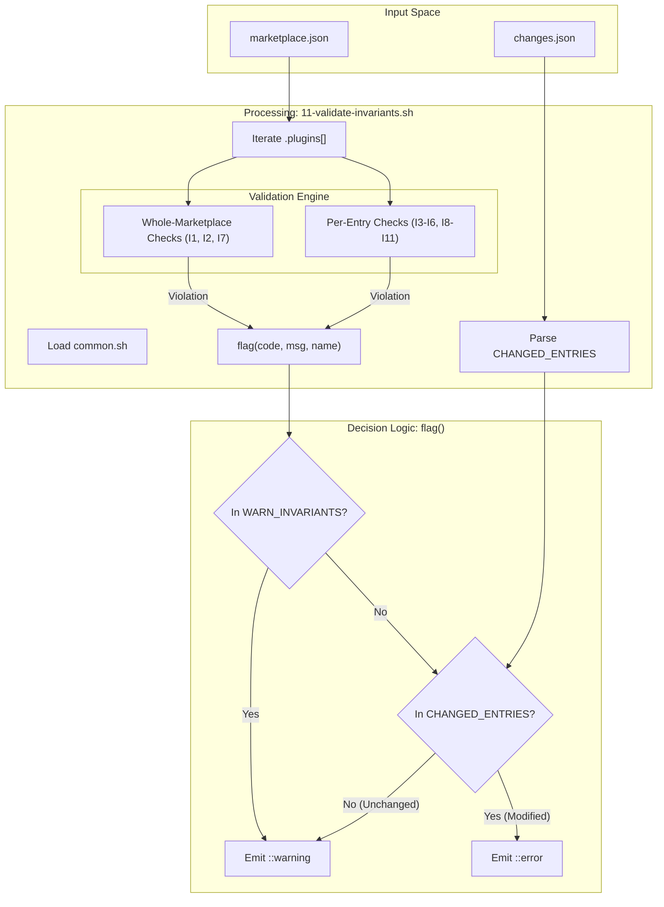
**Sources:** [.github/actions/validate-plugins/scripts/11-validate-invariants.sh:21-87]()

---

## Detailed Invariant Reference

| ID | Name | Scope | Description |
|:---|:---|:---|:---|
| **I1** | Alpha Sort | Global | `plugins[]` must be alpha-sorted by `name` (case-insensitive) [.github/actions/validate-plugins/scripts/11-validate-invariants.sh:91-93](). |
| **I2** | Duplicate Detection | Global | No two entries may share the same `name` [.github/actions/validate-plugins/scripts/11-validate-invariants.sh:95-97](). |
| **I3** | Description Bounds | Entry | Description must be 10–2000 characters and have no leading/trailing whitespace [.github/actions/validate-plugins/scripts/11-validate-invariants.sh:114-119](). |
| **I4** | HTTPS-Only | Entry | All `source.url` or `source.repo` fields must use `https://` or `owner/repo` shorthand [.github/actions/validate-plugins/scripts/11-validate-invariants.sh:130-135](). |
| **I5** | SHA Pinning | Entry | External sources must have a 40-char hex SHA. Exemptions allowed via `SHA_EXEMPT` [.github/actions/validate-plugins/scripts/11-validate-invariants.sh:136-148](). |
| **I6** | Filename Consistency| Entry | In per-file mode, the filename must match the `.name` field [.github/actions/validate-plugins/scripts/11-validate-invariants.sh:14-14](). |
| **I7** | Direct-Edit Block | Global | In per-file mode, `marketplace.json` must not be edited directly [.github/actions/validate-plugins/scripts/11-validate-invariants.sh:15-15](). |
| **I8** | Vendored Path | Entry | Vendored source paths must exist and contain `.claude-plugin/plugin.json` [.github/actions/validate-plugins/scripts/11-validate-invariants.sh:16-16](). |
| **I9** | Shell Safety | Entry | URLs, paths, and SHAs must not contain shell metacharacters (`;`, `&`, `\|`, etc.) [.github/actions/validate-plugins/scripts/11-validate-invariants.sh:150-150](). |
| **I10**| Hidden Unicode | Entry | Names and descriptions must not contain zero-width spaces or bidi control characters [.github/actions/validate-plugins/scripts/11-validate-invariants.sh:110-112](). |
| **I11**| Name Schema | Entry | Names must match the regex `^[a-z0-9][a-z0-9-]{1,63}$` [.github/actions/validate-plugins/scripts/11-validate-invariants.sh:107-109](). |

**Sources:** [.github/actions/validate-plugins/scripts/11-validate-invariants.sh:8-19]()

---

## Configuration and Control

The script behavior is tuned via environment variables passed from the GitHub Action.

### Variable Reference
*   `WARN_INVARIANTS`: A space-separated list of invariant IDs (e.g., `"I1 I3"`) that should always be treated as warnings rather than errors. Defaults to `"I1 I3 I5 I8"` [.github/actions/validate-plugins/scripts/11-validate-invariants.sh:26-26]().
*   `SHA_EXEMPT`: A space-separated list of plugin names allowed to omit the `source.sha` field [.github/actions/validate-plugins/scripts/11-validate-invariants.sh:29-29]().
*   `SCOPE_ERRORS_TO_CHANGED`: When set to `true`, enables the grandfathering logic using `changes.json` [.github/actions/validate-plugins/scripts/11-validate-invariants.sh:40-40]().

### The flag() Function
The `flag()` function is the central authority for reporting violations. It calculates the exact line number in `marketplace.json` using `entry_line()` and formats a GitHub Actions workflow command [.github/actions/validate-plugins/scripts/11-validate-invariants.sh:58-87]().

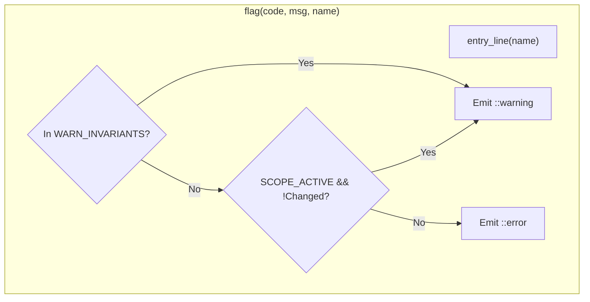
**Sources:** [.github/actions/validate-plugins/scripts/11-validate-invariants.sh:58-87]()

---

## Testing Invariants

The repository includes a dedicated test harness, `test-invariants.sh`, which validates the enforcement logic against synthetic fixtures without requiring network access [.github/actions/validate-plugins/test-invariants.sh:2-4]().

### Test Categories
1.  **Positive/Negative Tests**: Verifies that each invariant (I1-I11) fires correctly on malformed data and stays silent on valid data [.github/actions/validate-plugins/test-invariants.sh:41-131]().
2.  **Scoping Tests**: Exercises the `SCOPE_ERRORS_TO_CHANGED` logic to ensure unchanged entries are downgraded to warnings [.github/actions/validate-plugins/test-invariants.sh:133-171]().
3.  **Security Tests**: Ensures that the `SHA_EXEMPT` list cannot be bypassed using name-splicing (e.g., names with spaces) [.github/actions/validate-plugins/test-invariants.sh:95-102]().

**Sources:** [.github/actions/validate-plugins/test-invariants.sh:1-171]()

---

# Page: Change Detection and External Manifest Resolution

# Change Detection and External Manifest Resolution

<details>
<summary>Relevant source files</summary>

The following files were used as context for generating this wiki page:

- [.github/actions/validate-plugins/scripts/00-detect-changes.sh](.github/actions/validate-plugins/scripts/00-detect-changes.sh)
- [.github/actions/validate-plugins/scripts/30-validate-cli-external.sh](.github/actions/validate-plugins/scripts/30-validate-cli-external.sh)
- [.github/actions/validate-plugins/test-external-manifest.sh](.github/actions/validate-plugins/test-external-manifest.sh)

</details>


This page documents the logic used by the `validate-plugins` action to identify changes in the repository and resolve manifests for external plugins. The core of this logic resides in `00-detect-changes.sh`, which determines the scope of validation, and the manifest resolution helpers in `common.sh` that handle the synthesis of manifests for non-strict external sources.

## Change Detection Logic

The `00-detect-changes.sh` script is the first stage of the validation pipeline. It compares the current `HEAD` against a `BASE_REF` (typically the target branch of a Pull Request) to identify which plugins need validation. This scoping prevents the CI from re-validating the entire marketplace on every change, which is critical given the potential for hundreds of external clones.

### Operation Modes

The script supports two distribution models for the marketplace registry:
1.  **Single-file mode**: The registry is a single `marketplace.json` file.
2.  **Per-file mode**: The registry is a directory of individual JSON files (specified by `ENTRIES_DIR`), which are assembled into a temporary `marketplace.json` during execution [[.github/actions/validate-plugins/scripts/00-detect-changes.sh:45-56]]().

### Detection Flow

The script outputs a `changes.json` file containing three categories of changes:
*   **`entries`**: Names of plugins whose metadata in the marketplace registry has changed [[.github/actions/validate-plugins/scripts/00-detect-changes.sh:60-89]]().
*   **`external`**: A subset of `entries` where the `source` is an object (URL or git-subdir), requiring a remote clone for validation [[.github/actions/validate-plugins/scripts/00-detect-changes.sh:96-104]]().
*   **`folders`**: Paths to in-repo plugin directories that contain a `.claude-plugin/plugin.json` marker [[.github/actions/validate-plugins/scripts/00-detect-changes.sh:108-130]]().

### Large Diff Handling via --slurpfile

When a bulk update occurs (e.g., a daily SHA bump touching hundreds of entries), the resulting JSON arrays can exceed the kernel's `MAX_ARG_STRLEN` (~128KB). To prevent "Argument list too long" errors (exit code 126), the script uses the `--slurpfile` pattern [[.github/actions/validate-plugins/scripts/00-detect-changes.sh:136-149]](). Instead of passing JSON strings as CLI arguments via `--argjson`, it writes the data to temporary files and reads them directly into `jq`.

### Logic Space to Code Entity Mapping

The following diagram maps the logical change detection concepts to the specific shell and `jq` implementations in the codebase.

**Change Detection Implementation Map**
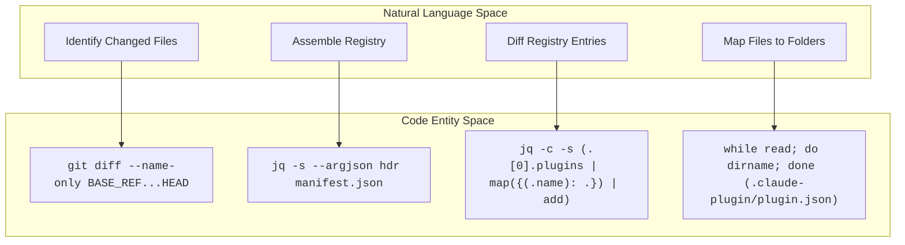
**Sources:** [[.github/actions/validate-plugins/scripts/00-detect-changes.sh:35-35]](), [[.github/actions/validate-plugins/scripts/00-detect-changes.sh:51-53]](), [[.github/actions/validate-plugins/scripts/00-detect-changes.sh:83-88]](), [[.github/actions/validate-plugins/scripts/00-detect-changes.sh:122-127]]()

---

## External Manifest Resolution

The `30-validate-cli-external.sh` script iterates through the `external` changes identified in the detection phase. For each entry, it performs a shallow clone and checkout of the pinned SHA [[.github/actions/validate-plugins/scripts/30-validate-cli-external.sh:79-98]]().

### resolve_external_manifest() Precedence

The function `resolve_external_manifest()` (defined in `common.sh`) determines which manifest file the `claude plugin validate` command should target. It follows a strict precedence order to ensure consistency:

1.  **Preferred**: `.claude-plugin/plugin.json` within the source repository.
2.  **Fallback**: `plugin.json` in the root of the source repository (or `subdir`).
3.  **Synthesis**: If `strict: false` is set in the marketplace and no file exists, it synthesizes a minimal manifest.

### strict:false Synthesis Logic

For "Skills-only" plugins that may not include a manifest file in their source repository, the registry allows a `strict: false` flag [[.github/actions/validate-plugins/scripts/30-validate-cli-external.sh:48-48]](). If this flag is present and no manifest is found, the system creates a temporary `.claude-plugin/plugin.json` containing only the `name` from the marketplace [[.github/actions/validate-plugins/test-external-manifest.sh:66-71]](). This allows the CLI validator to proceed with validating the skill prompts without failing on a missing manifest.

### Manifest Resolution Flow

The following diagram illustrates the decision tree for manifest resolution.

**Manifest Resolution Decision Tree**
```mermaid
flowchart TD
    START["resolve_external_manifest(target, name, strict)"] --> CHECK_DOT_CLAUDE[".claude-plugin/plugin.json exists?"]
    CHECK_DOT_CLAUDE -- "Yes" --> RETURN_DOT_CLAUDE["Return path (RC 0)"]
    CHECK_DOT_CLAUDE -- "No" --> CHECK_ROOT["plugin.json exists?"]
    
    CHECK_ROOT -- "Yes" --> RETURN_ROOT["Return path (RC 0)"]
    CHECK_ROOT -- "No" --> CHECK_STRICT{"Is strict == 'false'?"}
    
    CHECK_STRICT -- "No" --> FAIL["Exit RC 1 (Error)"]
    CHECK_STRICT -- "Yes" --> SYNTHESIZE["Write minimal {name} to .claude-plugin/plugin.json"]
    SYNTHESIZE --> RETURN_SYNTH["Return path (RC 2)"]
```
**Sources:** [[.github/actions/validate-plugins/scripts/30-validate-cli-external.sh:116-125]](), [[.github/actions/validate-plugins/test-external-manifest.sh:38-71]]()

---

## Test Harness

The `test-external-manifest.sh` script provides a static test suite for the resolution logic. It simulates various repository structures and marketplace flags to verify that:
*   Real manifests are never overwritten by synthesis [[.github/actions/validate-plugins/test-external-manifest.sh:53-58]]().
*   Precedence correctly favors the `.claude-plugin/` directory [[.github/actions/validate-plugins/test-external-manifest.sh:47-49]]().
*   Synthesis correctly injects the plugin name from the registry [[.github/actions/validate-plugins/test-external-manifest.sh:66-71]]().
*   `strict: true` (default) correctly fails when no manifest is present [[.github/actions/validate-plugins/test-external-manifest.sh:74-75]]().

### Summary Table: Resolution Outcomes

| Scenario | `strict` Flag | Source Files | Resulting Path | Return Code |
| :--- | :--- | :--- | :--- | :--- |
| Standard Plugin | `true` | `.claude-plugin/plugin.json` | `.claude-plugin/plugin.json` | `0` |
| Legacy Layout | `true` | `plugin.json` | `plugin.json` | `0` |
| Skills-only | `false` | *None* | `.claude-plugin/plugin.json` (Synthesized) | `2` |
| Missing Manifest | `true` | *None* | *N/A* | `1` |

**Sources:** [[.github/actions/validate-plugins/test-external-manifest.sh:38-80]]()

---

# Page: Shared Library: common.sh Utilities

# Shared Library: common.sh Utilities

<details>
<summary>Relevant source files</summary>

The following files were used as context for generating this wiki page:

- [.github/actions/validate-plugins/lib/common.sh](.github/actions/validate-plugins/lib/common.sh)

</details>


The `common.sh` library serves as the foundational utility suite for the `validate-plugins` composite action. It provides a standardized interface for logging, result tracking, security assertions, and manifest resolution. By sourcing this script at the start of every validation stage, the pipeline ensures consistent behavior across different execution environments.

## Core Logging and GitHub Actions Integration

The library wraps standard output with GitHub Actions workflow commands to provide rich logging in the GitHub UI.

| Function | Description | Implementation |
| :--- | :--- | :--- |
| `log` | Standard stdout logging. | `printf '%s\n' "$*"` |
| `info` | Creates a GitHub Action "notice". | `::notice::%s\n` |
| `warn` | Creates a GitHub Action "warning". | `::warning::%s\n` |
| `error` | Creates a GitHub Action "error". | `::error::%s\n` |
| `die` | Logs an error, records a fatal result, and exits 1. | Calls `error`, `record_result`, then `exit 1` |
| `group_start` | Collapses subsequent logs into a UI group. | `::group::%s\n` |
| `group_end` | Closes the current UI group. | `::endgroup::\n` |

**Sources:**
- [.github/actions/validate-plugins/lib/common.sh:9-16]()
- [.github/actions/validate-plugins/lib/common.sh:13-13]()

## Result Tracking System

The `record_result` function implements a JSONL (JSON Lines) tracking system. This allows independent validation scripts to append findings to a shared state file, which is later aggregated by the reporting stage (`90-report.sh`).

### Data Flow: Validation Results
```mermaid
graph LR
    subgraph "Validation Scripts"
        S1["11-invariants.sh"]
        S2["30-cli-external.sh"]
        S3["40-cli-local.sh"]
    end

    subgraph "common.sh"
        RR["record_result()"]
        RF[(".validate-tmp/results.jsonl")]
    end

    S1 --> RR
    S2 --> RR
    S3 --> RR
    RR --> RF
    RF --> REP["90-report.sh"]

    style RF stroke-dasharray: 5 5
```

**Implementation Details:**
- **Storage:** Results are stored in `$RESULTS_FILE`, defaulting to `./.validate-tmp/results.jsonl` [[.github/actions/validate-plugins/lib/common.sh:21-21]()]
- **Schema:** Each entry contains `step`, `status` (pass/warn/fail), `subject` (plugin name), and `detail` (error message or CLI output) [[.github/actions/validate-plugins/lib/common.sh:26-32]()]

**Sources:**
- [.github/actions/validate-plugins/lib/common.sh:18-33]()

## Security Predicates and SSRF Guard

A critical role of `common.sh` is enforcing the security boundary between untrusted marketplace metadata and the CI runner. It implements a defense-in-depth strategy using strict regex and allowlist predicates.

### Security Assertion Logic
```mermaid
flowchart TD
    subgraph "Security Predicates"
        AS_STR["assert_safe_string"]
        AS_URL["assert_safe_url"]
        AS_SHA["assert_safe_sha"]
        AS_PATH["assert_safe_path"]
    end

    INPUT["Untrusted Metadata (marketplace.json)"] --> AS_STR
    INPUT --> AS_URL
    INPUT --> AS_SHA
    INPUT --> AS_PATH

    AS_STR -- "Shell Metacharacters?" --> DIE["die() / exit 1"]
    AS_URL -- "Bare IP or Not in ALLOWED_HOSTS?" --> DIE
    AS_SHA -- "Not 40-char Hex?" --> DIE
    AS_PATH -- "Absolute or Traversal (..)?" --> DIE

    AS_URL -.-> SSRF["SSRF Protection"]
    AS_STR -.-> INJ["Injection Protection"]
```

### SSRF Guard Implementation
The `assert_safe_url` function prevents Server-Side Request Forgery (SSRF) by:
1.  **Protocol Enforcement:** Requiring `https://` [[.github/actions/validate-plugins/lib/common.sh:59-61]()].
2.  **Bare IP Rejection:** Blocking numeric IP addresses (e.g., `http://169.254.169.254`) to prevent metadata service exfiltration [[.github/actions/validate-plugins/lib/common.sh:64-66]()].
3.  **Host Allowlisting:** Checking the host against the `ALLOWED_HOSTS` environment variable [[.github/actions/validate-plugins/lib/common.sh:67-77]()].

**Sources:**
- [.github/actions/validate-plugins/lib/common.sh:35-95]()
- [.github/actions/validate-plugins/lib/common.sh:56-78]()

## CLI Validation Wrapper

The `cli_validate` function wraps the `claude plugin validate` command. It manages the lifecycle of a CLI validation check, including output capture, status classification, and result recording.

- **Warning Handling:** If the CLI returns "passed with warnings", the function checks the `FAIL_ON_WARNINGS` toggle. If `true`, it escalates the warning to a failure [[.github/actions/validate-plugins/lib/common.sh:105-112]()].
- **Exit Codes:** Returns `0` for success or warnings (if not failing on them), and `1` for hard failures [[.github/actions/validate-plugins/lib/common.sh:116-121]()].

**Sources:**
- [.github/actions/validate-plugins/lib/common.sh:100-122]()

## External Manifest Resolution

The `resolve_external_manifest` function handles the complexity of locating a `plugin.json` within a cloned repository, including support for "skills-only" (non-strict) plugins.

### Resolution Logic
1.  **Preferred Path:** Checks `.claude-plugin/plugin.json` [[.github/actions/validate-plugins/lib/common.sh:154-156]()].
2.  **Legacy Path:** Checks `plugin.json` at the root [[.github/actions/validate-plugins/lib/common.sh:157-159]()].
3.  **Synthesis (strict:false):** If no manifest is found and the entry is marked `strict:false`, the function synthesizes a minimal manifest containing only the plugin name. This prevents false positives for plugins that only provide skills/prompts and do not require a physical manifest [[.github/actions/validate-plugins/lib/common.sh:160-164]()].

**Sources:**
- [.github/actions/validate-plugins/lib/common.sh:152-166]()

---

# Page: bump-plugin-shas Action

# bump-plugin-shas Action

<details>
<summary>Relevant source files</summary>

The following files were used as context for generating this wiki page:

- [.github/actions/bump-plugin-shas/README.md](.github/actions/bump-plugin-shas/README.md)
- [.github/actions/bump-plugin-shas/action.yml](.github/actions/bump-plugin-shas/action.yml)
- [.github/actions/bump-plugin-shas/scripts/bump.sh](.github/actions/bump-plugin-shas/scripts/bump.sh)

</details>


The `bump-plugin-shas` action is a composite GitHub Action designed to automate the maintenance of the `marketplace.json` registry. It identifies external plugin entries whose upstream source code has moved past the currently pinned SHA, validates the new version, and proposes updates via Pull Requests.

The action follows a "bot-free" design philosophy, using the standard `GITHUB_TOKEN` to perform all operations. To satisfy security requirements and status checks without triggering recursive workflow runs, it performs all CI validation inline before creating signed commits via the GitHub GraphQL API.

### Core Pipeline Architecture

The action executes a four-stage pipeline to ensure that only valid, safe updates are committed to the repository.

1.  **Discovery**: Iterates through `marketplace.json` entries. For each external source, it uses `git ls-remote` to find the current `HEAD` SHA of the upstream repository.
2.  **Validation**: For every stale entry, it performs a blobless clone of the upstream repository at the **new** SHA and executes `claude plugin validate`. This ensures the new version still adheres to the registry's technical requirements.
3.  **Staging**: Updates the `sha` field in the local `marketplace.json` for all passing plugins.
4.  **Persistence**: Commits the changes and opens/updates Pull Requests. It uses the GraphQL `createCommitOnBranch` mutation, which generates a "Verified" signed commit by the `github-actions[bot]` without requiring external GPG keys.

### Pipeline Logic Flow

The following diagram illustrates the relationship between the discovery logic in `bump.sh` and the external `claude` CLI tool used for validation.

**Bump Action Logic Flow**
```mermaid
graph TD
  subgraph "Discovery & Filter"
    A["bump.sh"] -- "Read" --> B[".claude-plugin/marketplace.json"]
    B --> C{"Is Stale?"}
    C -- "git ls-remote" --> D["Upstream HEAD"]
  end

  subgraph "Validation Stage"
    D --> E{"Validate New SHA"}
    E -- "git clone --filter=blob:none" --> F["Local Temp Dir"]
    F --> G["claude plugin validate"]
  end

  subgraph "Persistence Stage"
    G -- "Pass" --> H["Update JSON Content"]
    H --> I["GraphQL createCommitOnBranch"]
    I --> J["Open/Update Pull Request"]
  end

  style G stroke-width:2px
```
Sources: [.github/actions/bump-plugin-shas/scripts/bump.sh:1-17](), [.github/actions/bump-plugin-shas/action.yml:3-11](), [.github/actions/bump-plugin-shas/README.md:8-16]()

---

### PR Operating Modes

The action supports two distinct modes for handling updates, configured via the `pr-mode` input.

| Mode | Description | Use Case |
| :--- | :--- | :--- |
| **Batch** (Default) | Consolidates all passing bumps into a single PR on a fixed branch (e.g., `bump/plugin-shas`). | Standard nightly maintenance for community registries. |
| **Per-Entry** | Opens one PR per plugin using a sanitized branch name (e.g., `bump/plugin-name`). | High-security environments requiring isolated status checks and individual triage for every update. |

Sources: [.github/actions/bump-plugin-shas/scripts/bump.sh:3-13](), [.github/actions/bump-plugin-shas/action.yml:51-58]()

---

### SHA Exemptions vs. Freezing

The action provides two mechanisms to prevent automatic updates, serving different lifecycle purposes.

*   **`sha-exempt`**: Used for plugins that are intentionally unpinned (e.g., local skills or plugins that should always track a moving target). Without this, the nightly run would attempt to pin them to the current HEAD.
*   **`freeze-shas`**: Used for plugins that **are** pinned but must not advance (e.g., during a security incident or pending a manual review of an upstream change). The action surfaces a `::warning` if a frozen plugin name is typo'd or missing from the registry.

**Code Entity Mapping: Policy Guards**
```mermaid
graph LR
  subgraph "Input Configuration"
    EX["sha-exempt"]
    FR["freeze-shas"]
  end

  subgraph "bump.sh Logic"
    EX_G["SHA_EXEMPT check"]
    FR_G["FREEZE_SHAS check"]
  end

  EX --> EX_G
  FR --> FR_G

  EX_G -- "Match" --> SKIP_E["Skip: Unpinned Policy"]
  FR_G -- "Match" --> SKIP_F["Skip: Frozen Pin"]
  
  FR_G -- "No Match/Typo" --> WARN["log ::warning"]
```
Sources: [.github/actions/bump-plugin-shas/scripts/bump.sh:31-37](), [.github/actions/bump-plugin-shas/scripts/bump.sh:140-155](), [.github/actions/bump-plugin-shas/action.yml:23-38]()

---

### Optimizations and Reporting

*   **Blobless Clones**: To minimize bandwidth and time during validation, the action uses `git clone --filter=blob:none`, which avoids downloading the full history and file contents of the upstream repository until needed.
*   **Self-Healing CLI Install**: The action includes a resilient installation routine for the `@anthropic-ai/claude-code` CLI, featuring a 3-attempt retry loop and a `heal_postinstall` fallback to ensure the platform-native binary is available on GitHub runners.
*   **GITHUB_STEP_SUMMARY**: The action generates a detailed Markdown report at the end of every run, listing all successfully bumped plugins and providing reasons for any skipped entries (e.g., validation failure, network timeout, or existing open PR).

Sources: [.github/actions/bump-plugin-shas/action.yml:122-158](), [.github/actions/bump-plugin-shas/README.md:10-14]()

---

### Detailed Components

For more detailed information on specific parts of the bumping infrastructure, see the following child pages:

*   **[Bump Workflow and Freeze List](#3.2.1)**: Detailed documentation on the `bump-plugin-shas.yml` workflow, the `freeze-shas.txt` format, and the fan-out dispatch pattern for per-entry PRs.

---

# Page: Bump Workflow and Freeze List

# Bump Workflow and Freeze List

<details>
<summary>Relevant source files</summary>

The following files were used as context for generating this wiki page:

- [.github/actions/bump-plugin-shas/test-bump-manifest.sh](.github/actions/bump-plugin-shas/test-bump-manifest.sh)
- [.github/actions/bump-plugin-shas/test-bump.sh](.github/actions/bump-plugin-shas/test-bump.sh)
- [.github/actions/validate-plugins/scripts/90-report.sh](.github/actions/validate-plugins/scripts/90-report.sh)
- [.github/freeze-shas.txt](.github/freeze-shas.txt)
- [.github/workflows/bump-plugin-shas.yml](.github/workflows/bump-plugin-shas.yml)

</details>


The **Bump Plugin SHAs** workflow (`bump-plugin-shas.yml`) is an automated maintenance system designed to keep the marketplace registry synchronized with upstream development. It performs a daily sweep of all external plugins, detects when an upstream `HEAD` has advanced beyond the pinned `source.sha`, validates the plugin at the new commit, and opens individual Pull Requests for each update.

## Workflow Configuration

The workflow is designed for high reliability and isolation, ensuring that a single broken upstream repository does not block the maintenance of other plugins.

### Triggers and Inputs
The workflow is triggered by two mechanisms:
1.  **Scheduled Cron**: Runs daily at 07:23 UTC `[23 7 * * *]` to ensure freshness [`.github/workflows/bump-plugin-shas.yml`:27-28]().
2.  **Manual Dispatch**: Allows maintainers to trigger a run with specific parameters [`.github/workflows/bump-plugin-shas.yml`:29-41]():
    *   `max_bumps`: Caps the number of plugins processed (default: 30) to manage PR volume [`.github/workflows/bump-plugin-shas.yml`:31-34]().
    *   `plugin`: An optional filter to target a single specific plugin for bumping [`.github/workflows/bump-plugin-shas.yml`:35-41]().

### Concurrency Guard
To prevent race conditions where multiple workflow runs attempt to update the same marketplace entries or create conflicting PR branches, a concurrency group `bump-plugin-shas` is enforced [`.github/workflows/bump-plugin-shas.yml`:48-49]().

### Sources:
- [`.github/workflows/bump-plugin-shas.yml`:26-50]()

---

## Freeze List Logic

The `freeze-shas.txt` file acts as a manual override to prevent the automated bumper from touching specific plugins that are known to be broken at their upstream `HEAD`.

### File Format
The file [`.github/freeze-shas.txt`]() follows a simple line-based format:
*   One plugin `name` (slug) per line [`.github/freeze-shas.txt`:1-3]().
*   Lines starting with `#` are treated as comments and ignored [`.github/freeze-shas.txt`:69]().
*   Blank lines are ignored [`.github/freeze-shas.txt`:69]().

### Loading Mechanism
The workflow uses a specialized shell pipeline to transform the newline-delimited file into a space-separated string suitable for the `bump-plugin-shas` action input:
1.  `grep -vE '^[[:space:]]*(#|$)'`: Removes comments and empty lines [`.github/workflows/bump-plugin-shas.yml`:69]().
2.  `tr '\n' ' '`: Flattens the list into a single line [`.github/workflows/bump-plugin-shas.yml`:69]().
3.  `sed`: Normalizes whitespace [`.github/workflows/bump-plugin-shas.yml`:69]().

### Logic Space to Code Entity Mapping
The following diagram illustrates how the freeze list transitions from a flat file to runtime logic within the `bump.sh` script.

```mermaid
graph TD
    subgraph "Natural Language Space"
        A["'Hold this plugin at current SHA'"]
        B["'Ignore comments and blanks'"]
    end

    subgraph "Code Entity Space"
        FILE[".github/freeze-shas.txt"]
        STEP["Workflow Step: 'Load freeze list'"]
        BUMP_SH["scripts/bump.sh"]
        
        FILE -->|Read by| STEP
        STEP -->|Regex Filter| STEP
        STEP -->|Output: list| BUMP_SH
        
        BUMP_SH -->|Logic: skip_if_frozen| SKIP["Record Skip Reason"]
    end

    A -.-> FILE
    B -.-> STEP
```

### Sources:
- [`.github/freeze-shas.txt`:1-67]()
- [`.github/workflows/bump-plugin-shas.yml`:63-75]()
- [`.github/actions/bump-plugin-shas/test-bump.sh`:143-151]()

---

## Fan-out Dispatch Pattern

A critical challenge in the repository's security model is the **Recursion Guard**. Pull Requests opened using the default `GITHUB_TOKEN` do not trigger further `on: pull_request` workflows [`.github/workflows/bump-plugin-shas.yml`:10-13](). This would normally prevent the mandatory `Validate Plugins` check from running on automated bump PRs.

### Implementation
The workflow implements a "Fan-out Dispatch" to bypass this limitation:
1.  **Output Capture**: The `bump-plugin-shas` action outputs a JSON array `pr-urls` containing metadata for every PR opened (name, branch, etc.) [`.github/workflows/bump-plugin-shas.yml`:103-106]().
2.  **Iterative Dispatch**: A subsequent step iterates through this JSON using `jq` [`.github/workflows/bump-plugin-shas.yml`:110]().
3.  **Manual Trigger**: For each branch, it calls `gh workflow run validate-plugins.yml --ref "$branch"` [`.github/workflows/bump-plugin-shas.yml`:114]().

Because `workflow_dispatch` is exempt from the recursion guard, this manually triggers the required status checks on the bot-authored PRs [`.github/workflows/bump-plugin-shas.yml`:14-17]().

### Fan-out Sequence Diagram

```mermaid
sequenceDiagram
    participant W as Bump Workflow
    participant A as bump-plugin-shas Action
    participant G as GitHub API
    participant V as validate-plugins Workflow

    W->>A: Execute (pr-mode: per-entry)
    A->>G: createCommitOnBranch (Signed)
    A->>G: Create Pull Request
    A-->>W: Output pr-urls (JSON Array)
    
    loop For each entry in pr-urls
        W->>G: gh workflow run validate-plugins.yml --ref branch
        G->>V: Trigger Dispatch
        V->>G: Post Status Check to PR
    end
```

### Sources:
- [`.github/workflows/bump-plugin-shas.yml`:5-17]()
- [`.github/workflows/bump-plugin-shas.yml`:90-120]()

---

## Validation and Testing

The bumping logic is protected by a hermetic test suite that simulates various marketplace states without requiring network access or real API tokens.

### test-bump.sh
This suite tests the "short-circuit" logic—reasons why a plugin might be skipped before network calls are made (e.g., frozen, exempt, or unsafe characters) [`.github/actions/bump-plugin-shas/test-bump.sh`:2-6](). It uses a "stub library" that mirrors `common.sh` to ensure the tests remain faithful to the production environment [`.github/actions/bump-plugin-shas/test-bump.sh`:18-34]().

### test-bump-manifest.sh
This suite tests the "synthesis path." It ensures that `strict:false` (skills-only) plugins are correctly synthesized and validated even if they lack a physical `plugin.json` file upstream [`.github/actions/bump-plugin-shas/test-bump-manifest.sh`:2-6](). It uses PATH-shims for `git`, `claude`, and `gh` to intercept and validate the commands issued by the bump script [`.github/actions/bump-plugin-shas/test-bump-manifest.sh`:34-114]().

### Sources:
- [`.github/actions/bump-plugin-shas/test-bump.sh`:1-114]()
- [`.github/actions/bump-plugin-shas/test-bump-manifest.sh`:1-114]()

---

# Page: scan-plugins Action

# scan-plugins Action

<details>
<summary>Relevant source files</summary>

The following files were used as context for generating this wiki page:

- [.github/actions/README.md](.github/actions/README.md)
- [.github/actions/scan-plugins/README.md](.github/actions/scan-plugins/README.md)
- [.github/actions/scan-plugins/action.yml](.github/actions/scan-plugins/action.yml)
- [.github/actions/scan-plugins/policy/prompt.md](.github/actions/scan-plugins/policy/prompt.md)
- [.github/actions/scan-plugins/policy/schema.json](.github/actions/scan-plugins/policy/schema.json)
- [.github/actions/scan-plugins/scripts/scan.sh](.github/actions/scan-plugins/scripts/scan.sh)

</details>


The `scan-plugins` action is a composite GitHub Action that performs an automated policy and safety review of external plugin source code using Claude. It functions as a non-blocking safety layer (by default) within the CI pipeline, evaluating whether a plugin's implementation complies with Anthropic's Software Directory and Acceptable Use policies [.github/actions/scan-plugins/action.yml:2-9]().

## System Architecture and Data Flow

The action operates by identifying changed external plugins in `marketplace.json`, cloning them into an isolated environment, and invoking the Claude CLI in a headless mode. Claude is provided with a specific policy prompt and a set of read-only file tools to inspect the codebase before returning a structured JSON verdict [.github/actions/scan-plugins/README.md:41-52]().

### Scan Pipeline Overview

The following diagram illustrates the flow from a change in the marketplace to the generation of a safety verdict.

**Plugin Scan Logic Flow**
```mermaid
graph TD
    subgraph "Environment Setup"
        A["scan.sh"] --> B["Source common.sh"]
        B --> C["Check Auth (WIF/API Key)"]
    end

    subgraph "Target Identification"
        C --> D["Identify Changed Plugins"]
        D --> E["Filter External Entries"]
    end

    subgraph "Execution Loop"
        E --> F["Clone Plugin at Pinned SHA"]
        F --> G["Invoke 'claude -p headless'"]
        G --> H["Read-only Tools: Read, Glob, Grep"]
        H --> I["Evaluate policy/prompt.md"]
    end

    subgraph "Result Processing"
        I --> J["Parse schema.json Verdict"]
        J --> K["Emit GitHub Annotations"]
        K --> L["Write GITHUB_STEP_SUMMARY"]
    end
```
**Sources:** [.github/actions/scan-plugins/scripts/scan.sh:1-166](), [.github/actions/scan-plugins/action.yml:73-160]()

## Implementation Details

### Target Determination
The script `scan.sh` determines which plugins to scan by comparing the current `marketplace.json` against a `BASE_REF` (typically the PR base or previous commit) [.github/actions/scan-plugins/scripts/scan.sh:32-47]().
- **Standard Mode:** Scans only plugins where the `source` object has changed or is new [.github/actions/scan-plugins/scripts/scan.sh:40-46]().
- **Full Sweep:** If `SCAN_ALL_EXTERNAL` is true, every entry with an external source is queued [.github/actions/scan-plugins/scripts/scan.sh:32-33]().

### Isolated Execution
For each target, the action:
1. Validates the URL against an `ALLOWED_HOSTS` list to prevent SSRF [.github/actions/scan-plugins/scripts/scan.sh:93-98]().
2. Clones the repository to a temporary directory using `git clone --depth 1` [.github/actions/scan-plugins/scripts/scan.sh:110]().
3. Checks out the specific pinned `sha` to ensure integrity [.github/actions/scan-plugins/scripts/scan.sh:112]().
4. Executes `claude` with the `--bare` and `--allowed-tools "Read,Glob,Grep"` flags, restricting the model to read-only filesystem access [.github/actions/scan-plugins/scripts/scan.sh:127-133]().

**Sources:** [.github/actions/scan-plugins/scripts/scan.sh:82-133](), [.github/actions/scan-plugins/README.md:114-122]()

## Policy and Verdict Structure

The scan is governed by two primary files:
1. **`policy/prompt.md`**: The natural language instructions for Claude. It specifically directs the model to look for credential exfiltration, such as "cross-service hops" where a secret for Service A is sent to Service B [.github/actions/scan-plugins/policy/prompt.md:22-41]().
2. **`policy/schema.json`**: Defines the required JSON structure for Claude's response, ensuring the CI can parse the results [.github/actions/scan-plugins/policy/schema.json:1-13]().

### Verdict Schema
| Field | Type | Description |
| :--- | :--- | :--- |
| `passes` | boolean | `true` if the plugin complies with policies [.github/actions/scan-plugins/policy/schema.json:6]() |
| `summary` | string | Brief description of plugin functionality [.github/actions/scan-plugins/policy/schema.json:7]() |
| `violations` | string | Details on specific files or issues found [.github/actions/scan-plugins/policy/schema.json:8]() |
| `may_make_external_network_calls` | boolean | Detection of network activity [.github/actions/scan-plugins/policy/schema.json:9]() |
| `may_download_additional_software` | boolean | Detection of package managers or downloads [.github/actions/scan-plugins/policy/schema.json:10]() |

**Sources:** [.github/actions/scan-plugins/policy/prompt.md:52-58](), [.github/actions/scan-plugins/policy/schema.json:1-13]()

## Authentication and Security

The action supports two authentication methods for communicating with the Anthropic API.

### Workload Identity Federation (WIF)
WIF allows the action to exchange a GitHub OIDC token for a short-lived Anthropic access token, removing the need for static secrets [.github/actions/scan-plugins/action.yml:17-24]().
- **OIDC Token Refresh Loop**: Because GitHub OIDC tokens have a short TTL (~5 minutes), `action.yml` implements a background loop that fetches a new JWT every 240 seconds and updates the `ANTHROPIC_IDENTITY_TOKEN_FILE` [.github/actions/scan-plugins/action.yml:125-133](). This ensures long-running scans of large plugin sets do not fail due to expired credentials.

### Static API Key
Alternatively, an `ANTHROPIC_API_KEY` can be provided as a secret [.github/actions/scan-plugins/action.yml:12-16]().

### Security Isolation
The `claude` process is restricted to a subset of tools (`Read`, `Glob`, `Grep`) and its scope is limited to the temporary directory containing the plugin source [.github/actions/scan-plugins/scripts/scan.sh:130](). Users can further isolate the scan by running it in a dedicated job with `permissions: {}` [.github/actions/scan-plugins/README.md:120-122]().

**Sources:** [.github/actions/scan-plugins/action.yml:101-140](), [.github/actions/scan-plugins/scripts/scan.sh:11-13](), [.github/actions/scan-plugins/README.md:11-16]()

## Configuration Options

| Input | Description | Default |
| :--- | :--- | :--- |
| `fail-on-findings` | If `true`, a `passes: false` verdict will fail the GitHub Action job [.github/actions/scan-plugins/action.yml:37-39](). | `false` |
| `policy-prompt` | Path to an override prompt. Organizations can use a private file for custom heuristics [.github/actions/scan-plugins/action.yml:43-45](). | Bundled `prompt.md` |
| `allowed-hosts` | Space-separated list of git hosts allowed for cloning (SSRF guard) [.github/actions/scan-plugins/action.yml:46-48](). | `github.com gitlab.com bitbucket.org` |

**Sources:** [.github/actions/scan-plugins/action.yml:11-57](), [.github/actions/scan-plugins/README.md:18-35]()

## Code Entity Mapping

The following diagram bridges the high-level scan concepts to the specific scripts and variables used in the implementation.

**Action Implementation Mapping**
```mermaid
graph LR
    subgraph "GitHub Action Layer"
        ACT["action.yml"] -- "calls" --> SCRIPT["scan.sh"]
        ACT -- "configures" --> ENV["GITHUB_ENV"]
    end

    subgraph "Auth Entities"
        ENV -- "WIF_RULE_ID" --> WIF["OIDC Refresh Loop"]
        WIF -- "updates" --> JWT_FILE["ANTHROPIC_IDENTITY_TOKEN_FILE"]
    end

    subgraph "Core Logic (scan.sh)"
        SCRIPT -- "uses" --> COMMON["common.sh (VALIDATE_LIB)"]
        SCRIPT -- "reads" --> P_MD["policy/prompt.md"]
        SCRIPT -- "reads" --> P_JSON["policy/schema.json"]
        SCRIPT -- "executes" --> CLI["claude CLI"]
    end

    subgraph "Tooling & Output"
        CLI -- "Bare Mode" --> TOOLS["Read, Glob, Grep"]
        SCRIPT -- "parses" --> JQ["jq"]
        JQ -- "populates" --> SUMMARY["GITHUB_STEP_SUMMARY"]
    end
```
**Sources:** [.github/actions/scan-plugins/action.yml:73-160](), [.github/actions/scan-plugins/scripts/scan.sh:1-23](), [.github/actions/scan-plugins/README.md:41-52]()

---

# Page: Security Model

# Security Model

<details>
<summary>Relevant source files</summary>

The following files were used as context for generating this wiki page:

- [.github/actions/README.md](.github/actions/README.md)
- [.github/actions/scan-plugins/scripts/scan.sh](.github/actions/scan-plugins/scripts/scan.sh)
- [.github/actions/validate-plugins/lib/common.sh](.github/actions/validate-plugins/lib/common.sh)

</details>


The `claude-plugins-community` repository employs a defense-in-depth security architecture designed to maintain a high-trust marketplace while allowing for automated community contributions. The system is built on a "bot-free" philosophy, leveraging native GitHub features and strict input validation to prevent common attack vectors like Server-Side Request Forgery (SSRF), shell injection, and supply chain compromise.

## Architecture Overview

The security model spans three primary composite actions that share a common library of safety predicates. The architecture ensures that no untrusted code is executed on the runner and that all external data is validated against strict allowlists and integrity checks.

### Code-to-System Mapping
The following diagram illustrates how natural language security concepts map to specific code entities within the repository.

**Security Concept to Code Entity Mapping**
```mermaid
graph TD
    subgraph "Natural Language Space"
        SSRF["SSRF Protection"]
        SI["Shell Injection Prevention"]
        Integrity["Integrity Pinning"]
        BotFree["Bot-Free Identity"]
    end

    subgraph "Code Entity Space"
        CommonLib[".github/actions/validate-plugins/lib/common.sh"]
        Invariants["11-validate-invariants.sh"]
        GraphQL["GraphQL createCommitOnBranch"]
        Allowlist["ALLOWED_HOSTS (env)"]
    end

    SSRF --> Allowlist
    SSRF --> CommonLib
    SI --> CommonLib
    Integrity --> Invariants
    BotFree --> GraphQL

    CommonLib -.->|"defines"| assert_safe_url["assert_safe_url()"]
    CommonLib -.->|"defines"| assert_safe_string["assert_safe_string()"]
    CommonLib -.->|"defines"| assert_safe_sha["assert_safe_sha()"]
    Invariants -.->|"enforces"| I5["Invariant I5 (SHA Pinning)"]
```
Sources: [.github/actions/README.md:3-5](), [.github/actions/validate-plugins/lib/common.sh:35-95]()

## Core Security Subsystems

### Input Validation and SSRF Protection
All three actions (`validate-plugins`, `bump-plugin-shas`, and `scan-plugins`) utilize a shared library of safety predicates to sanitize untrusted plugin metadata. 

*   **Host Allowlist:** The `ALLOWED_HOSTS` variable restricts where the system can clone code from, preventing SSRF attacks against internal metadata endpoints or private network ranges [.github/actions/validate-plugins/lib/common.sh:56-78]().
*   **Shell Safety:** The `assert_safe_string` function blocks shell metacharacters and whitespace to prevent command injection when values are passed to CLI tools [.github/actions/validate-plugins/lib/common.sh:46-51]().
*   **Path Traversal:** The `assert_safe_path` function ensures that plugin subdirectories are relative and do not contain `..` sequences [.github/actions/validate-plugins/lib/common.sh:89-95]().

For details, see [Input Validation and SSRF Protection](#4.1).

### Signed Commits and Bot-Free Design
The system avoids using GitHub Apps or external bots. Instead, it uses the standard `GITHUB_TOKEN` to interact with the GitHub API. 

*   **Verified Commits:** Automated updates (like SHA bumping) are performed via the GitHub GraphQL `createCommitOnBranch` mutation. This ensures that commits are "Verified" and signed by GitHub, satisfying repository rulesets that require signed commits [.github/actions/README.md:3-5]().
*   **Access Control:** The `close-external-prs` workflow prevents external contributors from running potentially sensitive workflows by immediately closing PRs from forks and directing users to the official submission portal.

For details, see [Signed Commits and Bot-Free Design](#4.2).

### Policy Scan Security
The `scan-plugins` action provides a safety layer by using Claude to review the source code of external plugins.

*   **No-Code-Execution:** The scanner uses Claude in a headless mode with a restricted set of read-only tools (`Read`, `Glob`, `Grep`) [.github/actions/scan-plugins/scripts/scan.sh:130-130](). It evaluates the logic of the plugin without ever executing its code.
*   **Exfiltration Detection:** The policy prompt specifically instructs the model to look for cross-service credential exfiltration, such as a plugin attempting to send AWS credentials to an unrelated third-party domain.
*   **Isolation:** Scans are performed in temporary directories that are wiped after each individual plugin check [.github/actions/scan-plugins/scripts/scan.sh:108-115]().

For details, see [Policy Scan Security: Credential Exfiltration Detection](#4.3).

## Integrity and Pinning

The marketplace enforces strict integrity through SHA-40 pinning. Every external plugin must specify a full 40-character hex SHA.

| Mechanism | Implementation | File Reference |
| :--- | :--- | :--- |
| **SHA Validation** | `assert_safe_sha` regex check | [.github/actions/validate-plugins/lib/common.sh:81-86]() |
| **Invariant I5** | Enforces SHA presence for all external sources | `11-validate-invariants.sh` |
| **Consumer Pinning** | Users must use commit SHAs for `uses:` keys | [.github/actions/README.md:13-14]() |

### Security Flow for External Plugins
This diagram shows the validation sequence for an external plugin entry.

**External Plugin Validation Flow**
```mermaid
sequenceDiagram
    participant Registry as marketplace.json
    participant Lib as common.sh
    participant Git as Git (Clone/Fetch)
    participant Claude as Claude CLI

    Registry->>Lib: assert_safe_url(source.url)
    Note over Lib: Check ALLOWED_HOSTS
    Lib-->>Registry: OK
    Registry->>Lib: assert_safe_sha(source.sha)
    Note over Lib: Check 40-hex regex
    Lib-->>Registry: OK
    Registry->>Git: git clone --depth 1 (url)
    Git->>Git: git checkout (sha)
    Registry->>Claude: claude plugin validate (path)
    Claude-->>Registry: Result (Pass/Fail)
```
Sources: [.github/actions/validate-plugins/lib/common.sh:56-86](), [.github/actions/scan-plugins/scripts/scan.sh:108-133]()

## Related Child Pages
*   [Input Validation and SSRF Protection](#4.1)
*   [Signed Commits and Bot-Free Design](#4.2)
*   [Policy Scan Security: Credential Exfiltration Detection](#4.3)

---

# Page: Input Validation and SSRF Protection

# Input Validation and SSRF Protection

<details>
<summary>Relevant source files</summary>

The following files were used as context for generating this wiki page:

- [.github/actions/validate-plugins/lib/common.sh](.github/actions/validate-plugins/lib/common.sh)
- [.github/actions/validate-plugins/scripts/11-validate-invariants.sh](.github/actions/validate-plugins/scripts/11-validate-invariants.sh)

</details>


This page details the defense-in-depth approach used by the `claude-plugins-community` repository to handle untrusted plugin metadata. Because the marketplace registry contains URLs, SHAs, and paths provided by contributors, the system enforces strict validation to prevent Server-Side Request Forgery (SSRF), shell injection, and directory traversal attacks during the validation and bumping processes.

## Defense-in-Depth Architecture

The security model relies on a tiered validation strategy. Validation occurs first at the schema level, followed by custom invariant checks, and finally through low-level safety predicates before any external network or file system operations are performed.

### System Safety Flow
The following diagram illustrates how untrusted input from `marketplace.json` is filtered through security gates before reaching sensitive sinks like `git clone` or `rm -rf`.

**Diagram: Input Validation Pipeline**
```mermaid
graph TD
    subgraph "Untrusted Input Space"
        MP["marketplace.json"]
    end

    subgraph "Validation Layer (11-validate-invariants.sh)"
        I9["Invariant I9: Shell Metacharacter Blocklist"]
        I4["Invariant I4: HTTPS/Repo Format Check"]
        I5["Invariant I5: 40-hex SHA Enforcement"]
    end

    subgraph "Execution Guard Layer (common.sh)"
        ASURL["assert_safe_url()"]
        ASSHA["assert_safe_sha()"]
        ASPATH["assert_safe_path()"]
        ASHST["ALLOWED_HOSTS Check"]
    end

    subgraph "Secure Sinks"
        GIT["git clone --depth 1"]
        FS["File System Operations"]
    end

    MP --> I9
    I9 --> I4
    I4 --> I5
    I5 --> ASURL
    ASURL --> ASHST
    ASHST --> GIT
    ASSHA --> GIT
    ASPATH --> FS
```
**Sources:** [.github/actions/validate-plugins/scripts/11-validate-invariants.sh:1-21](), [.github/actions/validate-plugins/lib/common.sh:35-95]()

---

## Safety Predicates and SSRF Protection

All three primary actions (`validate-plugins`, `bump-plugin-shas`, and `scan-plugins`) source the shared library `common.sh`. This library provides the core security predicates that protect the GitHub Actions runner environment.

### SSRF Protection via `assert_safe_url`
The `assert_safe_url` function is the primary defense against SSRF. It prevents the runner from making requests to internal metadata endpoints (e.g., `169.254.169.254`) or unauthorized hosts.

1.  **Metacharacter Blocklist**: Calls `assert_safe_string` to reject whitespace and shell characters [`.github/actions/validate-plugins/lib/common.sh:58-58`]().
2.  **Protocol Enforcement**: Strictly matches `^https://[A-Za-z0-9./_-]+$` [`.github/actions/validate-plugins/lib/common.sh:59-61`]().
3.  **Bare IP Rejection**: Rejects any host that is a raw IP address or contains a port colon [`.github/actions/validate-plugins/lib/common.sh:64-66`]().
4.  **Host Allowlist**: Checks the extracted host against the `ALLOWED_HOSTS` environment variable. It supports exact matches and suffix matches (e.g., `github.com` allows `raw.githubusercontent.com`) [`.github/actions/validate-plugins/lib/common.sh:67-78`]().

### Integrity and Path Protection
| Function | Enforcement Logic | Purpose |
| :--- | :--- | :--- |
| `assert_safe_sha` | Regex `^[0-9a-f]{40}$` | Prevents injection in git checkout commands [`.github/actions/validate-plugins/lib/common.sh:81-86`](). |
| `assert_safe_path` | Rejects leading `/` and any `..` | Prevents directory traversal during subdir extraction [`.github/actions/validate-plugins/lib/common.sh:89-95`](). |
| `has_unsafe_chars` | Blocklist: `$`, `` ` ``, `;`, `&`, `|`, `(`, `)`, `<`, `>`, `\`, quotes, and whitespace | Prevents shell injection in scripts using variables [`.github/actions/validate-plugins/lib/common.sh:38-44`](). |

**Sources:** [.github/actions/validate-plugins/lib/common.sh:35-95]()

---

## Custom Invariants (I1–I11)

The script `11-validate-invariants.sh` enforces security and policy rules that exceed standard JSON Schema capabilities.

### Shell Injection Prevention (I9)
Invariant **I9** ensures that every string-valued field under the `source` object is free of shell metacharacters. This is critical because these values are often interpolated into shell commands during the cloning and bumping processes [`.github/actions/validate-plugins/scripts/11-validate-invariants.sh:17-17`]().

### Name and Description Hardening (I10, I11)
To prevent UI spoofing and malicious naming:
*   **I11**: Plugin names must match `^[a-z0-9][a-z0-9-]{1,63}$` [`.github/actions/validate-plugins/scripts/11-validate-invariants.sh:107-109`]().
*   **I10**: Names and descriptions are scanned for hidden Unicode characters (Zero-Width Spaces, Bidi controls like `U+202E`) which could be used to obfuscate malicious content or mislead users [`.github/actions/validate-plugins/scripts/11-validate-invariants.sh:99-112`]().

**Sources:** [.github/actions/validate-plugins/scripts/11-validate-invariants.sh:99-150]()

---

## Secure Clone Path Derivation

A common vulnerability in CI pipelines is using contributor-supplied names to create directory paths. The system mitigates this by deriving target paths from the plugin's index in the array rather than its `.name` field when performing batch operations.

**Diagram: Safe Path Derivation Logic**
```mermaid
graph LR
    subgraph "Input"
        ENTRY["Plugin Entry: 'My;rm -rf /;Plugin'"]
        IDX["Array Index: 4"]
    end

    subgraph "Logic"
        SAN["common.sh: assert_safe_string"]
        DERIVE["Target Path: tmp/external/4"]
    end

    subgraph "Sink"
        MKDIR["mkdir -p tmp/external/4"]
        CLONE["git clone ... tmp/external/4"]
    end

    ENTRY --> SAN
    SAN -- "Fail" --> DIE["Process Aborts"]
    IDX --> DERIVE
    DERIVE --> MKDIR
    MKDIR --> CLONE
```

In the `bump-plugin-shas` and `validate-plugins` actions, external repositories are cloned into directories named by their numeric index in the marketplace array. This ensures that even if a plugin name bypasses `I11` (e.g., in a "warn-only" mode), it cannot cause path traversal or command injection during the `mkdir` or `rm` phases of the CI runner.

**Sources:** [.github/actions/validate-plugins/lib/common.sh:89-95](), [.github/actions/validate-plugins/scripts/11-validate-invariants.sh:107-109]()

---

# Page: Signed Commits and Bot-Free Design

# Signed Commits and Bot-Free Design

<details>
<summary>Relevant source files</summary>

The following files were used as context for generating this wiki page:

- [.github/actions/bump-plugin-shas/action.yml](.github/actions/bump-plugin-shas/action.yml)
- [.github/actions/bump-plugin-shas/scripts/bump.sh](.github/actions/bump-plugin-shas/scripts/bump.sh)
- [.github/workflows/close-external-prs.yml](.github/workflows/close-external-prs.yml)

</details>


This page details the security and automation architecture used to maintain the plugin marketplace. The system is designed to be "bot-free," meaning it avoids the complexity of GitHub Apps and external signing keys while still producing "Verified" commits that satisfy enterprise-grade branch protection rules.

## Bot-Free Architecture: GITHUB_TOKEN vs. GitHub Apps

The repository intentionally avoids using a custom GitHub App or a shared "Machine User" account for automated maintenance. Instead, it relies on the standard `GITHUB_TOKEN` provided by GitHub Actions.

### Rationale
1.  **Reduced Secret Surface Area**: By using the ephemeral `GITHUB_TOKEN`, there are no long-lived private keys or App secrets to rotate or secure in repository secrets.
2.  **Native Identity**: Actions performed by the token are natively attributed to `github-actions[bot]`, making them easy to identify in audit logs and workflows.
3.  **Scoped Permissions**: The `bump-plugin-shas` action requests only the minimum necessary scopes: `contents:write` and `pull-requests:write` [.github/actions/bump-plugin-shas/action.yml:5-11]().

### The Recursion Guard and workflow_dispatch
A security feature of the default `GITHUB_TOKEN` is that it cannot trigger other workflows (to prevent infinite loops). This creates a challenge for the `bump-plugin-shas` workflow: a PR opened by the token will not trigger the `validate-plugins` CI check.

To solve this, the system uses a **Workflow Dispatch Workaround**:
*   The `bump-plugin-shas` action performs validation **inline** before committing [.github/actions/bump-plugin-shas/action.yml:9-11]().
*   The resulting PR body includes a link back to the successful "Bump" run as the CI evidence.
*   For repositories requiring status checks, the system supports a `per-entry` mode that allows a downstream orchestrator to trigger checks via `workflow_dispatch` [.github/actions/bump-plugin-shas/scripts/bump.sh:9-13]().

Sources: [.github/actions/bump-plugin-shas/action.yml:1-11](), [.github/actions/bump-plugin-shas/scripts/bump.sh:1-15]()

## Server-Side Signed Commits

To satisfy `required_signatures` rulesets (which block unverified commits from being merged), the system does not use a local `git commit` command. Local commits would require a GPG or SSH signing key to be stored in the repository.

Instead, the `bump-plugin-shas` action uses the GitHub GraphQL `createCommitOnBranch` mutation.

### Implementation Detail
When a plugin SHA is updated, the script prepares the new file content and sends it to the GitHub GraphQL API. Because the commit is created via the GitHub API using the `GITHUB_TOKEN`, GitHub signs the commit using its own internal web-flow key. This results in a **Verified** badge on the commit without the maintainers ever touching a private key.

### Data Flow: GraphQL Commit Mutation
The following diagram illustrates how the `bump.sh` script transforms a detected SHA change into a signed GitHub commit.

**Commit Signature Data Flow**
```mermaid
sequenceDiagram
    participant B as bump.sh
    participant G as GitHub GraphQL API
    participant R as Repository (main)

    B->>B: Discover stale SHA via common.sh
    B->>B: Validate at new HEAD using claude plugin validate
    Note over B: createCommitOnBranch mutation
    B->>G: POST /graphql (File changes + Base SHA)
    G->>G: Verify GITHUB_TOKEN permissions
    G->>G: Apply changes to virtual tree
    G->>G: Sign commit with GitHub Web-Flow Key
    G->>R: Push Verified Commit to bump/plugin-shas
    R-->>B: Return New Commit SHA
```
Sources: [.github/actions/bump-plugin-shas/action.yml:5-11](), [.github/actions/bump-plugin-shas/scripts/bump.sh:63-67]()

## Close-External-PRs Guard

The repository is a read-only mirror of an internal Anthropic pipeline. To prevent community confusion and maintain the integrity of the mirror, direct external Pull Requests are automatically closed.

### Implementation: pull_request_target
The `close-external-prs.yml` workflow uses the `pull_request_target` trigger. Unlike the standard `pull_request` trigger, this runs in the context of the base repository (main) and has access to a write-capable `GITHUB_TOKEN`, even for forks.

### Logic Flow
The workflow distinguishes between authorized automation and unauthorized external contributors using the `user.login` and collaborator permission levels.

1.  **Bot Exemption**: It explicitly allows `github-actions[bot]` so that the `bump-plugin-shas` automation can continue to open PRs [.github/workflows/close-external-prs.yml:29-32]().
2.  **Collaborator Check**: It checks if the author has `admin` or `write` access to the repository [.github/workflows/close-external-prs.yml:40-43]().
3.  **Auto-Closure**: If neither condition is met, it posts a friendly message directing the user to the official submission portal and closes the PR [.github/workflows/close-external-prs.yml:47-63]().

**PR Authorization Logic**
```mermaid
graph TD
    A["on: pull_request_target"] --> B{"author == 'github-actions[bot]'?"}
    B -- "Yes" --> C["Allow PR (Internal Automation)"]
    B -- "No" --> D["getCollaboratorPermissionLevel"]
    D --> E{"Permission in ['admin', 'write']?"}
    E -- "Yes" --> F["Allow PR (Maintainer)"]
    E -- "No" --> G["Post Comment + Close PR"]

    subgraph "Code Entities"
        B
        D
        G
    end
```
Sources: [.github/workflows/close-external-prs.yml:1-64]()

## System Integration: The Bump Cycle

The `bump-plugin-shas` action integrates these components into a cohesive maintenance cycle.

| Component | Role | Code Entity |
| :--- | :--- | :--- |
| **Discovery** | Identifies plugins where upstream `HEAD` != `source.sha` | `bump.sh` loop over `MARKETPLACE_PATH` |
| **Validation** | Runs `claude plugin validate` against the new SHA | `install_attempt` and `claude --version` |
| **Staging** | Prepares the updated `marketplace.json` | `base_marketplace_content` variable |
| **Persistence** | Creates the signed commit and PR | `createCommitOnBranch` (via GraphQL) |

### Branch Management
The system supports two `PR_MODE` settings in `bump.sh`:
*   **batch**: A single PR on `bump/plugin-shas` containing all updates [.github/actions/bump-plugin-shas/scripts/bump.sh:5-7]().
*   **per-entry**: One PR per plugin (e.g., `bump/my-plugin`) to allow granular triage and per-PR status checks [.github/actions/bump-plugin-shas/scripts/bump.sh:9-13]().

The `branch_for()` function in `bump.sh` ensures that plugin names (which may contain dots, slashes, or uppercase characters) are safely sanitized into git-compatible branch names [.github/actions/bump-plugin-shas/scripts/bump.sh:85-91]().

Sources: [.github/actions/bump-plugin-shas/scripts/bump.sh:1-91](), [.github/actions/bump-plugin-shas/action.yml:51-63]()

---

# Page: Policy Scan Security: Credential Exfiltration Detection

# Policy Scan Security: Credential Exfiltration Detection

<details>
<summary>Relevant source files</summary>

The following files were used as context for generating this wiki page:

- [.github/actions/scan-plugins/action.yml](.github/actions/scan-plugins/action.yml)
- [.github/actions/scan-plugins/policy/prompt.md](.github/actions/scan-plugins/policy/prompt.md)

</details>


The `scan-plugins` action implements an automated security review process for external plugins submitted to the marketplace. A primary objective of this scan is the detection of **Credential Exfiltration**, specifically identifying patterns where a plugin attempts to read a user's sensitive credentials and transmit them across service boundaries.

## Purpose and Scope

The security scan uses the `claude` CLI in a headless environment to evaluate the source code of changed plugins against a specific policy rubric [ .github/actions/scan-plugins/policy/prompt.md:1-6 ](). The detection logic focuses on the "cross-service hop"—a behavior where credentials belonging to one service (e.g., Anthropic) are routed to a different service or a third-party endpoint [ .github/actions/scan-plugins/policy/prompt.md:31-34 ]().

## Detection Rubric: The Cross-Service Hop

The policy distinguishes between legitimate integration behavior and malicious exfiltration by analyzing the source and destination of credential data.

### Credential Sources to Watch
The scanner is instructed to monitor access to the following sensitive locations:
*   **OS Keystores:** macOS Keychain (`security`), Linux `secret-tool`, Windows `cmdkey`, or libraries like `keytar`/`keyring` [ .github/actions/scan-plugins/policy/prompt.md:26-28 ]().
*   **Cloud/Service Configs:** `~/.aws/credentials`, `~/.railway/config.json`, and Google Cloud (`gcloud`) tokens [ .github/actions/scan-plugins/policy/prompt.md:28-38 ]().
*   **Claude Specifics:** `~/.claude/.credentials` and `ANTHROPIC_AUTH_TOKEN` or `ANTHROPIC_*` environment variables [ .github/actions/scan-plugins/policy/prompt.md:29-36 ]().
*   **Browser/SSH:** Browser cookie/login stores and private SSH keys [ .github/actions/scan-plugins/policy/prompt.md:29-30 ]().

### Defining the Red Flag
A violation is flagged if a credential identified by its name or storage location is sent to a service other than the one it belongs to [ .github/actions/scan-plugins/policy/prompt.md:31-41 ]().

| Scenario | Behavior | Verdict |
| :--- | :--- | :--- |
| **Normal Integration** | AWS plugin reads `~/.aws/credentials` to call AWS APIs. | **PASS** |
| **Normal Integration** | Railway plugin reads Railway config to call Railway. | **PASS** |
| **Exfiltration** | Plugin reads `ANTHROPIC_AUTH_TOKEN` and sends it to a 3rd-party AI gateway. | **FAIL** |
| **Exfiltration** | Plugin reads `~/.aws/credentials` and sends it to a non-AWS endpoint. | **FAIL** |

Sources: [ .github/actions/scan-plugins/policy/prompt.md:22-50 ]()

## Implementation Logic

The `scan-plugins` action orchestrates the security review by cloning the plugin at its pinned SHA and invoking the Claude CLI with a set of read-only tools.

### Scan Execution Flow
The following diagram illustrates how the `scan-plugins` action bridges the natural language policy requirements to the execution of code analysis.

**Diagram: Policy-to-Code Security Scanning Flow**
```mermaid
graph TD
    subgraph "Natural Language Policy Space"
        P1["policy/prompt.md"]
        R1["Credential Exfiltration Rubric"]
        R2["Cross-Service Hop Logic"]
    end

    subgraph "Code Entity Space"
        A1[".github/actions/scan-plugins/action.yml"]
        S1["scan.sh"]
        C1["claude CLI (Headless)"]
        T1["Read/Glob/Grep Tools"]
    end

    P1 -->|Defines| R1
    P1 -->|Defines| R2
    A1 -->|Invokes| S1
    S1 -->|Executes| C1
    C1 -->|Consumes| P1
    C1 -->|Analyzes Files via| T1
    T1 -->|Scans| D1[".claude/skills/"]
    T1 -->|Scans| D2["scripts/"]
    T1 -->|Scans| D3["~/.aws/credentials (Detection)"]
```
Sources: [ .github/actions/scan-plugins/action.yml:1-9 ](), [ .github/actions/scan-plugins/policy/prompt.md:7-21 ]()

### Deep Inspection Requirements
The scanner does not limit its review to the "declared surface" (like `.mcp.json` or `skills/`). It is explicitly required to inspect:
1.  **Hidden Directories:** Such as `.claude/` or `.env` files [ .github/actions/scan-plugins/policy/prompt.md:13-20 ]().
2.  **Dormant Code:** Scripts, examples, and tests that are not auto-loaded but ship with the payload [ .github/actions/scan-plugins/policy/prompt.md:14-16 ]().
3.  **Cross-Language Payloads:** Files ending in `.ts`, `.js`, `.py`, `.sh`, `.go`, etc., regardless of their location in the tree [ .github/actions/scan-plugins/policy/prompt.md:15-16 ]().

Sources: [ .github/actions/scan-plugins/policy/prompt.md:7-21 ](), [ .github/actions/scan-plugins/policy/prompt.md:48-50 ]()

## Security Isolation and Permissions

To ensure the security of the scanner itself, the `scan-plugins` action is designed to run in an isolated environment.

### GitHub Actions Permissions
When using Workload Identity Federation (WIF) to authenticate with Anthropic, the calling job must provide specific permissions to mint the OIDC token [ .github/actions/scan-plugins/action.yml:101-112 ]().

```yaml
permissions:
  id-token: write  # Required for WIF
  contents: read   # Required to clone marketplace
```

### OIDC Token Refresh Loop
Because security scans can exceed the 5-minute TTL of a GitHub OIDC JWT, the action implements a background refresh loop. This loop fetches a new JWT every 240 seconds and updates the token file used by the `claude` CLI [ .github/actions/scan-plugins/action.yml:125-133 ]().

**Diagram: WIF Token Lifecycle Management**
```mermaid
sequenceDiagram
    participant GHA as GHA Runner
    participant OIDC as GitHub OIDC Provider
    participant CLI as claude CLI
    participant API as Anthropic API

    GHA->>OIDC: Request JWT (Audience: api.anthropic.com)
    OIDC-->>GHA: Return short-lived JWT
    GHA->>GHA: Write JWT to $RUNNER_TEMP/anthropic-gha-jwt
    loop Background Refresh (Every 240s)
        GHA->>OIDC: Request fresh JWT
        OIDC-->>GHA: Return new JWT
        GHA->>GHA: Atomic update of token file
    end
    CLI->>GHA: Read token file
    CLI->>API: Exchange JWT for Session Token
    CLI->>API: Execute Policy Scan
```
Sources: [ .github/actions/scan-plugins/action.yml:101-140 ]()

## Verdict Schema

The scan results are returned as a JSON object, ensuring that the `passes: false` verdict can be used to fail the CI job if `fail-on-findings` is enabled [ .github/actions/scan-plugins/action.yml:37-39 ]().

| Field | Description |
| :--- | :--- |
| `passes` | Boolean indicating compliance with exfiltration and AUP policies [ .github/actions/scan-plugins/policy/prompt.md:53 ](). |
| `summary` | Brief description of the plugin's functional purpose [ .github/actions/scan-plugins/policy/prompt.md:54 ](). |
| `violations` | Specific files and lines where exfiltration or policy breaches were found [ .github/actions/scan-plugins/policy/prompt.md:55 ](). |
| `may_make_external_network_calls` | Flag for plugins that require network access [ .github/actions/scan-plugins/policy/prompt.md:56 ](). |

Sources: [ .github/actions/scan-plugins/policy/prompt.md:52-58 ](), [ .github/actions/scan-plugins/action.yml:59-68 ]()

---

# Page: Releasing and Consumer Guidance

# Releasing and Consumer Guidance

<details>
<summary>Relevant source files</summary>

The following files were used as context for generating this wiki page:

- [.github/actions/bump-plugin-shas/README.md](.github/actions/bump-plugin-shas/README.md)
- [.github/actions/validate-plugins/README.md](.github/actions/validate-plugins/README.md)
- [.github/actions/validate-plugins/RELEASING.md](.github/actions/validate-plugins/RELEASING.md)
- [.github/actions/validate-plugins/scripts/41-validate-aux-files.sh](.github/actions/validate-plugins/scripts/41-validate-aux-files.sh)

</details>


This page provides the operational framework for maintainers releasing updates to the `claude-plugins-community` actions and for external consumers integrating these actions into their own plugin marketplace repositories.

The primary goal of this guidance is to ensure a secure, immutable supply chain for CI validation and automated maintenance.

## Release Process and Immutability

The actions in this repository—`validate-plugins`, `bump-plugin-shas`, and `scan-plugins`—must be consumed using **immutable commit SHAs**. This security requirement prevents unauthorized code execution in consumer CI environments that would otherwise be possible if mutable references (like `@main` or `@v1`) were used.

### Release Workflow
Maintainers follow a specific sequence to cut a release:
1. Merge vetted changes to the `main` branch.
2. Capture the merge commit SHA using `git rev-parse HEAD`.
3. Create an annotated tag (e.g., `validate-plugins/v1.2.3`) for human-readable versioning and history.
4. Update the usage documentation in the action's README to reflect the new canonical SHA.
5. Open PRs in downstream consumer repositories to update their workflow files.

For details on the step-by-step procedure and the security rationale, see **[Action Release Process](#5.1)**.

Sources: [.github/actions/validate-plugins/RELEASING.md:1-27](), [.github/actions/validate-plugins/README.md:39-40]()

---

## Consumer Integration Patterns

Integrating these actions involves configuring the `marketplace-path` and managing SHA pinning. The system is designed to support both monolithic `marketplace.json` files and per-file plugin directories.

### Common Configuration
| Requirement | Implementation |
|:---|:---|
| **Pinning** | Always use `@<FULL-COMMIT-SHA>` in the `uses:` block. |
| **CLI Versioning** | Consumers should pin `claude-cli-version` to a specific version rather than `latest`. |
| **SSRF Safety** | Define `allowed-hosts` to restrict which domains the actions can clone from. |

### Integration Diagram: Action to Consumer
The following diagram illustrates how the release entities (Tags/SHAs) map to the consumer's workflow configuration.

**Release Mapping**
```mermaid
graph TD
    subgraph "Upstream: claude-plugins-community"
        M["Commit: main (SHA: 2b3c4d...)"]
        T["Tag: validate-plugins/v1.0.0"]
        T -.->|Points to| M
    end

    subgraph "Downstream: Consumer Repository"
        W["Workflow: .github/workflows/ci.yml"]
        W -->|uses| M
    end

    style M stroke-dasharray: 5 5
```
Sources: [.github/actions/validate-plugins/README.md:107-125](), [.github/actions/validate-plugins/RELEASING.md:18-24]()

---

## Claude CLI Installation and Self-Healing

The actions depend on `@anthropic-ai/claude-code` to perform canonical validation. Because these actions often run on various GitHub-hosted runner images where optional native dependencies might fail to compile or install, a "self-healing" installation pattern is utilized.

### Resilient Installation Logic
The installation process includes:
*   **Retry Loop:** A three-attempt loop to handle transient network or registry issues.
*   **State Cleansing:** Automated removal of `node_modules` and clearing of the `npm` cache between failed attempts.
*   **Post-install Healing:** A fallback mechanism that manually executes `node install.cjs` if the platform-native binary is missing after the standard `npm install`.
*   **Timeout Protection:** A 300-second wrapper to prevent hung installation processes from consuming runner minutes indefinitely.

For technical details on the installation scripts and failure recovery, see **[Claude CLI Installation and Self-Healing](#5.2)**.

### Installation Flow Diagram
This diagram bridges the high-level installation logic to the specific shell commands and files involved in the self-healing routine.

**Self-Healing Logic Flow**
```mermaid
flowchart TD
    START["Start Installation"] --> RETRY{"Attempt < 3?"}
    RETRY -- "Yes" --> NPM_I["npm install @anthropic-ai/claude-code"]
    NPM_I -- "Success" --> CHECK_BIN{"Binary exists?"}
    NPM_I -- "Fail" --> CLEAN["clean_state: rm -rf node_modules"]
    CLEAN --> RETRY
    
    CHECK_BIN -- "No" --> HEAL["heal_postinstall: node install.cjs"]
    CHECK_BIN -- "Yes" --> DONE["Installation Verified"]
    HEAL --> DONE
    
    RETRY -- "No" --> FAIL["Exit with Error"]
```
Sources: [.github/actions/validate-plugins/README.md:7-12](), [.github/actions/validate-plugins/scripts/41-validate-aux-files.sh:1-47]() (shared logic context).

---

## Child Pages
*   **[Action Release Process](#5.1)**: Detailed instructions for maintainers on tagging, SHA pinning, and the security implications of mutable references.
*   **[Claude CLI Installation and Self-Healing](#5.2)**: Technical breakdown of the `npm` installation wrapper, the retry logic, and the post-install binary recovery used across all actions.

---

# Page: Action Release Process

# Action Release Process

<details>
<summary>Relevant source files</summary>

The following files were used as context for generating this wiki page:

- [.github/actions/validate-plugins/RELEASING.md](.github/actions/validate-plugins/RELEASING.md)
- [.github/actions/validate-plugins/scripts/41-validate-aux-files.sh](.github/actions/validate-plugins/scripts/41-validate-aux-files.sh)

</details>


The `claude-plugins-community` repository enforces a strict, security-first release process for its composite GitHub Actions. Unlike typical GitHub Actions that might encourage using mutable tags (e.g., `@v1`) or branch names (e.g., `@main`), this project mandates **immutable commit SHA pinning** for all consumers. This ensures that the maintenance pipeline remains resistant to supply-chain attacks and provides a deterministic execution environment across different repositories.

## Security Rationale: Immutable Refs

The primary driver for the release process is the prevention of arbitrary code execution in consumer CI pipelines.

*   **Mutable Ref Risk:** If a consumer uses `@main` or a tag like `@v1.2.3`, anyone with push access to the `claude-plugins-community` repository could potentially modify the action's logic (e.g., the `common.sh` library or validation scripts) to exfiltrate secrets or run malicious payloads in the consumer's environment [RELEASING.md:3-5]().
*   **SHA Pinning:** By pinning to a full 40-character commit SHA, consumers are guaranteed that the code they audited is exactly the code that runs. The release process treats tags as human-readable pointers only; they are never used in the `uses:` block of a workflow [RELEASING.md:18-26]().

## Step-by-Step Release Workflow

The release process follows a linear path from code stabilization to consumer deployment.

### 1. Merging and Identification
Changes are first integrated into the primary branch. Once the CI passes on the PR, the maintainer merges it to `main` [RELEASING.md:9](). The specific merge commit SHA is then captured using `git rev-parse HEAD` [RELEASING.md:10]().

### 2. Annotated Tagging
While consumers pin to SHAs, tags are used for versioning and changelog tracking. Tags follow the pattern `{action-name}/vX.Y.Z` (e.g., `validate-plugins/v1.0.4`) [RELEASING.md:11]().
*   **Command:** `git tag -a validate-plugins/vX.Y.Z -m "Release description" <SHA>`
*   **Push:** `git push origin --tags`

### 3. Documentation Update
The `README.md` for the specific action is updated to reflect the "current SHA." This serves as the source of truth for new consumers or those looking to upgrade [RELEASING.md:12]().

### 4. Downstream Deployment
Finally, the maintainer opens Pull Requests against consuming repositories (such as internal Anthropic repositories or partner integrations) to bump their pinned SHA to the newly released version [RELEASING.md:13]().

### Release Data Flow and Command Mapping

The following diagram maps the natural language steps of the release process to the specific Git commands and file entities involved.

**Title: Release Command and Entity Mapping**
```mermaid
graph TD
    subgraph "Local Development Space"
        A["Merge to main"] --> B["git rev-parse HEAD"]
        B --> C["Capture SHA"]
        C --> D["git tag -a {action}/vX.Y.Z"]
    end

    subgraph "Code Entity Space"
        C -- "Used in" --> E["README.md Usage Block"]
        C -- "Pinned in" --> F["Consumer .github/workflows/*.yml"]
        D -- "References" --> G["Commit Object"]
    end

    subgraph "Validation Logic"
        H[".github/actions/validate-plugins/RELEASING.md"]
    end

    E -. "Guided by" .-> H
    F -. "Guided by" .-> H
```
Sources: [.github/actions/validate-plugins/RELEASING.md:1-27]()

## Implementation Detail: Action Pinning Examples

The release process explicitly forbids the "Wrong" patterns often found in GitHub Actions documentation to maintain the security posture of the marketplace.

| Usage Type | Syntax Example | Status | Rationale |
| :--- | :--- | :--- | :--- |
| **Correct** | `uses: .../validate-plugins@2b3c4d5...` | **Approved** | Immutable; immune to tag floating or branch force-pushes [RELEASING.md:19](). |
| **Wrong** | `uses: .../validate-plugins@main` | **Forbidden** | Mutable; tracks the latest (potentially unvetted) code [RELEASING.md:22](). |
| **Wrong** | `uses: .../validate-plugins@v1` | **Forbidden** | Mutable; tags can be moved to different commits [RELEASING.md:23](). |

## Validation Consistency

The release process ensures that the scripts within the action, such as the auxiliary file validator, are deployed as a cohesive unit. For instance, when `41-validate-aux-files.sh` is updated to check for new runtime config files like `.mcp.json` or `.lsp.json`, the release process ensures that the `common.sh` library it sources is the exact version expected by that script [41-validate-aux-files.sh:7-11]().

### Release Pipeline Interaction

This diagram illustrates how a release (a specific SHA) encapsulates the entire validation logic, ensuring that the script execution and the shared library remain in sync.

**Title: Action Release Encapsulation**
```mermaid
flowchart LR
    subgraph "Release SHA (e.g. 2b3c4d5...)"
        direction TB
        subgraph "Scripts"
            S1["41-validate-aux-files.sh"]
            S2["11-validate-invariants.sh"]
        end
        subgraph "Library"
            L1["lib/common.sh"]
        end
        S1 -- "source" --> L1
        S2 -- "source" --> L1
    end

    Consumer["Consumer Workflow"] -- "uses: ...@{SHA}" --> S1
    Consumer -- "uses: ...@{SHA}" --> S2
```
Sources: [.github/actions/validate-plugins/scripts/41-validate-aux-files.sh:7](), [.github/actions/validate-plugins/RELEASING.md:3-5]()

---

# Page: Claude CLI Installation and Self-Healing

# Claude CLI Installation and Self-Healing

<details>
<summary>Relevant source files</summary>

The following files were used as context for generating this wiki page:

- [.github/actions/bump-plugin-shas/action.yml](.github/actions/bump-plugin-shas/action.yml)
- [.github/actions/scan-plugins/action.yml](.github/actions/scan-plugins/action.yml)
- [.github/actions/validate-plugins/action.yml](.github/actions/validate-plugins/action.yml)

</details>


This section documents the resilient `npm` installation routine shared by all three primary GitHub Actions in the repository: `validate-plugins`, `bump-plugin-shas`, and `scan-plugins`. The routine is designed to mitigate non-deterministic failures of platform-native binary fetches on hosted CI runners.

## Overview and Rationale

The `@anthropic-ai/claude-code` package distributes its core runtime as a platform-native **optional dependency** [ .github/actions/validate-plugins/action.yml:139-140 ](). In standard environments, this binary is fetched via an `npm` `postinstall` script. However, on hosted GitHub Actions runners, this network fetch intermittently stalls or is skipped due to specific runner configurations (e.g., `npm --omit=optional` or `pnpm` overrides) [ .github/actions/validate-plugins/action.yml:140-142 ]().

Without the self-healing routine, a standard `npm install -g` might report success ("added 1 package") while leaving the environment without a usable `claude` binary, causing subsequent CI steps to fail with "native binary not installed" [ .github/actions/validate-plugins/action.yml:142-145 ]().

### Key Features
*   **Three-Attempt Retry Loop**: Orchestrates the entire recovery process [ .github/actions/bump-plugin-shas/action.yml:144 ]().
*   **State Sanitization**: Clears existing partial installs and the `npm` cache before retrying [ .github/actions/bump-plugin-shas/action.yml:130-134 ]().
*   **Heal Fallback**: Manually invokes the `install.cjs` script if the binary is missing after a successful `npm` command [ .github/actions/bump-plugin-shas/action.yml:136-142 ]().
*   **Strict Timeouts**: Wraps every network-bound operation in a 300-second `timeout` to prevent CI hangs [ .github/actions/bump-plugin-shas/action.yml:135 ]().

---

## Installation Implementation Details

The installation logic is implemented as a Bash script block within the `Install claude CLI` step of each action [ .github/actions/validate-plugins/action.yml:133-180 ](), [ .github/actions/bump-plugin-shas/action.yml:116-160 ](), [ .github/actions/scan-plugins/action.yml:154-166 ]().

### Key Functions and Logic

| Function | Role | Code Reference |
| :--- | :--- | :--- |
| `pkg_root` | Resolves the global `node_modules` path for the CLI package. | [ .github/actions/bump-plugin-shas/action.yml:129 ]() |
| `clean_state` | Deletes the package directory and runs `npm cache clean --force`. | [ .github/actions/bump-plugin-shas/action.yml:130-134 ]() |
| `install_attempt` | Executes `npm install -g --include=optional` under a 300s timeout. | [ .github/actions/bump-plugin-shas/action.yml:135 ]() |
| `heal_postinstall` | Manually runs `node install.cjs` from the package root. | [ .github/actions/bump-plugin-shas/action.yml:136-142 ]() |

### Execution Flow

The routine follows a specific escalation path to ensure the binary is available:

1.  **Attempt 1**: Runs `install_attempt`.
2.  **Verification**: Checks `claude --version`. If it succeeds, the loop breaks [ .github/actions/bump-plugin-shas/action.yml:148 ]().
3.  **Healing**: If verification fails, it calls `heal_postinstall` to manually trigger the native binary download [ .github/actions/bump-plugin-shas/action.yml:149 ]().
4.  **Re-Verification**: Checks `claude --version` again [ .github/actions/bump-plugin-shas/action.yml:150 ]().
5.  **Retry**: If still failing, it waits (10s/20s), calls `clean_state`, and repeats the cycle up to 3 times [ .github/actions/bump-plugin-shas/action.yml:146-153 ]().

**Sources:** [ .github/actions/bump-plugin-shas/action.yml:128-158 ](), [ .github/actions/validate-plugins/action.yml:150-178 ]()

---

## Logic and Entity Mapping

The following diagrams illustrate how the Natural Language concepts of "Self-Healing" and "Retries" map to the specific Bash entities in the Action YAML files.

### Installation State Machine
This diagram shows the transition between the recovery functions defined in the scripts.

```mermaid
graph TD
    Start["Start Loop (attempt 1..3)"] --> Clean["clean_state()"]
    Clean --> Install["install_attempt()"]
    Install --> Verify1{"claude --version?"}
    Verify1 -- "Success" --> End["Exit 0"]
    Verify1 -- "Failure" --> Heal["heal_postinstall()"]
    Heal --> Verify2{"claude --version?"}
    Verify2 -- "Success" --> End
    Verify2 -- "Failure" --> Sleep["sleep (attempt * 10)"]
    Sleep --> Start
    Start -- "Exhausted" --> Die["exit 1 (Error)"]

    subgraph "Code Entities"
    Clean
    Install
    Heal
    end
```
**Sources:** [ .github/actions/bump-plugin-shas/action.yml:130-153 ](), [ .github/actions/validate-plugins/action.yml:153-171 ]()

### Code Entity Association
Mapping the high-level installation goals to the specific CLI and NPM commands used in the shell script.

```mermaid
graph LR
    subgraph "Natural Language Space"
        R["Resilient Install"]
        V["Binary Verification"]
        F["Force Native Fetch"]
    end

    subgraph "Code Entity Space"
        C1["npm install -g --include=optional"]
        C2["claude --version"]
        C3["node install.cjs"]
        C4["npm cache clean --force"]
    end

    R --> C1
    R --> C4
    V --> C2
    F --> C3
    
    style C1 font-family:monospace
    style C2 font-family:monospace
    style C3 font-family:monospace
    style C4 font-family:monospace
```
**Sources:** [ .github/actions/bump-plugin-shas/action.yml:133-140 ](), [ .github/actions/validate-plugins/action.yml:158-165 ]()

---

## Failure Handling and Diagnostics

If the CLI remains unusable after three attempts, the action terminates with a diagnostic block to assist maintainers in debugging runner environment issues.

### Diagnostic Output
The script prints the following system state information before exiting:
*   `node --version` [ .github/actions/bump-plugin-shas/action.yml:156 ]()
*   `npm --version` [ .github/actions/bump-plugin-shas/action.yml:156 ]()
*   `npm config get omit` (to check if optional dependencies are being suppressed) [ .github/actions/bump-plugin-shas/action.yml:156 ]()

### Error Message
> `::error::claude CLI did not become usable after 3 attempts (native-binary fetch failing — see logs above).` [ .github/actions/bump-plugin-shas/action.yml:155 ]()

**Sources:** [ .github/actions/bump-plugin-shas/action.yml:154-158 ](), [ .github/actions/validate-plugins/action.yml:174-178 ]()

---

# Page: Glossary

# Glossary

<details>
<summary>Relevant source files</summary>

The following files were used as context for generating this wiki page:

- [.claude-plugin/marketplace.json](.claude-plugin/marketplace.json)
- [.github/actions/README.md](.github/actions/README.md)
- [.github/actions/bump-plugin-shas/scripts/bump.sh](.github/actions/bump-plugin-shas/scripts/bump.sh)
- [.github/actions/scan-plugins/scripts/scan.sh](.github/actions/scan-plugins/scripts/scan.sh)
- [.github/actions/validate-plugins/README.md](.github/actions/validate-plugins/README.md)
- [.github/actions/validate-plugins/lib/common.sh](.github/actions/validate-plugins/lib/common.sh)
- [.github/actions/validate-plugins/scripts/11-validate-invariants.sh](.github/actions/validate-plugins/scripts/11-validate-invariants.sh)
- [LICENSE](LICENSE)
- [README.md](README.md)

</details>


This page provides a comprehensive reference for terms, abbreviations, and domain concepts used throughout the `claude-plugins-community` repository and its associated CI/CD infrastructure.

## Core Concepts

### Marketplace Manifest
The central registry file, typically located at `.claude-plugin/marketplace.json`, which defines the catalog of available plugins [README.md:7-7](). It contains an array of plugin objects, each specifying metadata such as name, description, and source [ .claude-plugin/marketplace.json:1-16]().

### Plugin Invariants
A set of eleven custom hardening rules (I1–I11) enforced by the `validate-plugins` action [ .github/actions/validate-plugins/scripts/11-validate-invariants.sh:8-19](). These rules go beyond standard JSON Schema validation to ensure repository consistency, security, and policy compliance.

| ID | Name | Description |
|---|---|---|
| **I1** | Alphabetical Sort | Plugins must be sorted by name (case-insensitive) [ .github/actions/validate-plugins/scripts/11-validate-invariants.sh:91-93](). |
| **I2** | No Duplicates | Plugin names must be unique within the manifest [ .github/actions/validate-plugins/scripts/11-validate-invariants.sh:95-97](). |
| **I4** | HTTPS Only | All external source URLs must use the `https://` protocol [ .github/actions/validate-plugins/scripts/11-validate-invariants.sh:131-134](). |
| **I5** | SHA Pinning | External sources must have a 40-character hex SHA, unless exempt [ .github/actions/validate-plugins/scripts/11-validate-invariants.sh:136-148](). |
| **I9** | Shell Safety | Source fields must not contain shell metacharacters [ .github/actions/validate-plugins/scripts/11-validate-invariants.sh:15-15](). |
| **I11** | Name Schema | Names must match `^[a-z0-9][a-z0-9-]{1,63}$` [ .github/actions/validate-plugins/scripts/11-validate-invariants.sh:107-109](). |

### SHA Bumping
The process of updating the pinned `source.sha` of an external plugin to its latest upstream `HEAD`. This is automated by the `bump-plugin-shas` action [ .github/actions/bump-plugin-shas/scripts/bump.sh:1-13]().

### Drift Detection
A mode of the `validate-plugins` action (triggered by `validate-all-external: "true"`) that scans all external entries to detect repositories that have been deleted or force-pushed past their pinned SHA [ .github/actions/validate-plugins/README.md:70-73]().

---

## Technical Terms & Components

### ALLOWED_HOSTS
An SSRF (Server-Side Request Forgery) guard list of permitted domains for plugin cloning. Defaults to `github.com`, `gitlab.com`, and `bitbucket.org` [ .github/actions/validate-plugins/README.md:123-123](). Enforced via `assert_safe_url` in the shared library [ .github/actions/validate-plugins/lib/common.sh:56-78]().

### Results JSONL
A machine-readable log file (`results.jsonl`) generated during validation. Each entry contains the `step`, `status` (pass/warn/fail), `subject`, and `detail` [ .github/actions/validate-plugins/lib/common.sh:21-33](). This file is used by `90-report.sh` to generate the final GitHub Actions summary [ .github/actions/validate-plugins/lib/common.sh:19-19]().

### strict:false (Skills-Only)
A plugin configuration that indicates the plugin does not ship a physical `plugin.json` manifest. In these cases, the marketplace and CI pipeline synthesize a minimal manifest for validation [ .github/actions/validate-plugins/lib/common.sh:129-137]().

### SHA_EXEMPT
A list of plugin names that are permitted by policy to omit a `source.sha`. This is used for plugins that should always track the latest version without pinning [ .github/actions/bump-plugin-shas/scripts/bump.sh:28-31]().

### FREEZE_SHAS
A list of plugin names whose SHAs should not be advanced by the automated bumping logic, even if they are stale. This is typically used during security incidents or pending upstream fixes [ .github/actions/bump-plugin-shas/scripts/bump.sh:33-37]().

---

## Data Flow Diagrams

### Plugin Validation Pipeline
This diagram illustrates the flow from natural language plugin metadata in `marketplace.json` to the code-level validation entities.

```mermaid
graph TD
    subgraph "Natural Language Space (Metadata)"
        A["marketplace.json Entry"] -->|".name"| B["Plugin Identity"]
        A -->|".source.url"| C["External Location"]
        A -->|".source.sha"| D["Integrity Pin"]
    end

    subgraph "Code Entity Space (Validation Logic)"
        B -->|validated by| I11["11-validate-invariants.sh (I11)"]
        C -->|checked by| ASU["assert_safe_url()"]
        D -->|checked by| ASS["assert_safe_sha()"]
        
        I11 -->|results to| RF["results.jsonl"]
        ASU -->|results to| RF
        ASS -->|results to| RF
        
        RF -->|parsed by| R90["90-report.sh"]
        R90 -->|outputs| GSS["GITHUB_STEP_SUMMARY"]
    end
```
**Sources:** [ .github/actions/validate-plugins/lib/common.sh:21-33](), [ .github/actions/validate-plugins/scripts/11-validate-invariants.sh:103-109](), [ .github/actions/validate-plugins/lib/common.sh:56-86]()

### External Manifest Resolution Flow
How the system handles the transition from a remote repository (Natural Language Space) to a validated manifest (Code Space).

```mermaid
graph LR
    subgraph "External Repository"
        R["Git Repo @ SHA"] -->|Contains| PJ[".claude-plugin/plugin.json"]
        R -->|Missing PJ| SF["strict:false flag"]
    end

    subgraph "Validation Logic (resolve_external_manifest)"
        REM["resolve_external_manifest()"]
        REM -->|found| V["Validate Existing"]
        REM -->|not found & strict:false| SYN["Synthesize {name}"]
        REM -->|not found & strict:true| ERR["Hard Failure"]
    end

    PJ --> REM
    SF --> REM
    V --> CV["cli_validate()"]
    SYN --> CV
```
**Sources:** [ .github/actions/validate-plugins/lib/common.sh:125-164](), [ .github/actions/validate-plugins/lib/common.sh:100-122]()

---

## Function & Utility Reference

| Function | File | Purpose |
|---|---|---|
| `record_result` | [lib/common.sh:23-33]() | Appends a structured JSON object to the results tracking file. |
| `assert_safe_url` | [lib/common.sh:56-78]() | Enforces HTTPS, non-IP hosts, and the `ALLOWED_HOSTS` allowlist. |
| `assert_safe_sha` | [lib/common.sh:81-86]() | Validates that a string is exactly a 40-character lowercase hex SHA. |
| `cli_validate` | [lib/common.sh:100-122]() | Wrapper for `claude plugin validate` that handles error classification and reporting. |
| `resolve_external_manifest` | [lib/common.sh:152-166]() | Logic for locating or synthesizing a manifest for an external plugin. |
| `flag` | [11-validate-invariants.sh:58-87]() | Logs an invariant violation, handling `SCOPE_ERRORS_TO_CHANGED` logic. |
| `branch_for` | [scripts/bump.sh:85-91]() | Sanitizes a plugin name into a git-safe branch name for PR creation. |

**Sources:** [ .github/actions/validate-plugins/lib/common.sh:1-166](), [ .github/actions/validate-plugins/scripts/11-validate-invariants.sh:58-87](), [ .github/actions/bump-plugin-shas/scripts/bump.sh:85-91]()