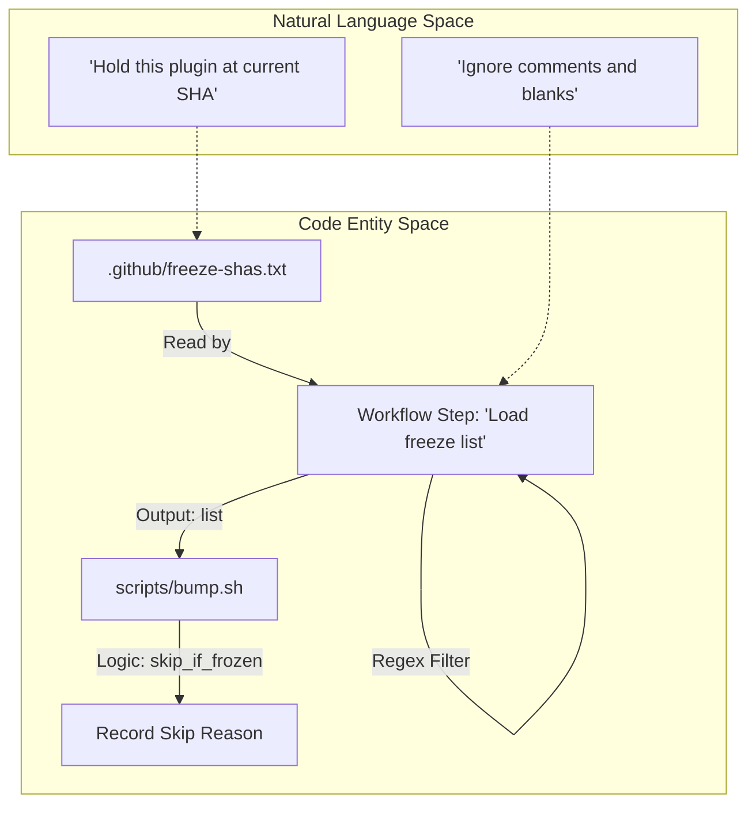
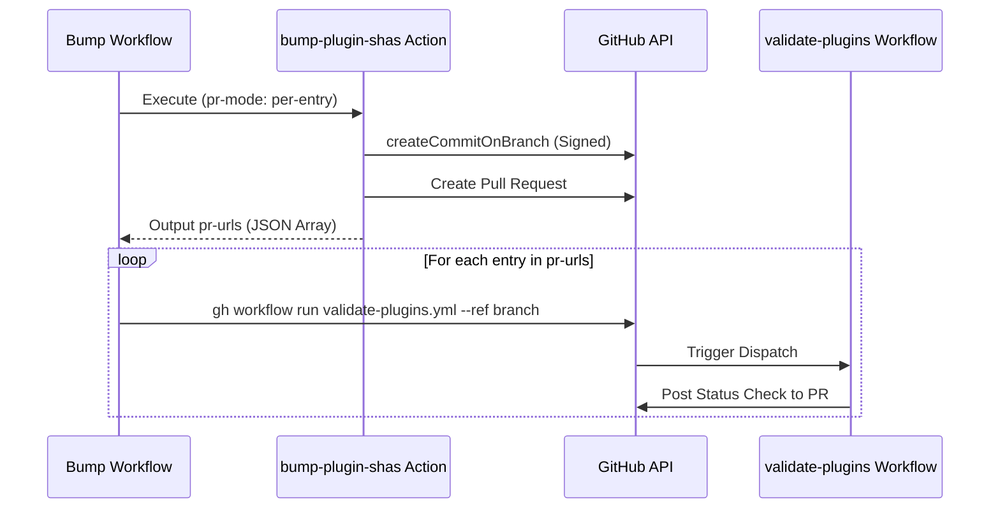

<!-- source: DeepWiki mcp.deepwiki.com · repo anthropics/claude-plugins-community · extra page Bump Workflow and Freeze List · fetched 2026-10-26 -->

# Bump Workflow and Freeze List

Relevant source files

The following files were used as context for generating this wiki page:

- [.github/actions/bump-plugin-shas/test-bump-manifest.sh](.github/actions/bump-plugin-shas/test-bump-manifest.sh)
- [.github/actions/bump-plugin-shas/test-bump.sh](.github/actions/bump-plugin-shas/test-bump.sh)
- [.github/actions/validate-plugins/scripts/90-report.sh](.github/actions/validate-plugins/scripts/90-report.sh)
- [.github/freeze-shas.txt](.github/freeze-shas.txt)
- [.github/workflows/bump-plugin-shas.yml](.github/workflows/bump-plugin-shas.yml)

The **Bump Plugin SHAs** workflow (`bump-plugin-shas.yml`) is an automated maintenance system designed to keep the marketplace registry synchronized with upstream development. It performs a daily sweep of all external plugins, detects when an upstream `HEAD` has advanced beyond the pinned `source.sha`, validates the plugin at the new commit, and opens individual Pull Requests for each update.

## Workflow Configuration

The workflow is designed for high reliability and isolation, ensuring that a single broken upstream repository does not block the maintenance of other plugins.

### Triggers and Inputs
The workflow is triggered by two mechanisms:
1.  **Scheduled Cron**: Runs daily at 07:23 UTC `[23 7 * * *]` to ensure freshness [`.github/workflows/bump-plugin-shas.yml`:27-28]().
2.  **Manual Dispatch**: Allows maintainers to trigger a run with specific parameters [`.github/workflows/bump-plugin-shas.yml`:29-41]():
    *   `max_bumps`: Caps the number of plugins processed (default: 30) to manage PR volume [`.github/workflows/bump-plugin-shas.yml`:31-34]().
    *   `plugin`: An optional filter to target a single specific plugin for bumping [`.github/workflows/bump-plugin-shas.yml`:35-41]().

### Concurrency Guard
To prevent race conditions where multiple workflow runs attempt to update the same marketplace entries or create conflicting PR branches, a concurrency group `bump-plugin-shas` is enforced [`.github/workflows/bump-plugin-shas.yml`:48-49]().

### Sources:
- [`.github/workflows/bump-plugin-shas.yml`:26-50]()

---

## Freeze List Logic

The `freeze-shas.txt` file acts as a manual override to prevent the automated bumper from touching specific plugins that are known to be broken at their upstream `HEAD`.

### File Format
The file [`.github/freeze-shas.txt`]() follows a simple line-based format:
*   One plugin `name` (slug) per line [`.github/freeze-shas.txt`:1-3]().
*   Lines starting with `#` are treated as comments and ignored [`.github/freeze-shas.txt`:69]().
*   Blank lines are ignored [`.github/freeze-shas.txt`:69]().

### Loading Mechanism
The workflow uses a specialized shell pipeline to transform the newline-delimited file into a space-separated string suitable for the `bump-plugin-shas` action input:
1.  `grep -vE '^[[:space:]]*(#|$)'`: Removes comments and empty lines [`.github/workflows/bump-plugin-shas.yml`:69]().
2.  `tr '\n' ' '`: Flattens the list into a single line [`.github/workflows/bump-plugin-shas.yml`:69]().
3.  `sed`: Normalizes whitespace [`.github/workflows/bump-plugin-shas.yml`:69]().

### Logic Space to Code Entity Mapping
The following diagram illustrates how the freeze list transitions from a flat file to runtime logic within the `bump.sh` script.

### Sources:
- [`.github/freeze-shas.txt`:1-67]()
- [`.github/workflows/bump-plugin-shas.yml`:63-75]()
- [`.github/actions/bump-plugin-shas/test-bump.sh`:143-151]()

---

## Fan-out Dispatch Pattern

A critical challenge in the repository's security model is the **Recursion Guard**. Pull Requests opened using the default `GITHUB_TOKEN` do not trigger further `on: pull_request` workflows [`.github/workflows/bump-plugin-shas.yml`:10-13](). This would normally prevent the mandatory `Validate Plugins` check from running on automated bump PRs.

### Implementation
The workflow implements a "Fan-out Dispatch" to bypass this limitation:
1.  **Output Capture**: The `bump-plugin-shas` action outputs a JSON array `pr-urls` containing metadata for every PR opened (name, branch, etc.) [`.github/workflows/bump-plugin-shas.yml`:103-106]().
2.  **Iterative Dispatch**: A subsequent step iterates through this JSON using `jq` [`.github/workflows/bump-plugin-shas.yml`:110]().
3.  **Manual Trigger**: For each branch, it calls `gh workflow run validate-plugins.yml --ref "$branch"` [`.github/workflows/bump-plugin-shas.yml`:114]().

Because `workflow_dispatch` is exempt from the recursion guard, this manually triggers the required status checks on the bot-authored PRs [`.github/workflows/bump-plugin-shas.yml`:14-17]().

### Fan-out Sequence Diagram

### Sources:
- [`.github/workflows/bump-plugin-shas.yml`:5-17]()
- [`.github/workflows/bump-plugin-shas.yml`:90-120]()

---

## Validation and Testing

The bumping logic is protected by a hermetic test suite that simulates various marketplace states without requiring network access or real API tokens.

### test-bump.sh
This suite tests the "short-circuit" logic—reasons why a plugin might be skipped before network calls are made (e.g., frozen, exempt, or unsafe characters) [`.github/actions/bump-plugin-shas/test-bump.sh`:2-6](). It uses a "stub library" that mirrors `common.sh` to ensure the tests remain faithful to the production environment [`.github/actions/bump-plugin-shas/test-bump.sh`:18-34]().

### test-bump-manifest.sh
This suite tests the "synthesis path." It ensures that `strict:false` (skills-only) plugins are correctly synthesized and validated even if they lack a physical `plugin.json` file upstream [`.github/actions/bump-plugin-shas/test-bump-manifest.sh`:2-6](). It uses PATH-shims for `git`, `claude`, and `gh` to intercept and validate the commands issued by the bump script [`.github/actions/bump-plugin-shas/test-bump-manifest.sh`:34-114]().

### Sources:
- [`.github/actions/bump-plugin-shas/test-bump.sh`:1-114]()
- [`.github/actions/bump-plugin-shas/test-bump-manifest.sh`:1-114]()

---

