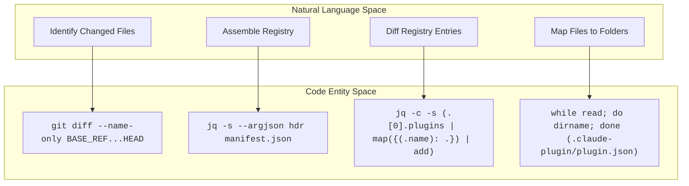
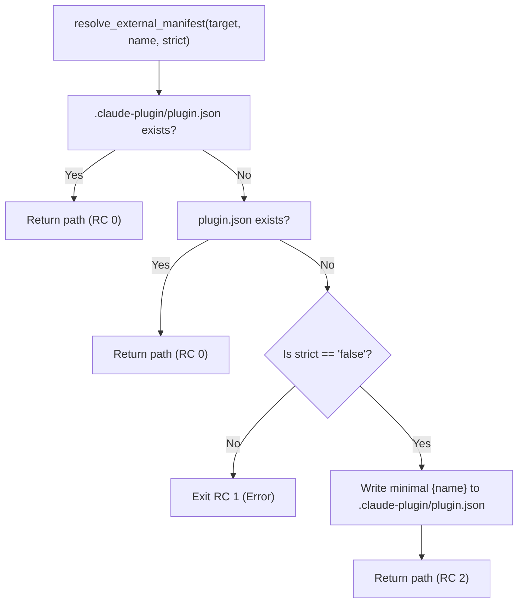

<!-- source: DeepWiki mcp.deepwiki.com · repo anthropics/claude-plugins-community · extra page Change Detection and External Manifest Resolution · fetched 2026-10-26 -->

# Change Detection and External Manifest Resolution

Relevant source files

The following files were used as context for generating this wiki page:

- [.github/actions/validate-plugins/scripts/00-detect-changes.sh](.github/actions/validate-plugins/scripts/00-detect-changes.sh)
- [.github/actions/validate-plugins/scripts/30-validate-cli-external.sh](.github/actions/validate-plugins/scripts/30-validate-cli-external.sh)
- [.github/actions/validate-plugins/test-external-manifest.sh](.github/actions/validate-plugins/test-external-manifest.sh)

This page documents the logic used by the `validate-plugins` action to identify changes in the repository and resolve manifests for external plugins. The core of this logic resides in `00-detect-changes.sh`, which determines the scope of validation, and the manifest resolution helpers in `common.sh` that handle the synthesis of manifests for non-strict external sources.

## Change Detection Logic

The `00-detect-changes.sh` script is the first stage of the validation pipeline. It compares the current `HEAD` against a `BASE_REF` (typically the target branch of a Pull Request) to identify which plugins need validation. This scoping prevents the CI from re-validating the entire marketplace on every change, which is critical given the potential for hundreds of external clones.

### Operation Modes

The script supports two distribution models for the marketplace registry:
1.  **Single-file mode**: The registry is a single `marketplace.json` file.
2.  **Per-file mode**: The registry is a directory of individual JSON files (specified by `ENTRIES_DIR`), which are assembled into a temporary `marketplace.json` during execution [[.github/actions/validate-plugins/scripts/00-detect-changes.sh:45-56]]().

### Detection Flow

The script outputs a `changes.json` file containing three categories of changes:
*   **`entries`**: Names of plugins whose metadata in the marketplace registry has changed [[.github/actions/validate-plugins/scripts/00-detect-changes.sh:60-89]]().
*   **`external`**: A subset of `entries` where the `source` is an object (URL or git-subdir), requiring a remote clone for validation [[.github/actions/validate-plugins/scripts/00-detect-changes.sh:96-104]]().
*   **`folders`**: Paths to in-repo plugin directories that contain a `.claude-plugin/plugin.json` marker [[.github/actions/validate-plugins/scripts/00-detect-changes.sh:108-130]]().

### Large Diff Handling via --slurpfile

When a bulk update occurs (e.g., a daily SHA bump touching hundreds of entries), the resulting JSON arrays can exceed the kernel's `MAX_ARG_STRLEN` (~128KB). To prevent "Argument list too long" errors (exit code 126), the script uses the `--slurpfile` pattern [[.github/actions/validate-plugins/scripts/00-detect-changes.sh:136-149]](). Instead of passing JSON strings as CLI arguments via `--argjson`, it writes the data to temporary files and reads them directly into `jq`.

### Logic Space to Code Entity Mapping

The following diagram maps the logical change detection concepts to the specific shell and `jq` implementations in the codebase.

**Change Detection Implementation Map**

**Sources:** [[.github/actions/validate-plugins/scripts/00-detect-changes.sh:35-35]](), [[.github/actions/validate-plugins/scripts/00-detect-changes.sh:51-53]](), [[.github/actions/validate-plugins/scripts/00-detect-changes.sh:83-88]](), [[.github/actions/validate-plugins/scripts/00-detect-changes.sh:122-127]]()

---

## External Manifest Resolution

The `30-validate-cli-external.sh` script iterates through the `external` changes identified in the detection phase. For each entry, it performs a shallow clone and checkout of the pinned SHA [[.github/actions/validate-plugins/scripts/30-validate-cli-external.sh:79-98]]().

### resolve_external_manifest() Precedence

The function `resolve_external_manifest()` (defined in `common.sh`) determines which manifest file the `claude plugin validate` command should target. It follows a strict precedence order to ensure consistency:

1.  **Preferred**: `.claude-plugin/plugin.json` within the source repository.
2.  **Fallback**: `plugin.json` in the root of the source repository (or `subdir`).
3.  **Synthesis**: If `strict: false` is set in the marketplace and no file exists, it synthesizes a minimal manifest.

### strict:false Synthesis Logic

For "Skills-only" plugins that may not include a manifest file in their source repository, the registry allows a `strict: false` flag [[.github/actions/validate-plugins/scripts/30-validate-cli-external.sh:48-48]](). If this flag is present and no manifest is found, the system creates a temporary `.claude-plugin/plugin.json` containing only the `name` from the marketplace [[.github/actions/validate-plugins/test-external-manifest.sh:66-71]](). This allows the CLI validator to proceed with validating the skill prompts without failing on a missing manifest.

### Manifest Resolution Flow

The following diagram illustrates the decision tree for manifest resolution.

**Manifest Resolution Decision Tree**

**Sources:** [[.github/actions/validate-plugins/scripts/30-validate-cli-external.sh:116-125]](), [[.github/actions/validate-plugins/test-external-manifest.sh:38-71]]()

---

## Test Harness

The `test-external-manifest.sh` script provides a static test suite for the resolution logic. It simulates various repository structures and marketplace flags to verify that:
*   Real manifests are never overwritten by synthesis [[.github/actions/validate-plugins/test-external-manifest.sh:53-58]]().
*   Precedence correctly favors the `.claude-plugin/` directory [[.github/actions/validate-plugins/test-external-manifest.sh:47-49]]().
*   Synthesis correctly injects the plugin name from the registry [[.github/actions/validate-plugins/test-external-manifest.sh:66-71]]().
*   `strict: true` (default) correctly fails when no manifest is present [[.github/actions/validate-plugins/test-external-manifest.sh:74-75]]().

### Summary Table: Resolution Outcomes

| Scenario | `strict` Flag | Source Files | Resulting Path | Return Code |
| :--- | :--- | :--- | :--- | :--- |
| Standard Plugin | `true` | `.claude-plugin/plugin.json` | `.claude-plugin/plugin.json` | `0` |
| Legacy Layout | `true` | `plugin.json` | `plugin.json` | `0` |
| Skills-only | `false` | *None* | `.claude-plugin/plugin.json` (Synthesized) | `2` |
| Missing Manifest | `true` | *None* | *N/A* | `1` |

**Sources:** [[.github/actions/validate-plugins/test-external-manifest.sh:38-80]]()

---

