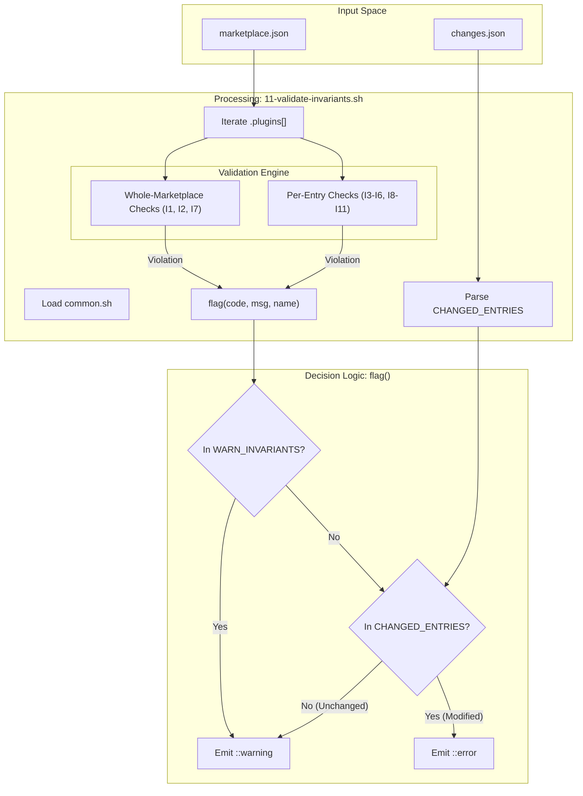
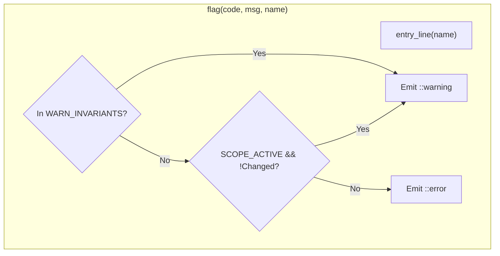

<!-- source: DeepWiki mcp.deepwiki.com · repo anthropics/claude-plugins-community · extra page Invariants I1–I11: Security and Policy Rules · fetched 2026-10-26 -->

# Invariants I1–I11: Security and Policy Rules

Relevant source files

The following files were used as context for generating this wiki page:

- [.github/actions/validate-plugins/scripts/11-validate-invariants.sh](.github/actions/validate-plugins/scripts/11-validate-invariants.sh)
- [.github/actions/validate-plugins/test-invariants.sh](.github/actions/validate-plugins/test-invariants.sh)

The `11-validate-invariants.sh` script enforces a set of eleven custom hardening rules that extend beyond standard JSON Schema validation. These invariants ensure the structural integrity, security, and stylistic consistency of the plugin marketplace registry.

## Overview and Purpose

While the primary JSON Schema handles basic data types, the invariants script performs deep inspection of the `marketplace.json` manifest. It is designed with a "grandfathering" policy called **diff-scoping**, which allows existing defects in the marketplace to remain as warnings while requiring new or modified entries to meet the full security and policy bar [.github/actions/validate-plugins/scripts/11-validate-invariants.sh:2-6]().

### Key Design Patterns
*   **Fail-Safe Scoping**: If change detection fails or is absent, the script defaults to strict enforcement for all entries [.github/actions/validate-plugins/scripts/11-validate-invariants.sh:36-39]().
*   **Non-Downgradable Rules**: Whole-marketplace invariants (like alphabetical sorting or duplicate detection) always result in hard failures regardless of which entry was changed [.github/actions/validate-plugins/scripts/11-validate-invariants.sh:75-76]().
*   **Shell Safety**: A dedicated invariant (I9) prevents shell metacharacter injection in URLs, paths, and SHAs, serving as a defense-in-depth layer for the maintenance actions [.github/actions/validate-plugins/scripts/11-validate-invariants.sh:17-17]().

---

## Data Flow and Implementation

The following diagram illustrates how the `11-validate-invariants.sh` script processes the marketplace manifest and applies the diff-scoping logic via the `flag()` function.

### Invariant Validation Logic

**Sources:** [.github/actions/validate-plugins/scripts/11-validate-invariants.sh:21-87]()

---

## Detailed Invariant Reference

| ID | Name | Scope | Description |
|:---|:---|:---|:---|
| **I1** | Alpha Sort | Global | `plugins[]` must be alpha-sorted by `name` (case-insensitive) [.github/actions/validate-plugins/scripts/11-validate-invariants.sh:91-93](). |
| **I2** | Duplicate Detection | Global | No two entries may share the same `name` [.github/actions/validate-plugins/scripts/11-validate-invariants.sh:95-97](). |
| **I3** | Description Bounds | Entry | Description must be 10–2000 characters and have no leading/trailing whitespace [.github/actions/validate-plugins/scripts/11-validate-invariants.sh:114-119](). |
| **I4** | HTTPS-Only | Entry | All `source.url` or `source.repo` fields must use `https://` or `owner/repo` shorthand [.github/actions/validate-plugins/scripts/11-validate-invariants.sh:130-135](). |
| **I5** | SHA Pinning | Entry | External sources must have a 40-char hex SHA. Exemptions allowed via `SHA_EXEMPT` [.github/actions/validate-plugins/scripts/11-validate-invariants.sh:136-148](). |
| **I6** | Filename Consistency| Entry | In per-file mode, the filename must match the `.name` field [.github/actions/validate-plugins/scripts/11-validate-invariants.sh:14-14](). |
| **I7** | Direct-Edit Block | Global | In per-file mode, `marketplace.json` must not be edited directly [.github/actions/validate-plugins/scripts/11-validate-invariants.sh:15-15](). |
| **I8** | Vendored Path | Entry | Vendored source paths must exist and contain `.claude-plugin/plugin.json` [.github/actions/validate-plugins/scripts/11-validate-invariants.sh:16-16](). |
| **I9** | Shell Safety | Entry | URLs, paths, and SHAs must not contain shell metacharacters (`;`, `&`, `\|`, etc.) [.github/actions/validate-plugins/scripts/11-validate-invariants.sh:150-150](). |
| **I10**| Hidden Unicode | Entry | Names and descriptions must not contain zero-width spaces or bidi control characters [.github/actions/validate-plugins/scripts/11-validate-invariants.sh:110-112](). |
| **I11**| Name Schema | Entry | Names must match the regex `^[a-z0-9][a-z0-9-]{1,63}$` [.github/actions/validate-plugins/scripts/11-validate-invariants.sh:107-109](). |

**Sources:** [.github/actions/validate-plugins/scripts/11-validate-invariants.sh:8-19]()

---

## Configuration and Control

The script behavior is tuned via environment variables passed from the GitHub Action.

### Variable Reference
*   `WARN_INVARIANTS`: A space-separated list of invariant IDs (e.g., `"I1 I3"`) that should always be treated as warnings rather than errors. Defaults to `"I1 I3 I5 I8"` [.github/actions/validate-plugins/scripts/11-validate-invariants.sh:26-26]().
*   `SHA_EXEMPT`: A space-separated list of plugin names allowed to omit the `source.sha` field [.github/actions/validate-plugins/scripts/11-validate-invariants.sh:29-29]().
*   `SCOPE_ERRORS_TO_CHANGED`: When set to `true`, enables the grandfathering logic using `changes.json` [.github/actions/validate-plugins/scripts/11-validate-invariants.sh:40-40]().

### The flag() Function
The `flag()` function is the central authority for reporting violations. It calculates the exact line number in `marketplace.json` using `entry_line()` and formats a GitHub Actions workflow command [.github/actions/validate-plugins/scripts/11-validate-invariants.sh:58-87]().

**Sources:** [.github/actions/validate-plugins/scripts/11-validate-invariants.sh:58-87]()

---

## Testing Invariants

The repository includes a dedicated test harness, `test-invariants.sh`, which validates the enforcement logic against synthetic fixtures without requiring network access [.github/actions/validate-plugins/test-invariants.sh:2-4]().

### Test Categories
1.  **Positive/Negative Tests**: Verifies that each invariant (I1-I11) fires correctly on malformed data and stays silent on valid data [.github/actions/validate-plugins/test-invariants.sh:41-131]().
2.  **Scoping Tests**: Exercises the `SCOPE_ERRORS_TO_CHANGED` logic to ensure unchanged entries are downgraded to warnings [.github/actions/validate-plugins/test-invariants.sh:133-171]().
3.  **Security Tests**: Ensures that the `SHA_EXEMPT` list cannot be bypassed using name-splicing (e.g., names with spaces) [.github/actions/validate-plugins/test-invariants.sh:95-102]().

**Sources:** [.github/actions/validate-plugins/test-invariants.sh:1-171]()

---

