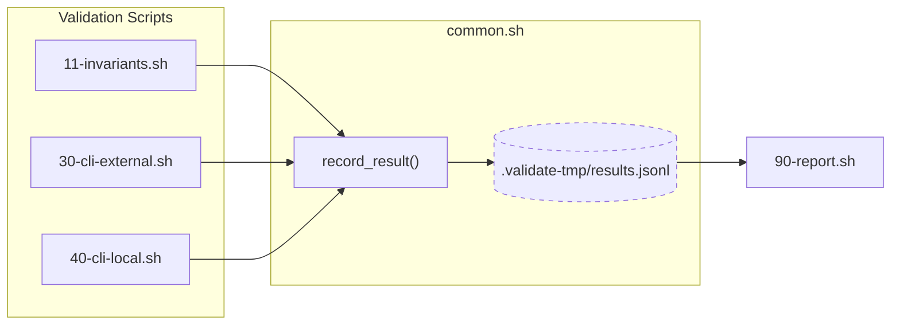
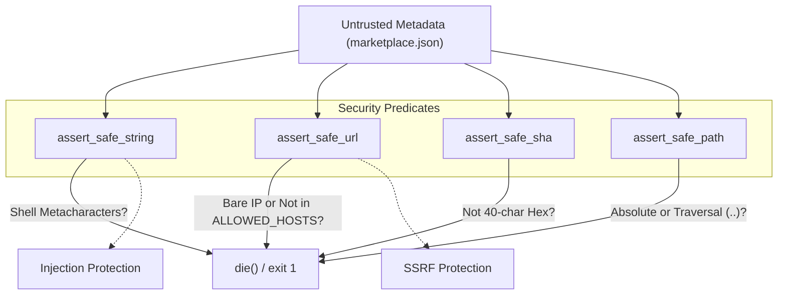

<!-- source: DeepWiki mcp.deepwiki.com · repo anthropics/claude-plugins-community · extra page Shared Library: common.sh Utilities · fetched 2026-10-26 -->

# Shared Library: common.sh Utilities

Relevant source files

The following files were used as context for generating this wiki page:

- [.github/actions/validate-plugins/lib/common.sh](.github/actions/validate-plugins/lib/common.sh)

The `common.sh` library serves as the foundational utility suite for the `validate-plugins` composite action. It provides a standardized interface for logging, result tracking, security assertions, and manifest resolution. By sourcing this script at the start of every validation stage, the pipeline ensures consistent behavior across different execution environments.

## Core Logging and GitHub Actions Integration

The library wraps standard output with GitHub Actions workflow commands to provide rich logging in the GitHub UI.

| Function | Description | Implementation |
| :--- | :--- | :--- |
| `log` | Standard stdout logging. | `printf '%s\n' "$*"` |
| `info` | Creates a GitHub Action "notice". | `::notice::%s\n` |
| `warn` | Creates a GitHub Action "warning". | `::warning::%s\n` |
| `error` | Creates a GitHub Action "error". | `::error::%s\n` |
| `die` | Logs an error, records a fatal result, and exits 1. | Calls `error`, `record_result`, then `exit 1` |
| `group_start` | Collapses subsequent logs into a UI group. | `::group::%s\n` |
| `group_end` | Closes the current UI group. | `::endgroup::\n` |

**Sources:**
- [.github/actions/validate-plugins/lib/common.sh:9-16]()
- [.github/actions/validate-plugins/lib/common.sh:13-13]()

## Result Tracking System

The `record_result` function implements a JSONL (JSON Lines) tracking system. This allows independent validation scripts to append findings to a shared state file, which is later aggregated by the reporting stage (`90-report.sh`).

### Data Flow: Validation Results

**Implementation Details:**
- **Storage:** Results are stored in `$RESULTS_FILE`, defaulting to `./.validate-tmp/results.jsonl` [[.github/actions/validate-plugins/lib/common.sh:21-21]()]
- **Schema:** Each entry contains `step`, `status` (pass/warn/fail), `subject` (plugin name), and `detail` (error message or CLI output) [[.github/actions/validate-plugins/lib/common.sh:26-32]()]

**Sources:**
- [.github/actions/validate-plugins/lib/common.sh:18-33]()

## Security Predicates and SSRF Guard

A critical role of `common.sh` is enforcing the security boundary between untrusted marketplace metadata and the CI runner. It implements a defense-in-depth strategy using strict regex and allowlist predicates.

### Security Assertion Logic

### SSRF Guard Implementation
The `assert_safe_url` function prevents Server-Side Request Forgery (SSRF) by:
1.  **Protocol Enforcement:** Requiring `https://` [[.github/actions/validate-plugins/lib/common.sh:59-61]()].
2.  **Bare IP Rejection:** Blocking numeric IP addresses (e.g., `http://169.254.169.254`) to prevent metadata service exfiltration [[.github/actions/validate-plugins/lib/common.sh:64-66]()].
3.  **Host Allowlisting:** Checking the host against the `ALLOWED_HOSTS` environment variable [[.github/actions/validate-plugins/lib/common.sh:67-77]()].

**Sources:**
- [.github/actions/validate-plugins/lib/common.sh:35-95]()
- [.github/actions/validate-plugins/lib/common.sh:56-78]()

## CLI Validation Wrapper

The `cli_validate` function wraps the `claude plugin validate` command. It manages the lifecycle of a CLI validation check, including output capture, status classification, and result recording.

- **Warning Handling:** If the CLI returns "passed with warnings", the function checks the `FAIL_ON_WARNINGS` toggle. If `true`, it escalates the warning to a failure [[.github/actions/validate-plugins/lib/common.sh:105-112]()].
- **Exit Codes:** Returns `0` for success or warnings (if not failing on them), and `1` for hard failures [[.github/actions/validate-plugins/lib/common.sh:116-121]()].

**Sources:**
- [.github/actions/validate-plugins/lib/common.sh:100-122]()

## External Manifest Resolution

The `resolve_external_manifest` function handles the complexity of locating a `plugin.json` within a cloned repository, including support for "skills-only" (non-strict) plugins.

### Resolution Logic
1.  **Preferred Path:** Checks `.claude-plugin/plugin.json` [[.github/actions/validate-plugins/lib/common.sh:154-156]()].
2.  **Legacy Path:** Checks `plugin.json` at the root [[.github/actions/validate-plugins/lib/common.sh:157-159]()].
3.  **Synthesis (strict:false):** If no manifest is found and the entry is marked `strict:false`, the function synthesizes a minimal manifest containing only the plugin name. This prevents false positives for plugins that only provide skills/prompts and do not require a physical manifest [[.github/actions/validate-plugins/lib/common.sh:160-164]()].

**Sources:**
- [.github/actions/validate-plugins/lib/common.sh:152-166]()

---

